<!-- source: DeepWiki mcp.deepwiki.com · repo anthropics/claudes-c-compiler · page 5.1 Code Generation Architecture · fetched 2026-10-26 -->

# Code Generation Architecture

<details>
<summary>Relevant source files</summary>

The following files were used as context for generating this wiki page:

- [README.md](README.md)
- [src/backend/README.md](src/backend/README.md)
- [src/backend/common.rs](src/backend/common.rs)
- [src/backend/generation.rs](src/backend/generation.rs)
- [src/backend/mod.rs](src/backend/mod.rs)
- [src/backend/state.rs](src/backend/state.rs)
- [src/backend/traits.rs](src/backend/traits.rs)
- [src/frontend/lexer/token.rs](src/frontend/lexer/token.rs)
- [src/frontend/preprocessor/conditionals.rs](src/frontend/preprocessor/conditionals.rs)
- [src/frontend/preprocessor/macro_defs.rs](src/frontend/preprocessor/macro_defs.rs)
- [src/frontend/preprocessor/mod.rs](src/frontend/preprocessor/mod.rs)
- [src/main.rs](src/main.rs)
- [src/passes/dce.rs](src/passes/dce.rs)
- [src/passes/gvn.rs](src/passes/gvn.rs)

</details>


This document describes the architecture of the backend code generation framework: the `ArchCodegen` trait, the shared instruction dispatch system, and how architecture-specific backends plug into the shared framework to emit assembly code from SSA IR.

For details on specific backends (instruction encoding, ABI conventions, peephole optimization), see the architecture-specific pages: [x86-64 Backend](#5.2), [i686 Backend](#5.3), [AArch64 Backend](#5.4), [RISC-V Backend](#5.5). For stack slot allocation and register assignment, see [Stack Layout](#5.7) and [Register Allocation](#5.6).

---

## Overview

The code generation system uses a trait-based architecture to share ~90% of codegen logic across four target architectures (x86-64, i686, AArch64, RISC-V 64) while allowing each backend to provide architecture-specific instruction emission.

**Key Design Principles:**

1. **Single Dispatch Point**: All code generation flows through `generate_instruction()` and `generate_terminator()` in [src/backend/generation.rs](), which call trait methods on an `ArchCodegen` implementor.

2. **Primitive Composition**: The `ArchCodegen` trait defines ~185 methods, but provides ~64 default implementations that compose shared algorithms from small "primitive" methods (1-4 lines each) that backends override with architecture-specific instructions.

3. **Shared State**: All backends use the same `CodegenState` structure to track stack slots, alloca metadata, register cache, label generation, and compilation options.

4. **Pre-Scan Optimizations**: Before emitting any instructions, the framework builds optimization maps (GEP folding, compare-branch fusion, global address folding) that the shared dispatch logic uses to skip or merge instructions.

Sources: [src/backend/generation.rs:1-531](), [src/backend/traits.rs:1-100](), [src/backend/README.md:222-321]()

---

## Architecture Overview

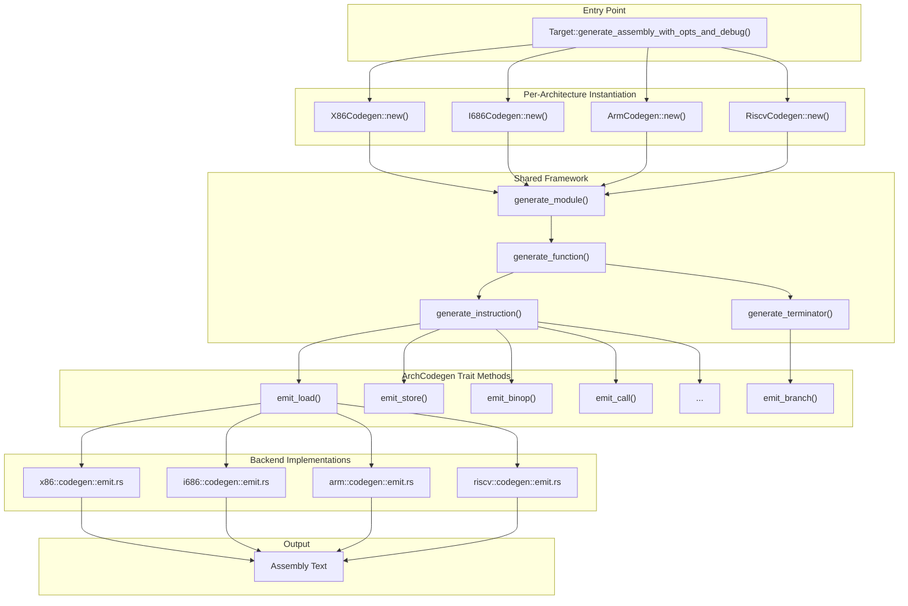

The target-selection entry point [src/backend/mod.rs:294-340]() instantiates the appropriate backend struct, then passes it to the shared framework. Each backend struct implements the `ArchCodegen` trait, providing architecture-specific instruction emission while the shared framework handles dispatch, optimization, and control flow.

Sources: [src/backend/mod.rs:294-340](), [src/backend/generation.rs:498-531]()

---

## The ArchCodegen Trait

The `ArchCodegen` trait is defined in [src/backend/traits.rs:99-750]() and serves as the interface between the shared framework and architecture-specific code generation.

### Trait Method Categories

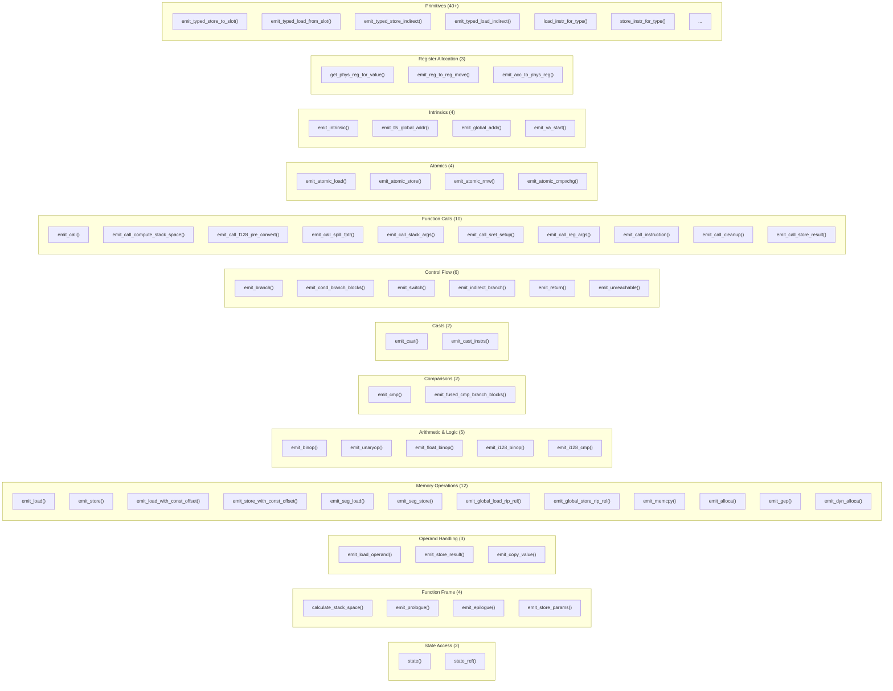

The trait organizes methods into functional categories. High-level methods (e.g., `emit_binop`, `emit_call`) have default implementations that call primitive methods (e.g., `emit_typed_store_to_slot`, `load_instr_for_type`). Backends implement only the primitives, and the shared framework composes them into complete operations.

Sources: [src/backend/traits.rs:99-750](), [src/backend/README.md:222-287]()

---

## CodegenState: Shared Mutable State

All backends use the same `CodegenState` structure to track stack slots, alloca metadata, and codegen options. The state is accessed through the trait methods `state()` and `state_ref()`.

```mermaid
graph TB
    subgraph "CodegenState Fields"
        OUT["out: AsmOutput<br/>output buffer"]
        STACK["stack_offset: i64<br/>frame offset counter"]
        LOCS["value_locations: FxHashMap&lt;u32, StackSlot&gt;<br/>value ID → stack slot"]
        ALLOCA["alloca_values: FxHashSet&lt;u32&gt;<br/>values that ARE allocas"]
        TYPES["alloca_types: FxHashMap&lt;u32, IrType&gt;<br/>alloca → type"]
        ALIGN["alloca_alignments: FxHashMap&lt;u32, usize&gt;<br/>over-aligned allocas"]
        I128["i128_values: FxHashSet&lt;u32&gt;<br/>128-bit values"]
        WIDE["wide_values: FxHashSet&lt;u32&gt;<br/>64-bit on 32-bit targets"]
        LABELS["label_counter: u32<br/>unique label generation"]
        PIC["pic_mode: bool<br/>position-independent code"]
        LOCAL["local_symbols: FxHashSet&lt;String&gt;<br/>static/hidden symbols"]
        TLS["tls_symbols: FxHashSet&lt;String&gt;<br/>thread-local symbols"]
        CACHE["reg_cache: RegCache<br/>register value cache"]
        DYN["has_dyn_alloca: bool<br/>uses dynamic stack alloc"]
        OPTS["function_return_thunk: bool<br/>indirect_branch_thunk: bool<br/>patchable_function_entry<br/>cf_protection_branch<br/>..."]
        F128["f128_load_sources<br/>f128_direct_slots"]
        SECTION["current_text_section: String<br/>custom section name"]
        PARAMS["param_classes: Vec&lt;ParamClass&gt;<br/>param_alloca_slots<br/>param_pre_stored"]
    end
    
    subgraph "SlotAddr Enum"
        DIRECT["Direct(StackSlot)<br/>rbp-relative offset"]
        INDIRECT["Indirect(StackSlot)<br/>pointer in stack slot"]
        OVERALIGNED["OverAligned(StackSlot, u32)<br/>runtime-aligned address"]
    end
    
    subgraph "RegCache"
        ACC["acc: Option&lt;RegCacheEntry&gt;<br/>accumulator cache"]
    end
    
    LOCS -.resolves to.-> DIRECT
    LOCS -.resolves to.-> INDIRECT
    LOCS -.resolves to.-> OVERALIGNED
    CACHE --> ACC
```

**Key State Components:**

- **`value_locations`**: Maps each IR value to its `StackSlot`. Resolved to a `SlotAddr` enum by `resolve_slot_addr()` based on whether the value is an alloca, over-aligned, or a pointer.

- **`alloca_values`**: Values whose stack slots hold the data directly (not a pointer). These skip pointer dereferencing in load/store paths.

- **`alloca_alignments`**: Allocas with alignment > 16 bytes that require runtime alignment. Their addresses are computed by `emit_alloca_aligned_addr()` instead of using a fixed rbp-relative offset.

- **`reg_cache`**: Tracks which IR value is currently in the accumulator register (rax/x0/t0). When `emit_load_operand()` is called, the cache is checked first to avoid redundant stack loads.

- **`f128_load_sources`**: Maps F128 value IDs to their memory load sources. Enables x86 x87 FPU to reload directly from memory for full 80-bit precision (bypassing the f64 accumulator). ARM/RISC-V use this for IEEE binary128 soft-float operations.

- **Compilation Options**: `pic_mode`, `function_return_thunk`, `indirect_branch_thunk`, `code_model_kernel`, etc. Control code generation patterns (GOT/PLT usage, retpoline thunks, absolute vs. RIP-relative addressing).

Sources: [src/backend/state.rs:1-230]()

---

## Instruction Dispatch Flow

The shared framework in [src/backend/generation.rs]() drives code generation by iterating over IR instructions and dispatching each one to the appropriate `ArchCodegen` trait method.

### Module Generation

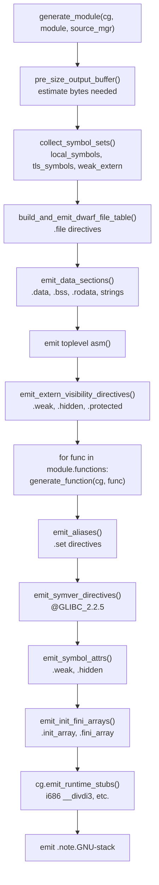

`generate_module()` is the top-level entry point [src/backend/generation.rs:498-531](). It:

1. **Pre-sizes the output buffer** based on total instruction count (each IR instruction generates ~40 bytes of assembly) [src/backend/generation.rs:536-545]()
2. **Collects symbol sets** (local, TLS, weak extern) for PIC/GOT/PLT decisions [src/backend/generation.rs:551-583]()
3. **Builds DWARF file table** and emits `.file` directives when debug info is enabled [src/backend/generation.rs:588-625]()
4. **Emits data sections** via `common::emit_data_sections()` [src/backend/generation.rs:504]()
5. **Emits toplevel asm blocks** verbatim [src/backend/generation.rs:507-513]()
6. **Iterates over functions**, calling `generate_function()` for each [src/backend/generation.rs:517]()
7. **Emits metadata**: aliases, symbol attributes, `.init_array`/`.fini_array` entries [src/backend/generation.rs:518-521]()
8. **Emits runtime stubs** (e.g., i686 `__divdi3`) [src/backend/generation.rs:524]()
9. **Emits `.note.GNU-stack`** for non-executable stack [src/backend/generation.rs:527-528]()

Sources: [src/backend/generation.rs:498-531]()

### Function Generation

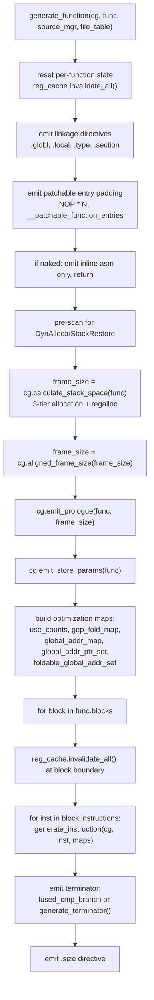

`generate_function()` [src/backend/generation.rs:705-992]() handles per-function code generation:

1. **Resets per-function state** (register cache, label counter) [src/backend/generation.rs:707-713]()
2. **Emits linkage/visibility directives** (`.globl`, `.weak`, `.hidden`, `.type`, custom section) [src/backend/generation.rs:714-782]()
3. **Emits patchable entry padding** (NOP sled for ftrace) when configured [src/backend/generation.rs:784-843]()
4. **Handles naked functions** (inline asm only, no prologue/epilogue) [src/backend/generation.rs:845-868]()
5. **Pre-scans for `DynAlloca`/`StackRestore`** to set `has_dyn_alloca` flag [src/backend/generation.rs:871-880]()
6. **Calculates stack space** via `calculate_stack_space()` (runs three-tier allocator + register allocator) [src/backend/generation.rs:882-886]()
7. **Emits prologue** [src/backend/generation.rs:887]()
8. **Stores parameters** from ABI registers to stack slots [src/backend/generation.rs:888]()
9. **Builds optimization maps** (use counts, GEP folding, global address folding) [src/backend/generation.rs:890-927]()
10. **Iterates over blocks**, invalidating register cache at each boundary [src/backend/generation.rs:933-989]()
11. **Emits `.size` directive** [src/backend/generation.rs:991]()

Sources: [src/backend/generation.rs:705-992]()

### Instruction Dispatch

```mermaid
graph TB
    GEN_INST["generate_instruction(cg, inst, maps)"]
    
    MATCH["match inst"]
    
    COPY["Inst::Copy<br/>→ emit_copy_value()"]
    BINOP["Inst::BinOp<br/>→ emit_binop()"]
    UNARY["Inst::UnaryOp<br/>→ emit_unaryop()"]
    CMP["Inst::Cmp<br/>→ emit_cmp()"]
    CAST["Inst::Cast<br/>→ emit_cast()"]
    
    LOAD_CHECK["Inst::Load<br/>check global_addr_fold"]
    LOAD_FOLD["if foldable:<br/>emit_global_load_rip_rel()"]
    LOAD_NORMAL["else:<br/>emit_load()"]
    
    STORE_CHECK["Inst::Store<br/>check global_addr_fold"]
    STORE_FOLD["if foldable:<br/>emit_global_store_rip_rel()"]
    STORE_OFFSET["check gep_fold_map"]
    STORE_FOLD_OFFSET["if folded GEP:<br/>emit_store_with_const_offset()"]
    STORE_NORMAL["else:<br/>emit_store()"]
    
    GEP_CHECK["Inst::GetElementPtr<br/>check gep_fold_map"]
    GEP_SKIP["if foldable: skip (folded into Load/Store)"]
    GEP_EMIT["else: emit_gep()"]
    
    GLOBAL_CHECK["Inst::GlobalAddr<br/>check foldable_global_addr_set"]
    GLOBAL_SKIP["if foldable: skip"]
    GLOBAL_EMIT["else: emit_global_addr()"]
    
    CALL["Inst::Call/CallIndirect<br/>→ emit_call()"]
    INTRINSIC["Inst::Intrinsic<br/>→ emit_intrinsic()"]
    ALLOCA["Inst::Alloca<br/>→ skip (handled by stack layout)"]
    
    CACHE["register cache management:<br/>set_acc() for dest value,<br/>invalidate on call/asm/complex ops"]
    
    GEN_INST --> MATCH
    MATCH --> COPY
    MATCH --> BINOP
    MATCH --> UNARY
    MATCH --> CMP
    MATCH --> CAST
    MATCH --> LOAD_CHECK
    MATCH --> STORE_CHECK
    MATCH --> GEP_CHECK
    MATCH --> GLOBAL_CHECK
    MATCH --> CALL
    MATCH --> INTRINSIC
    MATCH --> ALLOCA
    
    LOAD_CHECK --> LOAD_FOLD
    LOAD_CHECK --> LOAD_NORMAL
    
    STORE_CHECK --> STORE_FOLD
    STORE_CHECK --> STORE_OFFSET
    STORE_OFFSET --> STORE_FOLD_OFFSET
    STORE_OFFSET --> STORE_NORMAL
    
    GEP_CHECK --> GEP_SKIP
    GEP_CHECK --> GEP_EMIT
    
    GLOBAL_CHECK --> GLOBAL_SKIP
    GLOBAL_CHECK --> GLOBAL_EMIT
    
    COPY --> CACHE
    BINOP --> CACHE
    LOAD_NORMAL --> CACHE
    CALL --> CACHE
```

`generate_instruction()` [src/backend/generation.rs:994-1400]() is a large match statement that dispatches each IR instruction variant to the appropriate trait method. Key dispatch patterns:

**Load/Store with Optimizations:**
- Checks `global_addr_map` to fold `GlobalAddr + Load/Store` into RIP-relative memory access [src/backend/generation.rs:1075-1109]()
- Checks `gep_fold_map` to fold `GEP(base, const_offset) + Load/Store` into offset addressing [src/backend/generation.rs:1111-1141]()
- Falls back to `emit_load()` or `emit_store()` for normal paths [src/backend/generation.rs:1143-1146]()

**GEP Folding:**
- If the GEP dest is in `gep_fold_map`, it's skipped entirely (the Load/Store will fold the offset) [src/backend/generation.rs:1148-1152]()

**GlobalAddr Folding:**
- If the GlobalAddr dest is in `foldable_global_addr_set`, it's skipped (all uses are folded Load/Store pointers) [src/backend/generation.rs:1154-1164]()

**Register Cache Management:**
- After most instructions, `reg_cache.set_acc(dest.0, false)` records that the destination value is in the accumulator [src/backend/generation.rs:1001-1007]()
- Operations that clobber registers (calls, inline asm, atomics, complex ops) invalidate the cache [src/backend/generation.rs:1212-1216]()

Sources: [src/backend/generation.rs:994-1400]()

---

## Default Implementations: Primitive Composition

The `ArchCodegen` trait provides ~64 default method implementations that capture shared codegen patterns. These defaults are built from small "primitive" methods (1-4 lines each) that backends override with architecture-specific instructions.

### Load/Store Dispatch Pattern

The default implementations of `emit_load()` and `emit_store()` handle the three-way addressing pattern (direct alloca, over-aligned alloca, indirect pointer) by resolving the value's `SlotAddr` and dispatching to the appropriate primitive.

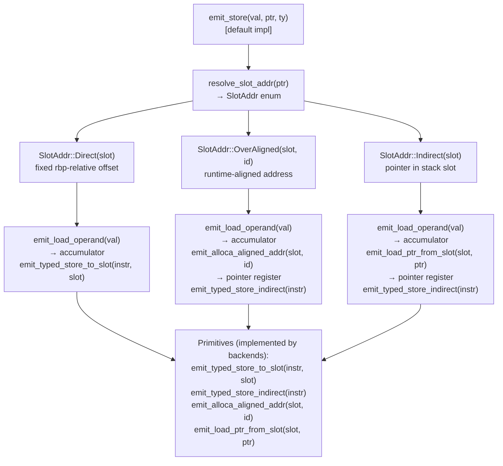

**Example: x86-64 Primitive Implementations**

```
emit_typed_store_to_slot(instr, slot):
    "    {instr} %rax, {slot.0}(%rbp)"

emit_typed_store_indirect(instr):
    "    {instr} %rax, (%rcx)"

emit_alloca_aligned_addr(slot, id):
    "    leaq {slot.0}(%rbp), %rcx"
    "    andq $-{align}, %rcx"

emit_load_ptr_from_slot(slot, ptr):
    "    movq {slot.0}(%rbp), %rcx"
```

Each primitive is 1-4 lines of architecture-specific assembly. The default `emit_store()` implementation composes these primitives to handle all addressing modes, eliminating ~30 lines of duplicated dispatch logic per backend.

**Backend Override for Special Types:**

Backends needing special handling (e.g., x86 F128 x87 stores) override `emit_store()`, handle their special case, then call the free function `emit_store_default()` for other types:

```rust
fn emit_store(&mut self, val: &Operand, ptr: &Value, ty: IrType) {
    if matches!(ty, IrType::F128 | IrType::LongDouble) {
        // x87 fstpt custom path
        self.emit_x87_store(val, ptr);
    } else {
        emit_store_default(self, val, ptr, ty);
    }
}
```

Sources: [src/backend/traits.rs:204-214](), [src/backend/traits.rs:753-835]()

### Call Emission: 8-Phase Orchestration

The default `emit_call()` implementation orchestrates an 8-phase call sequence, with each phase delegating to a backend-supplied hook method.

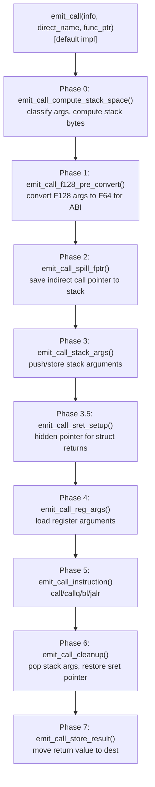

Each phase is a separate trait method with a backend-specific implementation. The shared `emit_call()` default [src/backend/traits.rs:592-646]() handles the control flow and common bookkeeping (invalidating register cache, setting return value cache), while backends provide the instruction emission for each phase.

**Why 8 Phases?**

The phase separation solves several ABI complexity problems:

- **Phase 1 (F128 pre-convert)**: x86 x87 FPU cannot pass F128 directly in XMM registers. The ABI requires converting F128 → F64 before the call. Separating this into Phase 1 allows the conversion to happen before spilling the indirect call pointer (which may occupy a register needed for the conversion).

- **Phase 2 (spill function pointer)**: Indirect calls via a pointer must save the pointer to a stack slot before loading arguments (which may clobber the pointer register). Separating this into Phase 2 ensures the pointer is safe before Phase 3 and Phase 4.

- **Phase 3.5 (sret setup)**: Struct returns via hidden pointer (sret) require the caller to allocate space and pass the address as an implicit first argument. This must happen AFTER stack arguments (Phase 3) but BEFORE register arguments (Phase 4) to maintain correct argument ordering.

- **Phase 6 (cleanup)**: Stack argument cleanup (caller pops on cdecl) must happen AFTER the call but BEFORE storing the return value (which uses the accumulator that may be clobbered by the cleanup).

Sources: [src/backend/traits.rs:592-646](), [src/backend/README.md:286-298]()

---

## Pre-Scan Optimizations

Before emitting any instructions, `generate_function()` builds several optimization maps by scanning the IR. These maps enable the shared dispatch logic to skip or merge instructions during emission.

### GEP Folding

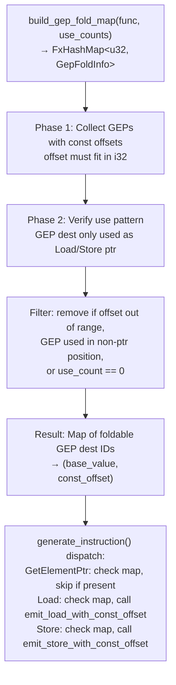

**GEP Folding Criteria:**

A GEP is foldable when [src/backend/generation.rs:52-152]():

1. Its offset is a compile-time constant (`Operand::Const`)
2. The constant fits in a 32-bit signed displacement (x86 addressing limit, also reasonable for ARM 9-bit/12-bit and RISC-V 12-bit)
3. The GEP result is ONLY used as the `ptr` operand of Load/Store instructions
4. The Load/Store type is not i128/u128 and has no segment override (these paths don't support folding)

**Optimization Impact:**

- Eliminates the `leaq base+offset, %reg` instruction
- Merges the offset into the Load/Store addressing mode: `movl offset(%rbp), %eax` instead of `leaq offset(%rbp), %rcx; movl (%rcx), %eax`
- Reduces register pressure by eliminating an intermediate pointer value

Sources: [src/backend/generation.rs:52-152]()

### Compare-Branch Fusion

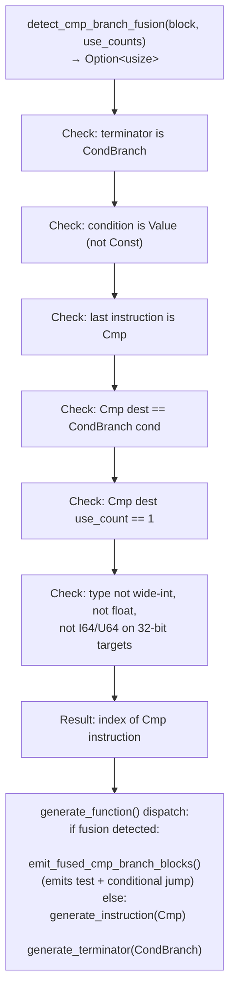

**Fusion Criteria:**

A Cmp can be fused with the following CondBranch when [src/backend/generation.rs:440-483]():

1. The block's terminator is a `CondBranch`
2. The condition operand is a `Value` (not a constant)
3. The last instruction in the block is a `Cmp`
4. The `Cmp` dest is the same value as the `CondBranch` condition
5. The `Cmp` result has `use_count == 1` (only used by the branch)
6. The type is not wide-int, not float, not I64/U64 on 32-bit targets (these have special codegen paths)

**Optimization Impact:**

- Eliminates the intermediate boolean value: no `setcc %al; movzbl %al, %eax; testl %eax, %eax` sequence
- Emits direct `cmp; jcc` instruction pair
- On x86-64: saves 3 instructions (setcc, movzbl, testl) → replaced with 1 (cmp, jcc was already there)
- Reduces register pressure by eliminating the boolean temporary

Sources: [src/backend/generation.rs:440-483]()

### Global Address Folding

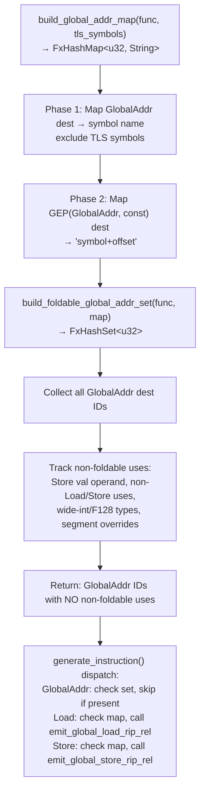

**Folding Criteria (x86-64 only):**

A `GlobalAddr` value can be folded when [src/backend/generation.rs:199-271]():

1. The backend supports global address folding (`supports_global_addr_fold()` returns true)
2. The symbol is not TLS (TLS requires special access patterns: `%fs:`, `@TPOFF`, etc.)
3. ALL uses of the GlobalAddr value are as the `ptr` operand of Load/Store with:
   - Type is not wide-int (I128/U128) or F128
   - No segment override
   - No offset (or offset is foldable via GEP folding separately)

**Optimization Impact:**

- Eliminates the `leaq symbol(%rip), %reg` instruction
- Merges the symbol reference into the Load/Store addressing mode: `movl symbol(%rip), %eax` instead of `leaq symbol(%rip), %rcx; movl (%rcx), %eax`
- On x86-64: produces cleaner, more compact machine code (fewer instructions, smaller encoding)

**Note:** This optimization is x86-64-specific because it requires RIP-relative addressing with symbol names. ARM and RISC-V use separate ADRP/ADD instruction pairs and cannot fold the symbol load into the memory access.

Sources: [src/backend/generation.rs:154-271]()

---

## Backend Structure and Delegation

Each backend implements the `ArchCodegen` trait by delegating trait methods to `_impl` functions using the `delegate_to_impl!` macro. This eliminates boilerplate while keeping the trait methods visible to the shared framework.

### Backend File Organization

Each architecture backend has a similar structure:

```
src/backend/{arch}/
  codegen/
    mod.rs                  # Re-exports
    emit.rs                 # ArchCodegen impl + delegate_to_impl!
    alu.rs                  # Integer arithmetic primitives
    atomics.rs              # Atomic operation primitives
    calls.rs                # Call emission phases
    cast_ops.rs             # Cast primitives
    comparison.rs           # Compare and fused compare-branch
    f128.rs                 # Long double operations (x86/ARM/RISC-V)
    float_ops.rs            # Floating-point arithmetic primitives
    globals.rs              # Global address and TLS access
    i128_ops.rs             # 128-bit integer operations
    inline_asm.rs           # InlineAsmEmitter impl
    intrinsics.rs           # Builtin intrinsics
    memory.rs               # Load/store primitives
    peephole.rs or peephole/  # Post-generation optimization
    prologue.rs             # Function prologue/epilogue
    returns.rs              # Return value emission
    variadic.rs             # va_start/va_arg/va_copy
    asm_emitter.rs          # InlineAsmEmitter trait impl
```

### The delegate_to_impl! Macro

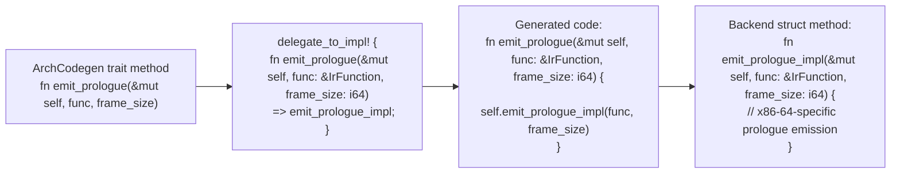

The macro [src/backend/traits.rs:36-64]() generates the one-line delegation:

```rust
// Before macro:
impl ArchCodegen for X86Codegen {
    fn emit_prologue(&mut self, func: &IrFunction, frame_size: i64) {
        self.emit_prologue_impl(func, frame_size)
    }
}

// After macro:
impl ArchCodegen for X86Codegen {
    delegate_to_impl! {
        fn emit_prologue(&mut self, func: &IrFunction, frame_size: i64)
            => emit_prologue_impl;
    }
}
```

**Why Use the Macro?**

- Each backend has ~80-120 trait method delegations
- The delegations are pure boilerplate (no logic, just `self.foo_impl(args)`)
- The macro eliminates ~400 lines of repetitive code per backend
- Trait method signatures remain visible in the `impl ArchCodegen` block for documentation

Sources: [src/backend/traits.rs:1-64](), [src/backend/README.md:301-321]()

---

## Register Cache and Register Allocation Integration

The register cache in `CodegenState` tracks which IR values are currently in physical registers, enabling backends to skip redundant stack loads.

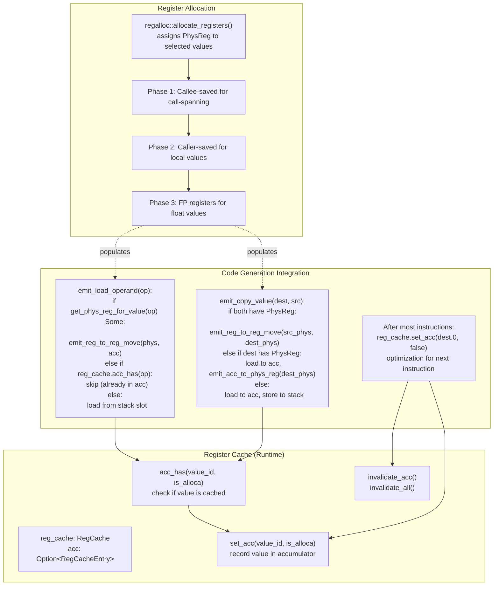

**Register Allocation → Code Generation Flow:**

1. During `calculate_stack_space()`, the register allocator assigns `PhysReg` to selected values based on liveness and use counts [src/backend/regalloc.rs]()

2. The assignments are stored in `CodegenState::reg_assignments: FxHashMap<u32, PhysReg>`

3. During instruction emission, `get_phys_reg_for_value()` queries this map [src/backend/traits.rs:178]()

4. When both source and destination have physical registers, `emit_copy_value()` emits a direct register-to-register move [src/backend/traits.rs:145-172]()

5. When only destination has a register, the value is loaded to the accumulator then moved to the destination register via `emit_acc_to_phys_reg()`

6. When neither has a register, the accumulator load/store path is used (traditional stack-slot model)

**Register Cache (Accumulator Only):**

The current register cache tracks only the accumulator register (rax/x0/t0). After most instructions, the destination value is recorded as being in the accumulator via `reg_cache.set_acc()` [src/backend/generation.rs:1001-1007](). On the next instruction, if that value is used as an operand, `emit_load_operand()` checks the cache and skips the stack load [src/backend/generation.rs:1407-1415]().

**Cache Invalidation:**

The cache is conservatively invalidated [src/backend/generation.rs:1212-1216]():
- At every basic block boundary (registers may be clobbered by phi elimination)
- After function calls (ABI may clobber registers)
- After inline assembly (unknown clobbers)
- After atomics and complex operations (may use scratch registers)

This conservative invalidation ensures correctness: a missed invalidation would cause incorrect code, while an unnecessary invalidation just causes a redundant load (the same behavior as before the cache existed).

Sources: [src/backend/state.rs:22-76](), [src/backend/traits.rs:145-190](), [src/backend/generation.rs:994-1416]()

---

## Summary

The code generation architecture achieves high code reuse (90% shared) across four target architectures through:

1. **The `ArchCodegen` trait** provides a unified interface with ~185 methods organized into functional categories

2. **Primitive composition** enables ~64 default trait method implementations to capture shared algorithms while backends provide only 1-4 line architecture-specific primitives

3. **Shared dispatch** in `generate_module()`, `generate_function()`, and `generate_instruction()` orchestrates code generation by calling trait methods

4. **Pre-scan optimizations** (GEP folding, compare-branch fusion, global address folding) enable instruction skipping and merging during emission

5. **`CodegenState`** provides unified state management for stack slots, alloca metadata, register cache, and compilation options

6. **The `delegate_to_impl!` macro** eliminates ~400 lines of boilerplate per backend while keeping trait method signatures visible

This architecture enables adding new backends by implementing ~80-120 primitive methods (e.g., `emit_typed_store_to_slot()`, `load_instr_for_type()`) while inheriting all shared logic (control flow, optimization, ABI orchestration) automatically.

Sources: [src/backend/traits.rs:1-1150](), [src/backend/generation.rs:1-1416](), [src/backend/state.rs:1-230](), [src/backend/README.md:1-500]()

---

