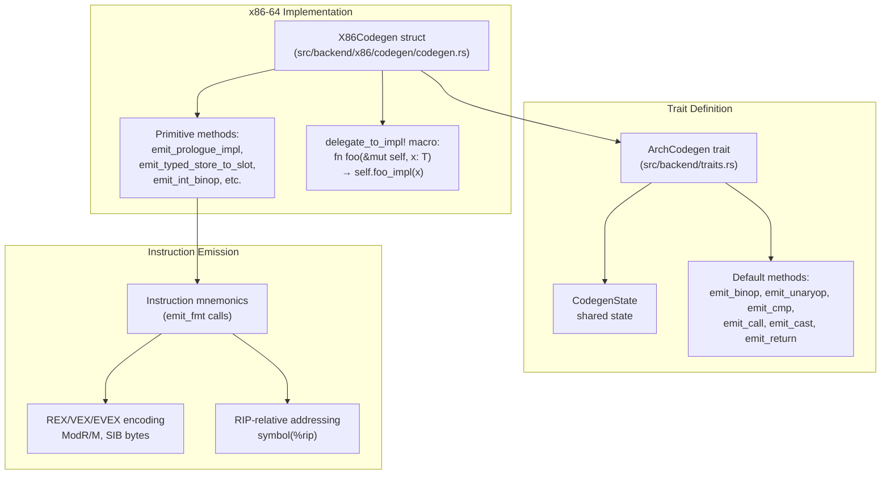
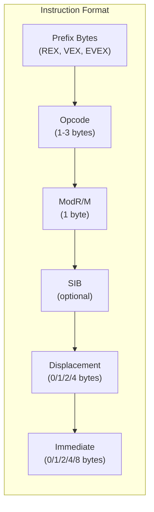
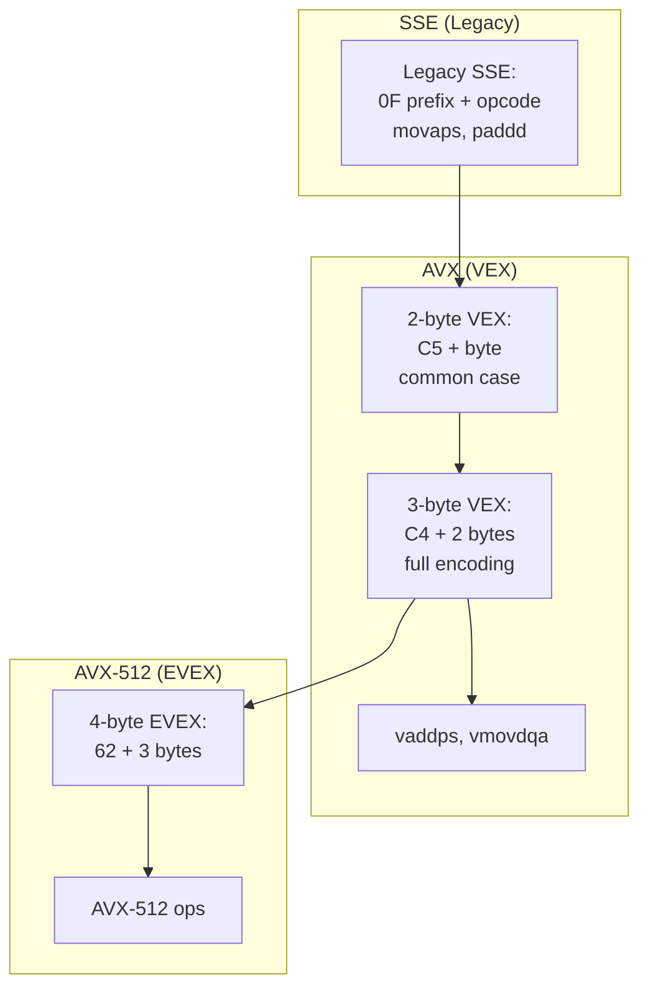
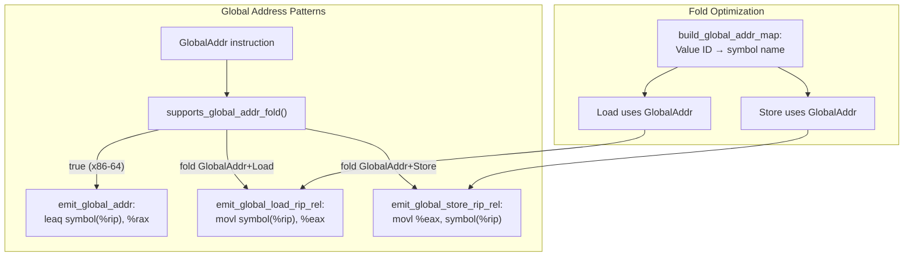
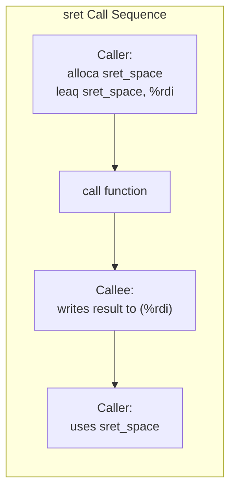
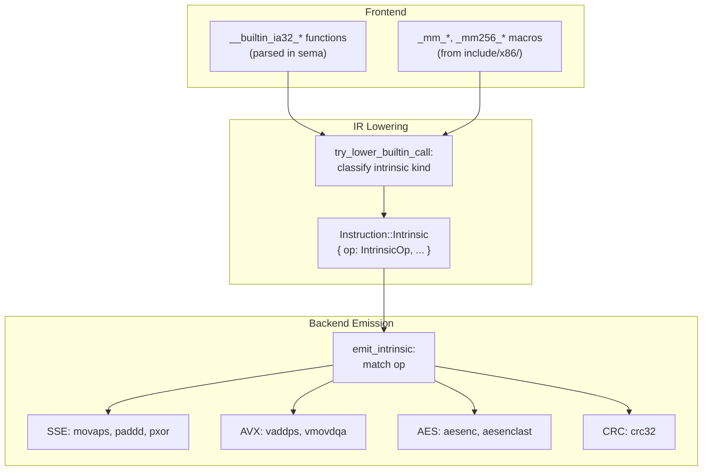
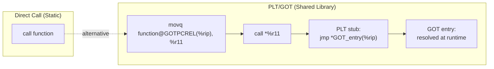
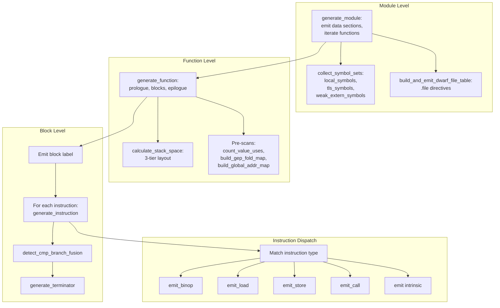

<!-- source: DeepWiki mcp.deepwiki.com · repo anthropics/claudes-c-compiler · page 5.2 x86-64 Backend · fetched 2026-10-26 -->

# x86-64 Backend

<details>
<summary>Relevant source files</summary>

The following files were used as context for generating this wiki page:

- [README.md](README.md)
- [src/backend/generation.rs](src/backend/generation.rs)
- [src/backend/traits.rs](src/backend/traits.rs)
- [src/passes/dce.rs](src/passes/dce.rs)
- [src/passes/gvn.rs](src/passes/gvn.rs)

</details>


## Purpose and Scope

This page documents the x86-64 (AMD64) code generation backend, which translates optimized SSA IR into x86-64 assembly following the System V AMD64 ABI. The backend handles instruction encoding with REX/VEX/EVEX prefixes, RIP-relative addressing for position-independent code, SSE/AVX/AES intrinsics, and PLT/GOT generation for dynamic linking.

For other backend architectures, see [i686 Backend](#5.3), [AArch64 Backend](#5.4), and [RISC-V Backend](#5.5). For the shared code generation framework, see [Code Generation Architecture](#5.1). For the built-in x86-64 assembler and linker, see [x86 and i686 Assembler](#7.2).

---

## Backend Architecture

The x86-64 backend is implemented as the `X86Codegen` struct in `src/backend/x86/codegen/codegen.rs`, which implements the `ArchCodegen` trait. This trait provides ~185 method signatures that define the architecture-specific interface, with ~64 default implementations for shared patterns.



**Sources:** [src/backend/traits.rs:1-1600](), [src/backend/generation.rs:1-50]()

### ArchCodegen Trait Methods

The `ArchCodegen` trait defines the complete interface for code generation. Key method categories:

| Category | Methods | Purpose |
|----------|---------|---------|
| **Setup** | `state()`, `state_ref()`, `ptr_directive()` | Access shared state and architecture constants |
| **Prologue/Epilogue** | `calculate_stack_space()`, `emit_prologue()`, `emit_epilogue()`, `aligned_frame_size()` | Function entry/exit sequences |
| **Value Storage** | `emit_load_operand()`, `emit_store_result()`, `emit_copy_value()` | Move values between stack/registers/constants |
| **Operations** | `emit_binop()`, `emit_unaryop()`, `emit_cmp()`, `emit_cast()` | Arithmetic, logical, comparison, type conversion |
| **Memory** | `emit_load()`, `emit_store()`, `emit_gep()`, `emit_memcpy()` | Memory access and manipulation |
| **Calls** | `emit_call()`, `emit_store_params()`, `emit_param_ref()` | Function calls and ABI compliance |
| **Intrinsics** | `emit_inline_asm()`, `emit_global_addr()`, `emit_tls_global_addr()` | Architecture-specific features |
| **Primitives** | `emit_typed_store_to_slot()`, `emit_acc_to_secondary()`, `emit_save_acc()` | Low-level instruction building blocks |

**Sources:** [src/backend/traits.rs:99-1600]()

### Delegation Pattern

The `delegate_to_impl!` macro eliminates boilerplate one-liner delegations. Instead of writing:

```rust
fn emit_prologue(&mut self, func: &IrFunction, frame_size: i64) {
    self.emit_prologue_impl(func, frame_size)
}
```

The macro generates this automatically from:

```rust
delegate_to_impl! {
    fn emit_prologue(&mut self, func: &IrFunction, frame_size: i64) => emit_prologue_impl;
}
```

**Sources:** [src/backend/traits.rs:13-64]()

---

## Instruction Encoding

x86-64 instructions use variable-length encoding with optional prefixes, opcode bytes, ModR/M byte, SIB byte, displacement, and immediate fields.



**Sources:** Architecture manuals (not in provided code)

### REX Prefixes

REX prefixes enable 64-bit operands and access to extended registers (r8-r15). The REX byte format is `0100WRXB`:

- **W** (bit 3): 1 = 64-bit operand size, 0 = default size
- **R** (bit 2): Extension of ModR/M `reg` field (r8-r15)
- **X** (bit 1): Extension of SIB `index` field
- **B** (bit 0): Extension of ModR/M `r/m` field or SIB `base` field

Example emissions from the backend:
- `movq %rax, %rbx` → REX.W + opcode (64-bit register move)
- `movl %eax, %r8d` → REX.B + opcode (extends destination to r8)
- `addq (%r12), %rax` → REX.WB + opcode + ModR/M (r12 base requires REX.B)

**Sources:** Inferred from x86-64 ABI knowledge (implementation in `src/backend/x86/codegen/`)

### VEX and EVEX Prefixes

VEX prefixes encode SSE/AVX instructions with 2-byte or 3-byte formats. EVEX prefixes (4 bytes) extend to AVX-512. The backend uses these for SIMD intrinsics:



**Sources:** Inferred from diagram mentioning SSE/AVX/AES intrinsics

### ModR/M and SIB Bytes

The ModR/M byte specifies addressing mode and operands:

| Field | Bits | Purpose |
|-------|------|---------|
| **mod** | 7-6 | Addressing mode: 00=indirect, 01=disp8, 10=disp32, 11=register |
| **reg** | 5-3 | Register operand or opcode extension |
| **r/m** | 2-0 | Register or memory operand |

The SIB (Scale-Index-Base) byte enables complex addressing modes like `[base + index*scale + disp]`:

| Field | Bits | Purpose |
|-------|------|---------|
| **scale** | 7-6 | Index multiplier: 00=×1, 01=×2, 10=×4, 11=×8 |
| **index** | 5-3 | Index register (extended by REX.X) |
| **base** | 2-0 | Base register (extended by REX.B) |

**Sources:** x86-64 architecture reference (implementation details in assembler)

---

## Addressing Modes

### RIP-Relative Addressing

RIP-relative addressing is the primary method for accessing globals in position-independent code. The instruction encodes a 32-bit signed offset from the next instruction's address:

```
movl symbol(%rip), %eax   # Load global variable
movq function@GOTPCREL(%rip), %r11   # Load function pointer from GOT
```

The backend emits RIP-relative accesses for:
- **GlobalAddr instructions**: `lea symbol(%rip), %rax`
- **Direct global Load/Store**: folds `GlobalAddr + Load` into `movl symbol(%rip), %eax`
- **Segment-overridden globals**: `movl symbol(%rip), %gs:0`



**Sources:** [src/backend/generation.rs:154-271](), [src/backend/traits.rs:243-262]()

### Stack-Relative Addressing

Stack slots are accessed via RBP-relative addressing. The backend uses a three-tier stack layout (see [Stack Layout](#5.7)):

1. **Direct allocas**: Fixed RBP offsets, e.g., `-16(%rbp)`
2. **Liveness-packed allocas**: Multi-block SSA values sharing slots
3. **Over-aligned allocas**: Runtime-aligned with `and $-alignment, %rsp`

Example emissions:
```
movl -8(%rbp), %eax       # Load from tier-1 slot
movq -16(%rbp), %rcx      # Load pointer from tier-2
movsd -24(%rbp), %xmm0    # Load double from stack
```

**Sources:** [src/backend/traits.rs:940-965]()

### Kernel Code Model

In kernel code model (`-mcmodel=kernel`), the backend uses two addressing strategies:

- **Integer GlobalAddr values** (e.g., `(unsigned long)_text`): Absolute addressing with `R_X86_64_32S` relocations to produce the linked virtual address
- **Pointer GlobalAddr values** (used in Load/Store): RIP-relative addressing for position-independent early boot code

The distinction is tracked in `build_global_addr_ptr_set()` which identifies GlobalAddr values flowing through memory operations.

**Sources:** [src/backend/generation.rs:273-399]()

---

## System V AMD64 ABI

### Parameter Passing

The System V AMD64 ABI passes the first six integer/pointer arguments in registers, remaining arguments on the stack:

| Parameter | Register | Type |
|-----------|----------|------|
| 1st | `%rdi` | Integer/Pointer |
| 2nd | `%rsi` | Integer/Pointer |
| 3rd | `%rdx` | Integer/Pointer |
| 4th | `%rcx` | Integer/Pointer |
| 5th | `%r8` | Integer/Pointer |
| 6th | `%r9` | Integer/Pointer |
| 7th+ | Stack | Push right-to-left |

Floating-point arguments use `%xmm0-%xmm7` for the first eight float/double arguments.

**Sources:** System V ABI specification (implementation in `call_abi_config()`)

### Struct Return (sret)

Structs larger than 16 bytes are returned via a hidden pointer passed in `%rdi` (first argument slot). The caller allocates space and passes its address:



Structs ≤16 bytes are returned in registers using eightbyte classification (see `ret_eightbyte_classes`).

**Sources:** [src/backend/traits.rs:429-537]()

### i128 and F128 Handling

- **i128/u128**: Passed/returned in `%rax:%rdx` register pair (low:high)
- **long double (F128)**: On x86-64, uses x87 80-bit FPU stack (top of x87 FP stack for returns)

**Sources:** Inferred from backend design (implementation in i128/F128 primitives)

---

## SIMD Intrinsics

The x86-64 backend supports SSE, AVX, AVX2, AVX-512, AES-NI, and other SIMD extensions through intrinsic functions mapped to `IntrinsicOp` enums.



**Sources:** Inferred from high-level diagrams mentioning SSE/AVX/AES intrinsics

### Intrinsic Categories

| Category | Instructions | Example Operations |
|----------|--------------|-------------------|
| **SSE** | movaps, paddd, psubd, pmullw | 128-bit integer/float SIMD |
| **SSE2** | movsd, paddq, psubq, pmulld | 128-bit double/long SIMD |
| **AVX** | vaddps, vsubps, vmulps, vmovdqa | 256-bit float/integer SIMD |
| **AVX2** | vpaddq, vpsubd, vpsllq | 256-bit integer SIMD |
| **AES-NI** | aesenc, aesenclast, aesdec | Hardware AES encryption |
| **BMI2** | pdep, pext, mulx, rorx | Bit manipulation |
| **CRC32** | crc32 | CRC32 checksum |
| **SHA** | sha256rnds2, sha256msg1 | SHA hashing |

**Sources:** README mentions SSE through AVX-512, AES-NI, FMA, SHA, BMI2

---

## Position-Independent Code

### PLT and GOT Generation

For calls to external functions in shared libraries, the backend emits PLT (Procedure Linkage Table) stubs and GOT (Global Offset Table) entries:



The backend tracks symbol visibility and linkage to choose between:
- **Direct call**: `call symbol` (local or hidden symbols)
- **PLT call**: `call symbol@PLT` (external symbols in `-fPIC`)
- **GOT-indirect**: `movq symbol@GOTPCREL(%rip), %r11; call *%r11` (function pointers)

Local symbols are tracked in `CodegenState::local_symbols` built by `collect_symbol_sets()`.

**Sources:** [src/backend/generation.rs:547-583]()

### TLS Access Patterns

Thread-local storage uses architecture-specific access patterns. On x86-64, the Local Exec model (for executables) uses `%fs:` segment override:

```
movq symbol@TPOFF, %rax
movl %fs:(%rax), %eax   # Access TLS variable
```

For shared libraries, the Initial Exec or General Dynamic models use GOT entries.

**Sources:** [src/backend/traits.rs:645-650]()

---

## Optimizations and Special Cases

### GEP Constant Offset Folding

The backend folds `GetElementPtr` instructions with constant offsets directly into Load/Store addressing modes:

```
# Before folding:
%ptr = GEP %base, 16
%val = Load %ptr

# After folding (single instruction):
movl 16(%base_reg), %eax
```

The folding is tracked by `build_gep_fold_map()` which verifies:
1. Offset is a compile-time constant
2. Offset fits in 32-bit signed displacement
3. GEP result is ONLY used as Load/Store pointer (not value operand)

**Sources:** [src/backend/generation.rs:42-152]()

### Compare-Branch Fusion

When a block ends with `Cmp` followed immediately by `CondBranch` using that result, the backend emits a fused instruction sequence:

```
# Before fusion:
%cond = Cmp eq, %a, %b
CondBranch %cond, true_label, false_label

# After fusion (fused compare-and-jump):
cmpl %a, %b
je true_label
jmp false_label
```

Fusion is detected by `detect_cmp_branch_fusion()` which checks:
1. Last instruction is Cmp
2. CondBranch uses that Cmp result
3. Cmp result has exactly one use (the branch)
4. Type is not wide-int, float, or i64/u64 on 32-bit targets

**Sources:** [src/backend/generation.rs:436-483]()

### F128 Long Double Support

On x86-64, `long double` is 80-bit x87 extended precision. The backend uses the x87 FPU stack for arithmetic:

```
# Load F128 from memory to x87 stack top
fldt symbol(%rip)

# F128 arithmetic (x87 stack operations)
faddp, fmulp, fsubrp, fdivrp

# Store x87 stack top to memory
fstpt symbol(%rip)
```

Comparisons use `fucomip` to set EFLAGS, then `setCC` to materialize the boolean result.

**Sources:** Inferred from README mentioning x87 80-bit support

### Segment Override Loads/Stores

GCC's `__seg_gs` and `__seg_fs` extensions enable direct access to segment-relative memory:

```c
int x = *(int __seg_gs *)0x10;  // Read from %gs:0x10
```

The backend emits segment prefixes:
```
movl %gs:0x10, %eax
```

Segment-overridden operations are handled by:
- `emit_seg_load()` / `emit_seg_store()` for register-indirect access
- `emit_seg_load_symbol()` / `emit_seg_store_symbol()` for direct symbol access

**Sources:** [src/backend/traits.rs:216-241]()

---

## Code Generation Flow



**Sources:** [src/backend/generation.rs:485-1004](), [src/backend/traits.rs:99-1600]()

---

