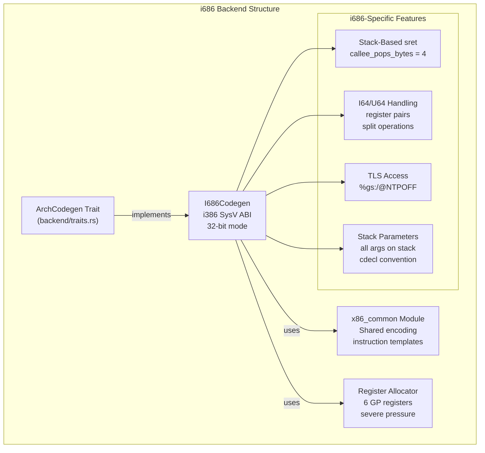
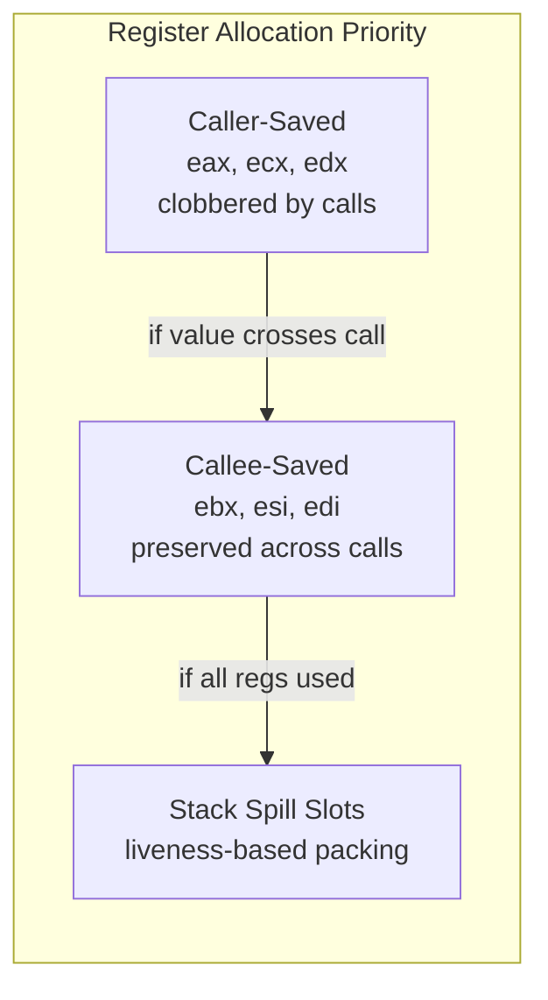
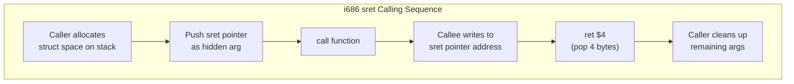
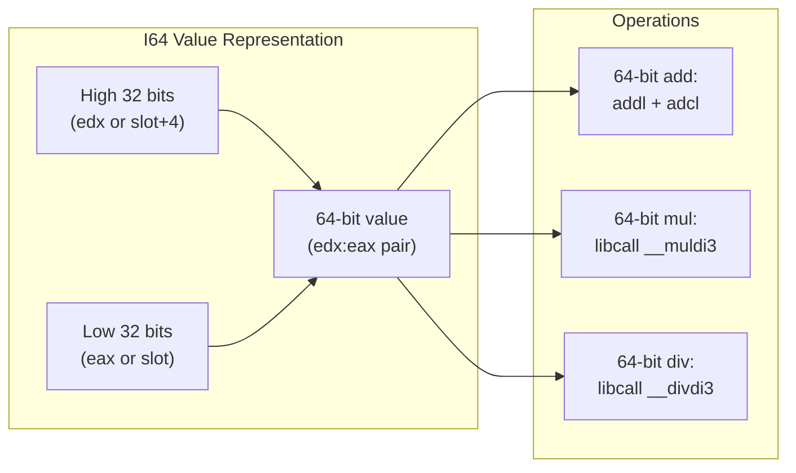

<!-- source: DeepWiki mcp.deepwiki.com · repo anthropics/claudes-c-compiler · page 5.3 i686 Backend · fetched 2026-10-26 -->

# i686 Backend

<details>
<summary>Relevant source files</summary>

The following files were used as context for generating this wiki page:

- [README.md](README.md)
- [src/backend/generation.rs](src/backend/generation.rs)
- [src/backend/traits.rs](src/backend/traits.rs)
- [src/passes/dce.rs](src/passes/dce.rs)
- [src/passes/gvn.rs](src/passes/gvn.rs)

</details>


## Purpose and Scope

This page documents the i686 (32-bit x86) code generation backend. The i686 backend targets the IA-32 architecture using the i386 System V ABI calling convention. It shares instruction encoding infrastructure with the x86-64 backend through the `x86_common` module but differs significantly in register availability, calling conventions, and type handling.

For x86-64 (64-bit) code generation, see [5.2](#5.2). For the shared x86 instruction encoding and assembler infrastructure, see [7.2](#7.2). For general backend architecture and the `ArchCodegen` trait, see [5.1](#5.1).

## Architecture Overview

The i686 backend implements 32-bit x86 code generation with severe constraints compared to x86-64:

| Feature | i686 | x86-64 |
|---------|------|--------|
| Pointer size | 4 bytes | 8 bytes |
| General-purpose registers | 6 (eax, ebx, ecx, edx, esi, edi) | 14 (rax-r15, excluding rsp) |
| Calling convention | i386 SysV (stack-heavy) | AMD64 SysV (register-heavy) |
| Struct return | Stack-based with callee pop | rdi register or stack |
| 64-bit integers | Treated as wide type (pairs) | Native type |
| TLS access | %gs:/@NTPOFF | %fs:/@TPOFF |
| Instruction encoding | 32-bit, no REX prefix | 64-bit, REX/VEX/EVEX prefixes |



**Sources:** [README.md:1-209](), [src/backend/traits.rs:1-100]()

## Register Set and Allocation Challenges

The i686 architecture provides only 6 general-purpose registers for computation after reserving `esp` (stack pointer) and `ebp` (frame pointer):

- **eax**: Primary accumulator, return value register
- **ecx**: Secondary register, shift count
- **edx**: Extended accumulator (for mul/div), second return register
- **ebx**: Base register, callee-saved
- **esi**: Source index, callee-saved
- **edi**: Destination index, callee-saved

This severe register pressure (6 registers vs 14 on x86-64) forces the register allocator to spill values to the stack more frequently. The allocator prioritizes callee-saved registers (ebx, esi, edi) for values that span function calls, avoiding save/restore overhead.



The register allocator uses linear scan with liveness analysis to pack multiple non-overlapping values into the same stack slot, mitigating the spilling overhead.

**Sources:** [README.md:17-19](), [src/backend/traits.rs:175-190]()

## Calling Convention: i386 System V ABI

### Parameter Passing

The i386 SysV ABI passes **all** function arguments on the stack in right-to-left order (cdecl convention). Unlike x86-64 which uses six integer registers and eight float registers for parameters, i686 has no argument registers:

```c
// C function: int foo(int a, int b, int c);
// Assembly (caller):
pushl   $3          // c
pushl   $2          // b  
pushl   $1          // a
call    foo
addl    $12, %esp   // caller cleans up stack
```

The backend's `emit_call_stack_args` method pushes all arguments in reverse order. Stack space calculation accounts for alignment and the i386 ABI's 4-byte slot granularity.

### Struct Returns (sret)

Struct returns larger than 8 bytes use the **stack-based sret convention** with callee cleanup:

1. Caller allocates space for the return struct on the stack
2. Caller pushes the **address** of that space as a hidden first argument
3. Callee writes the struct to the provided address
4. Callee pops the hidden pointer on return via `ret $4`



The `callee_pops_bytes_for_sret` trait method returns 4 for i686 when `is_sret` is true, causing the backend to subtract 4 from the caller's stack cleanup size.

**Sources:** [src/backend/traits.rs:586-589](), [src/backend/generation.rs:528-530]()

### Return Value Handling

| Return Type | Register(s) | Notes |
|-------------|-------------|-------|
| 32-bit integer/pointer | eax | Single register |
| 64-bit integer (I64/U64) | edx:eax | High 32 bits in edx, low 32 bits in eax |
| float (F32) | st(0) | x87 FPU stack (if no SSE) or xmm0 (SSE) |
| double (F64) | st(0) | x87 FPU stack (if no SSE) or xmm0 (SSE) |
| long double (F128) | st(0) | x87 80-bit extended precision |
| Struct ≤ 8 bytes | edx:eax | Packed into register pair |
| Struct > 8 bytes | sret | Callee writes to caller-provided address |

The backend's `emit_call_store_i128_result` (also used for I64 on i686) loads the register pair (edx:eax) and stores it as a 64-bit value.

**Sources:** [src/backend/traits.rs:606-620]()

## Code Generation and Instruction Encoding

### Shared x86_common Infrastructure

The i686 backend shares instruction templates and encoding logic with x86-64 through the `x86_common` module. Both architectures use AT&T assembly syntax and similar mnemonics, differing primarily in:

- **Operand size suffixes**: `l` for 32-bit on i686 (e.g., `movl`), `q` for 64-bit on x86-64 (e.g., `movq`)
- **Register names**: `%eax` vs `%rax`, `%esp` vs `%rsp`
- **Addressing modes**: 32-bit displacements vs 64-bit RIP-relative

### Instruction Encoding Differences

i686 uses 32-bit instruction encoding **without** REX prefixes:

| Feature | i686 Encoding | x86-64 Encoding |
|---------|---------------|-----------------|
| Register extension | N/A (only 8 registers) | REX prefix for r8-r15 |
| Operand size override | 0x66 prefix for 16-bit | REX.W bit for 64-bit |
| Maximum immediate | 32-bit signed | 32-bit signed (64-bit via mov) |
| PC-relative addressing | Not used (absolute/GOT) | RIP-relative (offset from PC) |

The assembler's instruction encoder checks the target architecture and emits appropriate prefixes. The i686 backend never generates REX prefixes.

### Position-Independent Code (PIC)

i686 PIC uses the **GOTPC** pattern instead of x86-64's RIP-relative addressing:

```asm
# i686 PIC (load global variable address):
call    __x86.get_pc_thunk.bx   # Load PC into ebx
addl    $_GLOBAL_OFFSET_TABLE_, %ebx
movl    symbol@GOT(%ebx), %eax  # Load GOT entry

# x86-64 PIC (RIP-relative):
movq    symbol@GOTPCREL(%rip), %rax
```

The `__x86.get_pc_thunk.bx` thunk is a runtime helper that returns the instruction pointer in ebx, enabling PC-relative GOT access.

**Sources:** [README.md:36](), [src/backend/traits.rs:540-595]()

## Type Handling: 64-bit Integers and Floating Point

### 64-bit Integer Handling (I64/U64)

On i686, 64-bit integers are **wide types** that require special handling. They are stored as register pairs or two 32-bit stack slots:



The backend detects I64/U64 types using the helper function `target_is_32bit()` and dispatches to pair-based emission methods:

- **emit_load_acc_pair**: Load 64-bit value into edx:eax
- **emit_store_acc_pair**: Store edx:eax to memory
- **emit_i128_binop**: Handle 64-bit arithmetic (same code path as i128 on x86-64)

Complex operations (multiply, divide, modulo, shifts by variable amounts) call compiler-rt helpers:

| Operation | Helper Function |
|-----------|-----------------|
| Multiply | `__muldi3` |
| Signed divide | `__divdi3` |
| Unsigned divide | `__udivdi3` |
| Signed modulo | `__moddi3` |
| Unsigned modulo | `__umoddi3` |
| Left shift | `__ashldi3` |
| Arithmetic right shift | `__ashrdi3` |
| Logical right shift | `__lshrdi3` |

The backend emits assembly stubs for these helpers that call into the system's compiler-rt/libgcc.

**Sources:** [src/backend/traits.rs:871-915](), [src/backend/generation.rs:468-476]()

### Floating-Point Types

The i686 backend supports both x87 FPU and SSE2 floating-point:

- **F32/F64**: Use SSE2 instructions (`movss`, `movsd`, `addss`, `addsd`) when available, fall back to x87 (`fld`, `fadd`, `fstp`) for older targets
- **F128 (long double)**: Always uses x87 extended precision (80-bit) via `fldt`, `fstpt`
- **Stack alignment**: The i386 ABI requires 4-byte stack alignment, but the backend enforces 16-byte alignment for SSE compatibility

**Sources:** [README.md:146-149]()

## Thread-Local Storage (TLS)

The i686 backend implements TLS using the **%gs segment register** with Local Exec model:

```asm
# Load TLS variable address (i686):
movl    %gs:0, %eax          # Load thread pointer
addl    $symbol@NTPOFF, %eax # Add TLS offset

# Compare to x86-64:
movq    %fs:0, %rax
addl    $symbol@TPOFF, %rax
```

The `@NTPOFF` relocation (negative thread pointer offset) is specific to i386, while x86-64 uses `@TPOFF`. The assembler and linker handle the relocation type translation.

**Sources:** [src/backend/traits.rs:645-650]()

## Stack Layout and Frame Management

The i686 backend uses a standard frame pointer layout:

```
High addresses
+------------------+
| Return address   |  <- 0(%ebp) (pushed by call)
+------------------+
| Saved %ebp       |  <- (%esp after push %ebp)
+------------------+ <- %ebp (frame pointer)
| Local variables  |
| and spill slots  |
+------------------+
| Aligned allocas  |
| (16-byte)        |
+------------------+
| Argument build   |
| area for calls   |
+------------------+ <- %esp (stack pointer)
Low addresses
```

### Prologue and Epilogue

```asm
# Function prologue (i686):
pushl   %ebp
movl    %esp, %ebp
subl    $frame_size, %esp
pushl   %ebx              # Save callee-saved if used
pushl   %esi
pushl   %edi

# Function epilogue:
popl    %edi              # Restore callee-saved
popl    %esi
popl    %ebx
movl    %ebp, %esp
popl    %ebp
ret                       # or "ret $4" for sret
```

The frame size is aligned to 16 bytes to satisfy SSE alignment requirements, even though the i386 ABI only requires 4-byte alignment.

**Sources:** [src/backend/traits.rs:113-120](), [src/backend/generation.rs:895-897]()

## Implementation Strategy

The i686 backend implements the `ArchCodegen` trait with ~185 methods, sharing default implementations for ~64 methods and providing architecture-specific overrides for:

1. **Register management**: 6-register allocation, ebx/esi/edi callee-saved prioritization
2. **Calling convention**: Stack-based parameter passing, sret callee cleanup
3. **Type handling**: I64/U64 pair operations, x87 long double
4. **Instruction emission**: 32-bit encoding, no REX prefixes, %gs TLS
5. **ABI conformance**: Stack alignment, struct return rules, cdecl cleanup

The shared `x86_common` module provides instruction templates, operand encoding, and assembler integration, allowing the i686 backend to focus on ABI and encoding differences rather than reimplementing the entire instruction set.

**Sources:** [src/backend/traits.rs:99-103](), [README.md:1-209]()

---

