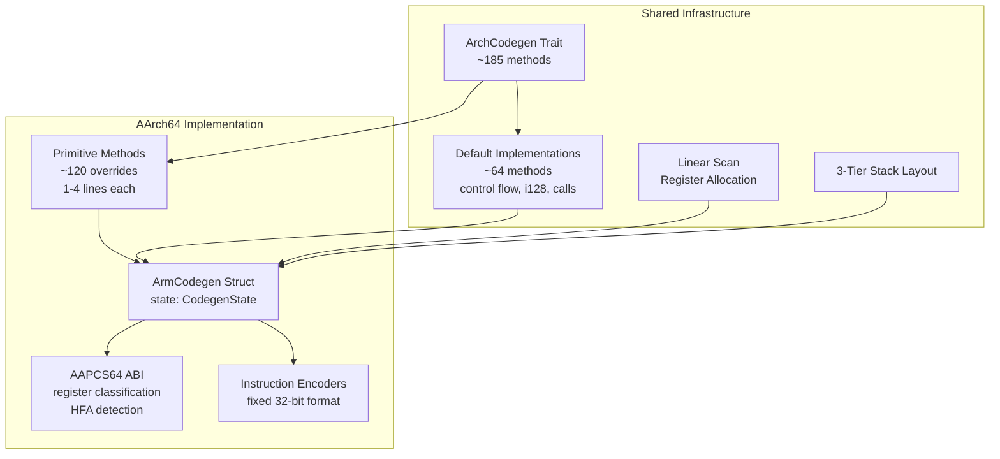
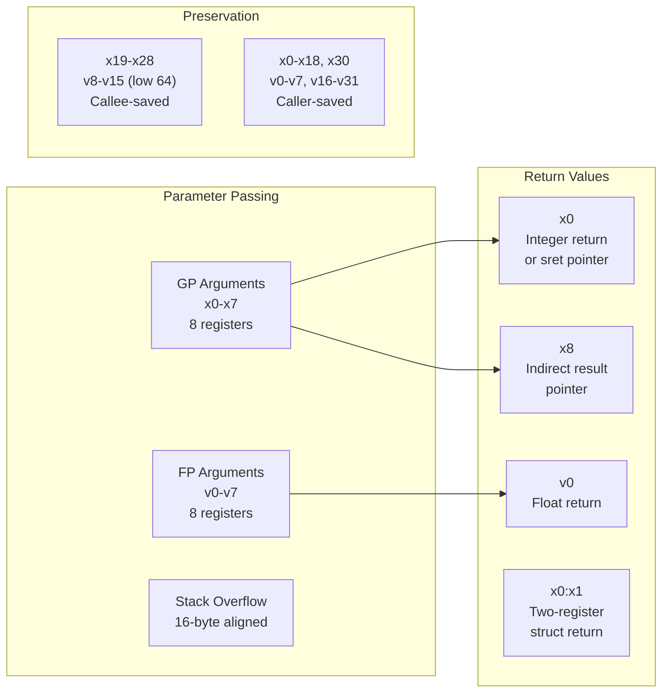
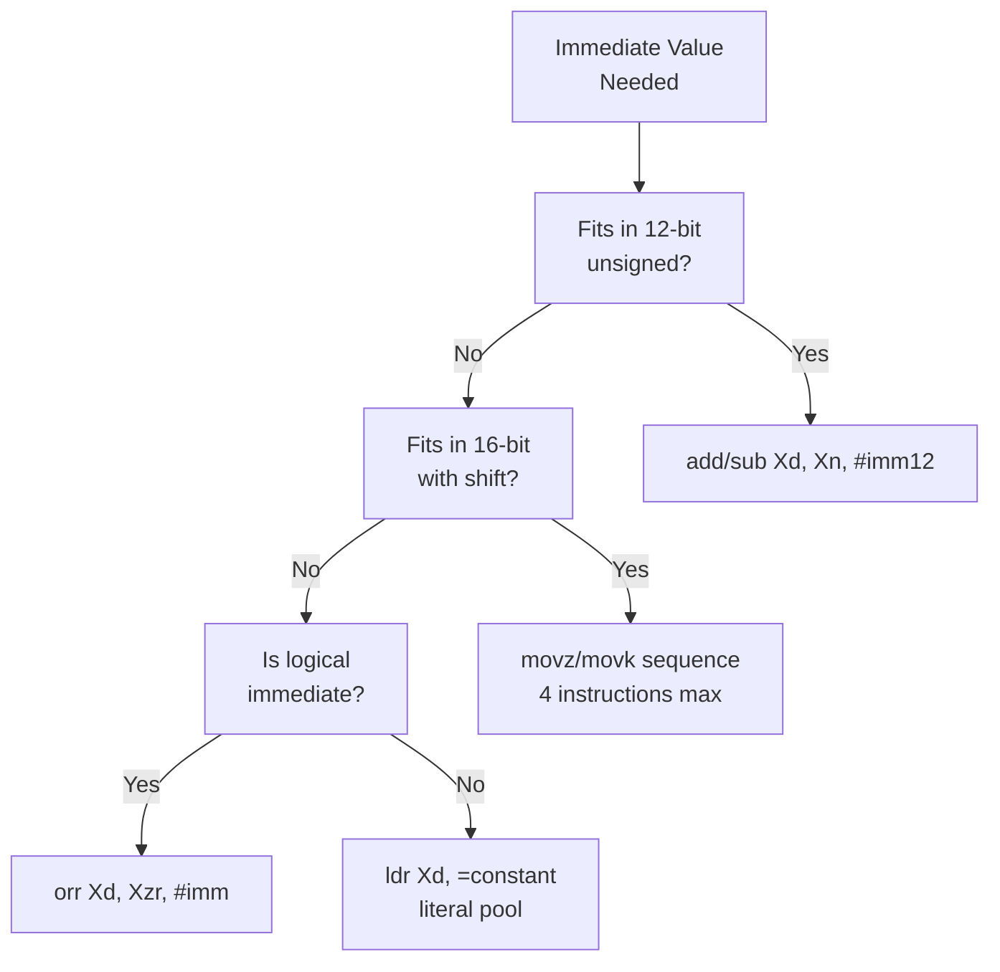
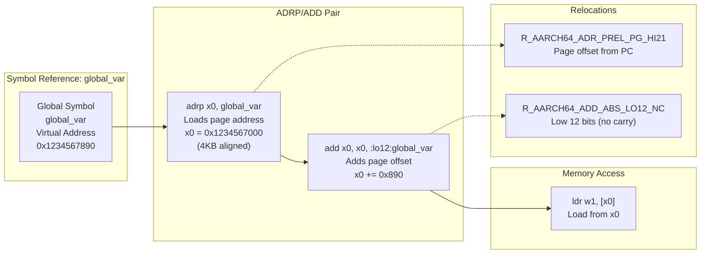
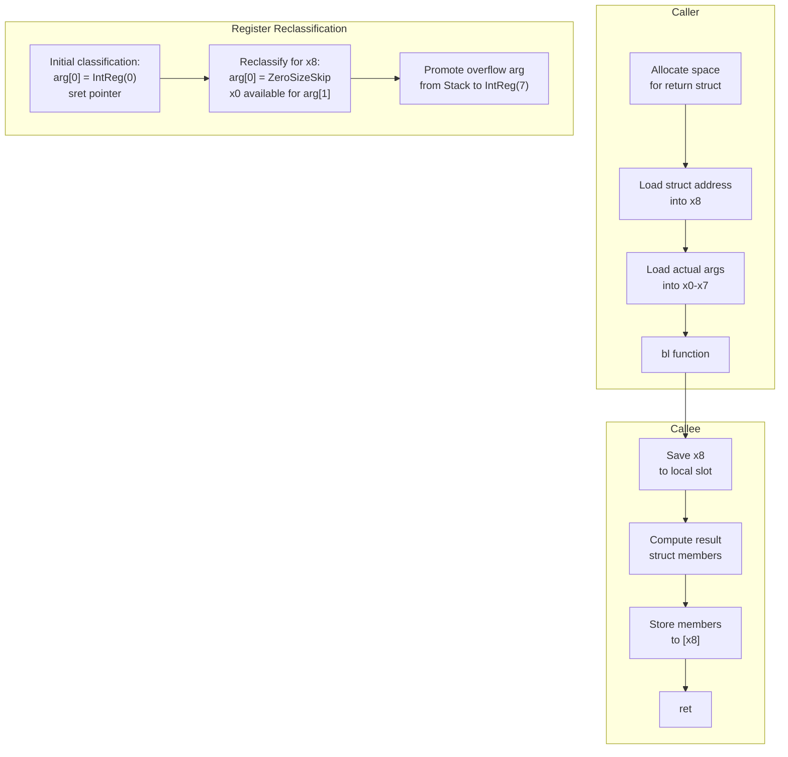
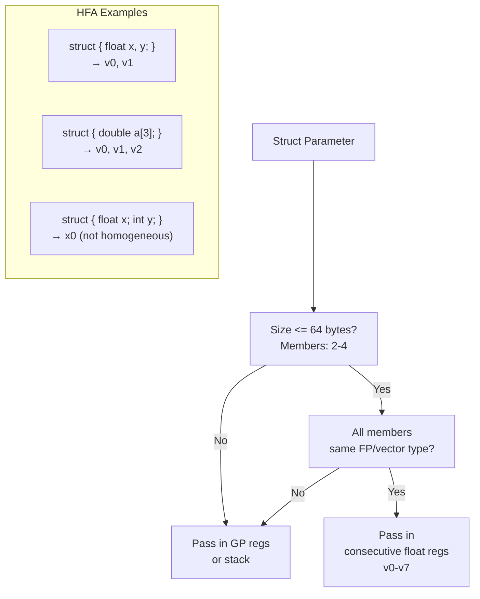
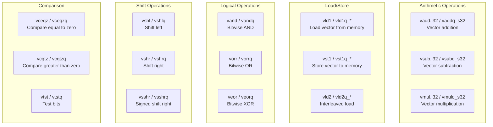
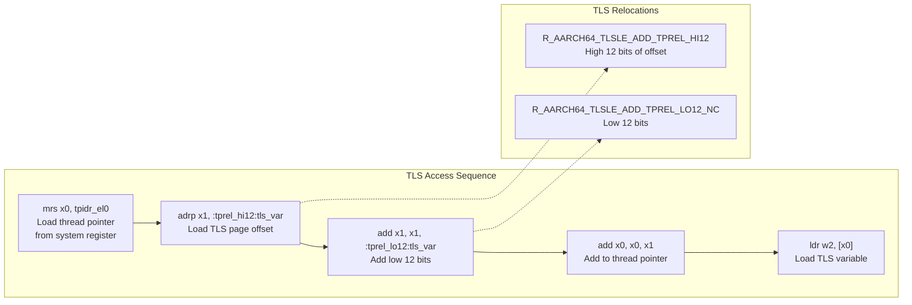

<!-- source: DeepWiki mcp.deepwiki.com · repo anthropics/claudes-c-compiler · page 5.4 AArch64 Backend · fetched 2026-10-26 -->

# AArch64 Backend

<details>
<summary>Relevant source files</summary>

The following files were used as context for generating this wiki page:

- [README.md](README.md)
- [src/backend/generation.rs](src/backend/generation.rs)
- [src/backend/traits.rs](src/backend/traits.rs)
- [src/passes/dce.rs](src/passes/dce.rs)
- [src/passes/gvn.rs](src/passes/gvn.rs)

</details>


## Overview

The AArch64 backend generates assembly code for ARM 64-bit processors, implementing the AAPCS64 (ARM Architecture Procedure Call Standard for AArch64) calling convention. This backend handles instruction selection, register allocation, and code emission for the AArch64 architecture.

For other architectures, see: [x86-64 Backend](#5.2), [i686 Backend](#5.3), [RISC-V Backend](#5.5). For cross-architecture infrastructure, see [Code Generation Architecture](#5.1), [Register Allocation](#5.6), and [Stack Layout](#5.7).

## Backend Architecture Integration

The AArch64 backend implements the `ArchCodegen` trait, sharing approximately 90% of code generation logic with other backends through default trait implementations. Architecture-specific behavior is provided through ~120 lines of trait method implementations that handle ARM-specific instruction encoding, register selection, and ABI details.



**Sources:** [src/backend/traits.rs:99-103](), [src/backend/generation.rs:1-11](), Diagram 5 from high-level architecture

## AAPCS64 Register Conventions

The AAPCS64 calling convention defines specific register roles for parameter passing, return values, and preservation requirements.

| Register Range | Purpose | Caller/Callee Saved | Notes |
|---------------|---------|---------------------|-------|
| `x0-x7` | Integer/pointer arguments | Caller-saved | First 8 GP args |
| `x8` | Indirect result (sret) | Caller-saved | Dedicated for struct returns >16 bytes |
| `x9-x15` | Temporary registers | Caller-saved | - |
| `x16-x17` (IP0, IP1) | Intra-procedure-call | Caller-saved | Linker scratch registers |
| `x18` | Platform register | Platform-specific | Reserved on some platforms |
| `x19-x28` | Callee-saved registers | Callee-saved | Preserved across calls |
| `x29` (FP) | Frame pointer | Callee-saved | - |
| `x30` (LR) | Link register | - | Return address |
| `sp` | Stack pointer | - | Must be 16-byte aligned |
| `v0-v7` (d0-d7, s0-s7) | Float/SIMD arguments | Caller-saved | First 8 FP args |
| `v8-v15` (d8-d15) | Callee-saved FP | Callee-saved | Only low 64 bits preserved |
| `v16-v31` | Temporary FP/SIMD | Caller-saved | - |



**Sources:** [src/backend/traits.rs:436-489](), AAPCS64 specification, Diagram 5 from high-level architecture

## Instruction Encoding

AArch64 uses fixed 32-bit instruction encoding, unlike x86's variable-length instructions. This simplifies encoding but requires careful handling of immediate values that don't fit in the instruction format.

### Immediate Encoding Strategies



**Key encoding patterns:**
- **Arithmetic immediate**: 12-bit unsigned + optional LSL 12
- **Logical immediate**: Complex bitmask encoding (N:immr:imms pattern)
- **Move immediate**: 16-bit chunks with shift (movz/movk)
- **Load literal**: PC-relative load from constant pool (±1MB range)

**Sources:** ARM Architecture Reference Manual, [src/backend/arm/codegen/]() (encoding logic)

## ADRP/ADD Addressing

AArch64 uses page-relative addressing for accessing global symbols in position-independent code. The `adrp` instruction loads the page address (4KB aligned), and `add` or memory operations add the page offset.



**ADRP instruction format:**
- Opcode: `1` (bit 31)
- `immlo`: bits 30-29 (low 2 bits of page offset)
- `10000`: bits 28-24 (opcode)
- `immhi`: bits 23-5 (high 19 bits of page offset)
- `Rd`: bits 4-0 (destination register)
- **Effective range**: ±4GB from PC

**Page offset calculation:**
```
page_offset = (symbol_address & ~0xFFF) - (PC & ~0xFFF)
page_offset must fit in 21 bits signed (±4GB)
```

**Sources:** [src/backend/arm/codegen/]() (ADRP emission), [src/backend/arm/assembler/]() (relocation handling), Diagram 5 from high-level architecture

## Structure Return Handling

Unlike x86-64 and RISC-V, which pass the sret pointer as the first normal argument (in x0/a0), AArch64 uses a dedicated register `x8` for indirect result pointers. This frees up `x0-x7` for actual function arguments.



**Implementation details:**
- `sret_uses_dedicated_reg()` returns `true` for AArch64
- `emit_call_sret_setup()` loads the sret pointer into x8
- Classification pass reclassifies arg[0] as `ZeroSizeSkip` when sret is present
- First stack overflow argument is promoted to use the freed x7 slot

**Sources:** [src/backend/traits.rs:436-489](), [src/backend/traits.rs:579-584](), Diagram 5 from high-level architecture

## HFA/HVA Detection

Homogeneous Floating-point Aggregates (HFA) and Homogeneous Vector Aggregates (HVA) are structs containing only float/vector members of the same base type. AAPCS64 passes these in float registers instead of GP registers or stack, improving SIMD performance.



**HFA/HVA rules:**
- **Maximum size**: 64 bytes (8 double-precision values)
- **Member count**: 2-4 members (single-member structs are not HFA)
- **Base types**: `float`, `double`, `__fp16`, or NEON vector types
- **Nesting**: HFA/HVA structs can contain HFA/HVA members
- **Alignment**: Follows base type alignment (4, 8, or 16 bytes)

**Non-qualifying cases:**
- Mixed types: `struct { float x; double y; }`
- Contains non-FP members: `struct { float x; int n; }`
- Too large: `struct { double arr[9]; }`
- Single member: `struct { float x; }` (passed as scalar)

**Sources:** AAPCS64 specification §5.4.2, [src/backend/arm/codegen/]() (HFA classification), Diagram 5 from high-level architecture

## NEON Intrinsics

The AArch64 backend supports ARM NEON SIMD intrinsics for 128-bit vector operations. NEON provides hardware acceleration for parallel data processing.

### NEON Register Organization

| Register View | Size | Count | Usage |
|--------------|------|-------|-------|
| `v0-v31` | 128-bit | 32 | Full SIMD registers |
| `d0-d31` | 64-bit | 32 | Double-precision view |
| `s0-s31` | 32-bit | 32 | Single-precision view |
| `h0-h31` | 16-bit | 32 | Half-precision view |
| `b0-b31` | 8-bit | 32 | Byte view |

### Intrinsic Categories



**Encoding considerations:**
- **Operand types**: Most intrinsics have typed variants (`_s8`, `_u32`, `_f64`, etc.)
- **Width variants**: 64-bit (`vfoo`) vs 128-bit (`vfooq`) versions
- **Immediate constraints**: Some operations require compile-time constant immediates
- **Lane operations**: `vget_lane`, `vset_lane` for scalar extraction/insertion

**Sources:** ARM NEON Intrinsics Reference, [include/]() (NEON header files), Diagram 7 from high-level architecture

## TLS (Thread-Local Storage)

AArch64 implements TLS using the Local Exec model for executables, which provides the most efficient access pattern.



**TLS layout:**
- Thread pointer (`tpidr_el0`) points to the TLS block base
- TLS variables have static offsets from this base
- Offset is computed at link time via relocations
- **Advantages**: No GOT indirection, minimal instruction overhead

**Instruction sequence:**
1. `mrs x0, tpidr_el0` — Load thread pointer (dedicated system register)
2. `adrp x1, :tprel_hi12:var` — Load high 12 bits of TLS offset
3. `add x1, x1, :tprel_lo12:var` — Add low 12 bits
4. `add x0, x0, x1` — Compute final address
5. `ldr w2, [x0]` — Access TLS variable

**Alternative (optimized single-register):**
```asm
mrs x0, tpidr_el0
ldr w0, [x0, :tprel_lo12:var]  ; If offset fits in 12 bits
```

**Sources:** [src/backend/traits.rs:645-650](), [src/backend/arm/codegen/]() (TLS emission), ELF TLS specification

## Register Allocation Strategy

The AArch64 backend uses linear scan register allocation with callee-saved register preference to minimize spilling across function calls.

### Available Registers for Allocation

| Register Class | Registers | Count | Strategy |
|---------------|-----------|-------|----------|
| **Caller-saved GP** | x9-x15 | 7 | Used for short-lived temps |
| **Callee-saved GP** | x19-x28 | 10 | Preferred for values spanning calls |
| **Caller-saved FP** | v16-v23 | 8 | FP/SIMD temporaries |
| **Callee-saved FP** | v8-v15 (low 64) | 8 | FP values spanning calls |

**Excluded from allocation:**
- `x0-x8`: Argument passing and return values
- `x16-x17`: Intra-procedure-call scratch (linker may clobber)
- `x18`: Platform register (reserved)
- `x29`: Frame pointer
- `x30`: Link register
- `v0-v7`: Float argument/return registers
- `v24-v31`: Reserved for specific intrinsics

**Allocation priority:**
1. Values spanning calls → callee-saved registers (x19-x28, v8-v15)
2. Block-local values → caller-saved registers (x9-x15, v16-v23)
3. High-pressure spill candidates → stack slots

**Sources:** [src/backend/regalloc/]() (allocation algorithm), [src/backend/arm/codegen/]() (register definitions), [Register Allocation](#5.6)

## Performance Characteristics

### Instruction Latencies (Cortex-A72 reference)

| Operation | Latency | Throughput | Notes |
|----------|---------|------------|-------|
| Integer ALU | 1 cycle | 2/cycle | add, sub, logical ops |
| Integer multiply | 3 cycles | 1/cycle | mul, madd |
| Integer divide | 4-20 cycles | 1/4-20 cycles | Depends on operand size |
| Load (L1 hit) | 4 cycles | 2/cycle | - |
| Store (L1 hit) | 1 cycle | 2/cycle | Write-through |
| FP add/sub | 5 cycles | 1/cycle | fadd, fsub |
| FP multiply | 5 cycles | 1/cycle | fmul |
| FP divide (single) | 7 cycles | 1/7 cycles | fdiv s-register |
| FP divide (double) | 12 cycles | 1/12 cycles | fdiv d-register |
| NEON integer ALU | 1-2 cycles | 2/cycle | Element-wise operations |
| NEON multiply | 4 cycles | 1/cycle | Vector multiply |
| NEON load | 5 cycles | 1/cycle | vld1 |
| NEON store | 1 cycle | 1/cycle | vst1 |

### Code Size Characteristics

**Fixed instruction length** (32 bits) provides:
- **Advantage**: Predictable code size, simple branch offset calculation
- **Disadvantage**: No compression for common patterns (unlike RISC-V RV64C)
- **Typical density**: 4 bytes per operation (vs x86's 2-7 bytes variable)

**Common patterns:**
- Simple arithmetic: 1 instruction (4 bytes)
- Load/store: 1-2 instructions (4-8 bytes with ADRP)
- Function call: 1 instruction (4 bytes) for direct, 2 (8 bytes) for indirect
- Constant load: 1-5 instructions depending on value (4-20 bytes)

**Sources:** ARM Cortex-A72 TRM, compiler benchmarks

## Code Example: Function Call Sequence

```asm
; void foo(int a, int b, int c, struct large_t *sret_ptr);
; AAPCS64 with sret in x8

.globl caller
.type caller, @function
caller:
    ; Prologue
    stp x29, x30, [sp, #-32]!   ; Save FP, LR
    mov x29, sp                   ; Set frame pointer
    
    ; Allocate space for return struct (assume 32 bytes)
    sub sp, sp, #32
    mov x8, sp                    ; x8 = sret pointer (dedicated register)
    
    ; Load arguments
    mov w0, #1                    ; arg0: a = 1
    mov w1, #2                    ; arg1: b = 2
    mov w2, #3                    ; arg2: c = 3
    ; x8 already set above
    
    ; Call
    bl foo                        ; Direct call
    
    ; Use return struct (pointed to by x8, now in [sp])
    ldr w0, [sp]                  ; Load first field
    
    ; Epilogue
    add sp, sp, #32               ; Deallocate struct space
    ldp x29, x30, [sp], #32       ; Restore FP, LR
    ret

.globl foo
.type foo, @function
foo:
    ; Prologue
    stp x29, x30, [sp, #-16]!
    mov x29, sp
    
    ; Access parameters (x0=a, x1=b, x2=c, x8=sret_ptr)
    add w3, w0, w1                ; w3 = a + b
    add w3, w3, w2                ; w3 = a + b + c
    
    ; Store to return struct via x8
    str w3, [x8]                  ; sret_ptr->field0 = result
    str wzr, [x8, #4]             ; sret_ptr->field1 = 0
    
    ; Epilogue (x8 return pointer already set by caller)
    ldp x29, x30, [sp], #16
    ret
```

**Key observations:**
1. **x8 dedicated usage**: Sret pointer passed in x8, not x0
2. **x0-x7 available**: All GP argument registers available for actual arguments
3. **Stack alignment**: Maintained at 16-byte boundaries (stp/ldp pairs)
4. **No callee cleanup**: Caller deallocates struct space after return
5. **FP chain**: x29 forms frame pointer chain for debuggers

**Sources:** [src/backend/arm/codegen/]() (call emission), AAPCS64 specification

---

