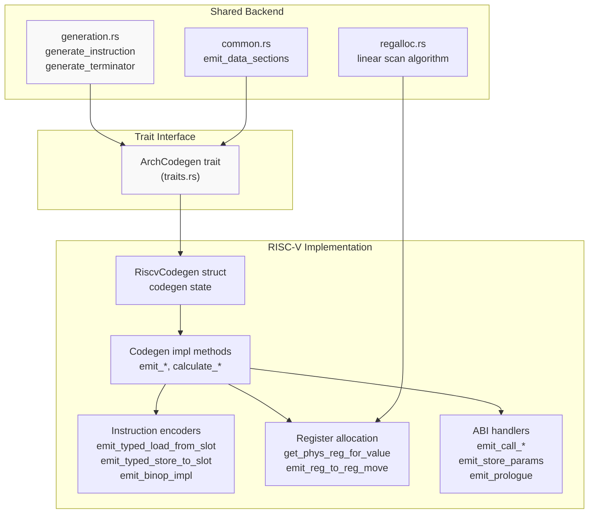
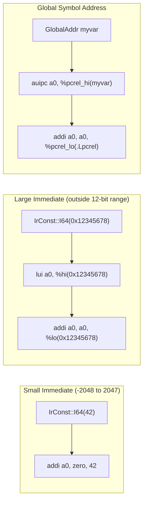
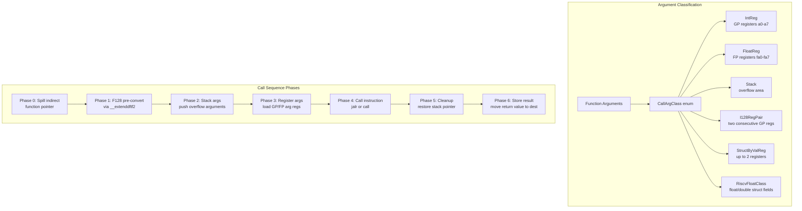
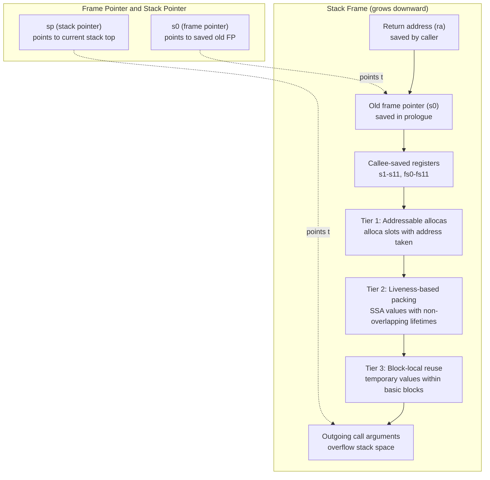
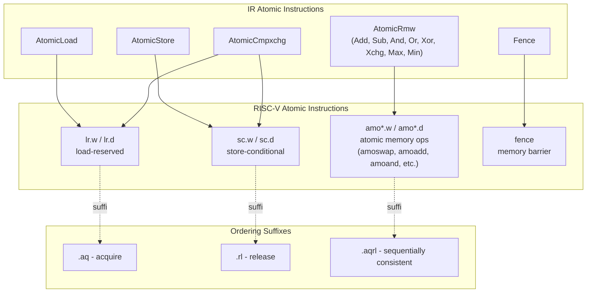
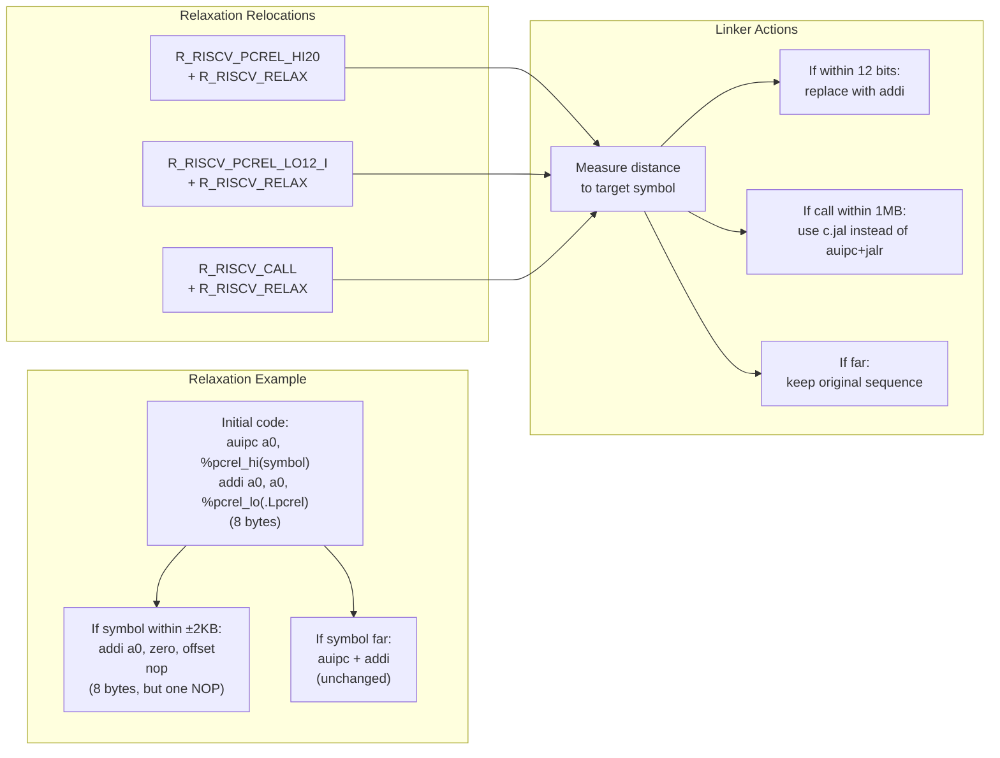
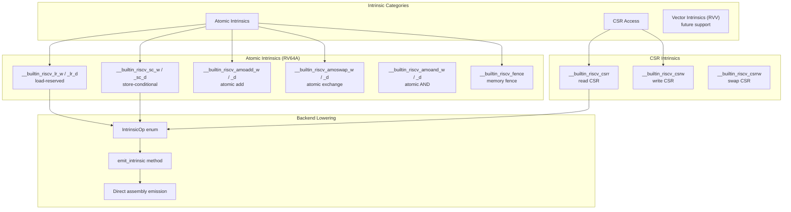

<!-- source: DeepWiki mcp.deepwiki.com · repo anthropics/claudes-c-compiler · page 5.5 RISC-V Backend · fetched 2026-10-26 -->

# RISC-V Backend

<details>
<summary>Relevant source files</summary>

The following files were used as context for generating this wiki page:

- [README.md](README.md)
- [src/backend/generation.rs](src/backend/generation.rs)
- [src/backend/traits.rs](src/backend/traits.rs)
- [src/passes/dce.rs](src/passes/dce.rs)
- [src/passes/gvn.rs](src/passes/gvn.rs)

</details>


This page documents the RISC-V 64-bit backend code generation implementation. The RISC-V backend is one of four target architectures supported by CCC (alongside x86-64, i686, and AArch64). It generates assembly for the RV64GC ISA (64-bit base with general, compressed, and atomic extensions) and implements the RISC-V calling convention.

For general backend architecture and the `ArchCodegen` trait interface, see [5.1](#5.1). For register allocation details shared across all backends, see [5.6](#5.6). For stack layout implementation, see [5.7](#5.7). For the RISC-V assembler and linker, see [7.4](#7.4).

## Architecture Overview

The RISC-V backend targets RV64GC, which comprises:
- **RV64I**: 64-bit base integer instruction set
- **RV64M**: Integer multiplication and division
- **RV64A**: Atomic instructions
- **RV64F**: Single-precision floating-point
- **RV64D**: Double-precision floating-point
- **RV64C**: Compressed 16-bit instructions (optional, for code density)

RISC-V uses a load-store architecture with fixed 32-bit instruction encoding (before compression). Unlike x86's variable-length and complex addressing modes, RISC-V uses simple immediate offsets limited to 12 bits signed (`-2048` to `2047`). Large constants require multi-instruction sequences via immediate splitting.

**Key Architectural Constraints:**

| Feature | RISC-V Characteristic | Impact on Codegen |
|---------|----------------------|-------------------|
| Instruction Width | Fixed 32-bit | Predictable encoding, no prefix bytes |
| Immediate Range | 12-bit signed offsets | Large constants need `lui`/`addi` pairs |
| Addressing Modes | Base + 12-bit offset only | No complex `[base + index*scale + disp]` |
| Register Count | 32 GP, 32 FP | More registers than x86, less pressure |
| ABI Argument Passing | Up to 8 GP + 8 FP registers | Fewer stack args than i686 |
| Return Values | Integer in `a0`/`a1`, float in `fa0`/`fa1` | Separate register classes |

Sources: [README.md:4-6](), [README.md:17-19]()

## Backend Implementation Structure

The RISC-V backend implements the `ArchCodegen` trait defined in [src/backend/traits.rs:99-1535](). The implementation follows the same pattern as other backends: a small struct holding mutable codegen state and ~185 trait methods that delegate to `_impl` functions using the `delegate_to_impl!` macro.



**Key Source Files (expected locations based on architecture patterns):**
- `src/backend/riscv/codegen/codegen.rs` - Main `RiscvCodegen` struct and trait impl
- `src/backend/riscv/codegen/instrs.rs` - Instruction emission primitives
- `src/backend/riscv/codegen/calls.rs` - Function call ABI implementation
- `src/backend/riscv/assembler/` - RISC-V assembler (see [7.4](#7.4))
- `src/backend/riscv/linker/` - RISC-V ELF linker (see [7.4](#7.4))

Sources: [src/backend/traits.rs:1-20](), [src/backend/generation.rs:1-11]()

## Register Usage and Allocation

RISC-V provides 32 general-purpose registers (`x0`-`x31`) and 32 floating-point registers (`f0`-`f31`). The backend uses standard ABI register names:

```mermaid
graph TB
    subgraph "Integer Registers (x0-x31)"
        zero["x0 (zero)<br/>hardwired to 0"]
        ra["x1 (ra)<br/>return address"]
        sp["x2 (sp)<br/>stack pointer"]
        gp["x3 (gp)<br/>global pointer"]
        tp["x4 (tp)<br/>thread pointer"]
        t0["x5-x7 (t0-t2)<br/>temporaries"]
        s0["x8-x9 (s0-s1)<br/>saved registers"]
        a0["x10-x17 (a0-a7)<br/>arguments/return"]
        s2["x18-x27 (s2-s11)<br/>saved registers"]
        t3["x28-x31 (t3-t6)<br/>temporaries"]
    end
    
    subgraph "Floating-Point Registers (f0-f31)"
        ft0["f0-f7 (ft0-ft7)<br/>FP temporaries"]
        fs0["f8-f9 (fs0-fs1)<br/>FP saved"]
        fa0["f10-f17 (fa0-fa7)<br/>FP arguments/return"]
        fs2["f18-f27 (fs2-fs11)<br/>FP saved"]
        ft8["f28-f31 (ft8-ft11)<br/>FP temporaries"]
    end
    
    subgraph "Backend Register Roles"
        AccReg["Accumulator: a0/t0<br/>primary computation register"]
        SecReg["Secondary: t1<br/>two-operand operations"]
        AddrReg["Address: t5<br/>Load/Store pointer computation"]
        ScratchReg["Scratch: t2, t3, t4<br/>spills and helper ops"]
        FPAccReg["FP Accumulator: fa0/ft0<br/>float operations"]
    end
    
    a0 -.-> AccReg
    t0 -.-> AccReg
    t1 -.-> SecReg
    t5 -.-> AddrReg
    t3 -.-> ScratchReg
    fa0 -.-> FPAccReg
    ft0 -.-> FPAccReg
```



**Callee-Saved vs Caller-Saved:**

| Register Class | Caller-Saved (Volatile) | Callee-Saved (Non-Volatile) |
|----------------|------------------------|----------------------------|
| Integer | `t0-t6` (x5-x7, x28-x31), `a0-a7` (x10-x17) | `s0-s11` (x8-x9, x18-x27) |
| Floating-Point | `ft0-ft11` (f0-f7, f28-f31), `fa0-fa7` (f10-f17) | `fs0-fs11` (f8-f9, f18-f27) |

The register allocator prioritizes callee-saved registers (`s0-s11`) for values that are live across function calls, avoiding save/restore overhead. See [5.6](#5.6) for the linear scan allocation algorithm.

Sources: [src/backend/traits.rs:99-108](), [README.md:4-6]()

## Instruction Encoding and Emission

RISC-V instructions have a fixed 32-bit encoding with immediate values embedded in the instruction word. The backend uses GNU AT&T-style assembly syntax (operands in `source, dest` order) for consistency with other architectures.

### Immediate Splitting

RISC-V's 12-bit immediate constraint means large constants require multi-instruction sequences:



**Immediate Encoding Patterns:**

| Immediate Type | Instruction Sequence | Relocation Type |
|----------------|---------------------|-----------------|
| 12-bit signed | `addi rd, rs, imm12` | None (direct encoding) |
| 32-bit constant | `lui rd, %hi(val); addi rd, rd, %lo(val)` | None (split by assembler) |
| Global address (PIC) | `auipc rd, %pcrel_hi(sym); addi rd, rd, %pcrel_lo(label)` | `R_RISCV_PCREL_HI20`, `R_RISCV_PCREL_LO12_I` |
| Global address (absolute) | `lui rd, %hi(sym); addi rd, rd, %lo(sym)` | `R_RISCV_HI20`, `R_RISCV_LO12_I` |

The backend emits PC-relative `auipc`/`addi` pairs for position-independent code, which the linker resolves to the final address. The assembler tracks the `auipc` label so the corresponding `addi` can calculate the low 12 bits relative to the high 20 bits.

Sources: [README.md:4-6](), Diagram 5 in high-level architecture

### Load/Store Instructions

RISC-V uses typed load/store mnemonics based on operand size:

```mermaid
graph TB
    subgraph "Load Instructions"
        LB["lb rd, offset(rs)<br/>load byte (sign-extend)"]
        LBU["lbu rd, offset(rs)<br/>load byte (zero-extend)"]
        LH["lh rd, offset(rs)<br/>load halfword (sign-extend)"]
        LHU["lhu rd, offset(rs)<br/>load halfword (zero-extend)"]
        LW["lw rd, offset(rs)<br/>load word (sign-extend)"]
        LWU["lwu rd, offset(rs)<br/>load word (zero-extend)"]
        LD["ld rd, offset(rs)<br/>load doubleword"]
        FLW["flw frd, offset(rs)<br/>load float (F32)"]
        FLD["fld frd, offset(rs)<br/>load double (F64)"]
    end
    
    subgraph "Store Instructions"
        SB["sb rs2, offset(rs1)<br/>store byte"]
        SH["sh rs2, offset(rs1)<br/>store halfword"]
        SW["sw rs2, offset(rs1)<br/>store word"]
        SD["sd rs2, offset(rs1)<br/>store doubleword"]
        FSW["fsw frs2, offset(rs)<br/>store float"]
        FSD["fsd frs2, offset(rs)<br/>store double"]
    end
    
    subgraph "Backend Implementation"
        LoadInstr["load_instr_for_type(ty: IrType)<br/>→ &'static str"]
        StoreInstr["store_instr_for_type(ty: IrType)<br/>→ &'static str"]
        EmitLoad["emit_typed_load_from_slot(instr, slot)"]
        EmitStore["emit_typed_store_to_slot(instr, ty, slot)"]
    end
    
    LoadInstr -.dispatches.-> LB
    LoadInstr -.dispatches.-> LW
    LoadInstr -.dispatches.-> LD
    LoadInstr -.dispatches.-> FLD
    StoreInstr -.dispatches.-> SB
    StoreInstr -.dispatches.-> SW
    StoreInstr -.dispatches.-> SD
    StoreInstr -.dispatches.-> FSD
    
    EmitLoad --> LoadInstr
    EmitStore --> StoreInstr
```



The `load_instr_for_type` and `store_instr_for_type` methods map IR types to RISC-V instruction mnemonics:

| IrType | Load Instruction | Store Instruction | Notes |
|--------|------------------|-------------------|-------|
| `I8` | `lb` | `sb` | Sign-extended |
| `U8` | `lbu` | `sb` | Zero-extended |
| `I16` | `lh` | `sh` | Sign-extended |
| `U16` | `lhu` | `sh` | Zero-extended |
| `I32` | `lw` | `sw` | Sign-extended to 64-bit |
| `U32` | `lwu` | `sw` | Zero-extended to 64-bit |
| `I64`, `U64`, `Ptr` | `ld` | `sd` | Native 64-bit |
| `F32` | `flw` | `fsw` | Single-precision FP |
| `F64` | `fld` | `fsd` | Double-precision FP |
| `I128`, `U128` | Two `ld` ops | Two `sd` ops | 128-bit emulated via pair |
| `F128` | Soft-float libcall | Soft-float libcall | No hardware quad precision |

Sources: [src/backend/traits.rs:942-951]()

## Function Calling Convention (RV64 ABI)

The RISC-V calling convention passes arguments in registers when possible, spilling to the stack only when register slots are exhausted.



**Argument Passing Rules:**

| Argument Type | Register Allocation | Stack Fallback | Notes |
|---------------|--------------------|--------------------|-------|
| Integer (≤64-bit) | `a0-a7` (8 regs) | Stack, 8-byte aligned | Signed types sign-extended |
| Float (F32, F64) | `fa0-fa7` (8 regs) | Stack, type-aligned | Floats NOT promoted to double |
| 128-bit integer | `a0/a1`, `a2/a3`, etc. (pairs) | Stack, 16-byte aligned | Two consecutive registers |
| Small struct (≤16 bytes) | Up to 2 GP or FP registers | Stack, natural alignment | RISC-V float struct rule |
| Large struct (>16 bytes) | Passed by reference (pointer in GP reg) | Stack pointer | Caller makes copy |
| Variadic args | GP registers first, then stack | Stack | No FP promotion like x86-64 |

**RISC-V Float Struct Rule:**  
Small structs (≤16 bytes) containing only float/double fields may be passed in FP registers (`fa0-fa7`) instead of GP registers. The `RiscvFloatClass` enum classifies these cases:
- `SingleFloat`: struct with one `float` → passed in one FP register
- `SingleDouble`: struct with one `double` → passed in one FP register
- `FloatFloat`: struct with two `float` fields → passed in two FP registers
- `FloatDouble`, `DoubleFloat`, `DoubleDouble`: mixed pairs → two FP registers

This differs from x86-64 (which uses eightbyte classes) and AArch64 (which uses HFA detection). The backend tracks `struct_arg_riscv_float_classes` in the call lowering and uses dedicated `emit_call_load_float_struct_*` methods.

**Return Value Convention:**

| Return Type | Return Registers | Notes |
|-------------|------------------|-------|
| Integer (≤64-bit) | `a0` | Sign/zero-extended as needed |
| 128-bit integer | `a0` (low), `a1` (high) | Little-endian pair |
| Float (F32, F64) | `fa0` | No promotion |
| F128 (long double) | Soft-float via memory | Passed by hidden pointer |
| Small struct (≤16 bytes) | `a0`, `a1` or `fa0`, `fa1` | Follows argument float struct rule |
| Large struct | Via hidden pointer (sret) | Pointer passed in `a0` |

Sources: [src/backend/traits.rs:425-537](), Diagram 5 in high-level architecture

## Stack Frame Layout

The RISC-V backend uses the standard three-tier stack layout (see [5.7](#5.7) for details):



**Prologue Sequence (typical function):**
```
function_name:
    addi sp, sp, -<frame_size>    # Allocate stack frame
    sd ra, <offset>(sp)            # Save return address
    sd s0, <offset>(sp)            # Save old frame pointer
    addi s0, sp, <frame_size>      # Set up new frame pointer
    sd s1, <offset>(sp)            # Save callee-saved regs (if used)
    ...
```

**Epilogue Sequence:**
```
    ld s1, <offset>(sp)            # Restore callee-saved regs
    ...
    ld s0, <offset>(sp)            # Restore frame pointer
    ld ra, <offset>(sp)            # Restore return address
    addi sp, sp, <frame_size>      # Deallocate stack frame
    ret                            # Return (jalr zero, ra, 0)
```

For functions with dynamic allocas (`DynAlloca` instructions), the epilogue restores `sp` from `s0` instead of adding the compile-time frame size:
```
    mv sp, s0                      # Restore SP from FP
    ld s0, <offset>(sp)
    ld ra, <offset>(sp)
    addi sp, sp, <frame_size>
    ret
```

Sources: [src/backend/traits.rs:112-121](), [src/backend/generation.rs:888-897]()

## Atomic Operations

RISC-V provides atomic memory operations via the `A` extension (RV64A). The backend maps IR atomic instructions to RISC-V `lr.w`, `sc.w`, `lr.d`, `sc.d`, and atomic RMW instructions.



**Atomic Instruction Mapping:**

| IR Operation | RISC-V Instruction | Memory Ordering |
|--------------|-------------------|-----------------|
| `AtomicLoad(Acquire)` | `lr.w.aq` / `lr.d.aq` | Acquire semantics |
| `AtomicStore(Release)` | `sc.w.rl` / `sc.d.rl` | Release semantics |
| `AtomicRmw(Add, SeqCst)` | `amoadd.w.aqrl` / `amoadd.d.aqrl` | Seq-cst (`.aqrl` suffix) |
| `AtomicRmw(Xchg, SeqCst)` | `amoswap.w.aqrl` / `amoswap.d.aqrl` | Seq-cst |
| `AtomicCmpxchg(SeqCst)` | `lr.d.aqrl` + `sc.d.aqrl` loop | Seq-cst via LR/SC |
| `Fence(SeqCst)` | `fence rw, rw` | Full memory barrier |

**AtomicCmpxchg Implementation:**  
RISC-V does not have a native compare-and-swap instruction. The backend emulates it using load-reserved/store-conditional:
```
.Lretry:
    lr.d.aq  a5, (a0)           # Load-reserved from ptr
    bne      a5, a1, .Lfail      # Compare with expected
    sc.d.rl  a6, a2, (a0)       # Store-conditional desired
    bnez     a6, .Lretry         # Retry if store failed
    li       a0, 1               # Success
    j        .Ldone
.Lfail:
    li       a0, 0               # Failure
.Ldone:
```

The backend uses the `A` constraint for inline assembly atomic operands (see [6.3](#6.3)), ensuring memory operands use base-register-only addressing as required by LR/SC instructions.

Sources: [src/backend/traits.rs:829-841](), Diagram 7 in high-level architecture

## Compressed Instructions (RV64C)

RISC-V's compressed instruction extension (RV64C) encodes frequently-used 32-bit instructions as 16-bit equivalents, improving code density. The assembler automatically compresses eligible instructions when the `-march=rv64gc` flag is used.

**Compression Examples:**

| 32-bit Instruction | 16-bit Compressed | Constraints |
|-------------------|-------------------|-------------|
| `addi sp, sp, -16` | `c.addi16sp -16` | Immediate is multiple of 16, in range |
| `ld a5, 8(sp)` | `c.ldsp a5, 8` | Immediate in range, using `sp` base |
| `sd a0, 0(sp)` | `c.sdsp a0, 0` | Immediate in range, using `sp` base |
| `addi a0, zero, 5` | `c.li a0, 5` | Loading small immediate |
| `add a0, a0, a1` | `c.add a0, a1` | Both operands in `a0-a5`, `s0-s1` |
| `jr ra` (jalr zero, ra, 0) | `c.jr ra` | Unconditional jump to register |
| `mv a1, a0` | `c.mv a1, a0` | Register-to-register copy |

The backend does not explicitly emit compressed instructions; instead, it emits standard 32-bit mnemonics and relies on the assembler's compression pass to detect eligible patterns. This keeps the backend code simple while achieving good code density.

**Compression Detection:**  
The assembler (see [7.4](#7.4)) checks each 32-bit instruction after encoding to see if it matches a compression pattern. Compressed instructions are marked with a flag, and the final ELF output alternates between 32-bit and 16-bit encoded instructions.

Sources: [README.md:4-6](), Diagram 6 in high-level architecture

## Relaxation and Linker Cooperation

RISC-V uses *relaxation* to optimize instruction sequences during linking. The backend emits relaxation hints (special relocation types) that tell the linker it's safe to replace multi-instruction sequences with shorter equivalents if addresses are close enough.



**Relaxation Relocation Types:**

| Relocation Pair | Optimization Opportunity | Savings |
|-----------------|-------------------------|---------|
| `R_RISCV_PCREL_HI20` + `R_RISCV_RELAX` | PC-relative address within 12 bits → single `addi` | 4 bytes (one instruction) |
| `R_RISCV_CALL` + `R_RISCV_RELAX` | Function call within 1MB → `jal` instead of `auipc+jalr` | 4 bytes |
| `R_RISCV_HI20` + `R_RISCV_RELAX` | Absolute address within 12 bits → single `addi` | 4 bytes |
| `R_RISCV_ALIGN` + `R_RISCV_RELAX` | Alignment padding → reduce NOP count if preceding instructions compressed | Variable |

The backend unconditionally emits `R_RISCV_RELAX` markers alongside applicable relocations. The linker checks whether relaxation is profitable and applies it during the final link pass. This cooperative model allows the backend to remain simple (always emit conservative code) while still achieving optimal code size.

Sources: [README.md:4-6](), Diagram 6 in high-level architecture

## Integration with Shared Backend Infrastructure

The RISC-V backend reuses ~90% of code generation logic from the shared backend framework (see [5.1](#5.1)):

**Shared Components:**

| Component | Source File | Role |
|-----------|-------------|------|
| Instruction dispatch | [src/backend/generation.rs:1-1535]() | `generate_instruction`, `generate_terminator` |
| Register allocation | `src/backend/regalloc.rs` | Linear scan with callee-saved priority |
| Stack layout | `src/backend/stack_layout.rs` | Three-tier packing algorithm |
| Call ABI classification | `src/backend/call_abi.rs` | `classify_call_args` |
| GEP folding | [src/backend/generation.rs:42-152]() | Constant offset merging |
| Compare-branch fusion | [src/backend/generation.rs:440-483]() | `detect_cmp_branch_fusion` |
| Data section emission | `src/backend/common.rs` | Global variable initialization |

**Architecture-Specific Primitives (implemented by RISC-V backend):**

| Primitive Category | Example Methods | Purpose |
|-------------------|-----------------|---------|
| Instruction mnemonics | `load_instr_for_type`, `store_instr_for_type` | Map IR types to RISC-V load/store ops |
| Register moves | `emit_acc_to_secondary`, `emit_add_secondary_to_acc` | Manage accumulator and secondary registers |
| Immediate loads | `emit_load_operand` | Immediate splitting for large constants |
| Memory addressing | `emit_typed_load_from_slot`, `emit_gep_direct_const` | Stack slot access, pointer arithmetic |
| Binary operations | `emit_int_binop`, `emit_float_binop_impl` | Arithmetic, bitwise, shift instructions |
| Call sequence | `emit_call_stack_args`, `emit_call_instruction` | RV64 calling convention |
| Prologue/epilogue | `emit_prologue`, `emit_epilogue_and_ret` | Frame setup/teardown |

The `ArchCodegen` trait's default implementations (e.g., `emit_binop`, `emit_call`, `emit_gep`) provide the algorithmic structure, while RISC-V overrides only the small instruction-emitting primitives. This design keeps the RISC-V-specific code focused on instruction syntax rather than reimplementing optimization passes or ABI logic.

Sources: [src/backend/traits.rs:1-20](), [src/backend/generation.rs:1-11]()

## Hardware Intrinsics

The RISC-V backend supports a limited set of hardware intrinsics for atomic operations and future vector extensions (RVV).



**Currently Implemented Intrinsics:**

| Intrinsic | RISC-V Instruction | Use Case |
|-----------|-------------------|----------|
| Atomics | `lr.w`, `sc.w`, `amoadd.w`, etc. | Lock-free data structures |
| Fence | `fence rw, rw` | Memory ordering |
| CSR access | `csrr`, `csrw` | System programming (kernel) |

**Future Work (RVV - RISC-V Vector Extension):**  
The vector extension intrinsics (e.g., `__builtin_riscv_vadd_vv`) are placeholders. When RVV support is added, these will map to vector instructions like `vadd.vv`, similar to how ARM NEON and x86 SSE/AVX intrinsics are handled (see [6.2](#6.2)).

Sources: [README.md:148-152](), Diagram 7 in high-level architecture

## Special Features

### Long Double (F128) Support

RISC-V does not have native hardware support for IEEE 754 binary128 (quad precision). The backend uses software floating-point emulation via `libgcc` or `compiler-rt`:

| Operation | Soft-Float Function | Notes |
|-----------|---------------------|-------|
| F128 add | `__addtf3` | 128-bit float addition |
| F128 multiply | `__multf3` | 128-bit float multiplication |
| F128 → F64 | `__trunctfdf2` | Quad to double conversion |
| F64 → F128 | `__extenddftf2` | Double to quad conversion |
| F128 → I64 | `__fixtfdi` | Quad to signed 64-bit int |
| I64 → F128 | `__floatditf` | Signed 64-bit int to quad |

F128 values are passed by reference (via hidden pointer) in function calls, and returned via a hidden pointer in `a0` (similar to large struct returns). See [8.2](#8.2) for detailed long double handling.

Sources: [README.md:146-148](), Diagram 7 in high-level architecture

### TLS (Thread-Local Storage)

RISC-V uses the `tp` register (x4) to hold the thread pointer. The backend implements the Local Exec TLS model:

```
.Ltls_symbol:
    lui  a0, %tprel_hi(tls_var)
    add  a0, a0, tp
    addi a0, a0, %tprel_lo(.Ltls_symbol)
```

This computes the address of a thread-local variable as `tp + offset`, where the offset is resolved by the linker using `R_RISCV_TPREL_HI20` and `R_RISCV_TPREL_LO12_I` relocations. Other TLS models (Initial Exec, General Dynamic) are not yet implemented.

Sources: [src/backend/traits.rs:645-650]()

### Inline Assembly

RISC-V inline assembly uses GCC extended syntax (see [6.3](#6.3) for details). The backend handles operand substitution with RISC-V-specific modifiers:

| Constraint | Meaning | Example |
|------------|---------|---------|
| `r` | General-purpose register | `a0`, `t1` |
| `f` | Floating-point register | `fa0`, `ft2` |
| `m` | Memory operand | `0(a5)` |
| `A` | Memory with base register only (for LR/SC) | `(a0)` - no offset allowed |
| `I` | 12-bit signed immediate | `-2048` to `2047` |
| `z` | Zero register (`x0`) | Special modifier: `%z` → `zero` |

**Operand Modifiers:**
- `%0-%9`: Operand index (standard)
- `%z`: Use `zero` register when operand is constant 0

Example inline assembly from kernel code:
```c
asm volatile("fence rw, rw" ::: "memory");
asm volatile("csrr %0, mhartid" : "=r"(hartid));
asm volatile("amoswap.w.aqrl %0, %1, %2" 
             : "=r"(old) 
             : "r"(new), "A"(*ptr));
```

Sources: [src/backend/inline_asm.rs]() (referenced), Diagram 7 in high-level architecture

## Code Generation Examples

### Simple Function

**C code:**
```c
int add(int a, int b) {
    return a + b;
}
```

**Generated RISC-V assembly:**
```
add:
    addw a0, a0, a1     # Add 32-bit, result in a0
    ret                 # Return (jalr zero, ra, 0)
```

### Function with Stack Frame

**C code:**
```c
long factorial(long n) {
    if (n <= 1) return 1;
    return n * factorial(n - 1);
}
```

**Generated RISC-V assembly:**
```
factorial:
    addi sp, sp, -32        # Allocate stack frame
    sd   ra, 24(sp)         # Save return address
    sd   s0, 16(sp)         # Save frame pointer
    addi s0, sp, 32         # Set up frame pointer
    sd   s1, 8(sp)          # Save callee-saved s1
    mv   s1, a0             # Save argument n in s1
    li   a1, 1
    bgt  s1, a1, .L2        # if (n > 1) goto .L2
    li   a0, 1              # return 1
    j    .L1
.L2:
    addi a0, s1, -1         # n - 1
    call factorial          # Recursive call
    mul  a0, a0, s1         # n * factorial(n-1)
.L1:
    ld   s1, 8(sp)          # Restore callee-saved s1
    ld   s0, 16(sp)         # Restore frame pointer
    ld   ra, 24(sp)         # Restore return address
    addi sp, sp, 32         # Deallocate stack frame
    ret
```

Sources: [src/backend/generation.rs:800-1004]()

---

**Page Completeness Note:**  
This page covers the RISC-V backend architecture, instruction encoding, calling convention, and special features. For assembler/linker implementation details (instruction parsing, ELF object generation, relaxation application), see [7.4](#7.4). For optimization passes that work across all architectures, see [4](#4). For IR lowering and ABI-agnostic type handling, see [3](#3).

---

