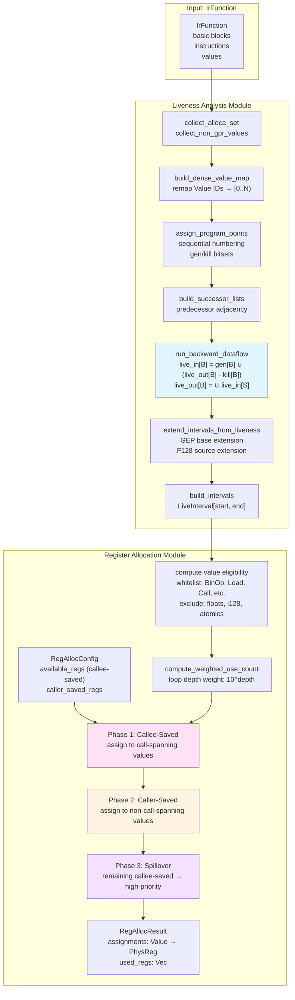

<!-- source: DeepWiki mcp.deepwiki.com · repo anthropics/claudes-c-compiler · page 5.6 Register Allocation · fetched 2026-10-26 -->

# Register Allocation

<details>
<summary>Relevant source files</summary>

The following files were used as context for generating this wiki page:

- [src/backend/liveness.rs](src/backend/liveness.rs)
- [src/backend/regalloc.rs](src/backend/regalloc.rs)
- [src/passes/README.md](src/passes/README.md)
- [src/passes/cfg_simplify.rs](src/passes/cfg_simplify.rs)
- [src/passes/constant_fold.rs](src/passes/constant_fold.rs)
- [src/passes/copy_prop.rs](src/passes/copy_prop.rs)
- [src/passes/if_convert.rs](src/passes/if_convert.rs)
- [src/passes/inline.rs](src/passes/inline.rs)
- [src/passes/licm.rs](src/passes/licm.rs)
- [src/passes/mod.rs](src/passes/mod.rs)
- [src/passes/narrow.rs](src/passes/narrow.rs)
- [src/passes/simplify.rs](src/passes/simplify.rs)

</details>


## Purpose and Scope

This document describes the register allocation system used in CCC's backend code generation. Register allocation assigns physical machine registers to IR values based on their liveness intervals and use patterns, reducing stack memory pressure and register moves. For information about stack layout and memory allocation for values that don't receive registers, see [Stack Layout](#5.7). For architecture-specific code generation that consumes register assignments, see [Code Generation Architecture](#5.1).

The register allocator uses a linear scan algorithm with three allocation phases: callee-saved registers for call-spanning values, caller-saved registers for non-call-spanning values, and callee-saved spillover for remaining high-priority values. Liveness analysis uses backward dataflow iteration to compute accurate live intervals even in the presence of loops.

---

## System Overview



**Sources:** [src/backend/regalloc.rs:1-552](), [src/backend/liveness.rs:1-210]()

---

## Liveness Analysis Pipeline

Liveness analysis computes live intervals `[start, end]` for each IR value, where `start` is the program point where the value is defined and `end` is the last program point where it is used. The analysis uses backward dataflow iteration to correctly handle values that are live across loop back-edges.

### Program Point Assignment and Dataflow Setup

```mermaid
graph LR
    subgraph "Phase 1: Program Point Assignment"
        ASSIGN_BLOCK["assign block start/end points<br/>block_start_points[i]<br/>block_end_points[i]"]
        GEN_KILL["build gen/kill bitsets<br/>gen[B] = values used before def<br/>kill[B] = values defined"]
        DEF_USE["record def/use points<br/>def_points[v] = point where v defined<br/>last_use_points[v] = last use"]
        CALL_PTS["track call_points<br/>for call-spanning detection"]
    end
    
    subgraph "Phase 2: Backward Dataflow"
        INIT["initialize live_in, live_out<br/>BitSet per block"]
        ITER["iterate until fixpoint<br/>live_in[B] = gen[B] ∪ (live_out[B] - kill[B])<br/>live_out[B] = ∪ live_in[S] for successors S"]
        CONVERGE["convergence when<br/>no live_in sets change"]
    end
    
    subgraph "Phase 3: Interval Extension"
        LIVE_THRU["extend intervals for<br/>live-through blocks<br/>interval.start = block_start<br/>interval.end = block_end"]
        GEP_EXT["extend_gep_base_liveness<br/>keep base live for folding"]
        F128_EXT["extend_f128_source_liveness<br/>keep source ptr live"]
        SETJMP["extend_intervals_for_setjmp<br/>extend to end of function"]
    end
    
    ASSIGN_BLOCK --> GEN_KILL
    GEN_KILL --> DEF_USE
    DEF_USE --> CALL_PTS
    
    CALL_PTS --> INIT
    INIT --> ITER
    ITER --> CONVERGE
    
    CONVERGE --> LIVE_THRU
    LIVE_THRU --> GEP_EXT
    GEP_EXT --> F128_EXT
    F128_EXT --> SETJMP
    
    style ITER fill:#e1f5ff
    style LIVE_THRU fill:#ffe1f5
```



**Sources:** [src/backend/liveness.rs:143-209](), [src/backend/liveness.rs:267-326]()

### Bitset-Based Dataflow for Performance

The liveness dataflow uses compact bitsets instead of hash sets for `gen`, `kill`, `live_in`, and `live_out`. Value IDs are remapped to a dense `[0..N)` range via `build_dense_value_map`, enabling minimal bitset size. This eliminates per-iteration heap allocation and replaces hash operations with fast word-level bitwise operations.

| Operation | BitSet Implementation | Complexity |
|-----------|----------------------|------------|
| Union | `words[i] |= other.words[i]` | O(N/64) |
| Difference | `words[i] & !other.words[i]` | O(N/64) |
| Insert | `words[idx/64] |= 1 << (idx%64)` | O(1) |
| Contains | `(words[idx/64] >> (idx%64)) & 1` | O(1) |

The core dataflow equation is computed in a single pass per block:
```
live_in[B] = gen[B] ∪ (live_out[B] - kill[B])
```

This is implemented as `assign_gen_union_out_minus_kill` [src/backend/liveness.rs:96-106](), which computes `new_val = gen.words[i] | (out.words[i] & !kill.words[i])` and returns whether any word changed.

**Sources:** [src/backend/liveness.rs:54-128](), [src/backend/liveness.rs:183-209]()

### Liveness Extensions for Backend Optimizations

The liveness analysis extends intervals in three critical cases to prevent incorrect optimization:

1. **GEP Base Extension** [src/backend/liveness.rs:172](): The base pointer of a `GetElementPtr` instruction is kept live until the GEP's last use to enable GEP folding (merging constant offsets into addressing modes). Without this, the base might be considered dead before the backend can fold the GEP.

2. **F128 Source Extension**: Long double operations on x86-64 use x87 FPU instructions that access source operands through memory. The source pointer must remain live through the entire operation.

3. **Setjmp Extension** [src/backend/liveness.rs:197-209](): Functions containing `setjmp` can have non-local control flow via `longjmp`. All values live at a setjmp call site are extended to the end of the function to ensure they remain valid if `longjmp` returns control.

**Sources:** [src/backend/liveness.rs:172-177](), [src/backend/liveness.rs:197-209]()

---

## Three-Phase Allocation Strategy

The register allocator runs three sequential phases, each operating on a priority-sorted list of live intervals:

```mermaid
graph TB
    subgraph "Input Processing"
        INTERVALS["LiveInterval list<br/>sorted by start point"]
        USE_COUNT["use_count: FxHashMap<u32, u64><br/>weighted by 10^loop_depth"]
        PRIORITY["priority score =<br/>(interval.end - interval.start) + use_count"]
    end
    
    subgraph "Phase 1: Callee-Saved for Call-Spanning"
        CALL_SPAN["filter: interval spans call_points"]
        CS_SORT["sort by priority (descending)"]
        CS_ASSIGN["assign to available_regs<br/>e.g., x86: rbx, r12-r15<br/>ARM: x20-x28<br/>RISC-V: s1, s7-s11"]
        CS_RESULT["assignments: Value → PhysReg<br/>used_regs tracking"]
    end
    
    subgraph "Phase 2: Caller-Saved for Non-Call-Spanning"
        NO_CALL["filter: interval does NOT span calls"]
        CR_SORT["sort by priority (descending)"]
        CR_ASSIGN["assign to caller_saved_regs<br/>e.g., x86: r11, r10, r8, r9<br/>ARM: x13, x14"]
        CR_RESULT["no prologue/epilogue save needed"]
    end
    
    subgraph "Phase 3: Callee-Saved Spillover"
        REMAINING["remaining intervals (no call span)"]
        SPILLOVER_SORT["sort by priority (descending)"]
        SPILLOVER_ASSIGN["assign to unused available_regs<br/>(from Phase 1 leftovers)"]
        SPILLOVER_RESULT["one-time prologue/epilogue cost<br/>amortized over loop iterations"]
    end
    
    INTERVALS --> USE_COUNT
    USE_COUNT --> PRIORITY
    PRIORITY --> CALL_SPAN
    
    CALL_SPAN --> CS_SORT
    CS_SORT --> CS_ASSIGN
    CS_ASSIGN --> CS_RESULT
    
    CS_RESULT --> NO_CALL
    NO_CALL --> CR_SORT
    CR_SORT --> CR_ASSIGN
    CR_ASSIGN --> CR_RESULT
    
    CR_RESULT --> REMAINING
    REMAINING --> SPILLOVER_SORT
    SPILLOVER_SORT --> SPILLOVER_ASSIGN
    SPILLOVER_ASSIGN --> SPILLOVER_RESULT
    
    style CS_ASSIGN fill:#e1f5ff
    style CR_ASSIGN fill:#ffe1f5
    style SPILLOVER_ASSIGN fill:#fff4e1
```



**Sources:** [src/backend/regalloc.rs:69-314]()

### Phase 1: Callee-Saved Registers for Call-Spanning Values

Values whose live intervals span function calls (i.e., `interval.start < call_point < interval.end` for some call point) are assigned callee-saved registers. These registers are preserved across calls by the ABI, so no save/restore is needed at each call site—only in the function prologue and epilogue.

The implementation [src/backend/regalloc.rs:264-297]() filters intervals that intersect with `liveness.call_points`, sorts by priority (longer intervals and more uses first), and assigns available callee-saved registers sequentially.

**Sources:** [src/backend/regalloc.rs:264-297]()

### Phase 2: Caller-Saved Registers for Non-Call-Spanning Values

Values whose live intervals do NOT span any function call are assigned caller-saved registers. Since these registers are destroyed by calls and the values aren't live across calls, no prologue/epilogue save/restore is needed at all.

This phase [src/backend/regalloc.rs:299-311]() is critical for call-free hot loops (e.g., hash functions, matrix multiply) where all values compete for a small number of caller-saved registers.

**Sources:** [src/backend/regalloc.rs:299-311]()

### Phase 3: Callee-Saved Spillover

After phases 1 and 2, any leftover callee-saved registers from phase 1 are assigned to the highest-priority non-call-spanning values that didn't fit in the caller-saved pool. The one-time prologue/epilogue save/restore cost is amortized over many loop iterations, making this profitable for tight loops.

Implementation at [src/backend/regalloc.rs:313-325]().

**Sources:** [src/backend/regalloc.rs:313-325]()

---

## Value Eligibility and Priority

### Eligibility Whitelist

Not all IR values can be register-allocated. The allocator uses a whitelist approach [src/backend/regalloc.rs:145-241](), accepting only values produced by instructions whose codegen paths use the standard accumulator storage helpers (`store_rax_to` on x86, `store_t0_to` on RISC-V).

| Instruction Type | Eligible | Reason |
|------------------|----------|--------|
| `BinOp`, `UnaryOp`, `Cmp` | ✓ (if not float/i128) | Standard accumulator path |
| `Cast` | ✓ (if both types are GPR) | Standard accumulator path |
| `Load` | ✓ (if not float/i128) | Standard accumulator path |
| `Call`, `CallIndirect` | ✓ (if return type is GPR) | Result in accumulator |
| `GetElementPtr` | ✓ | Produces pointer (GPR) |
| `Copy` | ✓ (if source is eligible) | Propagates eligibility |
| `Select` | ✓ (if type is GPR) | Standard accumulator path |
| `AtomicLoad`, `AtomicRmw`, `AtomicCmpxchg` | ✓ (if type is GPR) | Standard accumulator path |
| `ParamRef` | ✓ (if type is GPR) | Standard accumulator path |
| `Alloca`, `Store`, `Phi`, `InlineAsm` | ✗ | Stack address, side effects, or backend limitations |

Values used as pointers in certain instructions are excluded via `remove_ineligible_operands` [src/backend/regalloc.rs:242-260]() because their codegen paths use `resolve_slot_addr()` which expects stack slots, not registers.

**Sources:** [src/backend/regalloc.rs:145-260]()

### Priority Calculation with Loop Weighting

Priority is computed as `(interval.end - interval.start) + use_count`, where `use_count` is weighted by loop nesting depth:

```rust
// Precompute per-block loop weight: 10^depth
let block_loop_weight: Vec<u64> = liveness.block_loop_depth.iter()
    .map(|&d| match d {
        0 => 1,
        1 => 10,
        2 => 100,
        3 => 1000,
        _ => 10_000,
    })
    .collect();

// Count uses weighted by containing block's loop depth
*use_count.entry(v.0).or_insert(0) += weight;
```

This ensures inner-loop temporaries receive priority over straight-line code values. A use inside a singly-nested loop counts 10×, doubly-nested counts 100×, etc.

**Sources:** [src/backend/regalloc.rs:117-154]()

---

## Architecture-Specific Configuration

Each backend provides a `RegAllocConfig` specifying available registers:

```rust
pub struct RegAllocConfig {
    pub available_regs: Vec<PhysReg>,        // Callee-saved
    pub caller_saved_regs: Vec<PhysReg>,     // Caller-saved
    pub allow_inline_asm_regalloc: bool,     // Backend-specific
}
```

### Register Sets by Architecture

| Architecture | Callee-Saved (`available_regs`) | Caller-Saved (`caller_saved_regs`) | Notes |
|--------------|----------------------------------|-------------------------------------|-------|
| x86-64 | `rbx`, `r12`, `r13`, `r14`, `r15` | `r11`, `r10`, `r8`, `r9` | `rbp` reserved for frame pointer |
| i686 | `ebx`, `esi`, `edi` | (none) | Severe register pressure (only 6 GP regs) |
| AArch64 | `x20`-`x28` | `x13`, `x14` | `x29` (fp), `x30` (lr) reserved |
| RISC-V | `s1`, `s7`-`s11` | `t3`, `t4` | `s0` (fp) reserved |

The severe register pressure on i686 (only 3 callee-saved registers after reserving `ebp` for the frame pointer) limits optimization effectiveness, which is one reason the backend struggles with large functions.

**Sources:** [src/backend/regalloc.rs:54-67](), architecture-specific codegen files

---

## Register-Aware Code Generation

### Instruction Emission with Register Assignments

Backend codegen queries `reg_assignments: &FxHashMap<u32, PhysReg>` when emitting instructions. For eligible values, the assignment replaces the stack slot:

```rust
// x86-64 example (conceptual)
if let Some(&phys_reg) = reg_assignments.get(&value.0) {
    // Move from physical register
    emit_mov_reg_to_reg(phys_reg, accumulator_reg);
} else {
    // Load from stack slot
    emit_load_from_slot(value, accumulator_reg);
}
```

Similarly, when storing results:

```rust
// x86-64 example (conceptual)
if let Some(&phys_reg) = reg_assignments.get(&dest.0) {
    // Move accumulator to physical register
    emit_mov_reg_to_reg(accumulator_reg, phys_reg);
} else {
    // Store to stack slot
    emit_store_to_slot(accumulator_reg, dest);
}
```

**Sources:** Backend codegen implementations (x86, ARM, RISC-V)

### Prologue and Epilogue Save/Restore

The backend generates prologue code to save callee-saved registers to the stack and epilogue code to restore them, based on `RegAllocResult.used_regs`:

```rust
// Prologue (conceptual)
for &reg in &used_regs {
    emit_push(reg);  // or sub rsp; mov [rsp+offset], reg
}

// Epilogue (conceptual)
for &reg in used_regs.iter().rev() {
    emit_pop(reg);   // or mov reg, [rsp+offset]; add rsp
}
```

Only registers actually assigned by the allocator are saved/restored, minimizing prologue/epilogue overhead.

**Sources:** Architecture-specific prologue/epilogue code in backend modules

---

## Integration with Stack Layout

Values that don't receive register assignments remain on the stack. The stack layout system (see [Stack Layout](#5.7)) uses the liveness results cached in `RegAllocResult.liveness` for Tier 2 liveness-based packing, avoiding redundant dataflow computation:

```rust
pub struct RegAllocResult {
    pub assignments: FxHashMap<u32, PhysReg>,
    pub used_regs: Vec<PhysReg>,
    pub liveness: Option<LivenessResult>,  // Cached for stack layout
}
```

This design ensures that expensive liveness analysis (backward dataflow with bitset operations over all blocks) is computed only once per function.

**Sources:** [src/backend/regalloc.rs:41-52]()

---

## Performance Characteristics

### Complexity Analysis

| Phase | Operation | Complexity | Notes |
|-------|-----------|------------|-------|
| Liveness Analysis | Backward dataflow | O(B × V × I) | B blocks, V values, I iterations (usually 2-3) |
| Program Point Assignment | Sequential scan | O(I) | I = total instructions |
| Bitset Operations | Union/difference | O(V/64) | Compact word-level operations |
| Interval Sorting | Priority sort | O(V log V) | Once per allocation phase |
| Register Assignment | Linear scan | O(V) | Simple sequential assignment |

### Optimization Impact

Loop-weighted use counts ensure that hot loop temporaries receive registers even when total use count is low. For example, in zlib's `longest_match` function (heavily used in deflate compression), inner-loop index variables receive registers despite having only 10-20 uses, while outer-loop setup code with 50+ uses may spill to stack.

The three-phase strategy maximizes register utilization: Phase 1 assigns expensive call-spanning values, Phase 2 assigns cheap caller-saved registers to loop temporaries, and Phase 3 amortizes prologue/epilogue cost over loop iterations.

**Sources:** [src/backend/regalloc.rs:105-154](), [src/backend/liveness.rs:143-209]()

---

