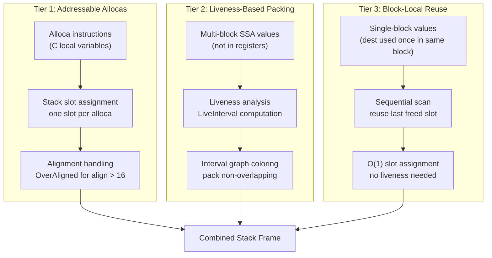
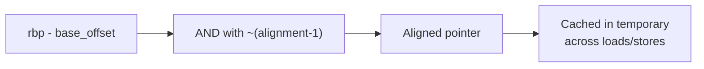
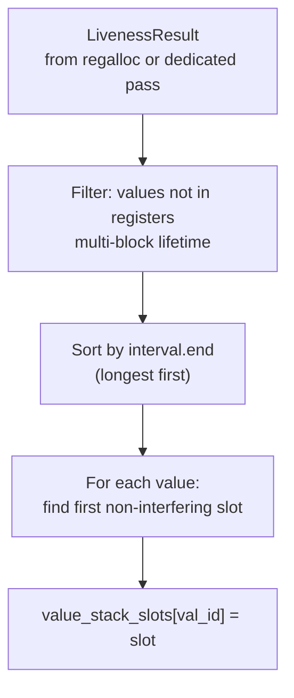
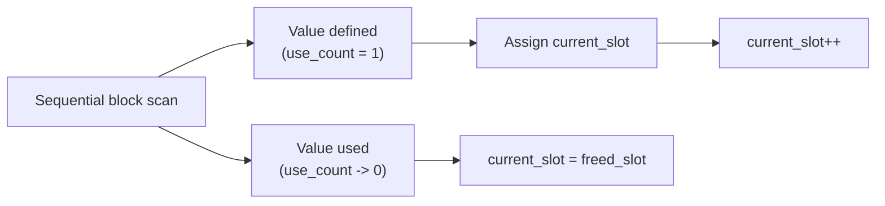
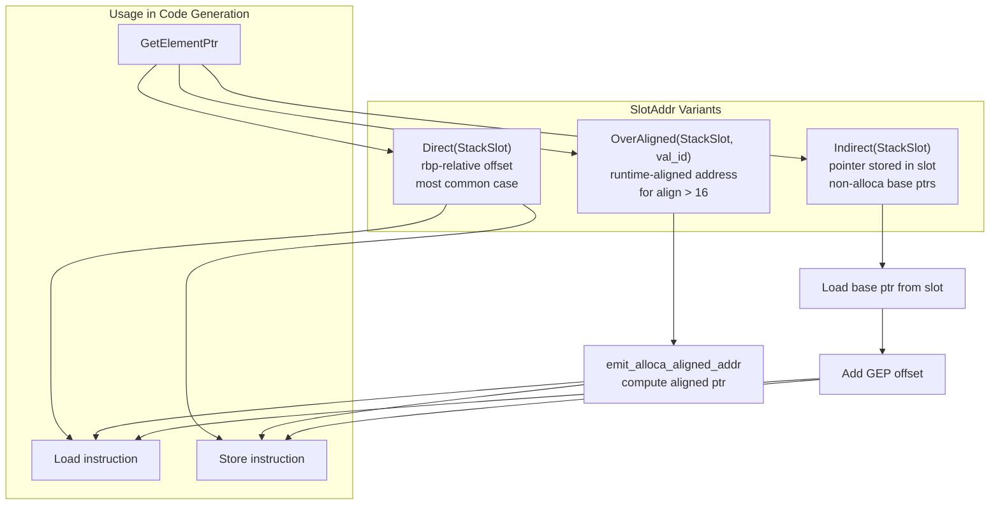
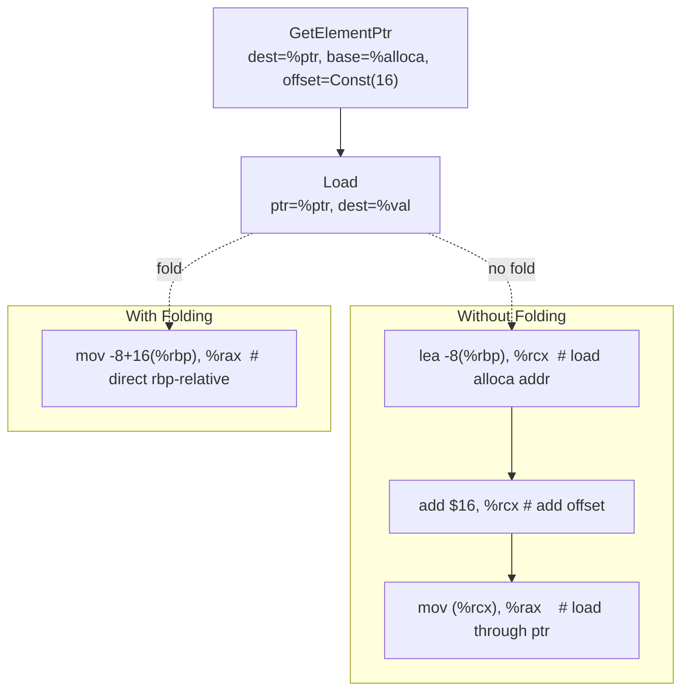
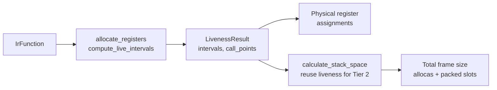

<!-- source: DeepWiki mcp.deepwiki.com · repo anthropics/claudes-c-compiler · page 5.7 Stack Layout · fetched 2026-10-26 -->

# Stack Layout

<details>
<summary>Relevant source files</summary>

The following files were used as context for generating this wiki page:

- [README.md](README.md)
- [src/backend/generation.rs](src/backend/generation.rs)
- [src/backend/liveness.rs](src/backend/liveness.rs)
- [src/backend/regalloc.rs](src/backend/regalloc.rs)
- [src/backend/traits.rs](src/backend/traits.rs)
- [src/passes/README.md](src/passes/README.md)
- [src/passes/cfg_simplify.rs](src/passes/cfg_simplify.rs)
- [src/passes/constant_fold.rs](src/passes/constant_fold.rs)
- [src/passes/copy_prop.rs](src/passes/copy_prop.rs)
- [src/passes/dce.rs](src/passes/dce.rs)
- [src/passes/gvn.rs](src/passes/gvn.rs)
- [src/passes/if_convert.rs](src/passes/if_convert.rs)
- [src/passes/inline.rs](src/passes/inline.rs)
- [src/passes/licm.rs](src/passes/licm.rs)
- [src/passes/mod.rs](src/passes/mod.rs)
- [src/passes/narrow.rs](src/passes/narrow.rs)
- [src/passes/simplify.rs](src/passes/simplify.rs)

</details>


## Purpose and Scope

The stack layout system assigns stack frame locations to all values in an IR function that cannot be kept in registers. This includes explicit allocas (from C local variables), SSA values that spill from register allocation, and temporary values used within basic blocks. The system uses a three-tier strategy to minimize stack frame size by packing non-interfering values into shared stack slots.

For register assignment of values that remain in registers, see [Register Allocation](#5.6). For the overall code generation architecture, see [Code Generation Architecture](#5.1).

## Three-Tier Stack Layout System

The stack layout system operates in three tiers, each targeting different categories of values with progressively more aggressive packing strategies:



**Sources:** [src/backend/traits.rs:113-114](), [README.md:7](), Diagram 5 in high-level architecture

### Tier 1: Addressable Allocas

Allocas represent C local variables whose addresses are taken (via `&x`) or whose values are too large for efficient register allocation (structs, arrays). Each alloca receives a dedicated stack slot that persists for the function's lifetime.

**Standard allocas** (alignment ≤ 16 bytes): Assigned sequential stack offsets during the function prologue. The stack offset is computed as `rbp - slot_offset` on x86 architectures.

**Over-aligned allocas** (alignment > 16 bytes): Cannot use static rbp-relative offsets because the required alignment exceeds the stack pointer's natural 16-byte alignment. Instead, runtime alignment is performed:



**Sources:** [src/backend/traits.rs:193-196](), [src/backend/generation.rs:52-63]()

### Tier 2: Liveness-Based Multi-Block Value Packing

SSA values that are live across multiple basic blocks but not assigned to physical registers are packed into shared stack slots based on liveness intervals. Two values can share a slot if their live ranges do not overlap.

The algorithm:

1. **Compute liveness intervals** using backward dataflow analysis (see [Register Allocation](#5.6) for details on the shared liveness computation)
2. **Build interference graph**: values with overlapping intervals cannot share slots
3. **Greedy coloring**: assign values to slots, reusing the first available non-interfering slot



**Why longest-first sorting**: Values with longer lifetimes are harder to pack, so assigning them first reduces fragmentation. Short-lived values can fill gaps between longer values.

**Sources:** [src/backend/liveness.rs:1-20](), [src/backend/regalloc.rs:1-25](), [src/passes/README.md:205-210]()

### Tier 3: Block-Local Value Reuse

Values that are defined and used only within a single basic block are assigned slots using a lightweight sequential scan. This avoids the overhead of liveness analysis for values that clearly don't interfere.

**Criteria for Tier 3**:
- Destination value has exactly one use
- Use appears in the same basic block as the definition
- Instruction is not a `Phi` (phis need stable slots across predecessors)
- Use is not in a `LabelAddr` (address-taken values need stable addresses)

**Allocation strategy**: Maintain a "last freed slot" index. When a value's single use is encountered, mark its slot as free. The next Tier 3 value reuses this slot.



**Sources:** [src/backend/traits.rs:113-114](), [README.md:7]()

## Stack Slot Addressing Modes

The `SlotAddr` enum represents three ways to address a value's location in the stack frame:



**Direct addressing**: Standard `mov offset(%rbp), %rax` on x86. Used for 95%+ of values.

**OverAligned addressing**: Allocas with `align > 16` (e.g., `__attribute__((aligned(32)))` for AVX). The base offset is AND-masked at runtime: `lea -offset(%rbp), %rcx; and $-32, %rcx`.

**Indirect addressing**: For non-alloca pointer values (e.g., a `GetElementPtr` result), the base pointer is loaded from its stack slot, then the offset is added in a register before the final memory access.

**Sources:** [src/backend/state.rs]() (SlotAddr definition), [src/backend/traits.rs:274-334]()

## GEP Folding Optimization

Constant offsets from `GetElementPtr` instructions are folded into `Load` and `Store` addressing modes to avoid computing the intermediate pointer. This optimization interacts with stack slot addressing:



**Folding interaction with SlotAddr**:
- `Direct(slot)` → `Direct(slot + offset)` (add offset to rbp displacement)
- `OverAligned(slot, id)` → compute aligned addr, then `add offset` to pointer register
- `Indirect(slot)` → load base pointer, then `add offset` before memory access

The fold optimization is performed during instruction generation if the GEP dest has only `Load`/`Store` uses. See [src/backend/generation.rs:42-152]() for the `build_gep_fold_map` logic.

**Sources:** [src/backend/generation.rs:42-152](), [src/backend/traits.rs:274-334]()

## Integration with Register Allocation

Stack layout and register allocation share liveness analysis to avoid redundant computation. The flow:



**Shared liveness**: The `RegAllocResult` caches the `LivenessResult` so that `calculate_stack_space` can reuse it for Tier 2 slot packing. This avoids a redundant O(blocks × values × dataflow_iterations) computation.

**Value classification**:
- **In register**: `reg_assignments[val_id]` exists → no stack slot needed
- **Alloca**: always gets Tier 1 slot (addressable)
- **Multi-block**: not in register, live across blocks → Tier 2 (liveness-based)
- **Single-block**: not in register, one use in same block → Tier 3 (reuse)

**Sources:** [src/backend/regalloc.rs:41-52](), [src/backend/liveness.rs:42-52](), [src/backend/traits.rs:113-114]()

## Architecture-Specific Variations

### x86-64 and i686

**Frame pointer**: `rbp` points to the saved frame pointer at the top of the stack. Local variables are at negative offsets: `rbp - 8`, `rbp - 16`, etc.

**Alignment**: x86-64 requires 16-byte stack alignment at call sites. The prologue aligns `rsp` after subtracting the frame size.

**Calling convention impact**: x86-64 uses more registers (rax, rdi, rsi, rdx, rcx, r8, r9 for parameters), reducing stack pressure. i686 passes most arguments on the stack, increasing stack usage.

### AArch64

**Frame pointer**: `x29` (fp) points to the saved `(fp, lr)` pair at the top of the frame. Locals are at negative offsets like x86.

**Alignment**: AArch64 requires 16-byte stack alignment at all times, not just at calls.

**Load/Store offset limits**: AArch64 `ldr`/`str` instructions support signed 9-bit unscaled offsets or unsigned 12-bit scaled offsets (multiplied by type size). Large offsets require address computation in a scratch register.

### RISC-V

**Frame pointer**: `s0` (fp) points to the saved `(fp, ra)` pair. Locals are at negative offsets.

**Alignment**: RISC-V requires 16-byte stack alignment.

**Immediate limits**: Load/store offsets are signed 12-bit immediates (±2048 bytes). Larger offsets require `lui`/`addi` to load the offset into a register.

**Sources:** [src/backend/x86/codegen/codegen.rs]() (x86 prologue), [src/backend/arm/codegen/codegen.rs]() (ARM prologue), [src/backend/riscv/codegen/codegen.rs]() (RISC-V prologue)

## Stack Frame Layout Example

For a function with 3 allocas, 5 multi-block SSA values (2 register-allocated), and 10 block-local values (8 of which reuse 2 slots):

```
High addresses (top of stack)
+---------------------------+
| Saved frame pointer (rbp) | ← rbp points here (x86)
+---------------------------+
| Return address            |
+---------------------------+
| Tier 1: Alloca 0 (8 bytes)|  rbp - 8
+---------------------------+
| Tier 1: Alloca 1 (4 bytes)|  rbp - 12
| (padding 4 bytes)         |  rbp - 16
+---------------------------+
| Tier 1: Alloca 2 (16 bytes)| rbp - 32
+---------------------------+
| Tier 2: Packed slot 0     |  rbp - 40  (SSA val 5, val 12)
+---------------------------+
| Tier 2: Packed slot 1     |  rbp - 48  (SSA val 8, val 15)
+---------------------------+
| Tier 2: Packed slot 2     |  rbp - 56  (SSA val 9)
+---------------------------+
| Tier 3: Reused slot 0     |  rbp - 64  (8 block-local values)
+---------------------------+
| Tier 3: Reused slot 1     |  rbp - 72  (2 block-local values)
+---------------------------+
| (Alignment padding)       |
+---------------------------+ ← rsp points here
Low addresses (bottom of stack)
```

Total frame size: 72 bytes + alignment padding (rounded up to 16-byte boundary).

Without packing: 3 allocas (28 bytes) + 3 SSA values (24 bytes) + 10 block-local values (80 bytes) = 132 bytes. Packing reduces this by 60 bytes (45%).

**Sources:** [src/backend/traits.rs:113-121](), [README.md:6-7]()

---

