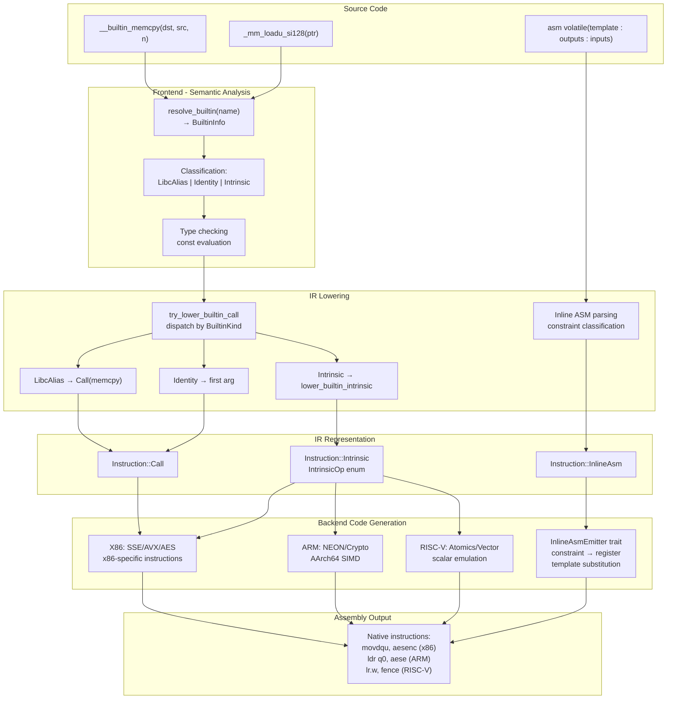
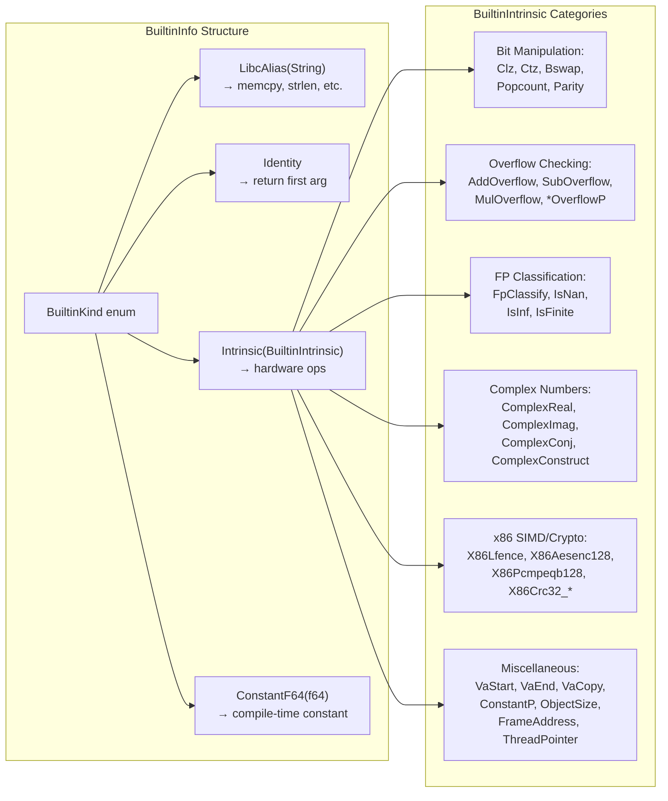
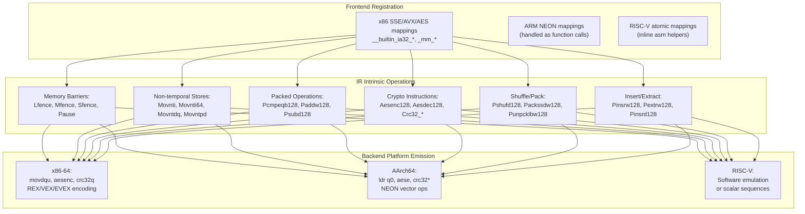
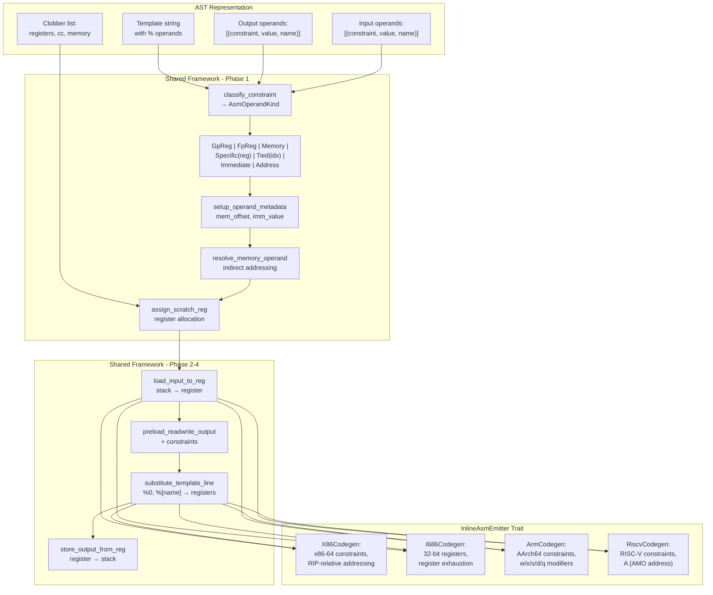
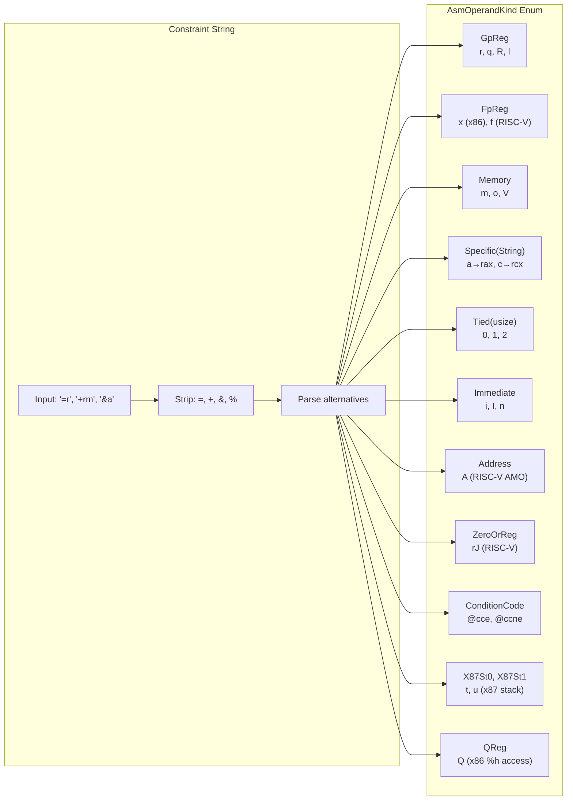
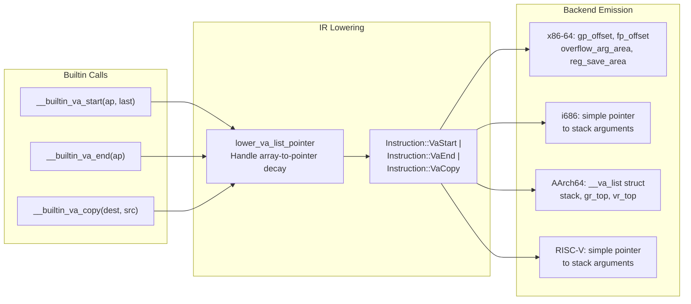

<!-- source: DeepWiki mcp.deepwiki.com · repo anthropics/claudes-c-compiler · page 6 Builtins and Intrinsics · fetched 2026-10-26 -->

# Builtins and Intrinsics

<details>
<summary>Relevant source files</summary>

The following files were used as context for generating this wiki page:

- [projects/cleanup_code_quality.txt](projects/cleanup_code_quality.txt)
- [src/backend/arm/codegen/asm_emitter.rs](src/backend/arm/codegen/asm_emitter.rs)
- [src/backend/arm/codegen/inline_asm.rs](src/backend/arm/codegen/inline_asm.rs)
- [src/backend/arm/codegen/intrinsics.rs](src/backend/arm/codegen/intrinsics.rs)
- [src/backend/i686/codegen/asm_emitter.rs](src/backend/i686/codegen/asm_emitter.rs)
- [src/backend/i686/codegen/inline_asm.rs](src/backend/i686/codegen/inline_asm.rs)
- [src/backend/i686/codegen/intrinsics.rs](src/backend/i686/codegen/intrinsics.rs)
- [src/backend/inline_asm.rs](src/backend/inline_asm.rs)
- [src/backend/riscv/codegen/asm_emitter.rs](src/backend/riscv/codegen/asm_emitter.rs)
- [src/backend/riscv/codegen/inline_asm.rs](src/backend/riscv/codegen/inline_asm.rs)
- [src/backend/riscv/codegen/intrinsics.rs](src/backend/riscv/codegen/intrinsics.rs)
- [src/backend/x86/codegen/asm_emitter.rs](src/backend/x86/codegen/asm_emitter.rs)
- [src/backend/x86/codegen/inline_asm.rs](src/backend/x86/codegen/inline_asm.rs)
- [src/backend/x86/codegen/intrinsics.rs](src/backend/x86/codegen/intrinsics.rs)
- [src/backend/x86_common.rs](src/backend/x86_common.rs)
- [src/frontend/sema/builtins.rs](src/frontend/sema/builtins.rs)
- [src/ir/intrinsics.rs](src/ir/intrinsics.rs)
- [src/ir/lowering/expr_builtins.rs](src/ir/lowering/expr_builtins.rs)
- [src/ir/lowering/func_lowering.rs](src/ir/lowering/func_lowering.rs)
- [src/ir/module.rs](src/ir/module.rs)

</details>


This page documents the compiler's support for GCC-compatible builtin functions, hardware-specific intrinsics, and inline assembly. These features allow C programs to access compiler services (__builtin_* functions), hardware instructions (SSE/NEON/etc), and emit raw assembly code directly.

For detailed coverage of specific builtin functions, see [Builtin Functions](#6.1). For hardware intrinsics implementation details, see [Hardware Intrinsics](#6.2). For inline assembly constraint handling and template substitution, see [Inline Assembly](#6.3).

## Overview

The compiler implements three cross-cutting concerns that span the entire compilation pipeline:

1. **Builtin Functions**: Over 1000 `__builtin_*` functions for GCC compatibility (memory operations, math, overflow checking, type queries, etc.)
2. **Hardware Intrinsics**: Architecture-specific SIMD and crypto instructions (x86 SSE/AVX/AES, ARM NEON, RISC-V atomics)
3. **Inline Assembly**: GCC extended asm syntax with constraint resolution, register allocation, and template substitution

These features are handled at multiple compilation stages: semantic analysis (builtin resolution), IR lowering (dispatch and ABI handling), and backend code generation (native instruction emission).

## System Architecture



**Diagram: Complete Builtins and Intrinsics Pipeline**

The system uses a three-tier classification at the frontend, followed by architecture-specific emission at the backend. Builtin functions are resolved by name in `BUILTIN_MAP`, classified by kind, and dispatched during IR lowering. Hardware intrinsics follow the same path but map to `IntrinsicOp` enums for backend emission. Inline assembly bypasses the builtin system entirely, using a shared framework for constraint resolution and operand substitution.

Sources: [src/frontend/sema/builtins.rs](), [src/ir/lowering/expr_builtins.rs](), [src/backend/inline_asm.rs]()

## Builtin Classification System



**Diagram: Builtin Classification Taxonomy**

The `BuiltinInfo` struct in [src/frontend/sema/builtins.rs:10-47]() defines the classification. `LibcAlias` builtins emit direct function calls (e.g., `__builtin_memcpy` → `Call("memcpy")`). `Identity` builtins are no-ops that return their first argument unchanged (e.g., `__builtin_expect`). `Intrinsic` builtins map to `BuiltinIntrinsic` enums that receive special lowering and backend emission. `ConstantF64` represents compile-time constants like `__builtin_inf()`.

Sources: [src/frontend/sema/builtins.rs:10-47](), [src/ir/lowering/expr_builtins.rs:206-256]()

### Builtin Resolution Flow

| Stage | Component | File | Key Functions |
|-------|-----------|------|---------------|
| Registration | Static builtin map | [src/frontend/sema/builtins.rs:10-400]() | `BUILTIN_MAP: LazyLock<FxHashMap>` |
| Resolution | Name lookup | [src/frontend/sema/builtins.rs:402-408]() | `resolve_builtin(name) -> Option<BuiltinInfo>` |
| Lowering Dispatch | IR generation | [src/ir/lowering/expr_builtins.rs:37-256]() | `try_lower_builtin_call(name, args)` |
| Kind Handling | Type-specific lowering | [src/ir/lowering/expr_builtins.rs:258-467]() | `lower_builtin_intrinsic(intrinsic, name, args)` |
| Backend Emission | Instruction selection | [src/backend/x86/codegen/intrinsics.rs]() | `emit_intrinsic(op, dest, dest_ptr, args)` |

The builtin resolution flow starts with a static hashmap containing 1000+ entries. When the parser encounters a function call, semantic analysis checks `BUILTIN_MAP` before looking up user-defined functions. During IR lowering, `try_lower_builtin_call` dispatches on `BuiltinKind`, emitting `Call` instructions for `LibcAlias`, returning the first argument for `Identity`, or invoking `lower_builtin_intrinsic` for hardware operations.

Sources: [src/frontend/sema/builtins.rs](), [src/ir/lowering/expr_builtins.rs:37-256]()

## Hardware Intrinsics



**Diagram: Intrinsic Operation Flow by Architecture**

Hardware intrinsics use a platform-neutral `IntrinsicOp` enum defined in [src/ir/intrinsics.rs:19-119](). The frontend maps both `__builtin_ia32_*` names (GCC internal names) and `_mm_*` names (Intel header names) to the same intrinsic operations. During IR lowering, these become `Instruction::Intrinsic` nodes. Each backend implements `emit_intrinsic` to generate native instructions: x86-64 emits SSE/AVX instructions directly, AArch64 uses NEON equivalents, and RISC-V either emits atomics or software-emulates SIMD operations using scalar instructions.

Sources: [src/ir/intrinsics.rs:19-119](), [src/backend/x86/codegen/intrinsics.rs](), [src/backend/arm/codegen/intrinsics.rs](), [src/backend/riscv/codegen/intrinsics.rs]()

### x86-64 Intrinsic Coverage

| Category | Example Operations | Native Instructions | Source |
|----------|-------------------|---------------------|--------|
| Memory Fences | `_mm_lfence`, `_mm_mfence` | `lfence`, `mfence`, `sfence` | [src/backend/x86/codegen/intrinsics.rs:24-28]() |
| SSE Load/Store | `_mm_loadu_si128`, `_mm_storeu_si128` | `movdqu` | [src/backend/x86/codegen/intrinsics.rs:101-118]() |
| Packed Compare | `_mm_cmpeq_epi8`, `_mm_cmpeq_epi32` | `pcmpeqb`, `pcmpeqd` | [src/backend/x86/codegen/intrinsics.rs:119-142]() |
| AES-NI | `_mm_aesenc_si128`, `_mm_aesdec_si128` | `aesenc`, `aesdec`, `aesimc` | [src/backend/x86/codegen/intrinsics.rs:246-283]() |
| CLMUL | `_mm_clmulepi64_si128` | `pclmulqdq` | [src/backend/x86/codegen/intrinsics.rs:284-304]() |
| CRC32 | `_mm_crc32_u8`, `_mm_crc32_u64` | `crc32b`, `crc32q` | [src/backend/x86/codegen/intrinsics.rs:305-356]() |
| Shuffle | `_mm_shuffle_epi32`, `_mm_shufflelo_epi16` | `pshufd`, `pshuflw` | [src/backend/x86/codegen/intrinsics.rs:357-392]() |

The x86-64 backend supports 300+ intrinsics covering SSE, SSE2, SSE4.1, AES-NI, and CRC32 extensions. Each intrinsic maps to one or more native x86 instructions with appropriate REX/VEX prefix encoding. For example, `_mm_aesenc_si128` loads two 128-bit operands into `xmm0`/`xmm1`, executes `aesenc %xmm1, %xmm0`, and stores the result.

Sources: [src/backend/x86/codegen/intrinsics.rs:1-500](), [src/frontend/sema/builtins.rs:274-360]()

## Inline Assembly Framework



**Diagram: Inline Assembly Processing Pipeline**

The inline assembly framework in [src/backend/inline_asm.rs:1-1640]() uses a shared four-phase pipeline that all backends invoke via `emit_inline_asm_common`. Phase 1 classifies constraints and assigns registers (specific registers first, then scratch registers from an architecture-specific pool). Phase 2 loads input values into their assigned registers. Phase 3 performs template substitution, replacing `%0`, `%[name]`, and modifiers like `%w0` with actual register names. Phase 4 stores output registers back to their stack slots.

Sources: [src/backend/inline_asm.rs:1-1640](), [src/backend/inline_asm.rs:400-472]()

### Constraint Classification



**Diagram: Constraint Classification Process**

The `classify_constraint` trait method maps GCC constraint strings to `AsmOperandKind` enums. Multi-alternative constraints like `"rm"` (register or memory) are parsed character-by-character with priority ordering: specific register > general register > floating-point register > memory > immediate. The classification determines how the operand is loaded, stored, and substituted in the template.

Sources: [src/backend/inline_asm.rs:19-52](), [src/backend/x86/codegen/asm_emitter.rs:26-116](), [src/backend/arm/codegen/asm_emitter.rs:43-99]()

### Register Allocation Strategy

| Architecture | GP Scratch Pool | FP Scratch Pool | Exhaustion Handling |
|--------------|-----------------|-----------------|---------------------|
| x86-64 | `rcx, rdx, rsi, rdi, r8-r11` (8 regs) | `xmm0-xmm15` (16 regs) | Overflow to `r12-r15`, then wrap |
| i686 | `ecx, edx, esi, edi, eax, ebx` (6 regs) | `xmm0-xmm7` (8 regs) | Return empty string → memory fallback |
| AArch64 | `x9-x15, x19-x21` (10 regs) | `v16-v25` (10 regs) | Mark callee-saved as used |
| RISC-V | `t0-t6, a2-a7, a0-a1` (15 regs) | `ft0-ft7` (8 regs) | Overflow to `s2-s11` with save/restore |

Each architecture implements `assign_scratch_reg` to allocate registers from a predefined pool, skipping those claimed by specific-register constraints or clobbers. x86-64 has the largest pool and can handle 8 GP operands without spillage. i686 has severe register pressure (only 6 GP registers) and returns an empty string when exhausted, triggering memory operand fallback for `"g"` constraints. RISC-V saves/restores borrowed callee-saved registers around the inline asm block.

Sources: [src/backend/x86/codegen/asm_emitter.rs:15-267](), [src/backend/i686/codegen/asm_emitter.rs:153-198](), [src/backend/arm/codegen/asm_emitter.rs:16-193](), [src/backend/riscv/codegen/asm_emitter.rs:16-251]()

### Template Substitution Rules

| Syntax | Meaning | Example | Output (x86-64) | Output (AArch64) |
|--------|---------|---------|-----------------|------------------|
| `%0` | Positional operand | `addl %0, %1` | `addl %rcx, %rdx` | `add x9, x10` |
| `%[name]` | Named operand | `mov %[src], %[dst]` | `movq %rax, %rbx` | `mov x0, x1` |
| `%w0` | 16-bit (x86) / 32-bit (ARM) | `movw %w0, (%rax)` | `movw %cx, (%rax)` | `mov w9, [x0]` |
| `%k0` | 32-bit (x86) | `movl %k0, %eax` | `movl %ecx, %eax` | N/A |
| `%b0` | 8-bit low (x86) | `movb %b0, (%rax)` | `movb %cl, (%rax)` | N/A |
| `%h0` | 8-bit high (x86) | `movb %h0, (%rax)` | `movb %ch, (%rax)` | N/A |
| `%c0` | Raw constant (no prefix) | `shl %c0` | `shl 5` | `lsl 5` |
| `%P0` | Raw symbol name | `call %P0` | `call memcpy` | `bl memcpy` |
| `%n0` | Negated immediate | `sub %n0` | `sub -5` | `sub -5` |
| `%a0` | Address reference | `lea %a0, %rax` | `lea symbol(%rip), %rax` | `adrp x0, symbol` |
| `%l[label]` | Goto label | `jz %l[done]` | `jz .L5` | `b.eq .L5` |

Template substitution is handled by architecture-specific implementations. x86-64 uses shared logic in [src/backend/x86_common.rs]() for parsing, with platform-specific operand emission (x86-64 uses RIP-relative addressing for `%a`, i686 uses direct symbol names). AArch64 has distinct modifier semantics: `%w` means 32-bit W register, `%x` means 64-bit X register, `%s/%d/%q` select FP/SIMD register views.

Sources: [src/backend/x86/codegen/inline_asm.rs:15-168](), [src/backend/arm/codegen/inline_asm.rs:1-279](), [src/backend/inline_asm.rs:322-398]()

## Complex Number Support

Complex types (`_Complex float`, `_Complex double`, `_Complex long double`) receive special builtin and ABI handling:

| Builtin | Purpose | IR Lowering | Platform Differences |
|---------|---------|-------------|---------------------|
| `creal`, `crealf`, `creall` | Extract real part | Load from offset 0 | x86-64 packed: unpack F64 |
| `cimag`, `cimagf`, `cimagl` | Extract imaginary part | Load from offset sizeof(component) | x86-64 packed: unpack F64 >> 32 |
| `conj`, `conjf`, `conjl` | Complex conjugate | Negate imaginary part | ABI decomposition first |
| `__builtin_complex` | Construct complex | Store real+imag consecutively | Recompose packed format |

On x86-64, `_Complex float` is packed into a single `F64` register for parameter passing (real in lower 32 bits, imaginary in upper 32 bits). ARM and RISC-V decompose into two separate FP registers. The builtins in [src/ir/lowering/expr_builtins.rs:601-647]() handle both representations transparently by checking `uses_packed_complex_float()` and applying the appropriate extraction logic.

Sources: [src/ir/lowering/expr_builtins.rs:27-34](), [src/ir/lowering/expr_builtins.rs:601-647](), [src/ir/lowering/func_lowering.rs:165-195]()

## Variadic Arguments

The `va_start`, `va_end`, and `va_copy` builtins provide variadic argument access:



**Diagram: Variadic Argument Handling**

The `va_list` type has architecture-specific ABI representations. x86-64 uses a complex struct with GP/FP register offsets and overflow area pointers. i686, RISC-V, and AArch64 use simpler pointer-based layouts. The IR lowering in [src/ir/lowering/expr_builtins.rs:126-153]() uses `lower_va_list_pointer` to correctly handle both local `va_list` variables (array type, needs address-of) and `va_list` parameters (pointer type after array-to-pointer decay, needs value load).

Sources: [src/ir/lowering/expr_builtins.rs:121-153](), [src/frontend/sema/builtins.rs:246-248]()

## Fortification Builtins

GCC's `_FORTIFY_SOURCE` feature defines wrapper functions that call `__builtin___*_chk` variants:

```c
// From glibc headers with _FORTIFY_SOURCE=2:
#define snprintf(...) __builtin___snprintf_chk(__VA_ARGS__, __builtin_object_size(...))
```

The compiler forwards all arguments to the glibc runtime `__*_chk` functions:

| Builtin | Runtime Function | Arguments Forwarded |
|---------|------------------|---------------------|
| `__builtin___memcpy_chk` | `__memcpy_chk` | `(dst, src, n, dst_size)` |
| `__builtin___snprintf_chk` | `__snprintf_chk` | `(buf, maxlen, flags, buflen, fmt, ...)` |
| `__builtin___sprintf_chk` | `__sprintf_chk` | `(buf, flags, buflen, fmt, ...)` |
| `__builtin___vsnprintf_chk` | `__vsnprintf_chk` | `(buf, maxlen, flags, buflen, fmt, va)` |

The lowering in [src/ir/lowering/expr_builtins.rs:470-541]() avoids infinite recursion by calling the runtime `__*_chk` function instead of the non-`_chk` variant. This is critical because glibc's fortification headers redefine standard functions like `snprintf` as always_inline wrappers that call the builtin, which would loop if the builtin tried to call `snprintf` again.

Sources: [src/ir/lowering/expr_builtins.rs:470-541](), [src/frontend/sema/builtins.rs:116-135]()

---

