<!-- source: DeepWiki mcp.deepwiki.com · repo anthropics/claudes-c-compiler · page 6.1 Builtin Functions · fetched 2026-10-26 -->

# Builtin Functions

<details>
<summary>Relevant source files</summary>

The following files were used as context for generating this wiki page:

- [src/backend/arm/codegen/intrinsics.rs](src/backend/arm/codegen/intrinsics.rs)
- [src/backend/i686/codegen/intrinsics.rs](src/backend/i686/codegen/intrinsics.rs)
- [src/backend/riscv/codegen/intrinsics.rs](src/backend/riscv/codegen/intrinsics.rs)
- [src/backend/x86/codegen/intrinsics.rs](src/backend/x86/codegen/intrinsics.rs)
- [src/frontend/sema/builtins.rs](src/frontend/sema/builtins.rs)
- [src/ir/intrinsics.rs](src/ir/intrinsics.rs)
- [src/ir/lowering/expr_builtins.rs](src/ir/lowering/expr_builtins.rs)
- [src/ir/lowering/func_lowering.rs](src/ir/lowering/func_lowering.rs)
- [src/ir/module.rs](src/ir/module.rs)

</details>


**Purpose and Scope**: This page documents the GCC `__builtin_*` function support system, covering builtin classification, registration, and IR lowering. The system handles over 1000 builtin functions through a three-tier classification scheme. For hardware-specific intrinsics (x86 SSE/AVX/AES, ARM NEON, RISC-V vector), see [Hardware Intrinsics](#6.2). For inline assembly, see [Inline Assembly](#6.3).

## Architecture Overview

The builtin system operates in two phases: semantic analysis (registration) and IR lowering (code generation).

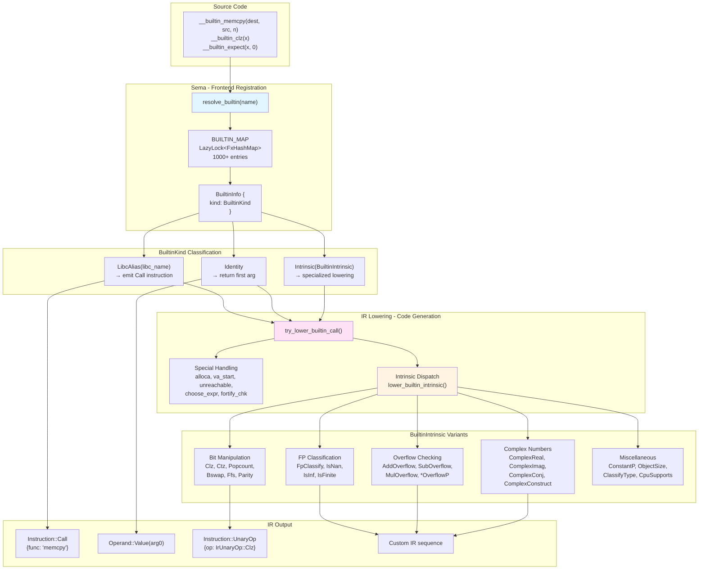

**Sources**: [src/frontend/sema/builtins.rs:1-10](), [src/ir/lowering/expr_builtins.rs:1-24]()

## Three-Tier Classification System

The `BuiltinKind` enum defines three categories for how builtins are lowered to IR:

| Classification | Description | Example | IR Output |
|---------------|-------------|---------|-----------|
| **LibcAlias** | Maps to standard library function | `__builtin_memcpy` → `memcpy` | `Instruction::Call` |
| **Identity** | Returns first argument (compiler hint) | `__builtin_expect(x, 0)` → `x` | `Operand::Value(arg[0])` |
| **Intrinsic** | Emits specialized IR instruction | `__builtin_clz(x)` | `Instruction::UnaryOp{op: Clz}` |

**Sources**: [src/frontend/sema/builtins.rs:1-10](), [src/ir/lowering/expr_builtins.rs:206-256]()

## Builtin Registration (Sema Phase)

The `BUILTIN_MAP` static hashmap registers all known builtins during semantic analysis. The map is lazily initialized on first access and contains over 1000 entries.

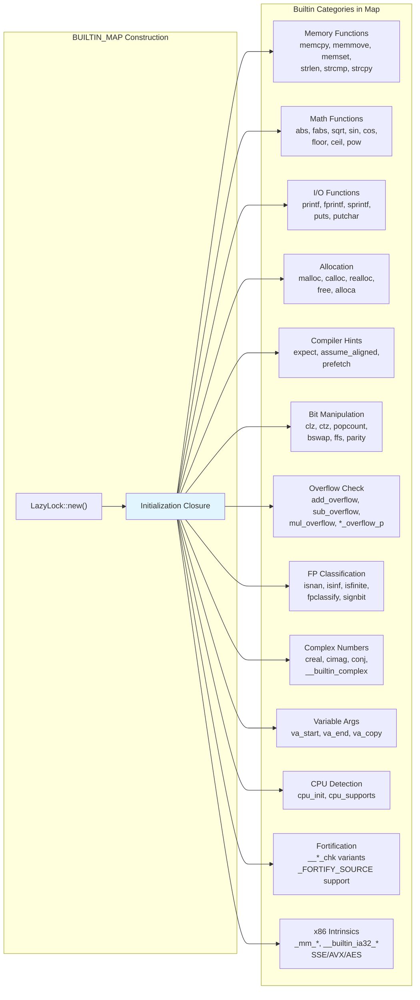

**Sources**: [src/frontend/sema/builtins.rs:10-432]()

### Registration Helper Methods

The `BuiltinInfo` struct provides constructor methods for each classification:

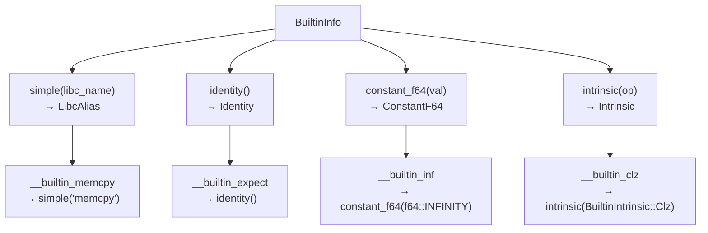

**Sources**: [src/frontend/sema/builtins.rs:18-96]()

## Builtin Categories and Examples

### Memory Functions (LibcAlias)

Memory operation builtins forward to standard library implementations:

| Builtin | Libc Function | Purpose |
|---------|---------------|---------|
| `__builtin_memcpy` | `memcpy` | Copy memory regions |
| `__builtin_memmove` | `memmove` | Copy overlapping regions |
| `__builtin_memset` | `memset` | Fill memory with byte |
| `__builtin_memcmp` | `memcmp` | Compare memory regions |
| `__builtin_strlen` | `strlen` | String length |
| `__builtin_strcmp` | `strcmp` | String comparison |
| `__builtin_strcpy` | `strcpy` | String copy |
| `__builtin_strcat` | `strcat` | String concatenation |

**Sources**: [src/frontend/sema/builtins.rs:21-34]()

### Compiler Hints (Identity)

These builtins are optimization hints that evaluate to their first argument:

| Builtin | Purpose | Lowering |
|---------|---------|----------|
| `__builtin_expect(exp, c)` | Branch prediction hint | Returns `exp`, evaluates `c` for side effects |
| `__builtin_expect_with_probability(exp, c, prob)` | Branch prediction with probability | Returns `exp` |
| `__builtin_assume_aligned(ptr, align)` | Alignment hint | Returns `ptr` unchanged |
| `__builtin_extract_return_addr(addr)` | Return address extraction | Returns `addr` unchanged |

**Sources**: [src/frontend/sema/builtins.rs:106-108](), [src/ir/lowering/expr_builtins.rs:156-170]()

### Bit Manipulation Intrinsics

Bit manipulation builtins emit specialized IR instructions:

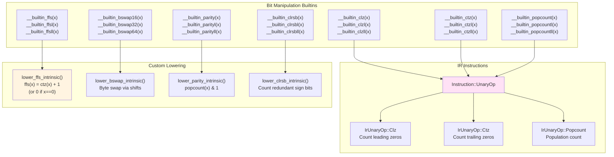

**Sources**: [src/frontend/sema/builtins.rs:161-181](), [src/ir/lowering/expr_builtins.rs:268-274]()

### Overflow-Checking Arithmetic

The compiler provides two families of overflow-checking builtins:

**Generic Type-Deduced Variants**:
```c
bool __builtin_add_overflow(a, b, &result);
bool __builtin_sub_overflow(a, b, &result);
bool __builtin_mul_overflow(a, b, &result);
```

**Type-Specific Variants**:
```c
// Signed
bool __builtin_sadd_overflow(int a, int b, int *result);
bool __builtin_saddl_overflow(long a, long b, long *result);
bool __builtin_saddll_overflow(long long a, long long b, long long *result);

// Unsigned
bool __builtin_uadd_overflow(unsigned a, unsigned b, unsigned *result);
// ... (similar for long, long long)
```

**Predicate Variants (GCC 7+)**:
```c
bool __builtin_add_overflow_p(a, b, (T)0);  // No result storage
bool __builtin_sub_overflow_p(a, b, (T)0);
bool __builtin_mul_overflow_p(a, b, (T)0);
```

**Lowering Strategy**:

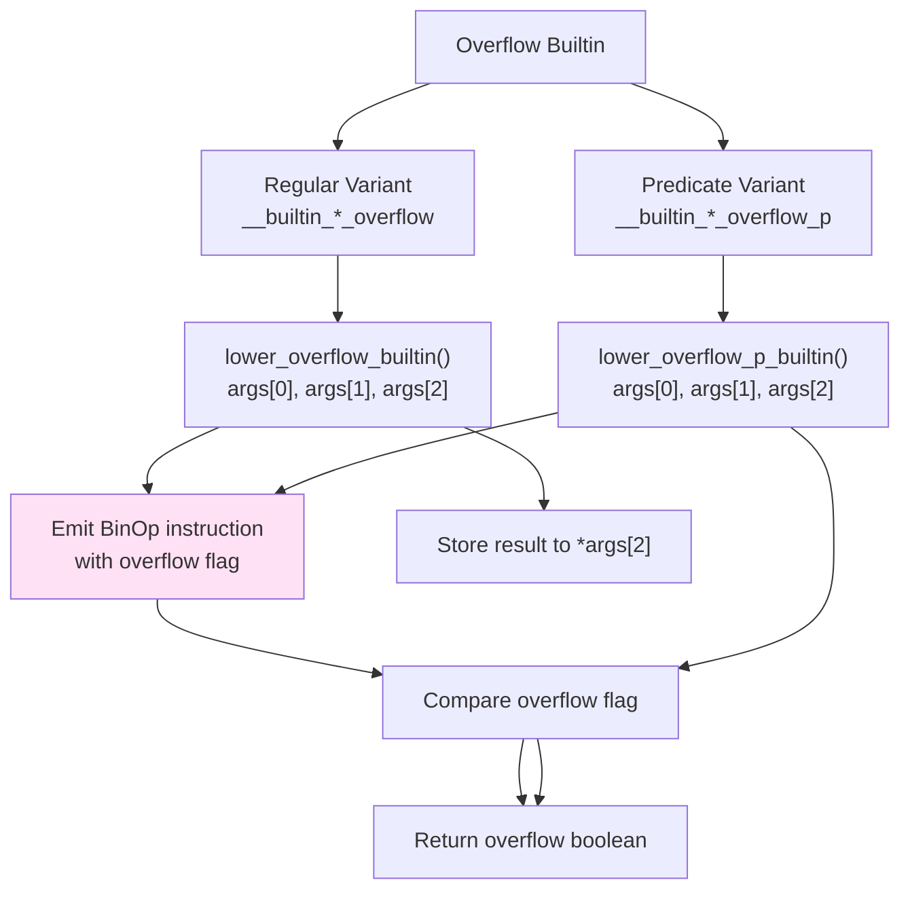

**Sources**: [src/frontend/sema/builtins.rs:183-214](), [src/ir/lowering/expr_builtins.rs:262-267]()

### Floating-Point Classification

FP classification builtins provide IEEE 754 property testing:

| Builtin | Returns | Implementation |
|---------|---------|----------------|
| `__builtin_fpclassify(...)` | FP class constant | `lower_builtin_fpclassify()` |
| `__builtin_isnan(x)` | 1 if NaN | `x != x` (NaN is only value where `x != x`) |
| `__builtin_isinf(x)` | 1 if infinite | Compare exponent bits |
| `__builtin_isfinite(x)` | 1 if finite | `!isinf(x) && !isnan(x)` |
| `__builtin_isnormal(x)` | 1 if normal | Not zero, subnormal, inf, or NaN |
| `__builtin_signbit(x)` | Sign bit | Extract high bit |
| `__builtin_isinf_sign(x)` | -1/0/1 | Sign of infinity |

**FP Comparison Builtins**:

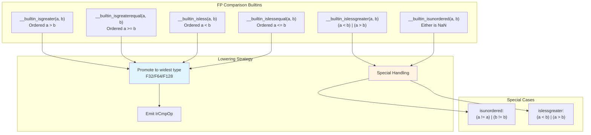

**Sources**: [src/frontend/sema/builtins.rs:142-158](), [src/ir/lowering/expr_builtins.rs:545-599]()

### Complex Number Builtins

C99 `_Complex` type support includes extraction and construction builtins:

**Extraction Builtins**:
```c
double creal(double _Complex z);    // Extract real part
double cimag(double _Complex z);    // Extract imaginary part
float crealf(float _Complex z);
long double creall(long double _Complex z);
// Also: __builtin_creal, __builtin_crealf, etc.
```

**Conjugation**:
```c
double _Complex conj(double _Complex z);  // Negate imaginary part
float _Complex conjf(float _Complex z);
// Also: __builtin_conj, __builtin_conjf, etc.
```

**Construction**:
```c
double _Complex __builtin_complex(double real, double imag);
```

**Lowering Strategy**:

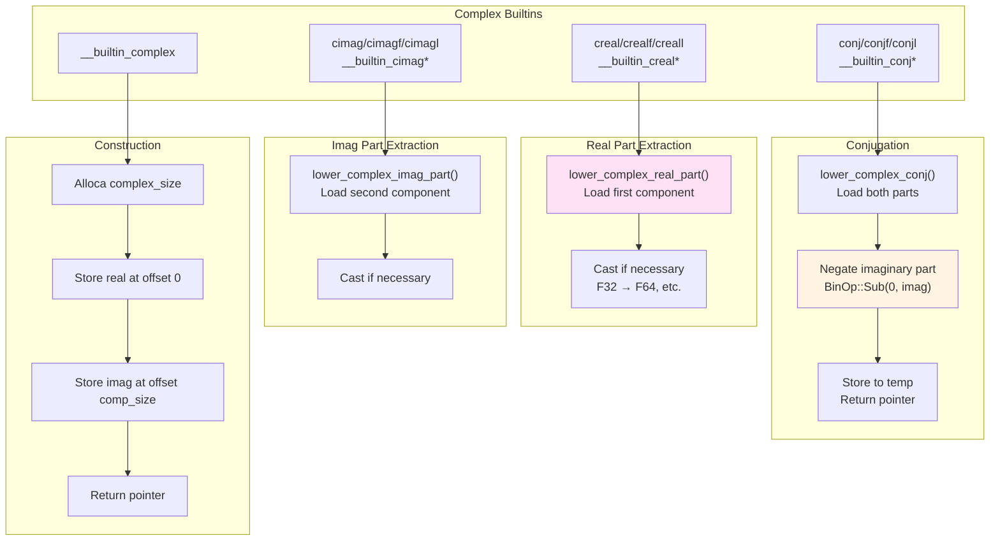

**Sources**: [src/frontend/sema/builtins.rs:219-240](), [src/ir/lowering/expr_builtins.rs:601-691]()

### Variable Argument Builtins

The `va_list` mechanism is implemented through three builtins:

```c
void __builtin_va_start(va_list ap, last_param);
void __builtin_va_end(va_list ap);
void __builtin_va_copy(va_list dest, va_list src);
```

**Lowering Strategy**:

These builtins require special handling for `va_list` pointer extraction. The `lower_va_list_pointer()` method correctly handles both local `va_list` variables (array type, needs address-of) and `va_list` parameters (pointer type after array-to-pointer decay).

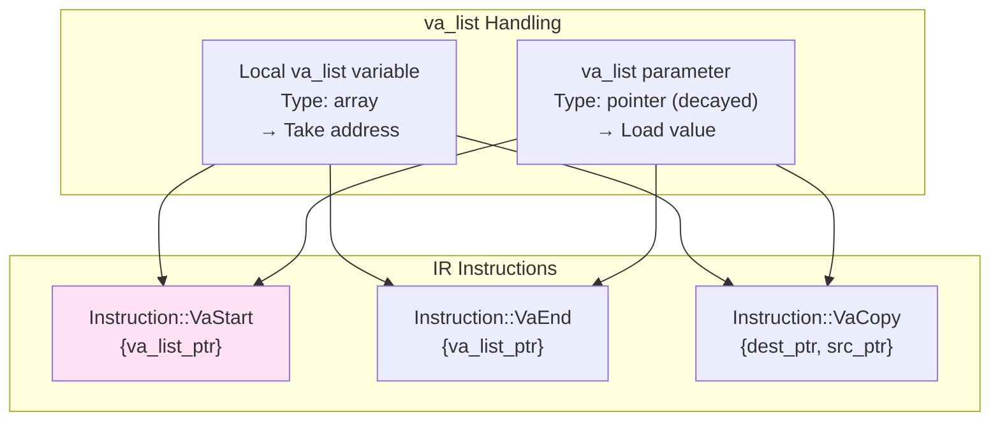

**Sources**: [src/frontend/sema/builtins.rs:246-248](), [src/ir/lowering/expr_builtins.rs:121-154]()

### Stack Allocation Builtins

Dynamic stack allocation through `alloca`:

```c
void *__builtin_alloca(size_t size);
void *__builtin_alloca_with_align(size_t size, size_t align_in_bits);
```

**Lowering**:
- Emits `Instruction::DynAlloca` with runtime size
- Default alignment: 16 bytes
- `alloca_with_align`: alignment in **bits**, converted to bytes (`bits / 8`)
- Unlike other builtins, cannot be overridden by user definitions

**Sources**: [src/frontend/sema/builtins.rs:96-97](), [src/ir/lowering/expr_builtins.rs:98-120]()

### Special Builtins

#### `__builtin_choose_expr`

Compile-time conditional selection (GCC extension):

```c
__builtin_choose_expr(const_expr, expr1, expr2)
// If const_expr is nonzero, returns expr1; else expr2
```

**Implementation**: Constant expression evaluated at lowering time; only the selected branch is lowered (other branch has no side effects).

**Sources**: [src/ir/lowering/expr_builtins.rs:68-96]()

#### `__builtin_unreachable` and `__builtin_trap`

Mark unreachable code or intentional crashes:

```c
void __builtin_unreachable(void);  // Undefined behavior if reached
void __builtin_trap(void);         // Intentional trap/crash
```

**Implementation**: Both emit `Terminator::Unreachable`, which backends translate to:
- x86: `ud2` (undefined instruction)
- ARM: `brk #0` (breakpoint)
- RISC-V: `ebreak` (environment break)

**Critical**: These **must not** call `abort()` because `abort()` may not exist in kernel/freestanding environments.

**Sources**: [src/frontend/sema/builtins.rs:13-17](), [src/ir/lowering/expr_builtins.rs:180-199]()

#### `__builtin_constant_p`

Compile-time constant detection:

```c
int __builtin_constant_p(expr);
// Returns 1 if expr is compile-time constant, 0 otherwise
```

**Implementation Strategy**:

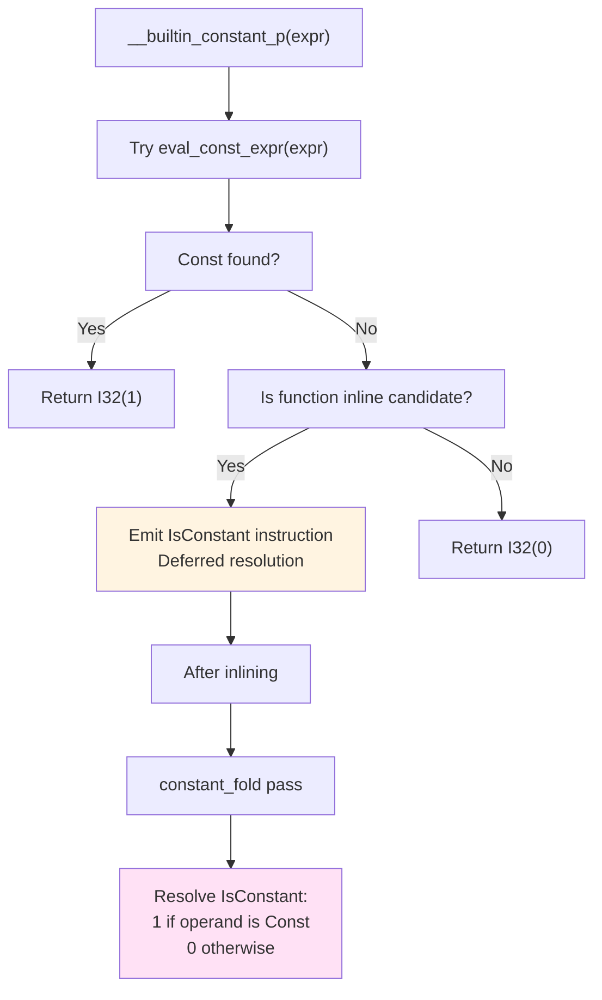

**Key Behavior**:
- Argument is **not evaluated** (no side effects) per GCC semantics
- In non-inline functions: always resolves to 0 for non-constant expressions
- In inline candidates: emits `Instruction::UnaryOp{op: IsConstant}` for deferred resolution
- After inlining, if the operand becomes constant, `constant_fold` resolves `IsConstant` to 1

**Sources**: [src/frontend/sema/builtins.rs:111](), [src/ir/lowering/expr_builtins.rs:634-665]()

#### `__builtin_object_size`

Object size query (for buffer overflow detection):

```c
size_t __builtin_object_size(void *ptr, int type);
// type 0/1: maximum estimate → -1 if unknown
// type 2/3: minimum estimate → 0 if unknown
```

**Implementation**: Conservatively returns "unknown" (no points-to analysis):
- Types 0/1: return `-1` (all bits set)
- Types 2/3: return `0`

**Sources**: [src/frontend/sema/builtins.rs:112-113](), [src/ir/lowering/expr_builtins.rs:303-325]()

#### `__builtin_classify_type`

GCC type classification (for generic macros):

```c
int __builtin_classify_type(expr);
// Returns: 0=void, 1=int, 2=char, 3=short, 4=long, 5=pointer, etc.
```

**Implementation**: Uses `classify_ctype()` helper to map `CType` to GCC type class integer.

**Sources**: [src/frontend/sema/builtins.rs:114](), [src/ir/lowering/expr_builtins.rs:326-347]()

### CPU Detection Builtins

Runtime CPU feature detection:

```c
void __builtin_cpu_init(void);
int __builtin_cpu_supports(const char *feature);
```

**Implementation**:
- `cpu_init`: No-op (glibc auto-initializes CPU detection)
- `cpu_supports`: Conservatively returns 0 (feature not supported)

**Rationale**: Returning 0 ensures code always takes the safe non-optimized fallback path, avoiding runtime feature detection complexity.

**Sources**: [src/frontend/sema/builtins.rs:253-260](), [src/ir/lowering/expr_builtins.rs:356-367]()

### Fortification Builtins (_FORTIFY_SOURCE)

glibc's `_FORTIFY_SOURCE` macro defines fortified versions of memory/string functions:

```c
// User code with _FORTIFY_SOURCE:
sprintf(buf, fmt, args...)
// Expands to always_inline wrapper calling:
__builtin___sprintf_chk(buf, flag, objsize, fmt, args...)
```

**Supported _chk Variants**:
- Memory: `__builtin___memcpy_chk`, `__builtin___memmove_chk`, `__builtin___memset_chk`
- String: `__builtin___strcpy_chk`, `__builtin___strncpy_chk`, `__builtin___strcat_chk`
- Printf family: `__builtin___sprintf_chk`, `__builtin___snprintf_chk`, `__builtin___printf_chk`
- vprintf family: `__builtin___vsprintf_chk`, `__builtin___vsnprintf_chk`

**Lowering Strategy**:

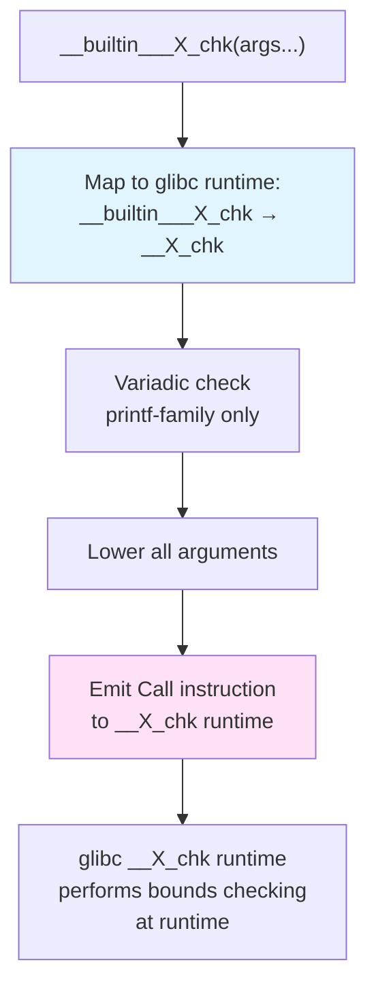

**Rationale**: Forward all arguments to glibc's runtime `__X_chk` functions rather than emitting inline bounds checks. This avoids infinite recursion when glibc's always_inline wrappers call the builtin.

**Sources**: [src/frontend/sema/builtins.rs:116-137](), [src/ir/lowering/expr_builtins.rs:410-541]()

### Frame and Return Address Builtins

Stack introspection for debugging/profiling:

```c
void *__builtin_frame_address(unsigned int level);
void *__builtin_return_address(unsigned int level);
```

**Supported Levels**:
- Level 0: Current frame/return address (fully supported)
- Level > 0: Outer frames (returns NULL; requires frame pointer chain walking)

**IR Lowering**:

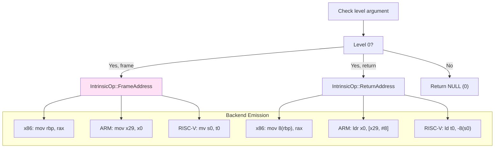

**Sources**: [src/frontend/sema/builtins.rs:100-102](), [src/ir/lowering/expr_builtins.rs:436-466]()

### Thread Pointer Builtin

TLS base address access:

```c
void *__builtin_thread_pointer(void);
```

**Backend Implementation**:
- **x86-64**: Read `%fs:0` segment register
- **i686**: Read `%gs:0` segment register  
- **AArch64**: Read `tpidr_el0` system register (`mrs x0, tpidr_el0`)
- **RISC-V**: Read `tp` register (`mv t0, tp`)

**Sources**: [src/frontend/sema/builtins.rs:103](), [src/ir/lowering/expr_builtins.rs:424-434]()

## IR Lowering Process

The `try_lower_builtin_call()` method orchestrates builtin lowering with a multi-stage dispatch:

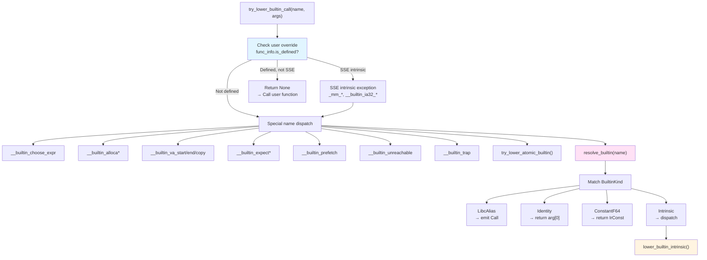

**Sources**: [src/ir/lowering/expr_builtins.rs:36-256]()

### Intrinsic Dispatch

The `lower_builtin_intrinsic()` method dispatches based on `BuiltinIntrinsic` variant:

| Intrinsic Category | Variants | Lowering Method |
|-------------------|----------|-----------------|
| FP Comparison | `FpCompare` | `lower_fp_compare()` |
| Overflow Checking | `AddOverflow`, `SubOverflow`, `MulOverflow` | `lower_overflow_builtin()` |
| Overflow Predicate | `AddOverflowP`, `SubOverflowP`, `MulOverflowP` | `lower_overflow_p_builtin()` |
| Bit Manipulation | `Clz`, `Ctz`, `Popcount` | `lower_unary_intrinsic()` |
| Bit Manipulation | `Ffs`, `Clrsb`, `Bswap`, `Parity` | Custom lowering |
| FP Classification | `FpClassify`, `IsNan`, `IsInf`, `IsFinite`, `IsNormal`, `SignBit`, `IsInfSign` | `lower_builtin_*()` |
| Complex | `ComplexReal`, `ComplexImag`, `ComplexConj`, `ComplexConstruct` | `lower_complex_*()` |
| Special | `ConstantP`, `ObjectSize`, `ClassifyType` | Inline in `lower_builtin_intrinsic()` |
| Fortification | `FortifyChk` | `lower_fortify_chk()` |
| No-ops | `Nop`, `CpuInit`, `CpuSupports`, `VaArgPack` | Return 0 |
| x86 SIMD | `X86*` (70+ variants) | `lower_x86_intrinsic()` |

**Sources**: [src/ir/lowering/expr_builtins.rs:258-468]()

## User Override Mechanism

Users can define their own function bodies to override builtin behavior (GCC compatibility):

```c
// User override:
void *__builtin_alloca(size_t size) {
    return malloc(size);  // Custom implementation
}
```

**Override Rules**:
1. Checks `func_info.is_defined` (function body exists, not just declaration)
2. **Exception**: SSE/SIMD intrinsics (`_mm_*`, `_mm256_*`, `__builtin_ia32_*`) **always** use builtin implementation
3. If user-defined, returns `None` → normal function call to user's definition
4. If not user-defined, proceeds to builtin lowering

**SSE Exception Rationale**:

The compiler's `emmintrin.h` headers define SSE intrinsics as `static inline` wrappers whose bodies call stub builtins (e.g., `__builtin_ia32_vec_init_*` which are `BuiltinIntrinsic::Nop`). If user overrides were honored, these wrappers would call the stubs returning 0, and macros like `__CCC_M128I_FROM_BUILTIN` would dereference NULL. The builtin intercept must take priority.

**Sources**: [src/ir/lowering/expr_builtins.rs:38-66]()

## x86 SSE/SIMD Intrinsics

x86 SSE intrinsics are registered as builtins and lowered to `IntrinsicOp` enums. These are documented separately in [Hardware Intrinsics](#6.2), but the registration happens in this builtin system:

**Intrinsic Families**:
- **SSE/SSE2**: `_mm_load*`, `_mm_store*`, `_mm_set*`, `_mm_add_*`, `_mm_cmpeq_*`, etc.
- **AES-NI**: `_mm_aesenc_si128`, `_mm_aesdec_si128`, `_mm_aeskeygenassist_si128`
- **CLMUL**: `_mm_clmulepi64_si128`
- **CRC32**: `_mm_crc32_u8`, `_mm_crc32_u16`, `_mm_crc32_u32`, `_mm_crc32_u64`

**Registration Example**:
```rust
// Direct _mm_* mappings bypass wrapper functions
m.insert("_mm_loadu_si128", BuiltinInfo::intrinsic(BuiltinIntrinsic::X86Loaddqu));
m.insert("_mm_cmpeq_epi8", BuiltinInfo::intrinsic(BuiltinIntrinsic::X86Pcmpeqb128));
```

**Sources**: [src/frontend/sema/builtins.rs:273-404]()

## Complete Builtin Lowering Flow

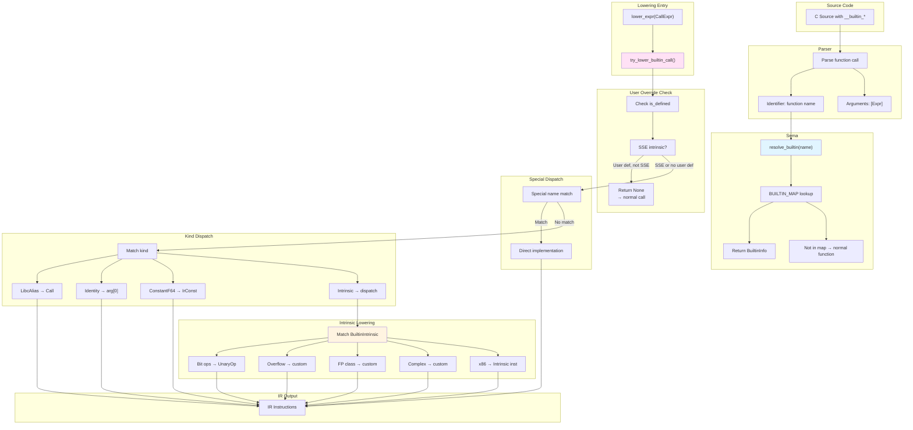

**Sources**: [src/ir/lowering/expr_builtins.rs:36-734](), [src/frontend/sema/builtins.rs:1-434]()

---

