<!-- source: DeepWiki mcp.deepwiki.com · repo anthropics/claudes-c-compiler · page 6.2 Hardware Intrinsics · fetched 2026-10-26 -->

# Hardware Intrinsics

Relevant source files

The following files were used as context for generating this wiki page:

- [src/backend/arm/codegen/intrinsics.rs](src/backend/arm/codegen/intrinsics.rs)
- [src/backend/i686/codegen/intrinsics.rs](src/backend/i686/codegen/intrinsics.rs)
- [src/backend/riscv/codegen/intrinsics.rs](src/backend/riscv/codegen/intrinsics.rs)
- [src/backend/x86/codegen/intrinsics.rs](src/backend/x86/codegen/intrinsics.rs)
- [src/frontend/sema/builtins.rs](src/frontend/sema/builtins.rs)
- [src/ir/intrinsics.rs](src/ir/intrinsics.rs)
- [src/ir/lowering/expr_builtins.rs](src/ir/lowering/expr_builtins.rs)
- [src/ir/lowering/func_lowering.rs](src/ir/lowering/func_lowering.rs)
- [src/ir/module.rs](src/ir/module.rs)

## Purpose and Scope

This document covers hardware-specific intrinsic functions: x86 SSE/AVX/AES, ARM NEON, and RISC-V operations. These intrinsics provide direct access to SIMD instructions, crypto operations, and hardware-specific features. For general compiler builtins like `__builtin_memcpy` or `__builtin_clz`, see [Builtin Functions](#6.1). For inline assembly support, see [Inline Assembly](#6.3).

Hardware intrinsics follow a three-stage pipeline: frontend classification in the builtin map, IR lowering to target-independent `IntrinsicOp` instructions, and backend emission of native assembly instructions specific to each architecture.

**Sources:** [src/ir/lowering/expr_builtins.rs:1-10](), [src/frontend/sema/builtins.rs:1-5](), [src/ir/intrinsics.rs:1-18]()

## Three-Stage Intrinsic Pipeline

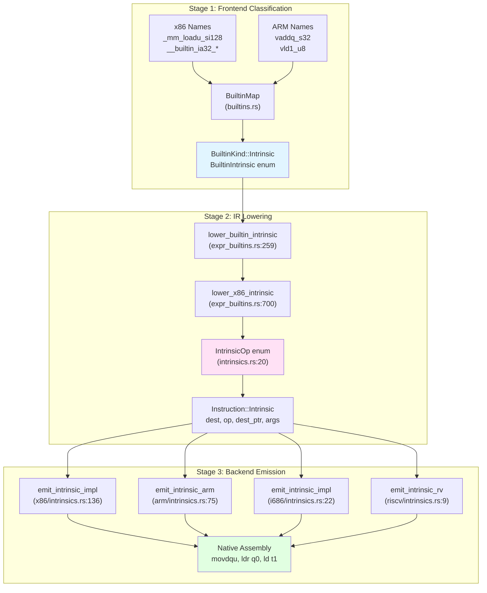

**Diagram: Hardware Intrinsic Processing Pipeline**

The pipeline ensures architecture-neutral IR while supporting platform-specific optimizations. Stage 1 maps function names to intrinsic classifications. Stage 2 converts builtin calls to `Instruction::Intrinsic` with a target-independent `IntrinsicOp` enum value. Stage 3 emits native instructions based on the target architecture.

**Sources:** [src/frontend/sema/builtins.rs:9-11](), [src/ir/lowering/expr_builtins.rs:258-468](), [src/ir/intrinsics.rs:19-189]()

## Intrinsic Classification System

The frontend builtin map in `builtins.rs` registers intrinsic names with `BuiltinKind::Intrinsic` and a specific `BuiltinIntrinsic` variant:

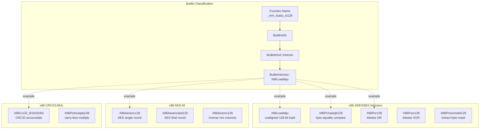

**Diagram: Builtin Intrinsic Classification**

**Sources:** [src/frontend/sema/builtins.rs:274-404](), [src/frontend/sema/builtins.rs:11-489]()

### x86 Intrinsic Name Mappings

The builtin map supports both `__builtin_ia32_*` GCC names and `_mm_*` Intel header names:

| GCC Name | Intel Name | BuiltinIntrinsic | Purpose |
|----------|------------|------------------|---------|
| `__builtin_ia32_loaddqu` | `_mm_loadu_si128` | `X86Loaddqu` | Load 128-bit unaligned |
| `__builtin_ia32_storedqu` | `_mm_storeu_si128` | `X86Storedqu` | Store 128-bit unaligned |
| `__builtin_ia32_pcmpeqb128` | `_mm_cmpeq_epi8` | `X86Pcmpeqb128` | Compare equal bytes |
| `__builtin_ia32_por128` | `_mm_or_si128` | `X86Por128` | Bitwise OR |
| `__builtin_ia32_aesenc128` | `_mm_aesenc_si128` | `X86Aesenc128` | AES encrypt round |
| `__builtin_ia32_crc32qi` | `_mm_crc32_u8` | `X86Crc32_8` | CRC32 8-bit |

**Sources:** [src/frontend/sema/builtins.rs:274-362]()

## IR Representation: IntrinsicOp Enum

The `IntrinsicOp` enum provides target-independent representation of hardware operations:

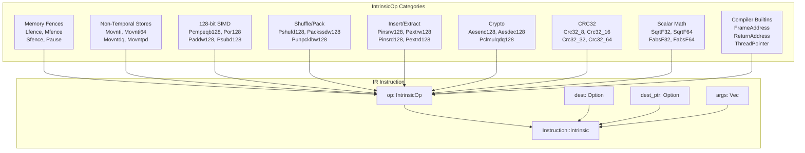

**Diagram: IntrinsicOp Organization**

**Sources:** [src/ir/intrinsics.rs:19-189]()

### Intrinsic Instruction Patterns

Intrinsics use four emission patterns based on operand and result types:

| Pattern | `dest` | `dest_ptr` | `args` | Example |
|---------|--------|------------|--------|---------|
| **Fence** | None | None | `[]` | `Lfence`, `Mfence`, `Sfence` |
| **PtrStore** | None | Some(ptr) | `[value]` | `Movnti`, `Movntdq` |
| **Vec128** | Some(v) | Some(ptr) | `[src1, src2]` | `Pcmpeqb128`, `Por128` |
| **Scalar** | Some(v) | None | `[src]` | `Pmovmskb128`, `Crc32_8` |

**Sources:** [src/ir/lowering/expr_builtins.rs:693-733]()

## x86/x86-64 SSE Intrinsics

### SSE/SSE2 Packed Operations

The x86-64 backend emits native SSE instructions for 128-bit SIMD operations:

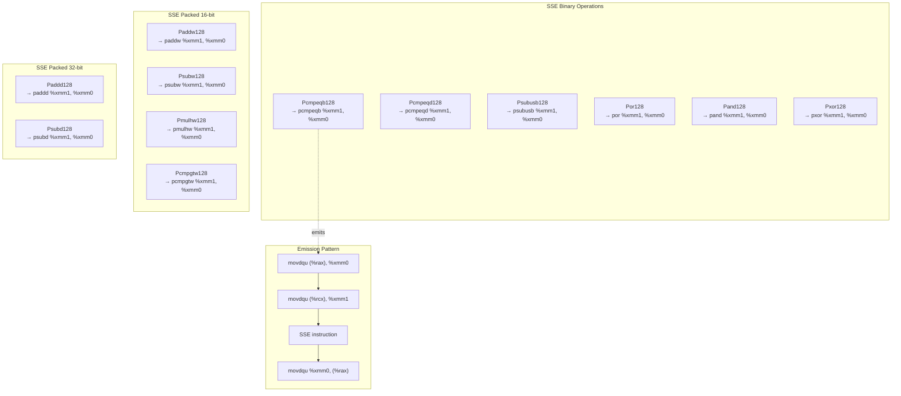

**Diagram: x86-64 SSE Binary Operation Emission**

**Sources:** [src/backend/x86/codegen/intrinsics.rs:104-112](), [src/backend/x86/codegen/intrinsics.rs:167-396]()

### SSE Shift and Shuffle Operations

Shift and shuffle operations use immediate operands:

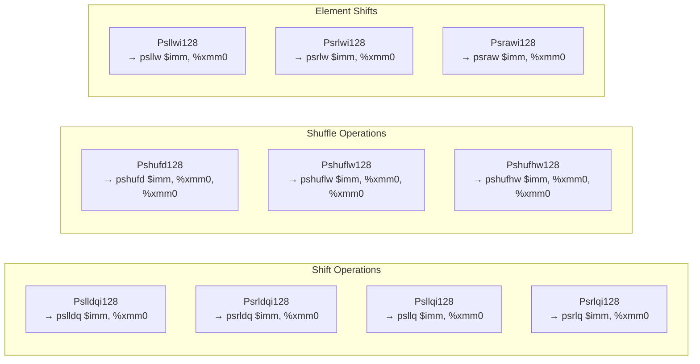

**Diagram: SSE Immediate-Operand Instructions**

**Sources:** [src/backend/x86/codegen/intrinsics.rs:116-134](), [src/backend/x86/codegen/intrinsics.rs:340-413]()

### SSE4.1 Insert/Extract Operations

SSE4.1 provides byte/word/dword/qword element access:

| Operation | Instruction | Operands | Result |
|-----------|-------------|----------|--------|
| `Pinsrb128` | `pinsrb $imm, %ecx, %xmm0` | vec, value, lane | 128-bit |
| `Pextrb128` | `pextrb $imm, %xmm0, %eax` | vec, lane | i32 |
| `Pinsrw128` | `pinsrw $imm, %ecx, %xmm0` | vec, value, lane | 128-bit |
| `Pextrw128` | `pextrw $imm, %xmm0, %eax` | vec, lane | i32 |
| `Pinsrd128` | `pinsrd $imm, %ecx, %xmm0` | vec, value, lane | 128-bit |
| `Pextrd128` | `pextrd $imm, %xmm0, %eax` | vec, lane | i32 |
| `Pinsrq128` | `pinsrq $imm, %rcx, %xmm0` | vec, value, lane | 128-bit |
| `Pextrq128` | `pextrq $imm, %xmm0, %rax` | vec, lane | i64 |

**Sources:** [src/backend/x86/codegen/intrinsics.rs:416-467]()

### AES-NI Encryption/Decryption

AES-NI intrinsics provide hardware-accelerated AES operations:

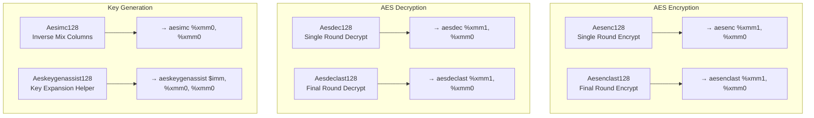

**Diagram: AES-NI Instruction Mapping**

**Sources:** [src/backend/x86/codegen/intrinsics.rs:290-325]()

### CRC32 Instructions

CRC32 intrinsics accumulate CRC32C (Castagnoli polynomial) checksums:

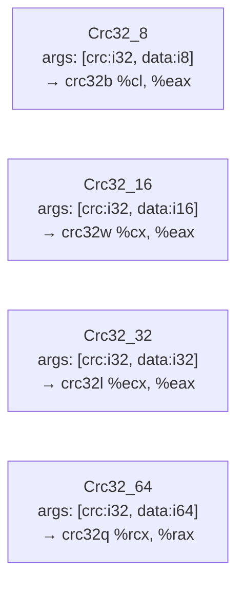

**Diagram: CRC32 Instruction Variants**

**Sources:** [src/backend/x86/codegen/intrinsics.rs:213-228]()

## ARM NEON Intrinsics

### NEON Binary Operations

ARM NEON uses fixed 32-bit instructions with vector register operands:

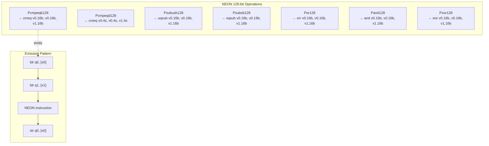

**Diagram: ARM NEON Binary Operation Emission**

**Sources:** [src/backend/arm/codegen/intrinsics.rs:10-36](), [src/backend/arm/codegen/intrinsics.rs:124-170]()

### NEON Pmovmskb Emulation

ARM has no direct `pmovmskb` equivalent, so CCC implements it using NEON bit manipulation:

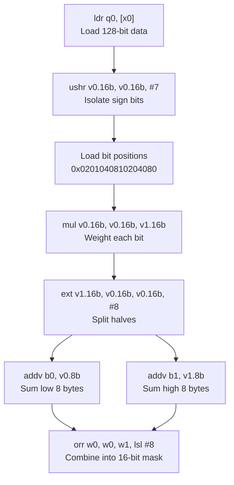

**Diagram: ARM NEON Pmovmskb Emulation**

**Sources:** [src/backend/arm/codegen/intrinsics.rs:171-196]()

### ARM CRC32 Instructions

AArch64 provides native CRC32C instructions:

| IntrinsicOp | ARM Instruction | Description |
|-------------|-----------------|-------------|
| `Crc32_8` | `crc32cb w9, w9, w0` | CRC32C 8-bit |
| `Crc32_16` | `crc32ch w9, w9, w0` | CRC32C 16-bit |
| `Crc32_32` | `crc32cw w9, w9, w0` | CRC32C 32-bit |
| `Crc32_64` | `crc32cx w9, w9, x0` | CRC32C 64-bit |

**Sources:** [src/backend/arm/codegen/intrinsics.rs:213-229]()

## RISC-V Intrinsics: Software Emulation

RISC-V lacks SIMD extensions in the base ISA, so CCC emulates SSE operations using scalar instructions:

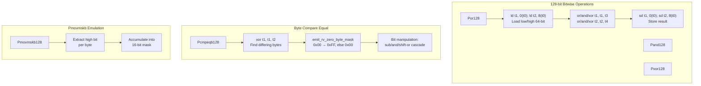

**Diagram: RISC-V Software SIMD Emulation**

**Sources:** [src/backend/riscv/codegen/intrinsics.rs:102-374]()

### RISC-V CRC32 Software Implementation

RISC-V implements CRC32C using bit-by-bit computation with the 0x82F63B78 polynomial:

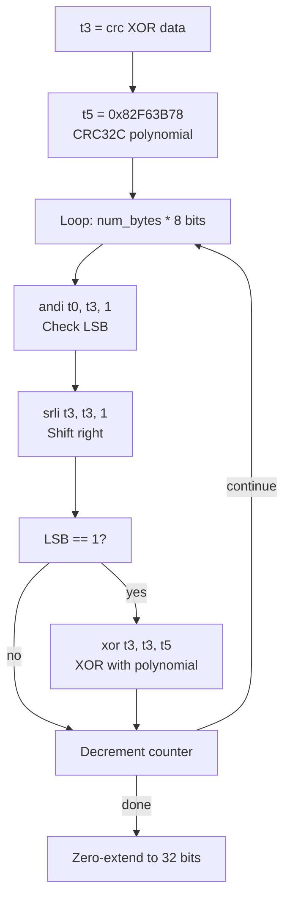

**Diagram: RISC-V Software CRC32 Algorithm**

**Sources:** [src/backend/riscv/codegen/intrinsics.rs:151-196]()

## Cross-Architecture Fallback Strategy

x86-specific intrinsics (AES-NI, CLMUL) on non-x86 architectures produce zeros to avoid runtime crashes:

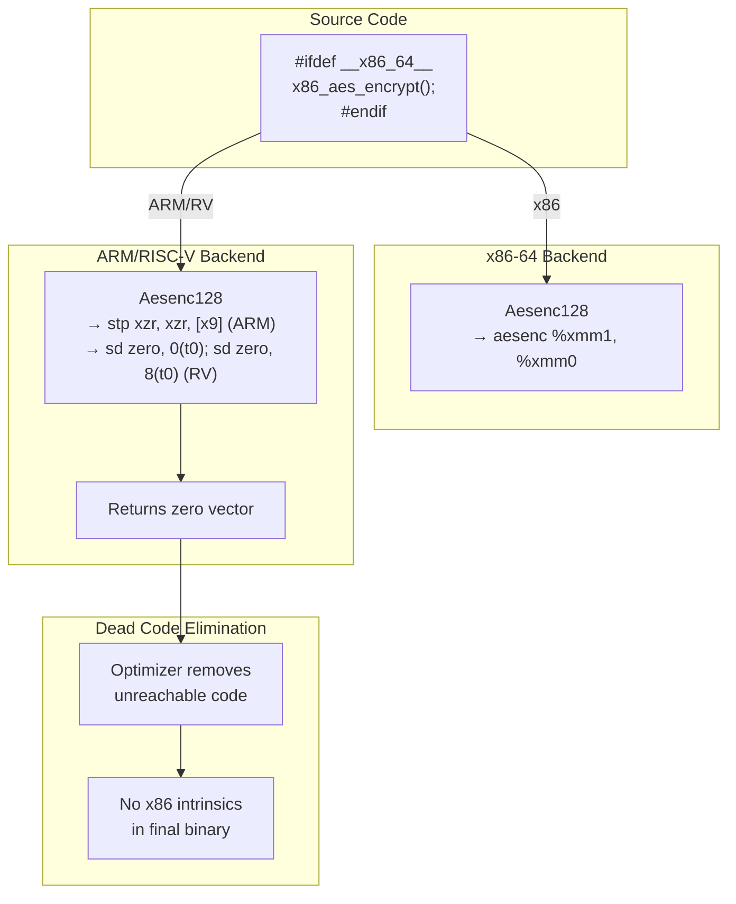

**Diagram: Cross-Architecture Intrinsic Fallback**

This strategy allows source code with architecture-guarded intrinsics to compile on all targets. Dead code elimination removes the zeroing operations when the intrinsic calls are inside `#ifdef` blocks.

**Sources:** [src/backend/arm/codegen/intrinsics.rs:248-285](), [src/backend/riscv/codegen/intrinsics.rs:256-292]()

## Scalar Math Intrinsics

All architectures support floating-point math intrinsics via native hardware:

| Intrinsic | x86-64 | i686 | AArch64 | RISC-V |
|-----------|--------|------|---------|--------|
| `SqrtF64` | `sqrtsd %xmm0, %xmm0` | `fld; fsqrt; fstp` | `fsqrt.d ft0, ft0` | `fsqrt.d ft0, ft0` |
| `SqrtF32` | `sqrtss %xmm0, %xmm0` | `fld; fsqrt; fstp` | `fsqrt.s ft0, ft0` | `fsqrt.s ft0, ft0` |
| `FabsF64` | `andpd mask, %xmm0` | `fld; fabs; fstp` | `fabs.d ft0, ft0` | `fabs.d ft0, ft0` |
| `FabsF32` | `andps mask, %xmm0` | `fld; fabs; fstp` | `fabs.s ft0, ft0` | `fabs.s ft0, ft0` |

**Sources:** [src/backend/x86/codegen/intrinsics.rs:250-289](), [src/backend/i686/codegen/intrinsics.rs:140-156](), [src/backend/arm/codegen/intrinsics.rs:244-254](), [src/backend/riscv/codegen/intrinsics.rs:219-254]()

## Compiler Builtin Intrinsics

Frame and return address intrinsics provide stack introspection:

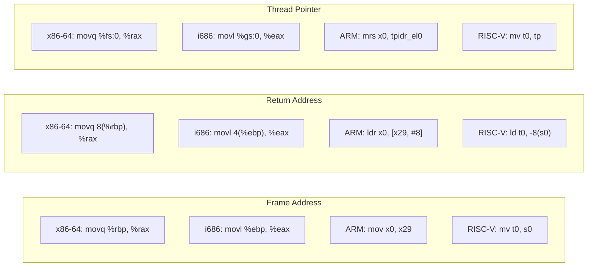

**Diagram: Compiler Builtin Intrinsic Implementation**

**Sources:** [src/backend/x86/codegen/intrinsics.rs:229-249](), [src/backend/i686/codegen/intrinsics.rs:113-138](), [src/backend/arm/codegen/intrinsics.rs:230-243](), [src/backend/riscv/codegen/intrinsics.rs:197-218]()

## Memory Fence Intrinsics

Memory ordering intrinsics map to architecture-specific barrier instructions:

| IntrinsicOp | x86-64/i686 | AArch64 | RISC-V | Purpose |
|-------------|-------------|---------|--------|---------|
| `Lfence` | `lfence` | `dmb ish` | `fence iorw, iorw` | Load fence |
| `Mfence` | `mfence` | `dmb ish` | `fence iorw, iorw` | Full memory fence |
| `Sfence` | `sfence` | `dmb ishst` | `fence ow, ow` | Store fence |
| `Pause` | `pause` | `yield` | `fence.tso` | Spin-wait hint |
| `Clflush` | `clflush (%rax)` | `dc civac, x0` | `fence iorw, iorw` | Cache line flush |

**Sources:** [src/backend/x86/codegen/intrinsics.rs:138-146](), [src/backend/i686/codegen/intrinsics.rs:24-32](), [src/backend/arm/codegen/intrinsics.rs:77-90](), [src/backend/riscv/codegen/intrinsics.rs:11-24]()

---

