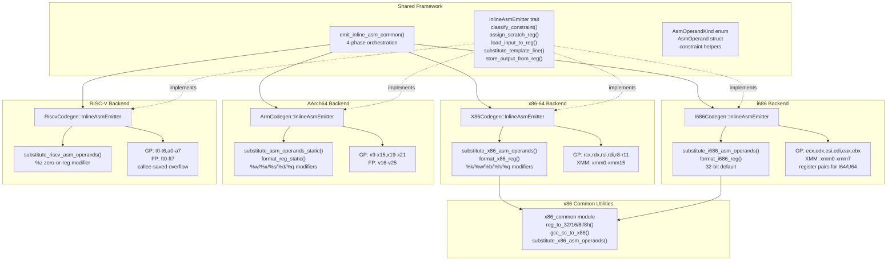
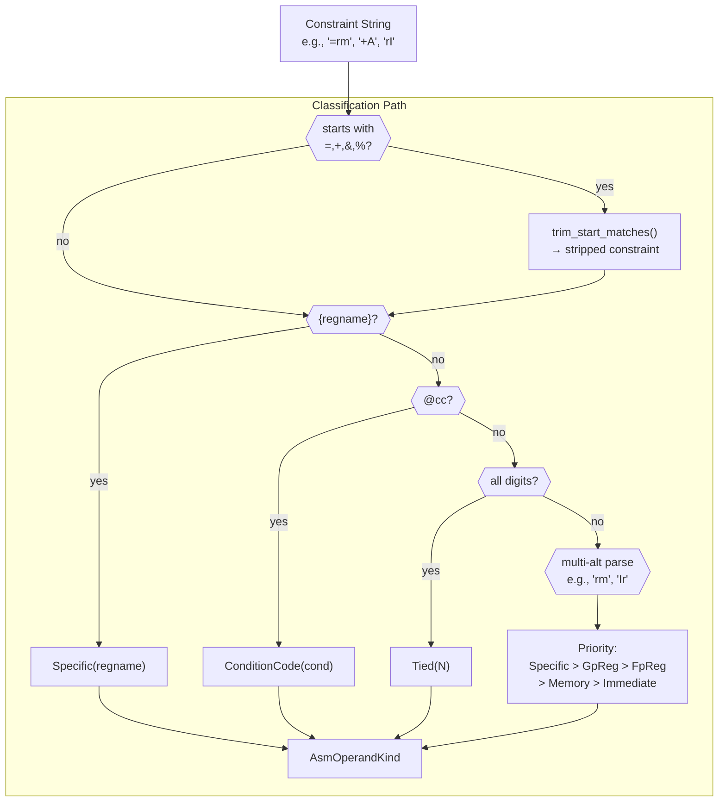

<!-- source: DeepWiki mcp.deepwiki.com · repo anthropics/claudes-c-compiler · page 6.3 Inline Assembly · fetched 2026-10-26 -->

# Inline Assembly

<details>
<summary>Relevant source files</summary>

The following files were used as context for generating this wiki page:

- [projects/cleanup_code_quality.txt](projects/cleanup_code_quality.txt)
- [src/backend/arm/codegen/asm_emitter.rs](src/backend/arm/codegen/asm_emitter.rs)
- [src/backend/arm/codegen/inline_asm.rs](src/backend/arm/codegen/inline_asm.rs)
- [src/backend/i686/codegen/asm_emitter.rs](src/backend/i686/codegen/asm_emitter.rs)
- [src/backend/i686/codegen/inline_asm.rs](src/backend/i686/codegen/inline_asm.rs)
- [src/backend/inline_asm.rs](src/backend/inline_asm.rs)
- [src/backend/riscv/codegen/asm_emitter.rs](src/backend/riscv/codegen/asm_emitter.rs)
- [src/backend/riscv/codegen/inline_asm.rs](src/backend/riscv/codegen/inline_asm.rs)
- [src/backend/x86/codegen/asm_emitter.rs](src/backend/x86/codegen/asm_emitter.rs)
- [src/backend/x86/codegen/inline_asm.rs](src/backend/x86/codegen/inline_asm.rs)
- [src/backend/x86_common.rs](src/backend/x86_common.rs)

</details>


GCC extended inline assembly (`asm` / `__asm__`) support in CCC enables embedding architecture-specific assembly instructions within C code, with automatic operand substitution, constraint-based register allocation, and multi-architecture portability. This page documents the inline assembly processing framework, constraint classification, and the four-phase execution pipeline used across all four target architectures.

For information about hardware intrinsics (`_mm_*`, NEON, etc.), see [Hardware Intrinsics](#6.2). For builtin functions (`__builtin_*`), see [Builtin Functions](#6.1).

## Overview

The inline assembly system implements GCC-compatible extended assembly syntax:

```c
asm volatile ("add %1, %0" : "+r"(x) : "r"(y) : "cc");
```

This syntax includes:
- **Template**: Assembly instruction string with `%N` operand references
- **Outputs**: `=` write-only or `+` read-write operands with constraints
- **Inputs**: Read-only operands with constraints
- **Clobbers**: Registers/flags modified by the assembly

The compiler translates this into architecture-specific assembly by classifying constraints, allocating registers, loading operand values, substituting template references, and storing results back to memory.

**Sources**: [src/backend/inline_asm.rs:1-83]()

## Architecture



**The Four-Phase Processing Pipeline**

```mermaid
graph LR
    subgraph "Phase 1: Classification & Allocation"
        P1A["classify_constraint()<br/>→ AsmOperandKind"]
        P1B["setup_operand_metadata()<br/>mem_addr, imm_value"]
        P1C["assign_scratch_reg()<br/>specific → scratch pool"]
        P1D["resolve_tied_and_types()<br/>copy metadata"]
        
        P1A --> P1B
        P1B --> P1C
        P1C --> P1D
    end
    
    subgraph "Phase 2: Load Inputs"
        P2A["load_input_to_reg()<br/>Const → li/movl"]
        P2B["preload_readwrite_output()<br/>'+'  constraints"]
        
        P2A --> P2B
    end
    
    subgraph "Phase 3: Template Substitution"
        P3A["expand_dialect_alternatives()<br/>{att|intel} → att"]
        P3B["substitute_template_line()<br/>%0,%1,%[name] → regs"]
        P3C["emit assembly lines"]
        
        P3A --> P3B
        P3B --> P3C
    end
    
    subgraph "Phase 4: Store Outputs"
        P4A["store_output_from_reg()<br/>reg → stack slot"]
        P4B["handle indirect stores<br/>non-alloca pointers"]
        
        P4A --> P4B
    end
    
    P1D --> P2A
    P2B --> P3A
    P3C --> P4A
```



**Sources**: [src/backend/inline_asm.rs:1-12](), [src/backend/inline_asm.rs:400-472]()

## Constraint Classification

Inline assembly constraints specify how operands are passed to the assembly template. The `InlineAsmEmitter::classify_constraint()` method maps constraint strings to `AsmOperandKind` enum variants.

### Constraint Types

| Constraint | AsmOperandKind | Description | Architectures |
|------------|----------------|-------------|---------------|
| `r` | `GpReg` | General-purpose register | All |
| `f` | `FpReg` | Floating-point register | RISC-V |
| `x`, `v`, `Y` | `FpReg` | XMM/SSE register | x86-64, i686 |
| `w` | `FpReg` | NEON/FP register | AArch64 |
| `m` | `Memory` | Memory operand | All |
| `Q` | `Memory` | Single base register memory | AArch64 (atomic ops) |
| `A` | `Address` | Address for AMO/LR/SC | RISC-V |
| `i`, `n`, `I` | `Immediate` | Immediate constant | All |
| `a`, `b`, `c`, `d` | `Specific(reg)` | Specific register | x86-64, i686 |
| `{regname}` | `Specific(reg)` | Explicit register variable | All |
| `0`, `1`, `2`... | `Tied(N)` | Tied to output N | All |
| `[name]` | Named tie | Tied to output named `[name]` | All |
| `=@cc<cond>` | `ConditionCode(cond)` | Condition code output | x86-64, i686 (AArch64/RISC-V partial) |
| `t` | `X87St0` | x87 FPU st(0) | x86-64, i686 |
| `u` | `X87St1` | x87 FPU st(1) | x86-64, i686 |
| `Q` | `QReg` | High-byte accessible register | x86-64 (for `%h` modifier) |
| `J`, `rJ` | `ZeroOrReg` | Zero register or GP reg | RISC-V |



**Sources**: [src/backend/inline_asm.rs:19-52](), [src/backend/x86/codegen/asm_emitter.rs:26-116](), [src/backend/arm/codegen/asm_emitter.rs:43-99](), [src/backend/riscv/codegen/asm_emitter.rs:63-90]()

### Multi-Alternative Constraints

GCC allows combining multiple constraint alternatives in a single string (e.g., `"rm"` = register or memory, `"Ir"` = immediate or register). The classifier prioritizes according to performance (registers preferred over memory) and defers immediate promotion to the operand setup phase.

**x86-64 Example** [src/backend/x86/codegen/asm_emitter.rs:59-95]():
```c
// Constraint "Ir" with constant value 5
char c = 'r';  // becomes GpReg
int x = 5;     // promoted to Immediate in setup phase
```

The promotion happens in `classify_all_operands()` when a `GpReg` operand has a constant value and the constraint contains an immediate alternative:

```c
if matches!(op.kind, AsmOperandKind::GpReg) {
    if let Operand::Const(c) = val {
        if constraint_has_immediate_alt(constraint) 
            && emitter.constant_fits_immediate(constraint, c.to_i64()) {
            op.imm_value = Some(c.to_i64());
            op.kind = AsmOperandKind::Immediate;
        }
    }
}
```

**Sources**: [src/backend/inline_asm.rs:528-542]()

## Phase 1: Classification and Register Allocation

### Operand Metadata Setup

`setup_operand_metadata()` populates architecture-specific metadata for each operand:

**Memory Operands**:
- **Alloca** (stack-local variables): `mem_addr` = `"offset(%rbp)"` (x86) or `mem_offset` = stack offset (ARM/RISC-V)
- **Non-alloca** (pointers): `mem_addr` left empty, resolved later via `resolve_memory_operand()`
- **Over-aligned allocas**: Require runtime address computation [src/backend/x86/codegen/asm_emitter.rs:118-149]()

**Immediate Operands**:
- Extract constant value into `imm_value`
- Populate `imm_symbol` for global/function addresses [src/backend/inline_asm.rs:579-614]()

**Sources**: [src/backend/inline_asm.rs:476-576](), [src/backend/x86/codegen/asm_emitter.rs:118-149](), [src/backend/arm/codegen/asm_emitter.rs:101-117](), [src/backend/riscv/codegen/asm_emitter.rs:92-127]()

### Scratch Register Allocation

`assign_scratch_reg()` assigns registers from architecture-specific scratch pools:

| Architecture | GP Scratch Pool | FP Scratch Pool | Special Handling |
|--------------|-----------------|-----------------|------------------|
| x86-64 | `rcx,rdx,rsi,rdi,r8-r11` | `xmm0-xmm15` | Wraps on exhaustion |
| i686 | `ecx,edx,esi,edi,eax,ebx` | `xmm0-xmm7` | Empty string on exhaustion (triggers memory fallback) |
| AArch64 | `x9-x15,x19-x21` | `v16-v25` | Callee-saved registers tracked |
| RISC-V | `t0-t6,a2-a7,a0-a1` | `ft0-ft7` | Overflows to callee-saved `s2-s11` with save/restore |

**Exclusion Lists**: Specific-register constraints (`"a"` → `rax`) and clobber registers are excluded from scratch allocation to prevent conflicts [src/backend/inline_asm.rs:629-690]().

**i686 Register Pairs**: 64-bit values on i686 require two 32-bit GP registers. The allocator fills both `op.reg` (low 32 bits) and `op.reg_hi` (high 32 bits) [src/backend/i686/codegen/asm_emitter.rs:272-294]().

**Sources**: [src/backend/inline_asm.rs:692-783](), [src/backend/x86/codegen/asm_emitter.rs:209-267](), [src/backend/i686/codegen/asm_emitter.rs:154-198](), [src/backend/arm/codegen/asm_emitter.rs:149-193](), [src/backend/riscv/codegen/asm_emitter.rs:181-251]()

### Early-Clobber and Read-Write Constraints

**Early-clobber** (`&`): Output is written before all inputs are read. Input operands must NOT share the register.

**Read-write** (`+`): Output register is pre-loaded with the current value. Synthetic input operand created automatically.

Both constraints extend the exclusion list for input scratch allocation [src/backend/inline_asm.rs:733-763]():

```rust
let mut input_excluded: Vec<String> = specific_regs.to_vec();
for i in 0..outputs.len() {
    if (outputs[i].0.contains('&') || outputs[i].0.contains('+')) 
        && !operands[i].reg.is_empty() {
        input_excluded.push(operands[i].reg.clone());
    }
}
```

**Sources**: [src/backend/inline_asm.rs:733-783]()

## Phase 2: Load Inputs

`load_input_to_reg()` and `preload_readwrite_output()` move operand values into their assigned registers.

### Input Loading by Type

**Constant Operands**:
- **GP registers**: `li` / `movl` / `mov` immediate instructions
- **FP registers**: Extract IEEE 754 bit pattern, move via GP scratch, then `fmov` / `fmv.d.x`
- **x87 FPU**: Materialize via stack scratch space with `flds` / `fldl` [src/backend/x86/codegen/asm_emitter.rs:273-314]()

**Value Operands**:
- **Alloca values**: Represent the address. Use `leaq` / `leal` to compute address, not load contents [src/backend/x86/codegen/asm_emitter.rs:388-404]()
- **Non-alloca values**: Load from stack slot with type-appropriate instruction (`movl`, `ldr`, `ld`)
- **Register-allocated values**: Copy directly from callee-saved register (critical for CSR manipulation on RISC-V) [src/backend/riscv/codegen/asm_emitter.rs:298-313]()

**RISC-V CSR Example** [src/backend/riscv/codegen/asm_emitter.rs:298-313]():
```c
register unsigned long satp asm("s1");  // allocated to s1
asm volatile ("csrw satp, %0" :: "r"(satp));
// Load directly from s1 (no stack access after CSR write which changes page tables)
```

**Sources**: [src/backend/x86/codegen/asm_emitter.rs:269-420](), [src/backend/i686/codegen/asm_emitter.rs:200-331](), [src/backend/arm/codegen/asm_emitter.rs:195-266](), [src/backend/riscv/codegen/asm_emitter.rs:253-336]()

### Address and Memory Operands

**Address Constraints** (`A` on RISC-V):
- AMO/LR/SC instructions require the address in a register
- Format as `(reg)` in template substitution [src/backend/riscv/codegen/inline_asm.rs:75-80]()

**Memory Constraints** (`m`, `Q`):
- **Alloca**: Direct stack-relative format `offset(s0)` or `[sp, #offset]`
- **Non-alloca**: Load pointer into scratch register, format as `(scratch)` or `[scratch]`
- **Over-aligned**: Compute runtime-aligned address with `leaq`+`addq`+`andq` [src/backend/x86/codegen/asm_emitter.rs:151-207]()

**Sources**: [src/backend/inline_asm.rs:146-180](), [src/backend/x86/codegen/asm_emitter.rs:151-207](), [src/backend/riscv/codegen/asm_emitter.rs:129-179]()

## Phase 3: Template Substitution

### GCC Dialect Alternatives

GCC inline assembly supports `{att|intel}` syntax for dual-dialect templates. CCC always emits AT&T syntax, so `expand_dialect_alternatives()` selects the first alternative [src/backend/inline_asm.rs:322-398]():

```c
// Input:  "pushf{l|d}"
// Output: "pushfl"

// Input:  "mov{l}\t{%0, %1|%1, %0}"
// Output: "movl\t%0, %1"
```

ARM NEON instructions use literal braces `{v0.4s}` which are preserved when no `|` pipe is found.

**Sources**: [src/backend/inline_asm.rs:322-398]()

### Operand Reference Syntax

| Syntax | Type | Example | Result |
|--------|------|---------|--------|
| `%N` | Positional | `%0`, `%1` | First output, second output |
| `%[name]` | Named | `%[result]` | Named output/input |
| `%mN` | Modifier + positional | `%k0` (x86 32-bit) | `%eax` instead of `%rax` |
| `%m[name]` | Modifier + named | `%w[val]` (ARM 32-bit) | `w9` instead of `x9` |
| `%l[label]` | Goto label | `%l[retry]` | `.L123` (block label) |
| `%%` | Literal | `%%rax` | `%rax` (no substitution) |

**Sources**: [src/backend/inline_asm.rs:454-460](), [src/backend/x86_common.rs:164-329]()

### Architecture-Specific Modifiers

**x86-64/i686** [src/backend/x86/codegen/inline_asm.rs:93-122]():
- `%k` / `%l`: 32-bit register (`eax`)
- `%w`: 16-bit register (`ax`)
- `%b`: 8-bit low register (`al`)
- `%h`: 8-bit high register (`ah`)
- `%q`: 64-bit register (`rax`, x86-64 only)
- `%c` / `%P`: Raw constant (no `$` prefix)
- `%a`: Address reference (x86-64: `symbol(%rip)`, i686: `symbol`)
- `%n`: Negated immediate

**AArch64** [src/backend/arm/codegen/inline_asm.rs:142-267]():
- `%w`: 32-bit GP register (`w9`)
- `%x`: 64-bit GP register (`x9`)
- `%s`: 32-bit FP register (`s16`)
- `%d`: 64-bit FP register (`d16`)
- `%q`: 128-bit SIMD register (`q16`)
- `%h`: 16-bit FP register (`h16`)
- `%b`: 8-bit register (`b16`)
- `%a`: Memory address `[reg]`
- `%c`: Raw constant (no `#` prefix)
- No modifier: FP/SIMD → `vN` form for vector ops

**RISC-V** [src/backend/riscv/codegen/inline_asm.rs:100-265]():
- `%z`: Zero-or-register (emits `zero` if operand is constant 0, else register name)
- `%lo` / `%hi`: Pass-through assembler directives for relocation
- No size modifiers (all GP registers are 64-bit on RV64)

**Sources**: [src/backend/x86/codegen/inline_asm.rs:15-168](), [src/backend/i686/codegen/inline_asm.rs:1-114](), [src/backend/arm/codegen/inline_asm.rs:14-267](), [src/backend/riscv/codegen/inline_asm.rs:100-265]()

### GCC Operand Numbering

GCC numbers outputs first, then real inputs, skipping synthetic `+` inputs created by the framework. The `gcc_to_internal` mapping translates GCC operand numbers to internal indices [src/backend/inline_asm.rs:441-445]():

```c
// asm (template : "+r"(a) : "r"(b), "r"(c));
// GCC numbering: 0=output a, 1=input b, 2=input c
// Internal: 0=output a, 1=synthetic input a, 2=input b, 3=input c
// gcc_to_internal = [0, 2, 3]
```

**Sources**: [src/backend/inline_asm.rs:441-445](), [src/backend/x86_common.rs:294-315]()

## Phase 4: Store Outputs

`store_output_from_reg()` writes output register values back to their stack slots or indirect memory locations.

### Direct vs. Indirect Stores

**Direct Stores** (`is_direct_slot`):
- Operand is an alloca (stack slot IS the variable)
- Store directly to stack: `str reg, [sp, #offset]` / `sd reg, offset(s0)` / `movl %reg, offset(%rbp)`

**Indirect Stores** (non-alloca):
- Operand is a pointer variable
- Load pointer address into scratch register, then store through it
- Scratch register must not conflict with any output register [src/backend/arm/codegen/asm_emitter.rs:331-375]()

### Type-Appropriate Store Instructions

On RISC-V and AArch64, sub-64-bit types require narrower stores to avoid corrupting adjacent memory:

| IrType | RISC-V Store | AArch64 Store | x86-64 Store |
|--------|--------------|---------------|--------------|
| I8/U8 | `sb` | `strb` | `movb` |
| I16/U16 | `sh` | `strh` | `movw` |
| I32/U32 | `sw` | `str` (w-reg) | `movl` |
| I64/U64/Ptr | `sd` | `str` (x-reg) | `movq` |

For direct slots, always use full-width store (`sd` / `str` x-reg / `movq`) because alloca slots are padded to 8 bytes [src/backend/riscv/codegen/asm_emitter.rs:449-462]().

**Sources**: [src/backend/x86/codegen/asm_emitter.rs:522-557](), [src/backend/i686/codegen/asm_emitter.rs:408-511](), [src/backend/arm/codegen/asm_emitter.rs:331-375](), [src/backend/riscv/codegen/asm_emitter.rs:406-503]()

### Condition Code Outputs (`=@cc<cond>`)

GCC's `=@cc<cond>` syntax captures CPU flags into a register output:

```c
int eq_flag;
asm ("cmp %1, %2" : "=@cce"(eq_flag) : "r"(a), "r"(b));
// eq_flag = 1 if a == b, else 0
```

**x86-64/i686**: Emit `set<cc>` instruction with GCC condition code mapping [src/backend/x86/codegen/asm_emitter.rs:557-574]():
```asm
cmp %rdx, %rcx
sete %al        # set byte if equal
movzbl %al, %eax # zero-extend to 32-bit
```

**AArch64/RISC-V**: Partially implemented. Currently stores the raw register value without condition capture [src/backend/arm/codegen/asm_emitter.rs:60-63]().

**Sources**: [src/backend/inline_asm.rs:40-42](), [src/backend/x86/codegen/asm_emitter.rs:557-574](), [src/backend/x86_common.rs:60-86]()

## Special Cases

### Register Variables

Explicit register variables bind a C variable to a specific hardware register:

```c
register unsigned long x asm("rax");
register uint32_t sp asm("sp");
```

The IR lowering converts these to `{regname}` constraints. The inline asm framework recognizes the braces and returns `AsmOperandKind::Specific(regname)` [src/backend/x86/codegen/asm_emitter.rs:34-38]().

**AArch64 r-prefix aliases**: GCC treats `r0-r30` as aliases for `x0-x30`. The classifier normalizes these [src/backend/arm/codegen/asm_emitter.rs:51-58]():

```c
register unsigned long r0 asm("r0");  // normalized to "x0"
```

**Sources**: [src/backend/x86/codegen/asm_emitter.rs:34-38](), [src/backend/arm/codegen/asm_emitter.rs:51-58](), [src/backend/arm/codegen/inline_asm.rs:415-430]()

### x87 FPU Stack Operations

x87 FPU constraints (`t` = st(0), `u` = st(1)) require special handling because x87 uses a register stack, not flat registers:

**Load**: `fld` instruction pushes value onto FPU stack [src/backend/x86/codegen/asm_emitter.rs:273-314]()
**Store**: `fstp` instruction pops from FPU stack to memory [src/backend/x86/codegen/asm_emitter.rs:526-557]()

**Sources**: [src/backend/inline_asm.rs:43-45](), [src/backend/x86/codegen/asm_emitter.rs:273-314](), [src/backend/x86/codegen/asm_emitter.rs:526-557]()

### Segment Prefixes (x86-64)

`__seg_gs` / `__seg_fs` pointer types propagate segment prefixes to inline assembly memory operands:

```c
int __seg_gs *ptr;
asm ("movl %%gs:%0, %1" : "=m"(*ptr), "=r"(result));
// Emits: movl %gs:offset(%rbp), %ecx
```

The segment prefix is stored in `op.seg_prefix` and prepended to `mem_addr` during template substitution [src/backend/inline_asm.rs:79-81](), [src/backend/x86/codegen/asm_emitter.rs:494-500]().

**Sources**: [src/backend/inline_asm.rs:79-81](), [src/backend/x86/codegen/asm_emitter.rs:494-500]()

### Goto Labels

Inline assembly can reference C labels for branching:

```c
retry:
asm goto ("cmpxchg %1, %2\n\tjne %l[retry]" 
    :: "a"(old), "r"(new), "m"(*ptr) :: retry);
```

Labels are passed as `goto_labels: &[(String, BlockId)]` and substituted via `%l[name]` or `%lN` syntax [src/backend/inline_asm.rs:138](), [src/backend/x86_common.rs:213-248]().

**Sources**: [src/backend/inline_asm.rs:138](), [src/backend/inline_asm.rs:403-415](), [src/backend/x86_common.rs:213-248]()

### Over-Aligned Allocas

Variables with explicit alignment attributes (`__attribute__((aligned(32)))`) require runtime address computation because the stack slot offset from `rbp`/`sp` may not satisfy the alignment:

```c
__attribute__((aligned(32))) char buf[64];
asm ("vmovdqa %0, %%ymm0" :: "m"(buf));
```

`resolve_memory_operand()` emits alignment calculation [src/backend/x86/codegen/asm_emitter.rs:172-185]():
```asm
leaq offset(%rbp), %rcx
addq $31, %rcx           # align - 1
andq $-32, %rcx          # ~(align - 1)
vmovdqa (%rcx), %ymm0
```

**Sources**: [src/backend/x86/codegen/asm_emitter.rs:118-149](), [src/backend/x86/codegen/asm_emitter.rs:172-185]()

### RISC-V Callee-Saved Register Borrowing

RISC-V has only 15 caller-saved GP registers (`t0-t6`, `a0-a7`). Inline assembly with many operands overflows to callee-saved registers (`s2-s11`), which are saved/restored around the assembly block [src/backend/riscv/codegen/asm_emitter.rs:196-250]():

```rust
if let Some(pos) = self.asm_borrowed_callee_saved.iter().position(|r| r == reg) {
    self.state.emit("    addi sp, sp, -16");
    self.state.emit_fmt(format_args!("    sd {}, 0(sp)", reg));
    // ... inline asm uses the register ...
    // Restore in emit_inline_asm after emit_inline_asm_common returns
}
```

**Sources**: [src/backend/riscv/codegen/asm_emitter.rs:16-23](), [src/backend/riscv/codegen/asm_emitter.rs:196-250](), [src/backend/riscv/codegen/asm_emitter.rs:253-270]()

---

