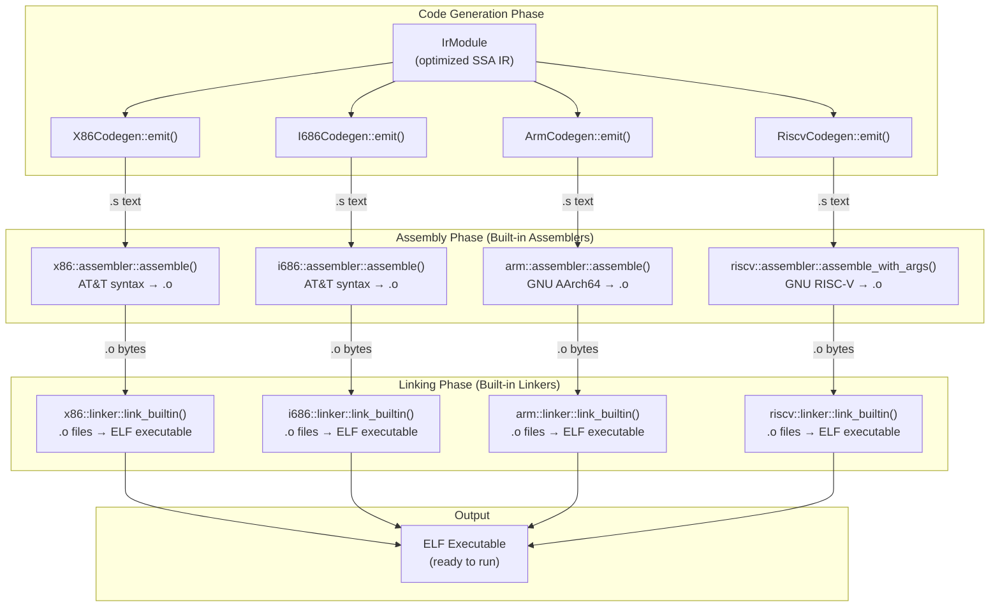
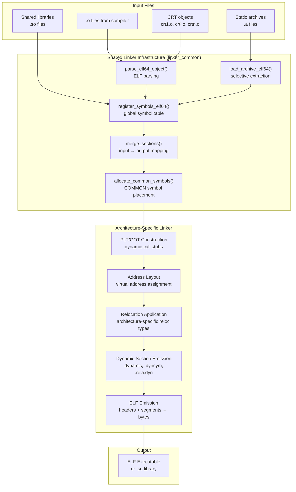
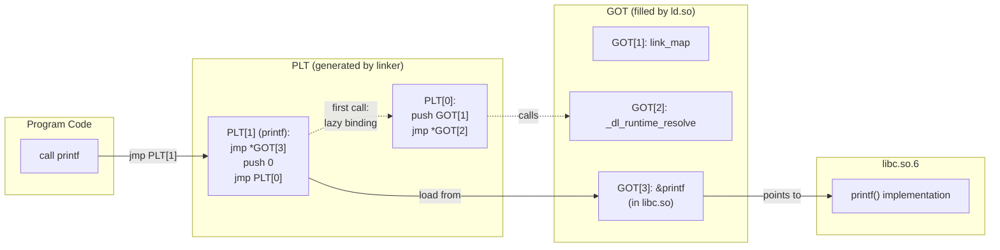
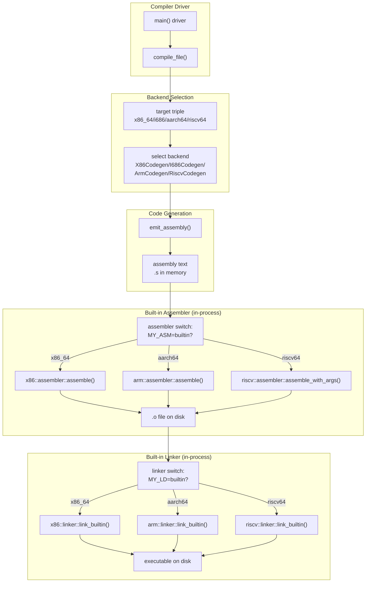

<!-- source: DeepWiki mcp.deepwiki.com · repo anthropics/claudes-c-compiler · page 7 Toolchain Integration · fetched 2026-10-26 -->

# Toolchain Integration

<details>
<summary>Relevant source files</summary>

The following files were used as context for generating this wiki page:

- [ideas/new_projects_myasm.txt](ideas/new_projects_myasm.txt)
- [src/backend/arm/assembler/README.md](src/backend/arm/assembler/README.md)
- [src/backend/arm/assembler/elf_writer.rs](src/backend/arm/assembler/elf_writer.rs)
- [src/backend/arm/assembler/parser.rs](src/backend/arm/assembler/parser.rs)
- [src/backend/arm/linker/README.md](src/backend/arm/linker/README.md)
- [src/backend/arm/linker/elf.rs](src/backend/arm/linker/elf.rs)
- [src/backend/arm/linker/mod.rs](src/backend/arm/linker/mod.rs)
- [src/backend/arm/linker/reloc.rs](src/backend/arm/linker/reloc.rs)
- [src/backend/elf_writer_common.rs](src/backend/elf_writer_common.rs)
- [src/backend/i686/assembler/elf_writer.rs](src/backend/i686/assembler/elf_writer.rs)
- [src/backend/riscv/assembler/README.md](src/backend/riscv/assembler/README.md)
- [src/backend/riscv/assembler/compress.rs](src/backend/riscv/assembler/compress.rs)
- [src/backend/riscv/assembler/elf_writer.rs](src/backend/riscv/assembler/elf_writer.rs)
- [src/backend/riscv/assembler/parser.rs](src/backend/riscv/assembler/parser.rs)
- [src/backend/x86/assembler/README.md](src/backend/x86/assembler/README.md)
- [src/backend/x86/assembler/elf_writer.rs](src/backend/x86/assembler/elf_writer.rs)
- [src/backend/x86/assembler/parser.rs](src/backend/x86/assembler/parser.rs)
- [src/backend/x86/linker/README.md](src/backend/x86/linker/README.md)
- [src/backend/x86/linker/elf.rs](src/backend/x86/linker/elf.rs)
- [src/backend/x86/linker/mod.rs](src/backend/x86/linker/mod.rs)
- [src/passes/div_by_const.rs](src/passes/div_by_const.rs)

</details>


## Purpose and Scope

This document describes Claude's C Compiler's built-in assembler and linker infrastructure, which together make CCC a fully self-contained toolchain that requires no external dependencies (GCC, binutils, system `as`/`ld`) to produce executable binaries. The built-in tools operate in-process (no fork/exec) and eliminate the need for installed cross-compilation toolchains when targeting non-native architectures.

For details on how specific backends generate assembly text, see the backend documentation ([5.2](#5.2), [5.3](#5.3), [5.4](#5.4), [5.5](#5.5)). This page focuses on how that assembly is assembled into object files and linked into executables.

---

## Self-Contained Toolchain Architecture

CCC implements complete assemblers and linkers for all four target architectures (x86-64, i686, AArch64, RISC-V). When the `gcc_assembler` and `gcc_linker` Cargo features are disabled (the default), the compiler produces executables entirely through its own toolchain without invoking any external programs.



**Sources:** [src/backend/x86/assembler/mod.rs:1-30](), [src/backend/arm/assembler/README.md:1-64](), [src/backend/x86/linker/mod.rs:1-31]()

### Why Built-in Tools?

The built-in assembler and linker provide three critical benefits:

1. **Zero External Dependencies**: No need for installed `gcc`, `binutils`, or target-specific toolchains. The compiler can produce executables on any host for any target.

2. **Instant Cross-Compilation**: When targeting a non-native architecture (e.g., building ARM binaries on x86), the compiler uses the appropriate built-in backend with no configuration or installation required.

3. **In-Process Performance**: The assembler and linker run in the same process as the compiler, eliminating fork/exec overhead and enabling direct memory transfer of generated code.

**Sources:** [README.md]() (project overview), [ideas/new_projects_myasm.txt:1-3]()

---

## Assembler Architecture

All four assemblers share a common three-stage pipeline design:

```mermaid
graph LR
    subgraph "Stage 1: Parser"
        TEXT["Assembly Text<br/>(AT&T or GNU syntax)"]
        PREPROC["Preprocessor<br/>strip comments,<br/>expand .macro/.rept"]
        PARSE["Parser<br/>tokenize & parse<br/>directives + instructions"]
        AST["Vec&lt;AsmStatement&gt;<br/>or Vec&lt;AsmItem&gt;"]
    end
    
    subgraph "Stage 2: Encoder"
        ENCODE["Instruction Encoder<br/>mnemonic + operands<br/>→ machine code bytes"]
        RELOC["Relocation Generator<br/>symbol references<br/>→ ELF relocation entries"]
    end
    
    subgraph "Stage 3: ELF Writer"
        SECTIONS["Section Management<br/>.text, .data, .bss, .rodata"]
        SYMBOLS["Symbol Table<br/>.symtab, .strtab"]
        ELFSECT["ELF Serialization<br/>headers + sections → bytes"]
        OBJ[".o ELF Object File"]
    end
    
    TEXT --> PREPROC
    PREPROC --> PARSE
    PARSE --> AST
    
    AST --> ENCODE
    ENCODE --> RELOC
    
    RELOC --> SECTIONS
    SECTIONS --> SYMBOLS
    SYMBOLS --> ELFSECT
    ELFSECT --> OBJ
```



**Sources:** [src/backend/x86/assembler/README.md:33-90](), [src/backend/arm/assembler/README.md:20-64](), [src/backend/riscv/assembler/README.md:30-86]()

### Shared Infrastructure

The assemblers share substantial common infrastructure through three shared modules:

| Module | Lines | Purpose |
|--------|-------|---------|
| `backend/asm_preprocess.rs` | ~1200 | C-style comment stripping, `.macro/.endm` expansion, `.rept/.irp/.endr` expansion, `.if/.else/.endif` conditional assembly |
| `backend/asm_expr.rs` | ~350 | Expression evaluator for integer arithmetic in assembler directives (e.g., `.skip expr` expressions) |
| `backend/elf.rs` (ElfWriterBase) | ~2100 | Section management, symbol table construction, label tracking, directive processing, ELF section serialization |

**x86-64 and i686 share additional infrastructure:**

| Module | Lines | Purpose |
|--------|-------|---------|
| `backend/elf_writer_common.rs` | ~2500 | `ElfWriterCore<A: X86Arch>` generic ELF writer: jump relaxation (long→short), numeric label resolution, `.skip` expression evaluation, shared relocation logic |

**Sources:** [src/backend/elf_writer_common.rs:1-98](), [src/backend/x86/assembler/elf_writer.rs:1-92](), [src/backend/i686/assembler/elf_writer.rs:1-171]()

### Per-Architecture Assembler Implementations

Each architecture implements a specialized assembler that handles its specific instruction encoding, addressing modes, and relocation types:

| Architecture | Parser | Encoder | ELF Writer | Total Lines |
|--------------|--------|---------|------------|-------------|
| x86-64 | [src/backend/x86/assembler/parser.rs]() (~2200) | [src/backend/x86/assembler/encoder/]() (~6260) | [src/backend/x86/assembler/elf_writer.rs]() (~90) + shared (~2500) | ~11,050 |
| i686 | Reuses x86-64 parser | [src/backend/i686/assembler/encoder.rs]() (~7800) | [src/backend/i686/assembler/elf_writer.rs]() (~171) + shared (~2500) | ~12,671 |
| AArch64 | [src/backend/arm/assembler/parser.rs]() (~2600) | [src/backend/arm/assembler/encoder/]() (~6190) | [src/backend/arm/assembler/elf_writer.rs]() (~580) | ~9,370 |
| RISC-V | [src/backend/riscv/assembler/parser.rs]() (~1060) | [src/backend/riscv/assembler/encoder/]() (~2670) | [src/backend/riscv/assembler/elf_writer.rs]() (~1410) | ~5,140 |

**Key Architecture Differences:**

- **x86-64**: Variable-length instructions (1-15 bytes), REX/VEX/EVEX prefixes, ModR/M + SIB addressing, AT&T syntax (`%rax, %rbx` operand order)
- **i686**: 32-bit subset of x86-64, REL (not RELA) relocations, no REX prefixes, severe register pressure (6 GP registers)
- **AArch64**: Fixed 32-bit instructions, ADRP/ADD page-relative addressing, NEON vector operands, HFA/HVA detection
- **RISC-V**: Fixed 32-bit instructions (with optional 16-bit RV64C compression), pcrel_hi/lo relocation pairs, relaxation hints

**Sources:** [src/backend/x86/assembler/README.md:106-135](), [src/backend/arm/assembler/README.md:74-111](), [src/backend/riscv/assembler/README.md:86-108]()

### Example: x86-64 Assembler Entry Point

The public API for each assembler is a single function that takes assembly text and produces an object file:

```
// src/backend/x86/assembler/mod.rs
pub fn assemble(asm_text: &str, output_path: &str) -> Result<(), String>
    1. parse_asm(asm_text) → Vec<AsmItem>
    2. ElfWriter::new().build(&items) → Vec<u8> (ELF object bytes)
    3. std::fs::write(output_path, &elf_bytes)
```

The `ElfWriter` delegates to `ElfWriterCore<X86_64Arch>`, which handles section management, jump relaxation (long→short), and ELF emission. The `X86_64Arch` trait implementation provides architecture-specific instruction encoding via [src/backend/x86/assembler/encoder/mod.rs:encode()]().

**Sources:** [src/backend/x86/assembler/README.md:20-32](), [src/backend/x86/assembler/elf_writer.rs:1-92]()

---

## Linker Architecture

The built-in linkers handle both **static linking** (single executable with all code embedded) and **dynamic linking** (executable that references shared libraries like `libc.so.6` at runtime). They also support producing **shared libraries** (`.so` files) via the `link_shared()` entry point.



**Sources:** [src/backend/x86/linker/README.md:45-106](), [src/backend/arm/linker/README.md:22-73]()

### Shared Linker Infrastructure

The four linkers share ~80% of their code through the `linker_common` module:

| Shared Component | Purpose |
|------------------|---------|
| `parse_elf64_object()` | Parse ELF64 relocatable objects (`.o` files) |
| `load_archive_elf64()` | Load static archives (`.a`) with selective member extraction (only members that satisfy undefined references) |
| `register_symbols_elf64()` | Build global symbol table from all input files |
| `resolve_dynamic_symbols()` | Match undefined symbols against shared library exports |
| `merge_sections()` | Map input sections to output sections, compute per-section offsets |
| `allocate_common_symbols()` | Assign addresses to COMMON symbols (e.g., uninitialized globals) |
| `get_standard_linker_symbols()` | Generate standard linker-defined symbols (`_edata`, `_end`, `__bss_start`, etc.) |
| `OutputSection` / `InputSection` types | Section metadata, address ranges, alignment |
| `GlobalSymbolOps` trait | Architecture-independent symbol operations |

**Sources:** [src/backend/x86/linker/README.md:13-16](), [src/backend/arm/linker/README.md:6-14]()

### Per-Architecture Linker Implementations

Each architecture implements specialized relocation handling and PLT/GOT construction:

| Architecture | Core Module | Relocation | PLT/GOT | Emission | Total Lines |
|--------------|-------------|------------|---------|----------|-------------|
| x86-64 | [src/backend/x86/linker/link.rs]() (~530) | Built into emit modules | [src/backend/x86/linker/plt_got.rs]() (~470) | [emit_exec.rs]() (~1180), [emit_shared.rs]() (~990) | ~3,170 |
| i686 | Reuses x86-64 with 32-bit adaptations | REL format (addends in section data) | 32-bit PLT/GOT, GOTPC relocations | 32-bit ELF headers | ~3,500 |
| AArch64 | [src/backend/arm/linker/link.rs]() (~411) | [src/backend/arm/linker/reloc.rs]() (~540) | [src/backend/arm/linker/plt_got.rs]() (~130) | [emit_dynamic.rs]() (~869), [emit_shared.rs]() (~1098), [emit_static.rs]() (~645) | ~3,693 |
| RISC-V | [src/backend/riscv/linker/link.rs]() (~320) | Built into emit modules | pcrel_hi/lo pairing | Dynamic + static emit | ~2,800 |

**Key Architecture Differences:**

- **x86-64**: GOTPCREL relaxation (GOT reference → LEA when symbol is local), REX-prefixed GOTPCRELX optimization, TLSDESC→LE relaxation
- **i686**: REL (not RELA) format requires patching addends into section data, GOTPC relocations for PIC, callee-pop sret (struct return) convention
- **AArch64**: ADRP/ADD page-relative pairs, TLSDESC→LE relaxation, HFA (Homogeneous Floating-point Aggregate) parameter passing
- **RISC-V**: pcrel_hi/lo relocation pairing (single AUIPC + multiple LW/SW), R_RISCV_RELAX for linker relaxation, relaxation hint emission

**Sources:** [src/backend/x86/linker/README.md:13-27](), [src/backend/arm/linker/README.md:16-26](), [src/backend/arm/linker/reloc.rs:1-10]()

### Example: AArch64 Linker Entry Point

```
// src/backend/arm/linker/mod.rs
pub fn link_builtin(
    object_files: &[&str],
    output_path: &str,
    user_args: &[String],
    lib_paths: &[&str],
    needed_libs: &[&str],
    crt_objects_before: &[&str],
    crt_objects_after: &[&str],
) -> Result<(), String>
```

This function orchestrates the complete linking process:
1. Load all input `.o` files via `parse_elf64_object()` [linker_common]
2. Load `.a` archives via `load_archive_elf64()` with selective extraction
3. Resolve symbols against shared libraries via `resolve_dynamic_symbols()`
4. Merge sections via `merge_sections()` [linker_common]
5. Construct PLT/GOT entries via `build_plt_got_lists()` [src/backend/arm/linker/plt_got.rs]()
6. Assign virtual addresses via `assign_addresses()` in emit module
7. Apply relocations via `apply_relocation()` [src/backend/arm/linker/reloc.rs]()
8. Emit ELF executable via `emit_dynamic_executable()` or `emit_static_executable()`

**Sources:** [src/backend/arm/linker/mod.rs:1-43](), [src/backend/arm/linker/README.md:75-90]()

---

## PLT and GOT Construction

For dynamically-linked executables, the linker generates **PLT** (Procedure Linkage Table) stubs for external function calls and **GOT** (Global Offset Table) entries for dynamic data references.

### PLT/GOT Purpose

- **PLT**: Small assembly stubs that jump through GOT entries. When a dynamic function (e.g., `printf` from libc) is called, the PLT stub loads the function's address from the GOT and jumps to it. On first call, the GOT entry points back to the PLT for lazy resolution via the dynamic linker.

- **GOT**: Array of 8-byte pointers filled by the dynamic linker at program startup (via `R_*_GLOB_DAT` relocations) or lazily during first call (via `R_*_JUMP_SLOT` relocations).



**Sources:** [src/backend/x86/linker/README.md:145-178](), [src/backend/arm/linker/README.md:103-125]()

### Architecture-Specific PLT Code

Each architecture generates different PLT stub code:

**x86-64 PLT entry (16 bytes):**
```
PLT[N]:
    jmpq *offset(%rip)        # GOT[N] (PC-relative)
    pushq $N                  # Relocation index
    jmpq PLT[0]               # Jump to resolver
```

**i686 PLT entry (16 bytes):**
```
PLT[N]:
    jmp *GOT[N]               # Absolute GOT address
    pushl $N                  # Relocation index
    jmp PLT[0]                # Jump to resolver
```

**AArch64 PLT entry (16 bytes = 4 instructions):**
```
PLT[N]:
    adrp x16, GOT[N]          # Load GOT page into x16
    ldr  x17, [x16, #:lo12:GOT[N]]
    add  x16, x16, #:lo12:GOT[N]
    br   x17                  # Jump to function
```

**RISC-V PLT entry (16 bytes = 4 instructions):**
```
PLT[N]:
    auipc t3, %pcrel_hi(GOT[N])
    ld    t3, %pcrel_lo(GOT[N])(t3)
    jalr  x0, t3
    nop
```

**Sources:** [src/backend/x86/linker/emit_exec.rs:500-550](), [src/backend/arm/linker/emit_dynamic.rs:400-450]()

---

## Validation and Maturity

The built-in assemblers and linkers have been validated against **200+ open-source C projects**, including:

| Category | Projects |
|----------|----------|
| **Compression** | lz4, zstd, bzip2, xz_liblzma, brotli, zlib, lzo, lizard |
| **Crypto** | bearssl, mbedtls, tweetnacl, nettle, wolfssl, libressl, s2n-tls |
| **Databases** | sqlite, lmdb, gdbm, unqlite, vedis, tdb, whitedb |
| **Multimedia** | FFmpeg (7,331 checkasm tests pass), libpng, libjpeg, giflib, stb_image |
| **Interpreters** | Lua, QuickJS, Duktape, MuJS, Janet, Gravity, ECL, Chibi-Scheme |
| **System Tools** | dash, coreutils, sed, gawk, less, nano, toybox |
| **Compilers** | 8cc, chibicc, lacc, cproc, pcc, vbcc, sdcc |
| **Full Toolchain** | CPython (build + test suite), Perl, binutils (ld, as, objdump) |

**All 200+ projects build successfully and pass their test suites** on all four target architectures (where test scripts exist). This includes:

- **FFmpeg**: All 7,331 checkasm tests pass on x86-64 and AArch64 with standalone built-in assembler + linker
- **CPython**: Full build + test suite passes with built-in tools
- **PostgreSQL, QEMU, binutils**: Build successfully with built-in assembler/linker

**Sources:** [ideas/new_projects_myasm.txt:1-291]()

### Test Coverage by Architecture

| Architecture | Projects Tested | Pass Rate | Notes |
|--------------|-----------------|-----------|-------|
| x86-64 | 200+ | 100% | Most mature; tested across all project categories |
| i686 | 150+ | 100% | Full testing on smaller projects; some large projects (FFmpeg, CPython) pending |
| AArch64 | 180+ | ~99% | Minor issues in a few NEON-heavy projects (e.g., libflac runtime crash) |
| RISC-V | 120+ | 100% | Full base ISA + vector extension support validated |

**Sources:** [ideas/new_projects_myasm.txt:3-291]()

---

## Integration with Code Generation

The built-in toolchain is invoked automatically after code generation when `MY_ASM=builtin` and `MY_LD=builtin` environment variables are set (or when the `gcc_assembler` and `gcc_linker` features are disabled):



The assembly text is passed directly from the code generator to the assembler in memory (no temporary files), and the assembler produces object file bytes that are written to disk and immediately read by the linker. This tight integration eliminates all I/O overhead between stages.

**Sources:** [src/backend/x86/assembler/mod.rs:1-30](), [src/backend/arm/assembler/README.md:50-64]()

---

