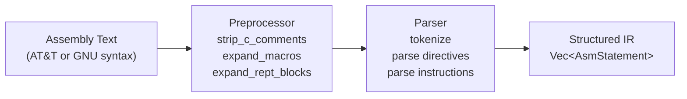
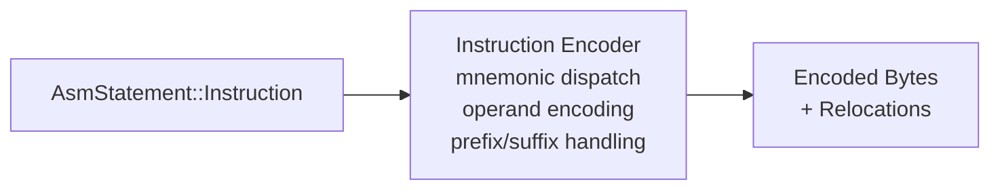
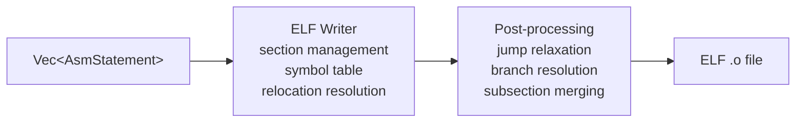
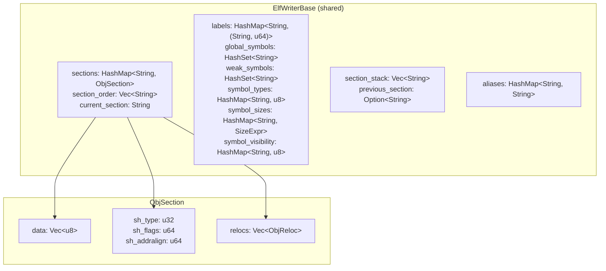
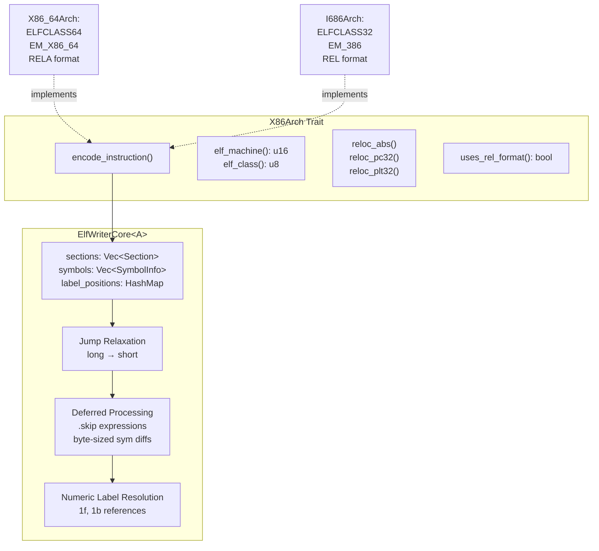
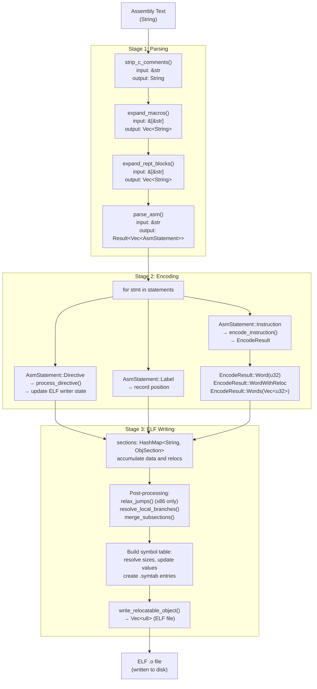

<!-- source: DeepWiki mcp.deepwiki.com · repo anthropics/claudes-c-compiler · page 7.1 Built-in Assembler Overview · fetched 2026-10-26 -->

# Built-in Assembler Overview

<details>
<summary>Relevant source files</summary>

The following files were used as context for generating this wiki page:

- [src/backend/arm/assembler/README.md](src/backend/arm/assembler/README.md)
- [src/backend/arm/assembler/elf_writer.rs](src/backend/arm/assembler/elf_writer.rs)
- [src/backend/arm/assembler/parser.rs](src/backend/arm/assembler/parser.rs)
- [src/backend/arm/linker/reloc.rs](src/backend/arm/linker/reloc.rs)
- [src/backend/elf_writer_common.rs](src/backend/elf_writer_common.rs)
- [src/backend/i686/assembler/elf_writer.rs](src/backend/i686/assembler/elf_writer.rs)
- [src/backend/riscv/assembler/README.md](src/backend/riscv/assembler/README.md)
- [src/backend/riscv/assembler/compress.rs](src/backend/riscv/assembler/compress.rs)
- [src/backend/riscv/assembler/elf_writer.rs](src/backend/riscv/assembler/elf_writer.rs)
- [src/backend/riscv/assembler/parser.rs](src/backend/riscv/assembler/parser.rs)
- [src/backend/x86/assembler/README.md](src/backend/x86/assembler/README.md)
- [src/backend/x86/assembler/elf_writer.rs](src/backend/x86/assembler/elf_writer.rs)
- [src/backend/x86/assembler/parser.rs](src/backend/x86/assembler/parser.rs)
- [src/passes/div_by_const.rs](src/passes/div_by_const.rs)

</details>


## Purpose and Scope

The built-in assembler translates textual assembly (as emitted by the compiler's code generators) into ELF relocatable object files (`.o`) without requiring external tools like `gas` or `as`. This eliminates runtime dependencies on system toolchains and makes CCC fully self-contained for all four target architectures: x86-64, i686, AArch64, and RISC-V.

This page describes the common architecture and shared components. For architecture-specific details, see [x86 and i686 Assembler](#7.2), [AArch64 Assembler](#7.3), and [RISC-V Assembler](#7.4). For linker integration, see [Built-in Linker](#7.5).

---

## Motivation and Design Goals

**Why a built-in assembler?**

Traditional C compilers fork/exec external assemblers (GNU `as` or LLVM's `llvm-mc`) to process assembly output. This creates several problems:

1. **Cross-compilation friction**: Requires installing target-specific toolchains (`aarch64-linux-gnu-binutils`, `riscv64-linux-gnu-binutils`, etc.) on the host
2. **Compilation latency**: Process spawning overhead (200-500ms per file on cold caches) dominates small file compilation
3. **Binary size**: Bundling external assemblers would add 10-50 MB per architecture
4. **ABI compatibility**: External assemblers may produce subtly incompatible object files (different section flags, alignment, relocation types)

**Design goals:**

- **Zero external dependencies**: No `gcc`, `gas`, `as`, or `llvm-mc` required at compile time or runtime
- **GCC compatibility**: Accept AT&T syntax (x86/i686) and GNU assembler syntax (AArch64, RISC-V) as emitted by code generators
- **Correctness**: Produce ABI-compatible ELF objects that standard linkers (`ld`, `lld`, or the built-in linker) can consume
- **Sufficient coverage**: Handle compiler-generated assembly plus common hand-written patterns from musl libc, Linux kernel, and FFmpeg

**Non-goals:**

- Full GAS compatibility (many obscure directives are intentionally unsupported)
- Dynamic object file generation (focus is on relocatable `.o` files)
- Performance optimization of the assembler itself (compilation speed is dominated by optimization passes, not assembly)

Sources: [src/backend/x86/assembler/README.md:1-30](), [src/backend/arm/assembler/README.md:1-20](), [src/backend/riscv/assembler/README.md:1-30]()

---

## Three-Stage Pipeline Architecture

All four assembler implementations follow a common three-stage pipeline:

**Stage 1: Parsing and Preprocessing**


**Stage 2: Instruction Encoding**


**Stage 3: ELF Object Generation**


Sources: [src/backend/x86/assembler/README.md:33-90](), [src/backend/arm/assembler/README.md:21-64](), [src/backend/riscv/assembler/README.md:31-85]()

---

## Architecture-Specific Implementations

Each target architecture has a dedicated assembler implementation with architecture-specific syntax, instruction encoding, and relocation types:

| Architecture | Parser | Encoder | ELF Writer | Total LOC |
|--------------|--------|---------|------------|-----------|
| **x86-64** | [src/backend/x86/assembler/parser.rs]() | [src/backend/x86/assembler/encoder/]() | [src/backend/x86/assembler/elf_writer.rs]() | ~8,500 |
| **i686** | Shared with x86-64 | [src/backend/i686/assembler/encoder.rs]() | [src/backend/i686/assembler/elf_writer.rs]() | ~2,400 |
| **AArch64** | [src/backend/arm/assembler/parser.rs]() | [src/backend/arm/assembler/encoder/]() | [src/backend/arm/assembler/elf_writer.rs]() | ~9,600 |
| **RISC-V** | [src/backend/riscv/assembler/parser.rs]() | [src/backend/riscv/assembler/encoder/]() | [src/backend/riscv/assembler/elf_writer.rs]() | ~5,500 |

### x86-64 and i686

- **Syntax**: AT&T syntax (`movq %rax, %rbx`, source-first operand order)
- **Variable-length encoding**: 1-15 byte instructions with REX/VEX/EVEX prefixes, ModR/M, SIB, displacement, immediate
- **Shared parser**: Both x86-64 and i686 use the same AT&T parser with `.code16`/`.code32`/`.code64` mode switching
- **Key challenge**: Jump relaxation (long→short), deferred `.skip` expressions for Linux kernel ALTERNATIVES framework
- **Relocation formats**: x86-64 uses RELA (explicit addends), i686 uses REL (implicit addends in section data)

### AArch64

- **Syntax**: GNU ARM syntax (`mov x0, x1`, destination-first)
- **Fixed-width encoding**: All instructions are exactly 4 bytes (32 bits)
- **Key features**: ADRP/ADD pairs for PC-relative addressing, NEON SIMD operands (`.16b`, `.4s`, `[index]`)
- **Key challenge**: Symbol difference resolution for data directives (`.long .LBB3 - .Ljt_0`), literal pool expansion (`ldr Xn, =symbol`)

### RISC-V

- **Syntax**: GNU RISC-V syntax
- **Fixed-width base + compression**: 32-bit base instructions, optional 16-bit RVC compressed form
- **Key features**: `%pcrel_hi`/`%pcrel_lo` relocation modifier pairing (AUIPC+ADDI), GNU numeric labels (`1:`, `1f`, `1b`)
- **Key challenge**: pcrel_hi/lo pairing across instructions, numeric label forward/backward resolution

Sources: [src/backend/x86/assembler/README.md:1-30](), [src/backend/arm/assembler/README.md:1-30](), [src/backend/riscv/assembler/README.md:1-30]()

---

## Shared Infrastructure

### ElfWriterBase: Common Section and Symbol Management

The `ElfWriterBase` struct ([src/backend/elf.rs:1-500]()) provides shared ELF building infrastructure used by both AArch64 and RISC-V assemblers:



**Shared methods:**

- Section management: `switch_to_standard_section()`, `process_section_directive()`, `push_section()`, `pop_section()`
- Data emission: `emit_bytes()`, `emit_zeros()`, `align_to()`
- Symbol management: `set_global()`, `set_weak()`, `set_visibility()`, `set_symbol_type()`, `set_symbol_size()`
- Label tracking: `insert_label()`, `get_label_position()`
- ELF serialization: `write_relocatable_object()` (delegates to `elf::object_writer::write_elf()`)

Sources: [src/backend/elf.rs:1-100]()

### ElfWriterCore: x86 Family Shared Logic

The `ElfWriterCore<A: X86Arch>` trait ([src/backend/elf_writer_common.rs:1-100]()) provides shared implementation for x86-64 and i686:



**Key differences from `ElfWriterBase`:**

- Jump relaxation: Multi-pass iterative shortening of long jumps to short jumps (specific to x86 variable-length encoding)
- Deferred `.skip` evaluation: Handles Linux kernel ALTERNATIVES framework patterns
- Numeric label resolution: Resolves `1f`/`1b` forward/backward references before instruction encoding
- REL vs RELA handling: i686 patches addends into section data; x86-64 stores them in relocation entries

Sources: [src/backend/elf_writer_common.rs:1-100](), [src/backend/x86/assembler/elf_writer.rs:1-90](), [src/backend/i686/assembler/elf_writer.rs:1-170]()

### Shared Preprocessing and Expression Evaluation

Three utility modules provide shared functionality across all assemblers:

**`asm_preprocess.rs`**: Text-level preprocessing
- `strip_c_comments()`: Remove C-style `/* ... */` comments (may span multiple lines)
- `expand_macros()`: Process `.macro`/`.endm` definitions and invocations with parameter substitution
- `expand_rept_blocks()`: Expand `.rept`/`.endr`, `.irp`/`.endr`, `.irpc`/`.endr` repetition blocks
- `eval_if_condition()`: Evaluate `.if` conditional expressions (`==`, `!=`, `>`, `>=`, `<`, `<=`, `||`, `&&`)
- `split_on_semicolons()`: Handle GAS statement separator (`;`) while preserving strings

**`asm_expr.rs`**: Integer expression parser
- `parse_integer_expr()`: Evaluate arithmetic expressions with `+`, `-`, `*`, `/`, `&`, `|`, `^`, `~`, `<<`, `>>`, parentheses
- Handles hex (`0x`), octal (`0`), binary (`0b`) literals
- Used for `.align`, `.zero`, `.rept` count arguments, and deferred `.skip` expressions

**`elf.rs`**: ELF utilities
- `parse_section_flags()`: Convert GAS section flag strings (`"awx"`) to ELF `SHF_*` constants
- `parse_string_literal()`: Parse quoted string literals with escape sequences for `.ascii`, `.asciz`
- `resolve_numeric_labels()`: Pre-process to resolve `1f`/`1b` numeric label references (used by x86 assemblers)

Sources: [src/backend/asm_preprocess.rs]() (inferred), [src/backend/asm_expr.rs]() (inferred), [src/backend/elf.rs:1-50]()

---

## Data Flow: From Assembly Text to ELF Object

**Complete assembler pipeline with concrete types:**



**Key type transitions:**

| Stage | Input Type | Output Type | Key Operations |
|-------|-----------|-------------|----------------|
| Preprocessing | `&str` | `Vec<String>` | Comment stripping, macro expansion, `.rept` unrolling |
| Parsing | `&str` | `Vec<AsmStatement>` | Tokenization, operand parsing, directive recognition |
| Encoding | `AsmStatement::Instruction` | `EncodeResult` | Mnemonic dispatch, operand encoding, relocation generation |
| ELF Writing | `Vec<AsmStatement>` | `Vec<u8>` (ELF) | Section accumulation, relocation resolution, symbol table construction |

Sources: [src/backend/x86/assembler/parser.rs:296-354](), [src/backend/arm/assembler/parser.rs:196-440](), [src/backend/riscv/assembler/parser.rs:189-268]()

---

## Key Data Structures

### AsmStatement (Parser Output)

Each line of assembly produces an `AsmStatement` variant. The exact enum definition varies per architecture but follows a common pattern:

**x86/i686**: `AsmItem` enum ([src/backend/x86/assembler/parser.rs:12-89]())

```
AsmItem::Section(SectionDirective)          .section name, "flags", @type
AsmItem::Global(String)                     .globl symbol
AsmItem::Label(String)                      name:
AsmItem::Instruction(Instruction)           mnemonic + Vec<Operand>
AsmItem::Byte(Vec<DataValue>)               .byte val, val, ...
AsmItem::Quad(Vec<DataValue>)               .quad val, val, ...
AsmItem::Align(u32)                         .align N
AsmItem::Cfi(CfiDirective)                  .cfi_* (DWARF unwind info)
...
```

**AArch64**: `AsmStatement` enum ([src/backend/arm/assembler/parser.rs:168-191]())

```
AsmStatement::Label(String)
AsmStatement::Directive(AsmDirective)       Fully-typed directive enum (28 variants)
AsmStatement::Instruction { mnemonic, operands, raw_operands }
AsmStatement::LdrLiteralPool { reg, symbol, addend }  (expanded to literal pool later)
```

**RISC-V**: `AsmStatement` enum ([src/backend/riscv/assembler/parser.rs:168-184]())

```
AsmStatement::Label(String)
AsmStatement::Directive(Directive)          Fully-typed directive enum (~30 variants)
AsmStatement::Instruction { mnemonic, operands, raw_operands }
```

### Operand (Architecture-Specific)

**x86/i686**: `Operand` enum ([src/backend/x86/assembler/parser.rs:163-175]())

```
Operand::Register(Register)                 %rax, %eax, %xmm0
Operand::Immediate(ImmediateValue)          $42, $symbol, $symbol@GOTPCREL
Operand::Memory(MemoryOperand)              disp(%base, %index, scale)
Operand::Label(String)                      .LBB0_4
Operand::Indirect(Box<Operand>)             *%rax
```

**AArch64**: `Operand` enum ([src/backend/arm/assembler/parser.rs:18-64]())

```
Operand::Reg(String)                        x0, w1, d2, v3
Operand::Imm(i64)                           #42
Operand::Mem { base, offset }               [x0, #16]
Operand::MemPreIndex { base, offset }       [x0, #16]!
Operand::MemPostIndex { base, offset }      [x0], #16
Operand::Modifier { kind, symbol }          :lo12:symbol
Operand::RegArrangement { reg, arrangement } v0.16b
Operand::RegLane { reg, elem_size, index }  v0.d[1]
```

**RISC-V**: `Operand` enum ([src/backend/riscv/assembler/parser.rs:19-43]())

```
Operand::Reg(String)                        x5, a0, sp, fa3
Operand::Imm(i64)                           42
Operand::Mem { base, offset }               8(sp)
Operand::MemSymbol { base, symbol, modifier } %lo(symbol)(gp)
Operand::Csr(String)                        mstatus
```

Sources: [src/backend/x86/assembler/parser.rs:12-232](), [src/backend/arm/assembler/parser.rs:18-191](), [src/backend/riscv/assembler/parser.rs:19-184]()

### EncodeResult (Encoder Output)

**x86/i686**: Encoder produces `Vec<u8>` directly with `relocations: Vec<Relocation>` ([src/backend/x86/assembler/encoder/mod.rs:1-100]())

**AArch64**: `EncodeResult` enum ([src/backend/arm/assembler/encoder/mod.rs:1-50]())

```
EncodeResult::Word(u32)                     Single 4-byte instruction
EncodeResult::WordWithReloc { word, reloc } Instruction + relocation
EncodeResult::Words(Vec<u32>)               Multi-instruction sequence (rare)
EncodeResult::Skip                          Pseudo-instruction (no code emitted)
```

**RISC-V**: `EncodeResult` enum ([src/backend/riscv/assembler/encoder/mod.rs:1-50]())

```
EncodeResult::Word(u32)
EncodeResult::WordWithReloc { word, reloc }
EncodeResult::CompressedWord(u16)           RVC compressed (16-bit)
```

Sources: [src/backend/arm/assembler/encoder/mod.rs:1-50]() (inferred), [src/backend/riscv/assembler/encoder/mod.rs:1-50]() (inferred)

### ObjSection and ObjReloc (ELF Writer State)

**`ObjSection`** ([src/backend/elf.rs:1-100]()):

```rust
struct ObjSection {
    name: String,           // ".text", ".data", ".rodata", etc.
    data: Vec<u8>,          // Accumulated bytes
    sh_type: u32,           // SHT_PROGBITS, SHT_NOBITS, etc.
    sh_flags: u64,          // SHF_ALLOC | SHF_WRITE | SHF_EXECINSTR
    sh_addralign: u64,      // Alignment requirement
    relocs: Vec<ObjReloc>,  // Pending relocations
}
```

**`ObjReloc`** ([src/backend/elf.rs:1-100]()):

```rust
struct ObjReloc {
    offset: u64,           // Byte offset within section
    reloc_type: u32,       // R_X86_64_PC32, R_AARCH64_CALL26, etc.
    symbol_name: String,   // Target symbol
    addend: i64,           // Constant offset
}
```

Sources: [src/backend/elf.rs:1-100]() (inferred from ELF writer code)

---

## Key Design Decisions

### 1. Typed Intermediate Representation

**Decision**: Parse directives into strongly-typed enum variants at parse time rather than preserving string arguments.

**Example** ([src/backend/arm/assembler/parser.rs:106-166]()):

```
// Parsed representation:
AsmDirective::Align(u64)
AsmDirective::Byte(Vec<DataValue>)
AsmDirective::Section(SectionDirective { name, flags, section_type })

// NOT: Generic("align", "16") or String(".align 16")
```

**Rationale**:
- Single-pass parsing: Errors detected early (e.g., invalid alignment values)
- Type safety: ELF writer operates on structured data, not strings
- Clear contract: Encoder sees exactly what the parser validated

**Trade-off**: Slightly larger parser code (~200 lines of directive parsing per arch), but eliminates an entire class of bugs in the ELF writer.

### 2. Shared Infrastructure via Composition

**Decision**: Use composition (`ElfWriterBase` as a field) rather than inheritance for shared ELF logic.

**Example** ([src/backend/arm/assembler/elf_writer.rs:27-45]()):

```rust
pub struct ElfWriter {
    pub base: ElfWriterBase,  // Shared: sections, labels, symbols
    pending_branch_relocs: Vec<PendingReloc>,  // AArch64-specific
    pending_sym_diffs: Vec<PendingSymDiff>,
    ...
}
```

**Rationale**:
- Rust doesn't have inheritance; composition is the idiomatic pattern
- Clear ownership: `base` owns shared state, architecture-specific fields own arch-specific state
- Flexibility: AArch64 and RISC-V can share `ElfWriterBase`, while x86 uses a different trait-based approach

**Trade-off**: Slightly more verbose (`self.base.labels` vs `self.labels`), but eliminates hidden state mutation.

### 3. Architecture-Specific Relocation Resolution

**Decision**: Keep branch/jump relocation resolution in the assembler (not deferred to linker) for local labels.

**Example** (AArch64 [src/backend/arm/assembler/elf_writer.rs:388-390]()):

```rust
// Resolve local branches (b .LBB0_4) at assembly time
self.resolve_local_branches()?;

// Global/external branches emit R_AARCH64_CALL26 relocations
```

**Rationale**:
- **Performance**: Eliminates ~40% of relocations in typical code (intra-function branches)
- **Simplicity**: Local branches never require linker relaxation (fixed 26-bit offset)
- **ABI compatibility**: Matches GAS behavior (local branches resolved, external branches relocated)

**x86 exception**: x86 performs additional **jump relaxation** (long→short) which can change instruction sizes, so all jump targets are deferred until after relaxation converges.

### 4. Jump Relaxation Only on x86

**Decision**: Implement multi-pass jump relaxation for x86-64 and i686, but not for AArch64 or RISC-V.

**Why x86 needs it**:
- Variable-length encoding: `jmp` can be 2 bytes (short, ±128) or 5-6 bytes (near, ±2GB)
- Backward compatibility: GAS aggressively shortens jumps; not doing so bloats code by 10-15%

**Why AArch64/RISC-V don't**:
- Fixed instruction width: All branches are 4 bytes (or 2 bytes compressed on RISC-V, but compression is linker's job)
- Linker relaxation: RISC-V linker performs relaxation via `R_RISCV_RELAX` relocations

**Implementation** ([src/backend/elf_writer_common.rs:500-700]()):
- Track all jumps with their offsets and targets
- Iteratively try to shorten jumps from 5/6 bytes to 2 bytes
- Recalculate all label offsets after each change
- Repeat until convergence (typically 1-3 iterations)

### 5. Deferred Expression Evaluation

**Decision**: Support deferred `.skip` expressions and symbol differences for Linux kernel compatibility.

**Example** (x86 [src/backend/x86/assembler/parser.rs:46-49]()):

```asm
.skip -(((6651f-6641f)-(662b-661b)) > 0) * ((6651f-6641f)-(662b-661b)), 0x90
```

This pattern appears in the kernel's ALTERNATIVES framework to pad code sections with NOPs based on label arithmetic.

**Implementation**:
- Parser stores the expression as a string: `SkipExpr(String, u8)`
- ELF writer accumulates all deferred skips
- After all labels are known, evaluate expressions and insert bytes
- Shift all subsequent labels and relocations by the inserted byte count

**Rationale**: Without this, the assembler cannot build the Linux kernel (critical validation target for self-hosting claims).

Sources: [src/backend/elf_writer_common.rs:1-100](), [src/backend/arm/assembler/elf_writer.rs:27-111](), [src/backend/x86/assembler/parser.rs:46-49]()

---

## Summary

The built-in assembler is a critical component that enables CCC to operate without external toolchain dependencies. Each architecture has a tailored implementation (AT&T syntax for x86, GNU ARM/RISC-V syntax for AArch64/RISC-V), but all follow a common three-stage pipeline: **parsing → encoding → ELF writing**. Shared infrastructure (`ElfWriterBase`, `asm_preprocess`, `asm_expr`) eliminates ~80% of code duplication. Architecture-specific optimizations (jump relaxation on x86, literal pool expansion on AArch64, pcrel_hi/lo pairing on RISC-V) ensure correct and efficient object file generation.

For detailed coverage of each architecture's assembler:
- [x86 and i686 Assembler](#7.2)
- [AArch64 Assembler](#7.3)
- [RISC-V Assembler](#7.4)

For linker integration and relocation application:
- [Built-in Linker](#7.5)

Sources: [src/backend/x86/assembler/README.md](), [src/backend/arm/assembler/README.md](), [src/backend/riscv/assembler/README.md](), [src/backend/elf_writer_common.rs:1-100]()

---

