<!-- source: DeepWiki mcp.deepwiki.com · repo anthropics/claudes-c-compiler · page 7.2 x86 and i686 Assembler · fetched 2026-10-26 -->

# x86 and i686 Assembler

<details>
<summary>Relevant source files</summary>

The following files were used as context for generating this wiki page:

- [src/backend/elf_writer_common.rs](src/backend/elf_writer_common.rs)
- [src/backend/i686/assembler/elf_writer.rs](src/backend/i686/assembler/elf_writer.rs)
- [src/backend/x86/assembler/README.md](src/backend/x86/assembler/README.md)
- [src/backend/x86/assembler/elf_writer.rs](src/backend/x86/assembler/elf_writer.rs)
- [src/backend/x86/assembler/parser.rs](src/backend/x86/assembler/parser.rs)

</details>


## Purpose and Scope

This document covers the built-in assemblers for x86-64 and i686 (32-bit x86) architectures. These assemblers parse AT&T syntax assembly text and produce ELF relocatable object files (`.o`), eliminating the need for external toolchain dependencies like `gas` or `gcc -c`. The assemblers share ~95% of their code through a generic architecture (`ElfWriterCore<A>`), differing only in instruction encoding details and relocation formats.

For information about the built-in linker that consumes these object files, see [Built-in Linker](#7.5). For details on backend code generation that produces the assembly text, see [x86-64 Backend](#5.2) and [i686 Backend](#5.3).

**Sources:** [src/backend/x86/assembler/README.md:1-32]()

## System Architecture

The x86 and i686 assemblers use a shared three-stage pipeline: parsing, encoding, and ELF emission. Both architectures share the same AT&T syntax parser and ELF writer infrastructure, differing only in their instruction encoders.

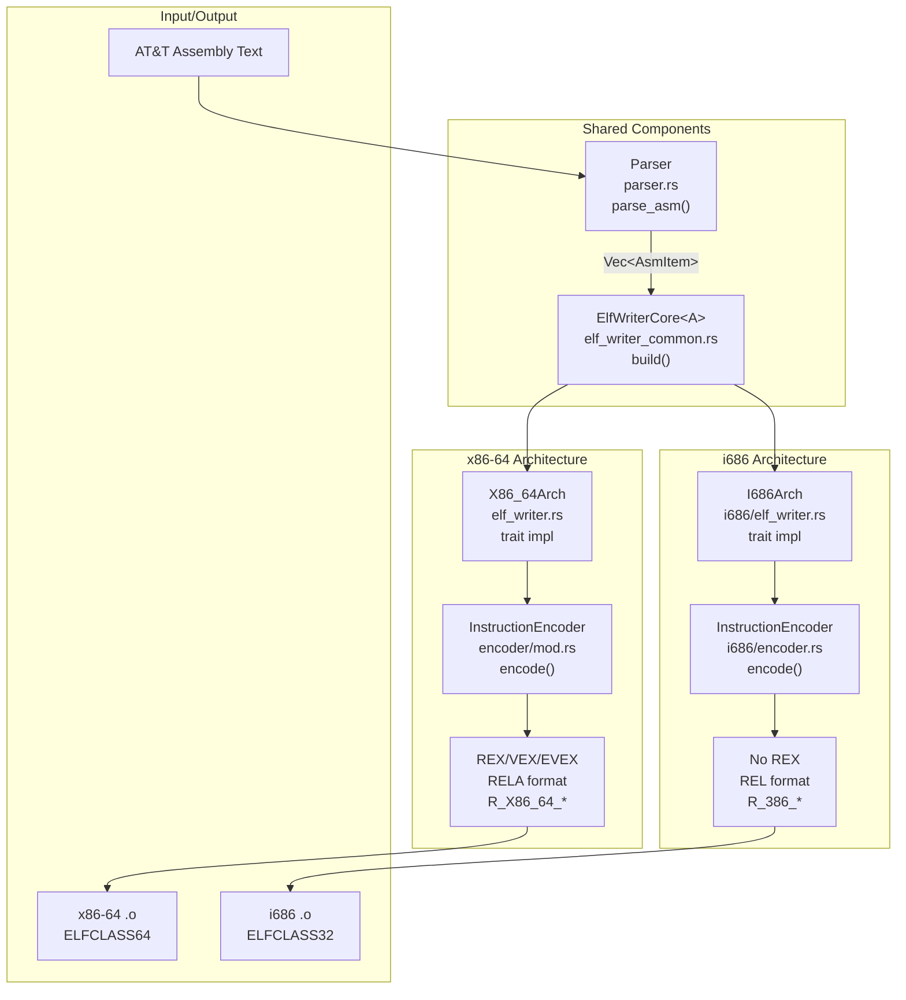

**Sources:** [src/backend/x86/assembler/README.md:33-89](), [src/backend/elf_writer_common.rs:1-97]()

## Shared Parser Pipeline

Both architectures use the same parser (`parse_asm()`) that transforms AT&T syntax assembly into a structured `Vec<AsmItem>` intermediate representation. The parser handles GAS macro expansion, numeric labels, and expression evaluation.

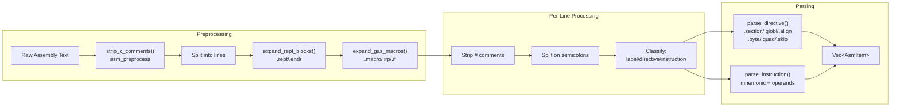

**Numeric label resolution** converts forward/backward references (`1f`, `1b`) to unique names before the main processing begins. This is handled by `resolve_numeric_labels()` which produces a deduplicated label map.

**Sources:** [src/backend/x86/assembler/parser.rs:1-354](), [src/backend/x86/assembler/README.md:230-294]()

### AsmItem Intermediate Representation

The `AsmItem` enum (33 variants) represents each parsed assembly line:

| Category | Variants | Example Syntax |
|----------|----------|----------------|
| **Section Control** | `Section`, `PushSection`, `PopSection`, `Previous` | `.section .text`, `.pushsection` |
| **Symbol Attributes** | `Global`, `Weak`, `Hidden`, `Protected`, `Internal` | `.globl main`, `.weak sym` |
| **Symbol Metadata** | `SymbolType`, `Size`, `Label` | `.type main, @function`, `main:` |
| **Alignment** | `Align`, `Org` | `.align 16`, `.org 0x1000` |
| **Data Emission** | `Byte`, `Short`, `Long`, `Quad`, `Zero`, `Asciz`, `Ascii` | `.byte 0x90`, `.quad symbol` |
| **Deferred Data** | `SkipExpr` | `.skip -(6651f-6641f), 0x90` |
| **Symbol Aliases** | `Set`, `Symver`, `Comm` | `.set alias, target` |
| **Instructions** | `Instruction` | `movq %rax, %rbx` |
| **Binary Inclusion** | `Incbin` | `.incbin "firmware.bin"` |
| **Code Mode** | `CodeMode` | `.code64`, `.code32`, `.code16` |
| **Debug/CFI** | `Cfi`, `File`, `Loc` | `.cfi_startproc` (parsed, not emitted) |

**Sources:** [src/backend/x86/assembler/parser.rs:12-89](), [src/backend/x86/assembler/README.md:141-181]()

## Architecture-Specific Encoding

The `X86Arch` trait abstracts the differences between x86-64 and i686. Each architecture provides its own `encode_instruction()` implementation and ELF constants.

### X86Arch Trait Interface

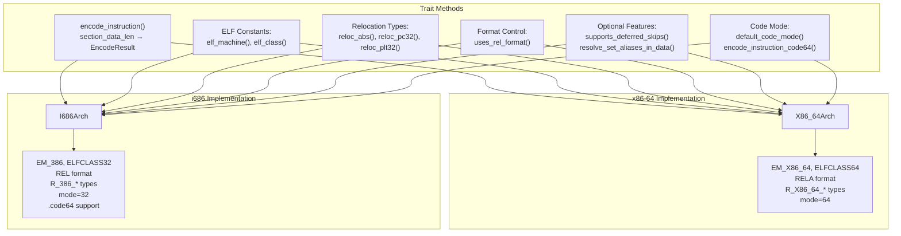

**Sources:** [src/backend/elf_writer_common.rs:31-97]()

### x86-64 vs i686 Encoding Differences

| Aspect | x86-64 | i686 |
|--------|--------|------|
| **ELF Class** | `ELFCLASS64` (64-bit) | `ELFCLASS32` (32-bit) |
| **Machine Type** | `EM_X86_64` | `EM_386` |
| **REX Prefix** | Required for 64-bit ops, extended registers | Not supported |
| **Register Set** | 16 GP registers (rax-r15) | 8 GP registers (eax-edi) |
| **Relocation Format** | RELA (explicit addends) | REL (addends in section data) |
| **Relocation Types** | `R_X86_64_PC32`, `R_X86_64_64`, etc. | `R_386_PC32`, `R_386_32`, etc. |
| **Default Mode** | 64-bit (`code_mode=64`) | 32-bit (`code_mode=32`) |
| **Cross-Mode Support** | N/A | `.code64` delegates to x86-64 encoder |

The i686 assembler includes special handling for `.code64` sections (used in Linux kernel boot code): when `code_mode == 64`, `I686Arch::encode_instruction_code64()` delegates to the x86-64 encoder but translates relocation types back to `R_386_*` constants for ELF32 compatibility.

**Sources:** [src/backend/x86/assembler/elf_writer.rs:14-89](), [src/backend/i686/assembler/elf_writer.rs:19-167]()

### Instruction Encoding Process

Both architectures follow the same encoding pattern through their respective `InstructionEncoder` implementations:

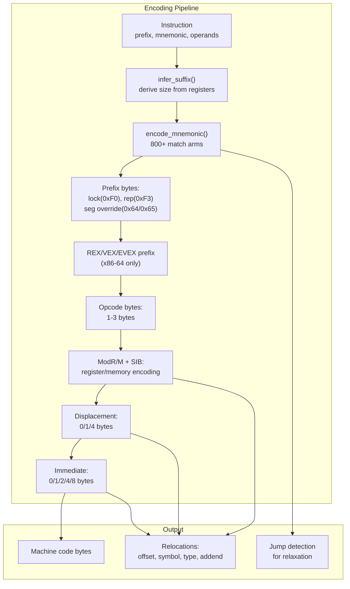

**RIP-relative addressing** (x86-64 only) uses `mod=00, rm=101` in ModR/M with a 32-bit displacement. Symbol references generate `R_X86_64_PC32` relocations with an initial addend of `-4` to account for the displacement field. For instructions with trailing immediates (e.g., `addl $1, sym(%rip)`), the addend is adjusted by the immediate size via `adjust_rip_reloc_addend()`.

**Sources:** [src/backend/x86/assembler/README.md:351-408](), encoder files in [src/backend/x86/assembler/encoder/]()

## Shared ELF Writer Architecture

The `ElfWriterCore<A>` struct in `elf_writer_common.rs` provides all section management, symbol tracking, jump relaxation, and ELF serialization logic. It is parameterized by the `X86Arch` trait to allow architecture-specific instruction encoding and relocation handling.

### Processing Phases

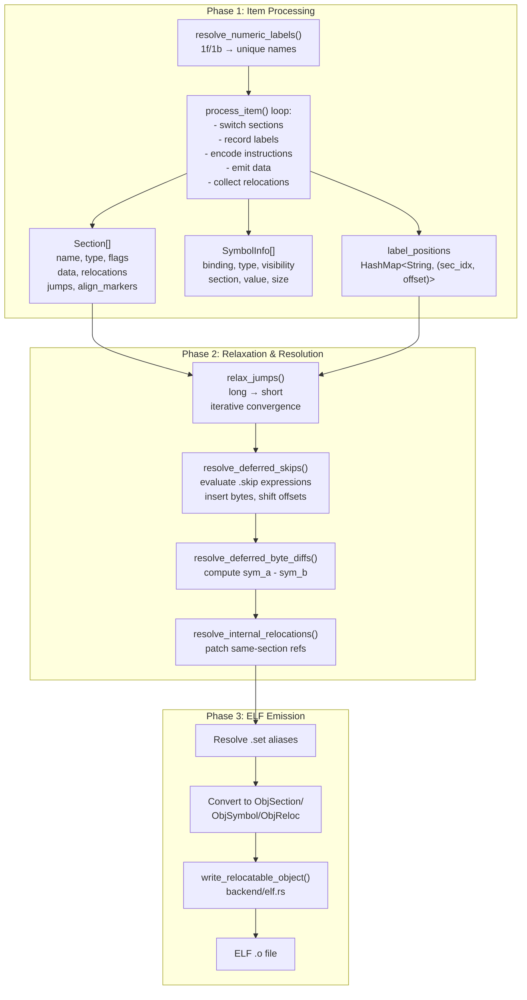

**Sources:** [src/backend/elf_writer_common.rs:269-337](), [src/backend/elf_writer_common.rs:1110-1298]()

### Section Management

Sections are created on-demand and identified by name. Well-known section names (`.text`, `.data`, `.bss`, `.rodata`) receive default type/flags via `parse_section_flags()`:

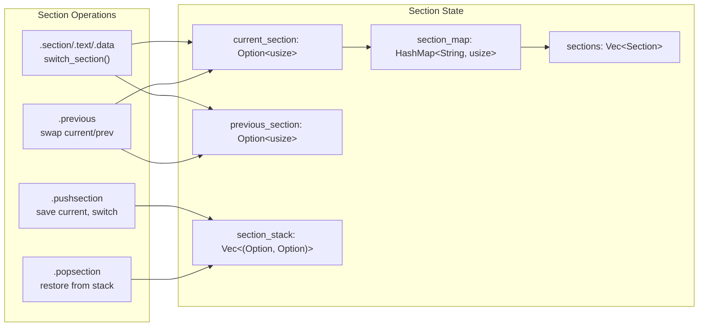

Each `Section` tracks:
- **data**: `Vec<u8>` of encoded bytes
- **relocations**: `Vec<ElfRelocation>` for unresolved symbol references
- **jumps**: `Vec<JumpInfo>` for relaxation candidates
- **align_markers**: `Vec<AlignMarker>` for post-relaxation fixup
- **comdat_group**: `Option<String>` for COMDAT deduplication

**Sources:** [src/backend/elf_writer_common.rs:151-162](), [src/backend/elf_writer_common.rs:339-369]()

## Jump Relaxation

The `relax_jumps()` method shrinks long-form jumps to short form when the target is within ±127 bytes. This is an iterative process because shrinking one jump can bring other jumps' targets into short range.

### Relaxation Algorithm

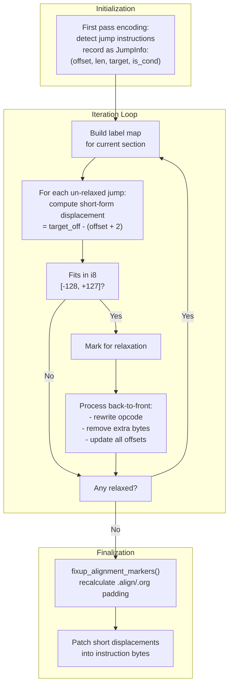

**Long-to-short transformations:**
- Unconditional jump: `E9 rel32` (5 bytes) → `EB rel8` (2 bytes)
- Conditional jump: `0F 8x rel32` (6 bytes) → `7x rel8` (2 bytes)

**Offset adjustments** after each shrink operation:
- All labels after the shrunk jump shift backward by 3 or 4 bytes
- Relocations, other jumps, deferred skips, and alignment markers are updated
- The jump's own relocation entry is removed (displacement is now inline)

**Sources:** [src/backend/elf_writer_common.rs:1334-1492]()

### Alignment Marker Fixup

`.align` and `.org` directives record padding at specific offsets. After jump relaxation, the padding must be recalculated because code before the marker may have shrunk:

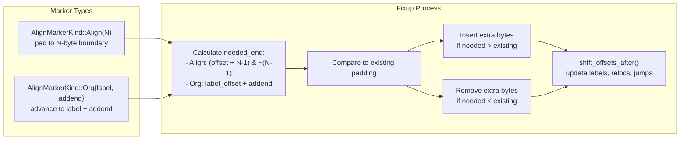

**Sources:** [src/backend/elf_writer_common.rs:1494-1553](), [src/backend/elf_writer_common.rs:134-149]()

## Deferred Expression Evaluation

Two categories of expressions cannot be evaluated during the first pass:

### Deferred .skip Expressions

The Linux kernel uses complex `.skip` expressions in its ALTERNATIVES macro framework:

```gas
.skip -(((6651f-6641f)-(662b-661b)) > 0) * ((6651f-6641f)-(662b-661b)), 0x90
```

These expressions:
- Reference forward labels (`6651f`) not yet defined
- Depend on final label positions after jump relaxation
- Use arithmetic, comparison, and boolean operators

The `resolve_deferred_skips()` method evaluates these after relaxation:

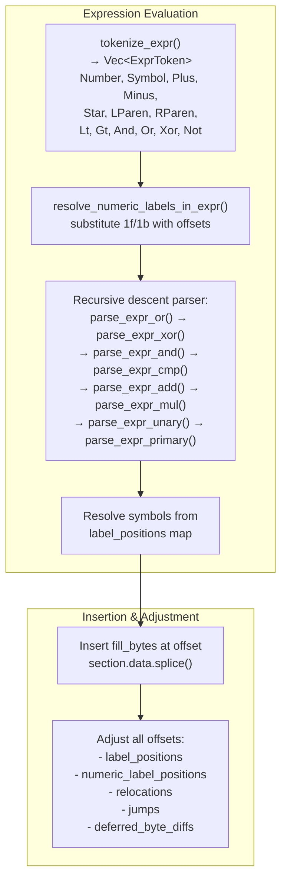

Deferred skips are processed in **reverse order** within each section to avoid invalidating later offsets during insertion.

**Sources:** [src/backend/elf_writer_common.rs:846-896](), [src/backend/elf_writer_common.rs:188-266]()

### Deferred Byte-Sized Symbol Diffs

Symbol-difference expressions like `.byte label_a - label_b` are deferred for byte and short sizes (1-2 bytes) because:
- The difference may change if `.skip` expressions insert bytes between the symbols
- Both symbols must be in the same section

The `resolve_deferred_byte_diffs()` method computes these after skip insertion:

| Deferred Diff | Computation | Error Case |
|---------------|-------------|------------|
| `.byte a - b` | `label_positions[a].1 - label_positions[b].1` | Cross-section diff |
| `.short a - b + N` | `label_positions[a].1 - label_positions[b].1 + N` | Undefined symbol |

**Sources:** [src/backend/elf_writer_common.rs:899-925]()

## Internal Relocation Resolution

The `resolve_internal_relocations()` method patches relocations that can be computed without the linker. This optimization reduces the number of relocations in the output ELF file and improves linking performance.

### Resolution Rules

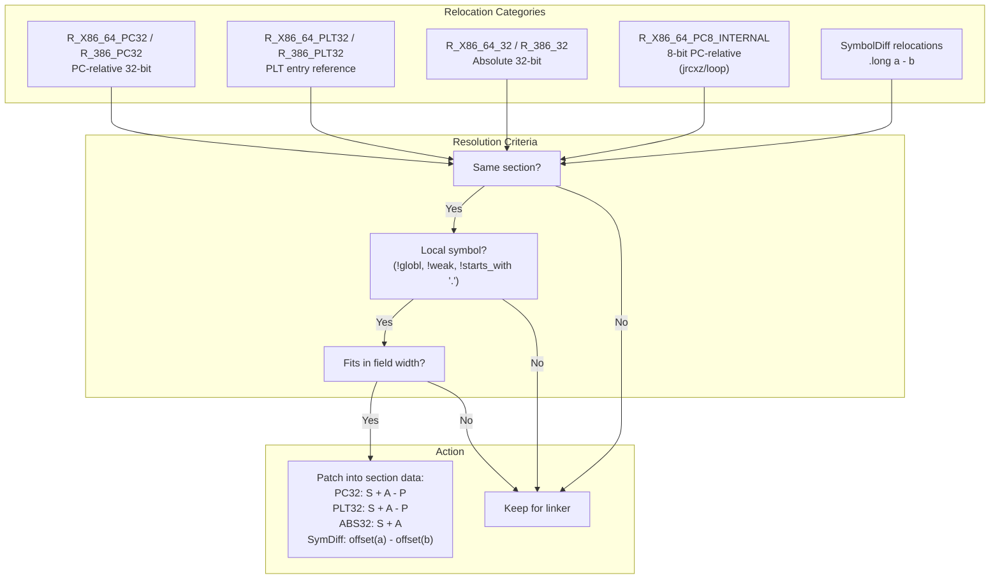

**Key optimization:** Global and weak symbols are **never** resolved internally, even if they reference the same section. This preserves the linker's ability to perform symbol interposition and PLT redirection.

**Sources:** [src/backend/elf_writer_common.rs:1619-1699]()

## REL vs RELA Relocation Formats

The x86-64 and i686 architectures use different relocation formats in their ELF object files:

| Aspect | x86-64 (RELA) | i686 (REL) |
|--------|---------------|------------|
| **Format** | Explicit addend in relocation entry | Addend stored in section data |
| **Struct** | `Elf64_Rela { offset, info, addend }` | `Elf32_Rel { offset, info }` |
| **Addend Location** | 8-byte field in `.rela.*` section | Embedded in relocated field |
| **Patching** | Linker reads addend from relocation | Linker reads addend from data |
| **Encoder Behavior** | Zero section data, set `addend` field | Patch addend into section data |

The `uses_rel_format()` trait method controls this behavior. When `true`, the ELF writer patches addends into section data during `emit_elf()`:

```rust
if A::uses_rel_format() {
    let off = reloc.offset as usize;
    let existing = i32::from_le_bytes([data[off], data[off+1], data[off+2], data[off+3]]);
    let patched = existing.wrapping_add(addend as i32);
    data[off..off+4].copy_from_slice(&patched.to_le_bytes());
    relocs.push(ObjReloc { ..., addend: 0 });
} else {
    relocs.push(ObjReloc { ..., addend });
}
```

**Sources:** [src/backend/elf_writer_common.rs:1110-1171]()

## Code Mode Switching

Both assemblers support `.code16`, `.code32`, and `.code64` directives that control instruction encoding. This is essential for kernel boot code that transitions between processor modes:

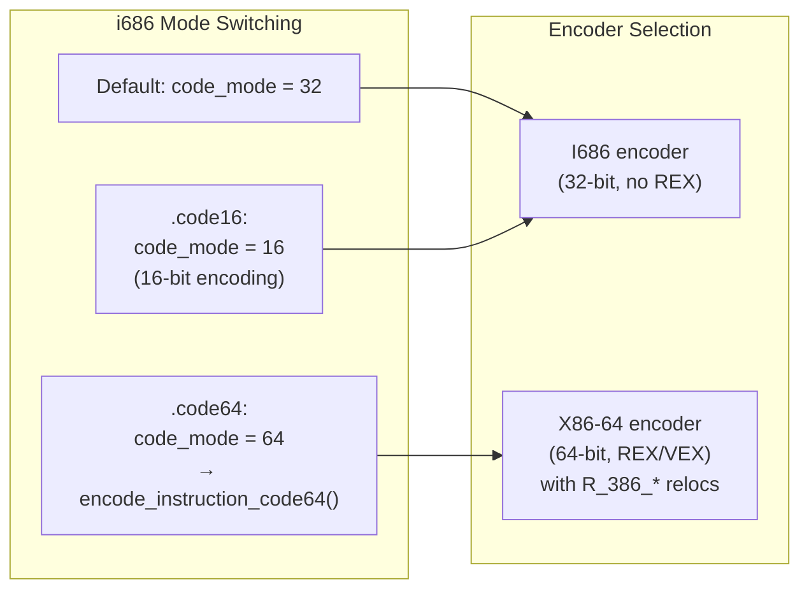

**Example use case:** Linux kernel `trampoline_64.S` compiles with `-m32` but contains `.code64` sections with 64-bit instructions like `jmpq` and `lidt` with RIP-relative addressing. The i686 assembler delegates to the x86-64 encoder but translates relocation types to `R_386_*` for ELF32 compatibility.

**Sources:** [src/backend/i686/assembler/elf_writer.rs:100-167](), [src/backend/elf_writer_common.rs:84-96](), [src/backend/elf_writer_common.rs:775-787]()

## Key Data Structures

### AsmItem Enum

The `AsmItem` enum represents parsed assembly lines with 33 variants covering directives, labels, data, and instructions:

```rust
pub enum AsmItem {
    Section(SectionDirective),
    Global(String),
    Weak(String),
    Hidden(String),
    Protected(String),
    Internal(String),
    SymbolType(String, SymbolKind),
    Size(String, SizeExpr),
    Label(String),
    Align(u32),
    Byte(Vec<DataValue>),
    Short(Vec<DataValue>),
    Long(Vec<DataValue>),
    Quad(Vec<DataValue>),
    Zero(u32),
    SkipExpr(String, u8),
    Asciz(Vec<u8>),
    Ascii(Vec<u8>),
    Comm(String, u64, u32),
    Set(String, String),
    Cfi(CfiDirective),
    File(u32, String),
    Loc(u32, u32, u32),
    Instruction(Instruction),
    PushSection(SectionDirective),
    PopSection,
    Previous,
    Org(String, i64),
    Incbin { path: String, skip: u64, count: Option<u64> },
    Symver(String, String),
    CodeMode(u8),
    OptionDirective(String),
    Empty,
}
```

**Sources:** [src/backend/x86/assembler/parser.rs:12-89]()

### Instruction and Operand Types

```rust
pub struct Instruction {
    pub prefix: Option<String>,      // lock, rep, repnz, notrack
    pub mnemonic: String,             // movq, addl, jmp
    pub operands: Vec<Operand>,       // AT&T order (src, dst)
}

pub enum Operand {
    Register(Register),               // %rax, %eax, %xmm0
    Immediate(ImmediateValue),        // $42, $symbol, $symbol@GOTPCREL
    Memory(MemoryOperand),            // disp(%base, %index, scale)
    Label(String),                    // target
    Indirect(Box<Operand>),           // *%reg, *addr
}

pub struct MemoryOperand {
    pub segment: Option<String>,      // fs, gs
    pub displacement: Displacement,   // Integer, Symbol, SymbolMod
    pub base: Option<Register>,       // %rax, %rip
    pub index: Option<Register>,      // %rcx
    pub scale: Option<u8>,            // 1, 2, 4, 8
}
```

**Sources:** [src/backend/x86/assembler/parser.rs:151-232]()

### ELF Writer Internal Types

```rust
struct Section {
    name: String,
    section_type: u32,              // SHT_PROGBITS, SHT_NOBITS
    flags: u64,                     // SHF_ALLOC, SHF_EXECINSTR, SHF_WRITE
    data: Vec<u8>,
    alignment: u64,
    relocations: Vec<ElfRelocation>,
    jumps: Vec<JumpInfo>,           // For relaxation
    align_markers: Vec<AlignMarker>,
    comdat_group: Option<String>,
}

struct JumpInfo {
    offset: usize,
    len: usize,
    target: String,
    is_conditional: bool,
    relaxed: bool,
}

struct AlignMarker {
    offset: usize,
    padding: usize,
    kind: AlignMarkerKind,          // Align(N) or Org{label, addend}
}

struct ElfRelocation {
    offset: u64,
    symbol: String,
    reloc_type: u32,
    addend: i64,
    diff_symbol: Option<String>,    // For .long a - b
    patch_size: u8,                 // 1, 2, 4, or 8 bytes
}
```

**Sources:** [src/backend/elf_writer_common.rs:123-173]()

## Supported Relocation Types

### x86-64 Relocations

| Constant | Value | Usage |
|----------|-------|-------|
| `R_X86_64_NONE` | 0 | No relocation |
| `R_X86_64_64` | 1 | Absolute 64-bit (`.quad symbol`) |
| `R_X86_64_PC32` | 2 | PC-relative 32-bit (RIP-relative) |
| `R_X86_64_PLT32` | 4 | PLT entry reference (`call`/`jmp`) |
| `R_X86_64_GOTPCREL` | 9 | GOT entry (`symbol@GOTPCREL(%rip)`) |
| `R_X86_64_32` | 10 | Absolute 32-bit unsigned |
| `R_X86_64_32S` | 11 | Absolute 32-bit signed |
| `R_X86_64_16` | 12 | Absolute 16-bit |
| `R_X86_64_PC8` | 15 | PC-relative 8-bit |
| `R_X86_64_TPOFF32` | 23 | TLS offset (`symbol@TPOFF`) |
| `R_X86_64_GOTTPOFF` | 22 | TLS GOT entry (`symbol@GOTTPOFF(%rip)`) |
| `R_X86_64_PC8_INTERNAL` | 0x80000001 | **Internal-only**: 8-bit PC-relative for `jrcxz`/`loop` (never emitted to ELF) |

**Sources:** [src/backend/x86/assembler/encoder/mod.rs:20-34]()

### i686 Relocations

| Constant | Value | Usage |
|----------|-------|-------|
| `R_386_NONE` | 0 | No relocation |
| `R_386_32` | 1 | Absolute 32-bit |
| `R_386_PC32` | 2 | PC-relative 32-bit |
| `R_386_PLT32` | 4 | PLT entry reference |
| `R_386_GOTPC` | 10 | GOT base relative to PC |
| `R_386_GOTOFF` | 9 | GOT base relative offset |

**Sources:** [src/backend/i686/assembler/encoder.rs]() (relocation constants)

---

