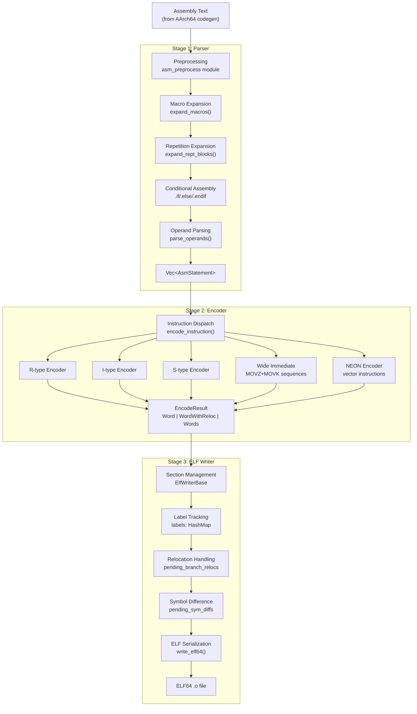
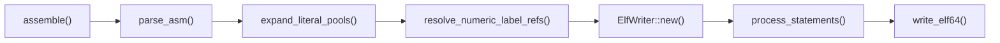
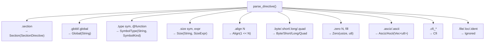
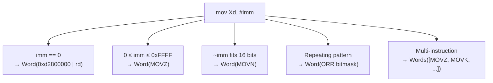
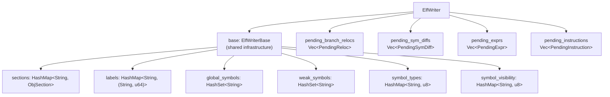
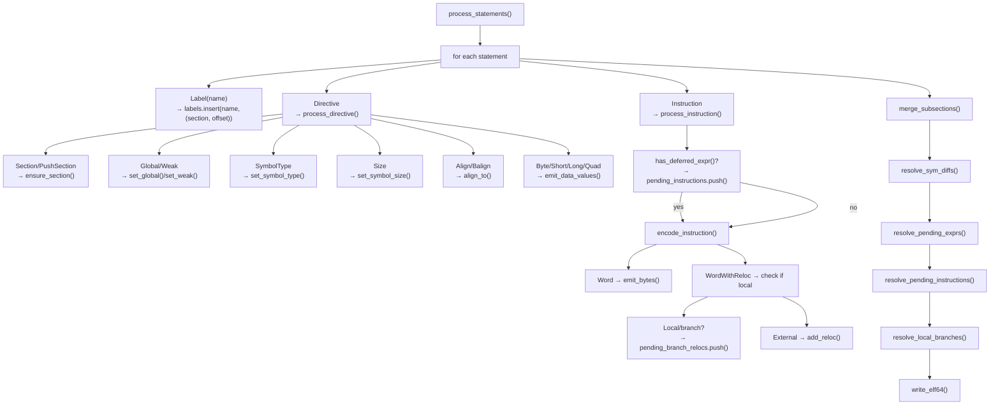
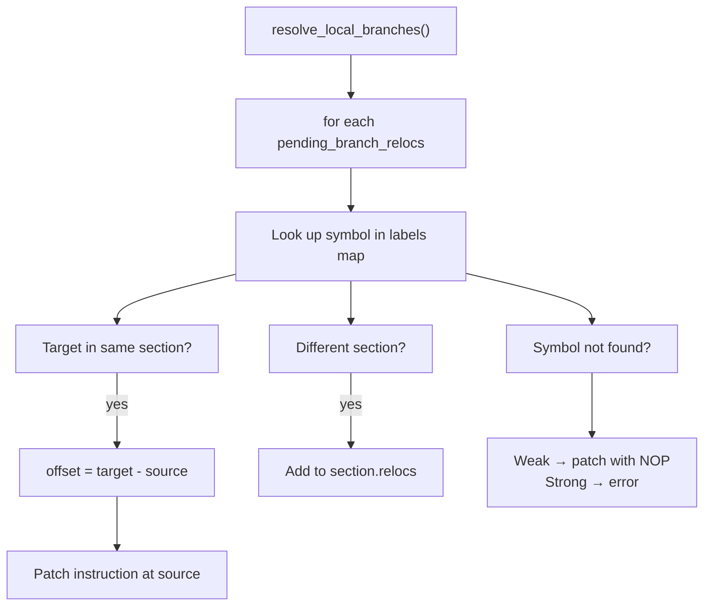
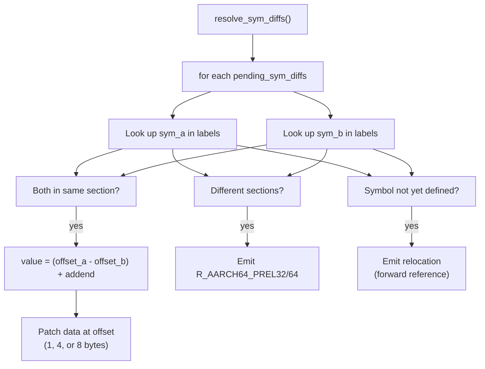

<!-- source: DeepWiki mcp.deepwiki.com · repo anthropics/claudes-c-compiler · page 7.3 AArch64 Assembler · fetched 2026-10-26 -->

# AArch64 Assembler

<details>
<summary>Relevant source files</summary>

The following files were used as context for generating this wiki page:

- [src/backend/arm/assembler/README.md](src/backend/arm/assembler/README.md)
- [src/backend/arm/assembler/elf_writer.rs](src/backend/arm/assembler/elf_writer.rs)
- [src/backend/arm/assembler/parser.rs](src/backend/arm/assembler/parser.rs)
- [src/backend/arm/linker/reloc.rs](src/backend/arm/linker/reloc.rs)
- [src/backend/riscv/assembler/README.md](src/backend/riscv/assembler/README.md)
- [src/backend/riscv/assembler/compress.rs](src/backend/riscv/assembler/compress.rs)
- [src/backend/riscv/assembler/elf_writer.rs](src/backend/riscv/assembler/elf_writer.rs)
- [src/backend/riscv/assembler/parser.rs](src/backend/riscv/assembler/parser.rs)
- [src/passes/div_by_const.rs](src/passes/div_by_const.rs)

</details>


## Purpose and Scope

The AArch64 assembler is a self-contained subsystem that translates GNU-style assembly text (`.s` files) emitted by the compiler's AArch64 backend into ELF64 relocatable object files (`.o`). It eliminates the external dependency on `aarch64-linux-gnu-as`, making the compiler fully self-hosting on AArch64 Linux targets.

This page documents the AArch64-specific implementation. For an overview of the built-in assembler architecture shared across all targets, see [Built-in Assembler Overview](#7.1). For the linker that processes these object files, see [Built-in Linker](#7.5).

The implementation spans approximately 9,600 lines across four files in `src/backend/arm/assembler/`. It composes with `ElfWriterBase` from `src/backend/elf.rs` for shared infrastructure (section management, symbol tables, ELF serialization), contributing only AArch64-specific logic.

**Sources:** [src/backend/arm/assembler/README.md:1-20]()

## Three-Stage Pipeline Architecture

The assembler processes assembly text through three sequential stages, each with a well-defined interface.



**Sources:** [src/backend/arm/assembler/README.md:20-62](), [src/backend/arm/assembler/parser.rs:196-268]()

## Entry Point and Orchestration

The public entry point `assemble()` in `src/backend/arm/assembler/mod.rs` orchestrates the pipeline:



The `expand_literal_pools()` pass converts `ldr Xn, =symbol` pseudo-instructions into `ldr Xn, .Llpool_N` with corresponding `.quad` pool entries. The `resolve_numeric_label_refs()` pass rewrites GNU numeric labels (`1:`, `1f`, `1b`) into unique synthetic labels to support forward/backward references.

**Sources:** [src/backend/arm/assembler/README.md:54-62](), [src/backend/arm/assembler/parser.rs:857-935]()

## Parser Stage: Data Structures

The parser produces a typed intermediate representation where all directives and operands are fully parsed. No string re-parsing occurs in later stages.

```mermaid
graph TB
    ASM["AsmStatement<br/>(enum)"]
    
    LABEL["Label(String)<br/>name:"]
    DIRECTIVE["Directive(AsmDirective)<br/>.text, .globl, .byte, ..."]
    INSTRUCTION["Instruction<br/>mnemonic + operands"]
    EMPTY["Empty<br/>blank line / comment"]
    
    DIRVARIANT["AsmDirective (28 variants)"]
    SECTION["Section(SectionDirective)"]
    GLOBAL["Global(String)"]
    TYPE["SymbolType(String, SymbolKind)"]
    SIZE["Size(String, SizeExpr)"]
    ALIGN["Align(u64) / Balign(u64)"]
    DATA["Byte/Short/Long/Quad<br/>(Vec&lt;DataValue&gt;)"]
    CFI["Cfi (ignored)"]
    
    OPERAND["Operand (20 variants)"]
    REG["Reg(String)<br/>x0, w0, d0, v0, sp"]
    IMM["Imm(i64)<br/>#42"]
    SYM["Symbol(String)<br/>printf"]
    MEM["Mem { base, offset }<br/>[x0, #8]"]
    MEMPRE["MemPreIndex<br/>[x0, #8]!"]
    MEMPOST["MemPostIndex<br/>[x0], #8"]
    MEMREG["MemRegOffset<br/>[x0, x1, lsl #3]"]
    MOD["Modifier<br/>:lo12:sym"]
    NEON["RegArrangement<br/>v0.16b"]
    LANE["RegLane<br/>v0.d[1]"]
    
    ASM --> LABEL
    ASM --> DIRECTIVE
    ASM --> INSTRUCTION
    ASM --> EMPTY
    
    DIRECTIVE --> DIRVARIANT
    DIRVARIANT --> SECTION
    DIRVARIANT --> GLOBAL
    DIRVARIANT --> TYPE
    DIRVARIANT --> SIZE
    DIRVARIANT --> ALIGN
    DIRVARIANT --> DATA
    DIRVARIANT --> CFI
    
    INSTRUCTION --> OPERAND
    OPERAND --> REG
    OPERAND --> IMM
    OPERAND --> SYM
    OPERAND --> MEM
    OPERAND --> MEMPRE
    OPERAND --> MEMPOST
    OPERAND --> MEMREG
    OPERAND --> MOD
    OPERAND --> NEON
    OPERAND --> LANE
```



**Sources:** [src/backend/arm/assembler/parser.rs:18-191](), [src/backend/arm/assembler/README.md:74-111]()

## Parser Stage: Operand Types

The `Operand` enum models every AArch64 addressing mode. This comprehensive type system enables type-safe instruction encoding without string parsing.

| Operand Variant | Example Syntax | Usage |
|-----------------|----------------|-------|
| `Reg(String)` | `x0`, `w5`, `d3`, `v1` | General-purpose, floating-point, SIMD registers |
| `Imm(i64)` | `#42`, `#-1` | Immediate values |
| `Symbol(String)` | `printf`, `.LC0` | Bare symbol references |
| `SymbolOffset(String, i64)` | `arr+16` | Symbol with constant offset |
| `Mem { base, offset }` | `[x0, #8]` | Memory reference with offset |
| `MemPreIndex { base, offset }` | `[x0, #8]!` | Pre-index writeback |
| `MemPostIndex { base, offset }` | `[x0], #8` | Post-index writeback |
| `MemRegOffset { base, index, extend, shift }` | `[x0, x1, lsl #3]` | Register offset with optional extend/shift |
| `Modifier { kind, symbol }` | `:lo12:symbol` | Relocation modifier |
| `ModifierOffset { kind, symbol, offset }` | `:lo12:symbol+8` | Modifier with addend |
| `Shift { kind, amount }` | `lsl #2` | Shift operand |
| `Extend { kind, amount }` | `sxtw #2` | Extend operand |
| `Cond(String)` | `eq`, `ne`, `lt` | Condition code |
| `Barrier(String)` | `ish`, `sy` | Memory barrier option |
| `Label(String)` | `.LBB0_4` | Branch target |
| `Expr(String)` | Complex expressions | Fallback for unparsed expressions |
| `RegArrangement { reg, arrangement }` | `v0.16b`, `v1.4s` | NEON vector arrangement |
| `RegLane { reg, elem_size, index }` | `v0.d[1]` | NEON lane index |
| `RegList(Vec<Operand>)` | `{v0.16b, v1.16b}` | NEON register list |
| `RegListIndexed { regs, index }` | `{v0.s, v1.s}[0]` | NEON indexed register list |

**Sources:** [src/backend/arm/assembler/parser.rs:18-64](), [src/backend/arm/assembler/README.md:86-111]()

## Parser Stage: Preprocessing

Before parsing individual lines, the shared `asm_preprocess` module performs several text-level expansions:


The macro expander supports:
- Default parameter values: `.macro foo enable=1`
- Varargs with `\()` delimiter stripping
- Nested macro definitions (FFmpeg's `function` macro defines `endfunc` inside its body)
- `.purgem` to remove definitions (allows macro redefinition)
- `\@` unique counter substitution for label generation

**Sources:** [src/backend/arm/assembler/parser.rs:722-856](), [src/backend/arm/assembler/README.md:115-145]()

## Parser Stage: Conditional Assembly

The parser evaluates conditional assembly directives during line processing, implementing a stack-based state machine:

| Directive | Semantics |
|-----------|-----------|
| `.if expr` | Push `eval_if_condition(expr)` onto stack |
| `.ifdef sym` / `.ifndef sym` | Test symbol existence |
| `.ifc str1, str2` / `.ifnc str1, str2` | String comparison |
| `.ifb arg` / `.ifnb arg` | Blank argument test |
| `.ifeq expr` / `.ifne expr` | Numeric comparison (zero/non-zero) |
| `.elseif expr` / `.elsif expr` | Pop and push new condition |
| `.else` | Negate top of stack |
| `.endif` | Pop stack |

Expressions support `==`, `!=`, `>`, `>=`, `<`, `<=`, `||`, `&&`, parentheses, and are evaluated via the shared `asm_expr::parse_integer_expr()` evaluator.

**Sources:** [src/backend/arm/assembler/parser.rs:857-1004](), [src/backend/arm/assembler/README.md:126-132]()

## Parser Stage: Directive Handling

All directives are fully parsed into typed `AsmDirective` variants. The parser never stores directive arguments as raw strings.



**Key parsing decisions:**

- `.align N` is power-of-2: stored as `Align(1u64 << N)` bytes
- `.balign N` is byte count: stored as `Balign(N)` directly
- `.type` maps `@function`/`%function` to `SymbolKind::Function` enum
- `.size sym, .-label` is parsed to `SizeExpr::CurrentMinusSymbol(label)`
- `.byte`/`.long`/`.quad` values are `DataValue` enum (integer, symbol, or symbol difference)

**Sources:** [src/backend/arm/assembler/parser.rs:1006-1282](), [src/backend/arm/assembler/README.md:147-161]()

## Encoder Stage: Instruction Dispatch

The encoder maps mnemonic strings to instruction encoders. It handles ~400 base mnemonics (~440 including condition code variants).

```mermaid
graph TB
    ENCODE["encode_instruction()"]
    
    DATAP["Data Processing<br/>add, sub, mul, div, ..."]
    SHIFT["Shifts<br/>lsl, lsr, asr, ror"]
    BITFIELD["Bit Fields<br/>ubfm, sbfm, bfi, ..."]
    COMPARE["Compare<br/>cmp, cmn, tst"]
    COND["Conditional<br/>csel, csinc, cset"]
    BRANCH["Branches<br/>b, bl, br, cbz, tbz"]
    LOADSTORE["Load/Store<br/>ldr, str, ldp, stp"]
    ADDR["Address<br/>adrp, adr"]
    FLOAT["Floating Point<br/>fadd, fmul, fcvt"]
    NEON["NEON<br/>vadd, vmul, vld1"]
    SYSTEM["System<br/>nop, dmb, mrs, msr"]
    ATOMIC["Atomics<br/>cas, ldadd, swp"]
    
    ENCODE --> DATAP
    ENCODE --> SHIFT
    ENCODE --> BITFIELD
    ENCODE --> COMPARE
    ENCODE --> COND
    ENCODE --> BRANCH
    ENCODE --> LOADSTORE
    ENCODE --> ADDR
    ENCODE --> FLOAT
    ENCODE --> NEON
    ENCODE --> SYSTEM
    ENCODE --> ATOMIC
```



Each encoder returns an `EncodeResult`:

```rust
enum EncodeResult {
    Word(u32),                              // Single 32-bit instruction
    WordWithReloc { word: u32, reloc: Relocation },  // Instruction + relocation
    Words(Vec<u32>),                        // Multi-word sequence (e.g., movz+movk)
    Skip,                                   // Pseudo-instruction (no output)
}
```

**Sources:** [src/backend/arm/assembler/encoder/mod.rs:1-50]() (inferred from README), [src/backend/arm/assembler/README.md:186-244]()

## Encoder Stage: Relocation Types

When an instruction references an external symbol, the encoder emits a `Relocation` with an AArch64 ELF relocation type. The linker resolves these at link time.

| RelocType | ELF Number | Instruction | Usage |
|-----------|------------|-------------|-------|
| `Call26` | 283 | `bl symbol` | 26-bit PC-relative call |
| `Jump26` | 282 | `b symbol` | 26-bit PC-relative jump |
| `AdrPrelLo21` | 274 | `adr Xd, symbol` | 21-bit PC-relative address |
| `AdrpPage21` | 275 | `adrp Xd, symbol` | Page-relative (bits [32:12]) |
| `AddAbsLo12` | 277 | `add Xd, Xn, :lo12:symbol` | Low 12 bits |
| `Ldst8AbsLo12` | 278 | `ldrb/strb` | Load/store byte, low 12 |
| `Ldst16AbsLo12` | 284 | `ldrh/strh` | Load/store halfword, low 12 |
| `Ldst32AbsLo12` | 285 | `ldr/str Wd` | Load/store word, low 12 |
| `Ldst64AbsLo12` | 286 | `ldr/str Xd` | Load/store doubleword, low 12 |
| `Ldst128AbsLo12` | 299 | `ldr/str Qd` | Load/store quadword, low 12 |
| `AdrGotPage21` | 311 | `adrp Xd, :got:symbol` | GOT page |
| `Ld64GotLo12` | 312 | `ldr Xd, [Xn, :got_lo12:symbol]` | GOT entry |
| `TlsLeAddTprelHi12` | 549 | TLS Local Exec | High 12 bits of TP offset |
| `TlsLeAddTprelLo12` | 551 | TLS Local Exec | Low 12 bits of TP offset |
| `CondBr19` | 280 | `b.cond` | Conditional branch, 19-bit |
| `TstBr14` | 279 | `tbz/tbnz` | Test-and-branch, 14-bit |
| `Ldr19` | 273 | `ldr Xd, =pool` | LDR literal, 19-bit PC-relative |
| `Abs64` | 257 | `.quad symbol` | 64-bit absolute |
| `Abs32` | 258 | `.long symbol` | 32-bit absolute |
| `Prel32` | 261 | `.long symbol - .` | 32-bit PC-relative |
| `Prel64` | 260 | `.quad symbol - .` | 64-bit PC-relative |

**Sources:** [src/backend/arm/assembler/README.md:246-274](), [src/backend/arm/linker/reloc.rs:1-40]()

## Encoder Stage: Wide Immediate Encoding

The `mov Xd, #imm` instruction requires special handling for large constants that don't fit in a single instruction's immediate field.



The encoder tries encodings in order:
1. **Zero**: `movz Xd, #0`
2. **MOVZ**: If `imm` fits in 16 bits: `movz Xd, #imm`
3. **MOVN**: If `~imm` fits in 16 bits: `movn Xd, #~imm`
4. **Bitmask immediate**: If `imm` is a repeating pattern (e.g., `0x0101010101010101`): `orr Xd, xzr, #imm`
5. **Multi-instruction**: Up to 4 instructions for a full 64-bit constant: `movz` + up to 3 `movk` instructions

**Sources:** [src/backend/arm/assembler/README.md:283-297]()

## ELF Writer Stage: State Management

The `ElfWriter` composes with `ElfWriterBase` for shared infrastructure and adds AArch64-specific deferred resolution.



**Deferred resolution queues:**

- `pending_branch_relocs`: Branch/local relocations resolved after all labels are positioned
- `pending_sym_diffs`: Symbol difference expressions (e.g., `.long .LBB3 - .Ljt_0`)
- `pending_exprs`: Complex expressions containing forward label references
- `pending_instructions`: Instructions with symbolic offset expressions in operands

**Sources:** [src/backend/arm/assembler/elf_writer.rs:27-110](), [src/backend/arm/assembler/README.md:302-338]()

## ELF Writer Stage: Processing Algorithm

The writer processes statements in a single pass, deferring relocations that reference forward labels.



**Key processing steps:**

1. **Statement processing**: Labels update the `labels` map, directives update section state, instructions encode and emit bytes
2. **Subsection merging**: `.subsection N` sections are merged back into parent (e.g., `.text.__subsection.1` → `.text`)
3. **Symbol difference resolution**: Evaluate `A - B` expressions, emit as PC-relative relocations if cross-section
4. **Expression resolution**: Substitute label offsets into deferred expressions and evaluate
5. **Instruction resolution**: Re-encode instructions that had symbolic operands
6. **Branch resolution**: Resolve intra-section branches at assembly time (no relocation needed)

**Sources:** [src/backend/arm/assembler/elf_writer.rs:351-391](), [src/backend/arm/assembler/README.md:340-398]()

## ELF Writer Stage: Branch Resolution

Branch and local label relocations are resolved at assembly time when both the source and target are in the same section. This eliminates unnecessary relocations in the object file.



**Branch relocation types handled:**

- `R_AARCH64_CALL26` / `R_AARCH64_JUMP26`: 26-bit offset for `bl`/`b` instructions
- `R_AARCH64_CONDBR19`: 19-bit offset for conditional branches (`b.eq`, `b.ne`, etc.)
- `R_AARCH64_TSTBR14`: 14-bit offset for test-and-branch (`tbz`, `tbnz`)

**Undefined weak symbols**: When a branch target is an undefined weak symbol, the instruction is replaced with NOP (`0xd503201f`). This is GCC-compatible behavior.

**Sources:** [src/backend/arm/assembler/elf_writer.rs:625-711](), [src/backend/arm/assembler/README.md:419-455]()

## ELF Writer Stage: Symbol Difference Resolution

Symbol differences (e.g., `.long .LBB3 - .Ljt_0`) are common in jump tables and size computations. The writer resolves these after all labels are positioned.



**Relocation choice:**
- **Same section**: Resolve at assembly time, patch data directly
- **Cross-section**: Emit `R_AARCH64_PREL32` (4-byte) or `R_AARCH64_PREL64` (8-byte)
- **Forward reference**: Emit relocation for linker

**Sources:** [src/backend/arm/assembler/elf_writer.rs:113-172](), [src/backend/arm/assembler/README.md:457-483]()

## Key Differences from Other Architectures

### Fixed 32-bit Instruction Width

Unlike x86 (variable-length 1-15 bytes) and RISC-V (16-bit compressed + 32-bit), AArch64 uses a fixed 32-bit instruction width. This simplifies encoding and branch offset calculation.

**Impact on assembler:**
- No instruction length calculation needed
- Branch offsets are always `(target - source) >> 2` (encoded as instruction count, not bytes)
- No compression pass required
- Alignment padding always uses NOP instructions (4 bytes each)

### Page-Relative Addressing (ADRP/ADD Pairs)

AArch64 uses page-relative addressing for position-independent code. A symbol reference requires two instructions:

```
adrp x0, symbol          ; Load page address (bits [32:12])
add  x0, x0, :lo12:symbol ; Add low 12 bits
```

Or for loads:
```
adrp x0, symbol
ldr  x1, [x0, :lo12:symbol]
```

The assembler emits two relocations:
- `R_AARCH64_ADR_PREL_PG_HI21` on the `adrp`
- `R_AARCH64_ADD_ABS_LO12_NC` or `R_AARCH64_LDST*_ABS_LO12_NC` on the `add`/`ldr`

**Sources:** [src/backend/arm/linker/reloc.rs:239-281]()

### NEON Support

AArch64 has extensive SIMD support via NEON. The assembler handles NEON-specific operand types:

- **Vector arrangements**: `v0.16b`, `v1.4s`, `v2.2d` (register + element size + count)
- **Lane indexing**: `v0.d[1]`, `v1.s[2]` (element access)
- **Register lists**: `{v0.16b, v1.16b, v2.16b}` (multi-register operations)
- **Indexed lists**: `{v0.s, v1.s}[0]` (single-element structure loads/stores)

The encoder dispatches to specialized NEON instruction encoders in the `encoder/` directory.

**Sources:** [src/backend/arm/assembler/parser.rs:56-64](), [src/backend/arm/assembler/README.md:224-237]()

### Homogeneous Floating-point Aggregate (HFA) Detection

The AArch64 calling convention uses HFA detection to determine parameter passing. An HFA is a struct containing only floating-point members of the same type, passed in NEON registers instead of general-purpose registers.

While this is primarily a codegen concern (see [AArch64 Backend](#5.4)), the assembler must correctly encode the NEON load/store instructions used for HFA parameters.

**Sources:** High-level diagram analysis

## Literal Pool Expansion

The `ldr Xn, =symbol` pseudo-instruction loads a 64-bit address into a register. The assembler expands this into:

```
ldr Xn, .Llpool_N    ; PC-relative load from pool
...
.Llpool_N:
  .quad symbol        ; Pool entry
```

The `expand_literal_pools()` pass in the parser:
1. Collects all `LdrLiteralPool` pseudo-instructions
2. Groups pool entries by section
3. Emits pool entries at end of section or at explicit `.ltorg`/`.pool` directives
4. Rewrites `ldr Xn, =symbol` to `ldr Xn, .Llpool_N`

**Pool entry placement:**
- Default: at end of section
- Explicit: at `.ltorg` or `.pool` directive
- Maximum offset: 1MB (19-bit signed offset in `ldr` literal instruction)

**Sources:** [src/backend/arm/assembler/parser.rs:184-191](), [src/backend/arm/assembler/README.md:54-62]()

## GNU Numeric Label Resolution

GNU assembler supports numeric labels (e.g., `1:`, `2:`) that can be redefined. References use `1b` (backward to nearest preceding `1:`) or `1f` (forward to nearest following `1:`).

The `resolve_numeric_label_refs()` pass rewrites these into unique synthetic labels:

```
1:           →  .Lnum_1_0:
  beq 1f     →    beq .Lnum_1_1
1:           →  .Lnum_1_1:
  bne 1b     →    bne .Lnum_1_1
```

**Algorithm:**
1. **First pass**: Scan for numeric label definitions, assign instance IDs
2. **Second pass**: For each numeric reference:
   - Extract label number and direction (`b`/`f`)
   - Find nearest definition in specified direction
   - Rewrite to `.Lnum_{number}_{instance}`

This is critical for kernel code that uses numeric labels extensively in alternative macros.

**Sources:** [src/backend/riscv/assembler/elf_writer.rs:108-232]() (similar implementation)

## Shared Infrastructure (ElfWriterBase)

The `ElfWriterBase` in `src/backend/elf.rs` provides shared infrastructure for all assembler backends:

| Component | Functionality |
|-----------|---------------|
| **Section management** | `ensure_section()`, `switch_to_standard_section()`, `push_section()`, `pop_section()` |
| **Symbol tables** | `set_global()`, `set_weak()`, `set_symbol_type()`, `set_symbol_size()`, `set_visibility()` |
| **Label tracking** | `labels: HashMap<String, (String, u64)>` maps label name to (section, offset) |
| **Data emission** | `emit_bytes()`, `emit_data_integer()`, `emit_data_symbol_ref()`, `emit_placeholder()` |
| **Alignment** | `align_to()` with NOP/zero padding |
| **Directive processing** | `process_section_directive()`, `emit_comm()`, `set_alias()` |
| **ELF serialization** | `write_elf64()` with symbol table, string table, relocation sections |
| **Subsection support** | `.subsection N` creates `.text.__subsection.N`, merged later |

The AArch64 `ElfWriter` composes with this base and adds only architecture-specific logic: branch resolution, symbol difference handling, and NEON operand processing.

**Sources:** [src/backend/arm/assembler/elf_writer.rs:102-111](), [src/backend/arm/assembler/README.md:310-338]()

---

