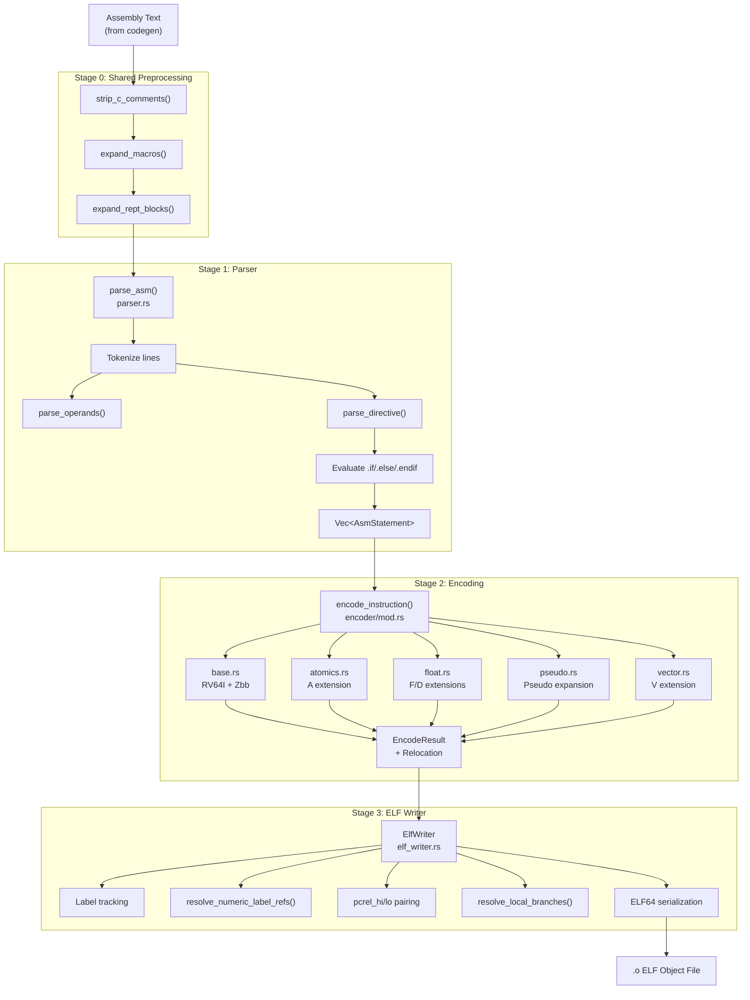
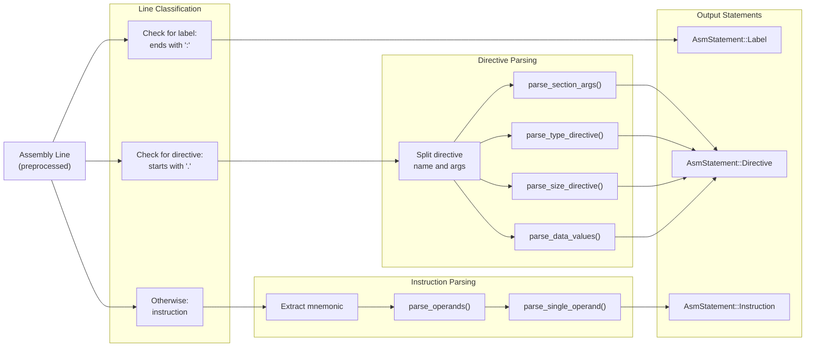
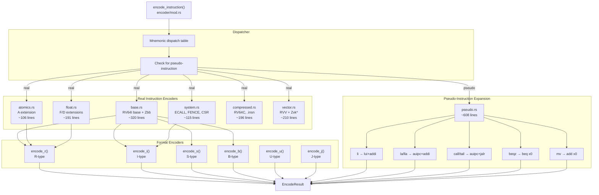
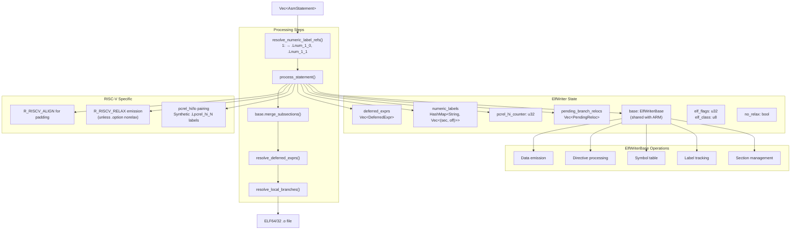
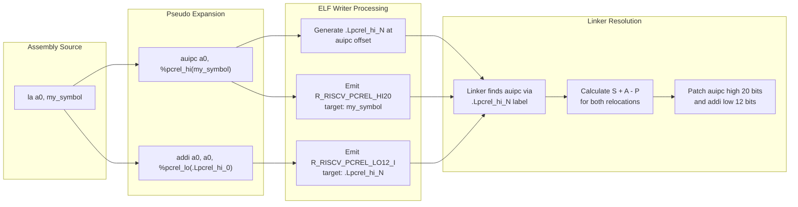
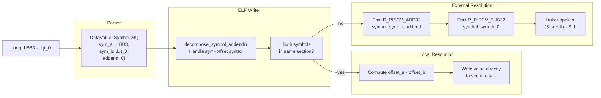

<!-- source: DeepWiki mcp.deepwiki.com · repo anthropics/claudes-c-compiler · page 7.4 RISC-V Assembler · fetched 2026-10-26 -->

# RISC-V Assembler

<details>
<summary>Relevant source files</summary>

The following files were used as context for generating this wiki page:

- [src/backend/arm/assembler/README.md](src/backend/arm/assembler/README.md)
- [src/backend/arm/assembler/elf_writer.rs](src/backend/arm/assembler/elf_writer.rs)
- [src/backend/arm/assembler/parser.rs](src/backend/arm/assembler/parser.rs)
- [src/backend/arm/linker/reloc.rs](src/backend/arm/linker/reloc.rs)
- [src/backend/riscv/assembler/README.md](src/backend/riscv/assembler/README.md)
- [src/backend/riscv/assembler/compress.rs](src/backend/riscv/assembler/compress.rs)
- [src/backend/riscv/assembler/elf_writer.rs](src/backend/riscv/assembler/elf_writer.rs)
- [src/backend/riscv/assembler/parser.rs](src/backend/riscv/assembler/parser.rs)
- [src/passes/div_by_const.rs](src/passes/div_by_const.rs)

</details>


## Purpose and Scope

The RISC-V Assembler is a self-contained, in-process assembler that translates GNU-style RISC-V assembly text (as emitted by the compiler's RISC-V code generator) into ELF relocatable object files (`.o`). It eliminates the dependency on an external `as` binary, enabling fully self-hosted compilation for RISC-V targets.

This assembler supports the RV64IMAFDCV instruction set (including Zbb bit manipulation and Zvksh/Zvksed vector crypto extensions), all standard GNU assembler directives, pseudo-instructions, macro expansion, conditional assembly, and GNU numeric labels.

For information about the RISC-V code generator that produces the assembly input for this assembler, see [RISC-V Backend](#5.5). For information about the linker that consumes the `.o` files produced by this assembler, see [Built-in Linker](#7.5).

**Sources:** [src/backend/riscv/assembler/README.md:1-30](), [src/backend/riscv/assembler/mod.rs:1-100]()

---

## Three-Stage Pipeline Architecture

The assembler operates as a clean three-stage pipeline, with shared preprocessing infrastructure from `asm_preprocess.rs` (used across all target architectures).

**Pipeline Overview**



**Sources:** [src/backend/riscv/assembler/README.md:30-80](), [src/backend/riscv/assembler/mod.rs:1-100]()

---

## Parser (`parser.rs`)

The parser converts preprocessed assembly text into a typed intermediate representation: `Vec<AsmStatement>`. Each line becomes one of four statement types: `Label`, `Directive`, `Instruction`, or `Empty`.

**Parser Data Flow**



**Sources:** [src/backend/riscv/assembler/parser.rs:189-322]()

### Key Parser Structures

The parser output uses typed enums to fully represent all parsed information:

| Type | Purpose | Variants |
|------|---------|----------|
| `AsmStatement` | Top-level IR node | `Label(String)`, `Directive(Directive)`, `Instruction{mnemonic, operands, raw_operands}`, `Empty` |
| `Directive` | Fully-parsed directives (~30 variants) | `Section(SectionInfo)`, `Text`, `Data`, `Globl(String)`, `Byte(Vec<DataValue>)`, `Align(u64)`, `Set(String, String)`, etc. |
| `Operand` | Instruction operand | `Reg(String)`, `Imm(i64)`, `Symbol(String)`, `SymbolOffset(String, i64)`, `Mem{base, offset}`, `MemSymbol{base, symbol, modifier}`, `Label(String)`, `Csr(String)`, `RoundingMode(String)` |
| `DataValue` | Data directive values | `Integer(i64)`, `Symbol{name, addend}`, `SymbolDiff{sym_a, sym_b, addend}`, `Expression(String)` |
| `SectionInfo` | Section directive | `name`, `flags`, `sec_type`, `flags_explicit` |
| `SymbolType` | Symbol type | `Function`, `Object`, `TlsObject`, `NoType` |

**Sources:** [src/backend/riscv/assembler/parser.rs:19-184]()

### Operand Parsing

The `parse_operands()` function splits the operand string on commas while respecting parentheses depth (for memory operands like `8(sp)`) and processes each with `parse_single_operand()`. This handles:

- **Register names:** `x0`-`x31`, ABI names (`a0`-`a7`, `sp`, `ra`, etc.), float registers (`f0`-`f31`, `fa0`-`fa7`)
- **Immediates:** Decimal, hex (`0x`), octal (`0`), binary (`0b`)
- **Memory references:** `offset(base)` format
- **Relocation modifiers:** `%pcrel_hi(sym)`, `%pcrel_lo(label)`, `%lo(sym)`, `%hi(sym)`, `%tprel_add(sym)`, etc.
- **CSR registers:** By name (`mstatus`, `mcycle`) or number
- **Fence arguments:** `iorw` combinations for fence instruction
- **Rounding modes:** `rne`, `rtz`, `rdn`, `rup`, `rmm`, `dyn` for floating-point

**Sources:** [src/backend/riscv/assembler/parser.rs:609-900]()

---

## Encoder Architecture

The encoder maps instruction mnemonics to binary machine code. It is organized into focused submodules, each handling a specific instruction category:

**Encoder Module Organization**



**Sources:** [src/backend/riscv/assembler/README.md:86-110](), [src/backend/riscv/assembler/encoder/mod.rs:1-926]()

### `EncodeResult` Variants

The encoder returns one of six result types depending on the instruction:

```rust
pub enum EncodeResult {
    Word(u32),                                    // Single 32-bit instruction
    Half(u16),                                    // 16-bit compressed (RV64C)
    Words(Vec<u32>),                              // Multi-instruction sequence (e.g., li with large imm)
    WordWithReloc { word: u32, reloc: Relocation }, // Instruction + linker relocation
    WordsWithRelocs(Vec<(u32, Option<Relocation>)>), // Multi-word + relocs (e.g., call)
    Skip,                                         // Pseudo handled elsewhere
}
```

**Sources:** [src/backend/riscv/assembler/encoder/mod.rs:31-49]()

### Pseudo-Instruction Expansion

The `pseudo.rs` module expands 40+ pseudo-instructions into real instruction sequences:

| Pseudo | Expansion | Use Case |
|--------|-----------|----------|
| `li rd, imm` | `lui + addi(w)` (up to 3 instructions) | Load arbitrary 64-bit constant |
| `la rd, sym` | `auipc + addi` with `%pcrel_hi/%pcrel_lo` | Load address PC-relative |
| `lla rd, sym` | Same as `la` | Load local address (non-PIC) |
| `call sym` | `auipc ra, %pcrel_hi(sym)` + `jalr ra, %pcrel_lo(sym)(ra)` | Function call with relocation |
| `tail sym` | `auipc t1, %pcrel_hi(sym)` + `jalr x0, %pcrel_lo(sym)(t1)` | Tail call optimization |
| `mv rd, rs` | `addi rd, rs, 0` (uses ADD form for RV64C) | Register move |
| `not rd, rs` | `xori rd, rs, -1` | Bitwise NOT |
| `neg rd, rs` | `sub rd, x0, rs` | Arithmetic negation |
| `seqz rd, rs` | `sltiu rd, rs, 1` | Set if equal to zero |
| `snez rd, rs` | `sltu rd, x0, rs` | Set if not equal to zero |
| `j label` | `jal x0, label` | Unconditional jump |
| `jr rs` | `jalr x0, 0(rs)` | Jump register |
| `ret` | `jalr x0, 0(ra)` | Return from function |
| `nop` | `addi x0, x0, 0` | No operation |

**Sources:** [src/backend/riscv/assembler/encoder/pseudo.rs:1-608](), [src/backend/riscv/assembler/README.md:316-343]()

### Relocation Modifier Parsing

Relocation modifiers are parsed in `pseudo.rs` as part of `%modifier(symbol)` operand handling. The assembler recognizes:

| Modifier | ELF Relocation | Usage |
|----------|----------------|-------|
| `%pcrel_hi(sym)` | `R_RISCV_PCREL_HI20` | PC-relative high 20 bits (auipc) |
| `%pcrel_lo(label)` | `R_RISCV_PCREL_LO12_I/S` | PC-relative low 12 bits (references auipc label) |
| `%hi(sym)` | `R_RISCV_HI20` | Absolute high 20 bits (lui) |
| `%lo(sym)` | `R_RISCV_LO12_I/S` | Absolute low 12 bits (addi/load/store) |
| `%tprel_hi(sym)` | `R_RISCV_TPREL_HI20` | TLS TP-relative high 20 bits |
| `%tprel_lo(sym)` | `R_RISCV_TPREL_LO12_I/S` | TLS TP-relative low 12 bits |
| `%tprel_add(sym)` | `R_RISCV_TPREL_ADD` | TLS add marker (no-op, linker hint) |
| `%got_pcrel_hi(sym)` | `R_RISCV_GOT_HI20` | GOT PC-relative high 20 bits |
| `%tls_gd_pcrel_hi(sym)` | `R_RISCV_TLS_GD_HI20` | TLS GD PC-relative high 20 bits |
| `%tls_ie_pcrel_hi(sym)` | `R_RISCV_TLS_GOT_HI20` | TLS IE PC-relative high 20 bits |

**Sources:** [src/backend/riscv/assembler/encoder/pseudo.rs:142-326](), [src/backend/riscv/assembler/encoder/mod.rs:51-84]()

---

## ELF Writer (`elf_writer.rs`)

The ELF writer processes parsed statements, tracks labels, applies relocations, and serializes the final ELF object file. It composes with `ElfWriterBase` (shared across ARM and RISC-V) for common infrastructure and adds RISC-V-specific logic.

**ELF Writer Architecture**



**Sources:** [src/backend/riscv/assembler/elf_writer.rs:38-62](), [src/backend/riscv/assembler/elf_writer.rs:425-525]()

### RISC-V-Specific State

The `ElfWriter` struct extends `ElfWriterBase` with RISC-V-specific tracking:

```rust
pub struct ElfWriter {
    pub base: ElfWriterBase,                        // Shared: sections, labels, symbols
    pending_branch_relocs: Vec<PendingReloc>,       // Unresolved local branches
    pcrel_hi_counter: u32,                          // Counter for synthetic .Lpcrel_hi_N
    numeric_labels: HashMap<String, Vec<(String, u64)>>, // "1" -> [(sec, off), ...]
    deferred_exprs: Vec<DeferredExpr>,              // Forward label data expressions
    elf_flags: u32,                                 // EF_RISCV_RVC | EF_RISCV_FLOAT_ABI_*
    elf_class: u8,                                  // ELFCLASS64 or ELFCLASS32
    no_relax: bool,                                 // Suppress R_RISCV_RELAX
    option_stack: Vec<bool>,                        // .option push/pop state
}
```

**Sources:** [src/backend/riscv/assembler/elf_writer.rs:43-62]()

---

## GNU Numeric Labels

GNU numeric labels (`1:`, `2:`, etc.) can be defined multiple times. References use `1b` (backward to nearest previous `1:`) or `1f` (forward to nearest next `1:`). The assembler pre-processes statements to resolve these references before encoding.

**Numeric Label Resolution Process**

```mermaid
graph TB
    Input["AsmStatements with<br/>numeric labels"]
    
    subgraph "resolve_numeric_label_refs()"
        FirstPass["First pass: collect<br/>label definitions"]
        Counter["Track instance count<br/>per label number"]
        Synthetic["Generate synthetic names<br/>.Lnum_1_0, .Lnum_1_1"]
    end
    
    subgraph "Second Pass: Rewrite"
        Labels["Label(\"1\") →<br/>Label(\".Lnum_1_0\")"]
        Backwards["Symbol(\"1b\") →<br/>nearest prior instance"]
        Forwards["Symbol(\"1f\") →<br/>nearest next instance"]
        Operands["Rewrite in instruction<br/>operands"]
        DataValues["Rewrite in data<br/>directives"]
    end
    
    Output["AsmStatements with<br/>unique label names"]
    
    Input --> FirstPass
    FirstPass --> Counter
    Counter --> Synthetic
    
    Synthetic --> Labels
    Synthetic --> Backwards
    Synthetic --> Forwards
    Synthetic --> Operands
    Synthetic --> DataValues
    
    Labels --> Output
    Backwards --> Output
    Forwards --> Output
    Operands --> Output
    DataValues --> Output
```

Example:
```asm
1:  nop          # becomes .Lnum_1_0:
    beq x0, x0, 1b   # references .Lnum_1_0
1:  nop          # becomes .Lnum_1_1:
    beq x0, x0, 1f   # references .Lnum_1_1 (defined after this line)
```

**Implementation Details:**

The function `resolve_numeric_label_refs()` [src/backend/riscv/assembler/elf_writer.rs:111-172]() performs two passes:

1. **Definition collection:** Walk statements, track each numeric label definition's position and instance number
2. **Reference rewriting:** For each reference (`1b` or `1f`), determine the target instance based on statement position and rewrite to `.Lnum_<label>_<instance>`

Helper functions:
- `is_numeric_label(name)` [src/backend/riscv/assembler/elf_writer.rs:85-87]() - Check if label is digits only
- `parse_numeric_label_ref(symbol)` [src/backend/riscv/assembler/elf_writer.rs:91-106]() - Extract label number and direction from reference
- `resolve_numeric_ref_name()` [src/backend/riscv/assembler/elf_writer.rs:207-230]() - Find target instance for a reference

**Sources:** [src/backend/riscv/assembler/elf_writer.rs:85-424]()

---

## RISC-V Relocation Pairing

RISC-V PC-relative addressing requires two instructions: `auipc` (load high 20 bits) followed by `addi`/`load`/`store` (low 12 bits). The linker needs to pair these relocations.

### pcrel_hi/pcrel_lo Pairing

When the assembler emits a `%pcrel_hi(symbol)` relocation, it generates a synthetic label at the `auipc` instruction. The corresponding `%pcrel_lo(label)` relocation references this label, allowing the linker to find the paired `auipc`.

**Pairing Mechanism**



**Implementation:** The encoder's `try_pcrel_hi()` function [src/backend/riscv/assembler/encoder/pseudo.rs:142-170]() emits both the `auipc` instruction with `R_RISCV_PCREL_HI20` relocation and the synthetic `.Lpcrel_hi_<counter>` label. The counter is incremented by the ELF writer [src/backend/riscv/assembler/elf_writer.rs:48]().

**Sources:** [src/backend/riscv/assembler/encoder/pseudo.rs:142-326](), [src/backend/riscv/assembler/elf_writer.rs:43-62]()

### Relaxation Hints

RISC-V linker relaxation allows the linker to shorten instruction sequences (e.g., `auipc+jalr` → `jal` if within 1MB). The assembler emits `R_RISCV_RELAX` relocations alongside call/branch/jal relocations unless `.option norelax` is set.

The `no_relax` flag [src/backend/riscv/assembler/elf_writer.rs:59]() is controlled by `.option push`, `.option pop`, `.option relax`, and `.option norelax` directives. When relaxation is disabled, `R_RISCV_RELAX` and `R_RISCV_ALIGN` relocations are suppressed.

**Sources:** [src/backend/riscv/assembler/elf_writer.rs:453-488](), [src/backend/riscv/assembler/elf_writer.rs:680-867]()

---

## Key Data Structures

### Relocation Types

All RISC-V ELF relocation types used by the assembler:

| RelocType Enum | ELF Number | Usage |
|----------------|-----------|-------|
| `Branch` | 16 | B-type instructions (12-bit PC-relative) |
| `Jal` | 17 | J-type instructions (20-bit PC-relative) |
| `CallPlt` | 19 | AUIPC+JALR call sequences |
| `PcrelHi20` | 23 | AUIPC high 20 bits (PC-relative) |
| `PcrelLo12I` | 24 | I-type low 12 bits (addi, load) |
| `PcrelLo12S` | 25 | S-type low 12 bits (store) |
| `Hi20` | 26 | LUI high 20 bits (absolute) |
| `Lo12I` | 27 | I-type low 12 bits (absolute) |
| `Lo12S` | 28 | S-type low 12 bits (absolute) |
| `TprelHi20` | 32 | TLS TP-relative high 20 bits |
| `TprelLo12I` | 33 | TLS TP-relative low 12 bits (I-type) |
| `TprelLo12S` | 34 | TLS TP-relative low 12 bits (S-type) |
| `TprelAdd` | 35 | TLS add marker (linker hint) |
| `GotHi20` | 20 | GOT access high 20 bits |
| `TlsGdHi20` | 22 | TLS GD high 20 bits |
| `TlsGotHi20` | 21 | TLS GOT high 20 bits |
| `Abs32` | 1 | 32-bit absolute address |
| `Abs64` | 2 | 64-bit absolute address |
| `Add16/Sub16` | 34/35 | 16-bit symbol difference (for .2byte A-B) |
| `Add32/Sub32` | 35/39 | 32-bit symbol difference (for .4byte A-B) |
| `Add64/Sub64` | 36/40 | 64-bit symbol difference (for .8byte A-B) |

**Sources:** [src/backend/riscv/assembler/encoder/mod.rs:51-84]()

### Section and Symbol Management

Section and symbol management is shared via `ElfWriterBase` [crate::backend::elf]():

| Component | Responsibility |
|-----------|----------------|
| `current_section` | Active section name |
| `sections: HashMap<String, ObjSection>` | All sections being built |
| `section_order: Vec<String>` | Section emission order |
| `labels: HashMap<String, (String, u64)>` | Label → (section, offset) |
| `global_symbols: HashSet<String>` | `.globl` declarations |
| `weak_symbols: HashSet<String>` | `.weak` declarations |
| `symbol_types: HashMap<String, u8>` | STT_FUNC, STT_OBJECT, etc. |
| `symbol_sizes: HashMap<String, u64>` | Symbol sizes from `.size` |
| `symbol_visibility: HashMap<String, u8>` | STV_HIDDEN, STV_PROTECTED |
| `aliases: HashMap<String, String>` | `.set`/`.equ` symbol aliases |

**Sources:** [src/backend/elf/writer_base.rs:1-100]() (shared module)

### Deferred Expression Resolution

Some data expressions reference forward labels and must be resolved after all labels are known:

```rust
struct DeferredExpr {
    section: String,   // Section containing the data
    offset: u64,       // Offset within section
    size: usize,       // 1, 2, 4, or 8 bytes
    expr: String,      // Expression string (e.g., "label_a - label_b")
}
```

The `resolve_deferred_exprs()` function [src/backend/riscv/assembler/elf_writer.rs:1049-1154]() substitutes label names with their offsets, evaluates the expression using `asm_expr::parse_integer_expr()`, and patches the section data.

**Sources:** [src/backend/riscv/assembler/elf_writer.rs:64-71](), [src/backend/riscv/assembler/elf_writer.rs:1049-1154]()

---

## Symbol Difference Handling

Symbol difference expressions (e.g., `.long label_a - label_b`) are common in position-independent code and jump tables. The assembler handles these with paired `R_RISCV_ADD*/R_RISCV_SUB*` relocations.

**Symbol Difference Encoding**



**Implementation:** The function `decompose_symbol_addend()` [src/backend/riscv/assembler/elf_writer.rs:256-286]() extracts embedded offsets from symbol names (e.g., `cgroup_bpf_enabled_key+144` becomes base `cgroup_bpf_enabled_key` with addend `144`). This is necessary because inline assembly operand substitution can produce symbols with embedded arithmetic.

When processing `.byte`/`.short`/`.long`/`.quad` directives with `SymbolDiff` values [src/backend/riscv/assembler/elf_writer.rs:750-784](), the ELF writer:

1. Checks if both symbols are defined and in the same section
2. If local: computes the difference directly and patches section data
3. If external or cross-section: emits paired `R_RISCV_ADD*` and `R_RISCV_SUB*` relocations

**Sources:** [src/backend/riscv/assembler/elf_writer.rs:256-286](), [src/backend/riscv/assembler/elf_writer.rs:750-784]()

---

## Compressed Instructions (RV64C)

The `compress.rs` module implements post-encoding compression of 32-bit instructions to 16-bit RV64C equivalents. However, this pass is **currently disabled** because linker relaxation (via `R_RISCV_RELAX`) handles compression more effectively.

The compression pass, if enabled, would run after instruction encoding but before branch resolution, transforming instructions like:

| 32-bit Instruction | 16-bit Compressed | Constraints |
|--------------------|-------------------|-------------|
| `addi x0, x0, 0` | `c.nop` | - |
| `addi rd, rd, imm` | `c.addi rd, imm` | rd ≠ 0, imm ∈ [-32, 31], rd ≠ sp |
| `add rd, rd, rs2` | `c.add rd, rs2` | rd ≠ 0, rs2 ≠ 0 |
| `add rd, x0, rs2` | `c.mv rd, rs2` | rd ≠ 0, rs2 ≠ 0 |
| `ld rd, offset(sp)` | `c.ldsp rd, offset` | rd ≠ 0, offset ∈ [0, 504], offset % 8 = 0 |
| `ld rd', offset(rs1')` | `c.ld rd', offset` | rd', rs1' ∈ {x8-x15}, offset ∈ [0, 248], offset % 8 = 0 |

The function `try_compress_rv64()` [src/backend/riscv/assembler/compress.rs:19-850]() examines each 32-bit instruction's encoding (opcode, funct3, register fields) and returns `Some(halfword)` if compression is possible.

**Why disabled:** Running our own compression would change instruction offsets in ways the linker's relaxation pass doesn't expect. The linker emits its own RV64C instructions during relaxation after all relocations are resolved.

**Sources:** [src/backend/riscv/assembler/compress.rs:1-850](), [src/backend/riscv/assembler/README.md:80-85]()

---

## Directive Processing

The assembler handles 30+ directive types. Most are processed by `ElfWriterBase`, but RISC-V-specific directives include:

| Directive | Processing |
|-----------|------------|
| `.option push/pop` | Save/restore `no_relax` state via `option_stack` |
| `.option relax` | Set `no_relax = false` (emit `R_RISCV_RELAX`) |
| `.option norelax` | Set `no_relax = true` (suppress `R_RISCV_RELAX`) |
| `.option rvc` | Enable RV64C extension in `elf_flags` |
| `.option norvc` | Disable RV64C extension in `elf_flags` |
| `.attribute` | Ignored (build attributes not emitted) |
| `.insn` | Raw instruction encoding via `encode_insn_directive()` |

The `.option` directive handler [src/backend/riscv/assembler/elf_writer.rs:868-916]() manages the relaxation state stack, allowing nested regions:

```asm
.option push
.option norelax
    # ... instructions without R_RISCV_RELAX
.option pop
    # relaxation state restored
```

**Sources:** [src/backend/riscv/assembler/elf_writer.rs:556-916]()

---

