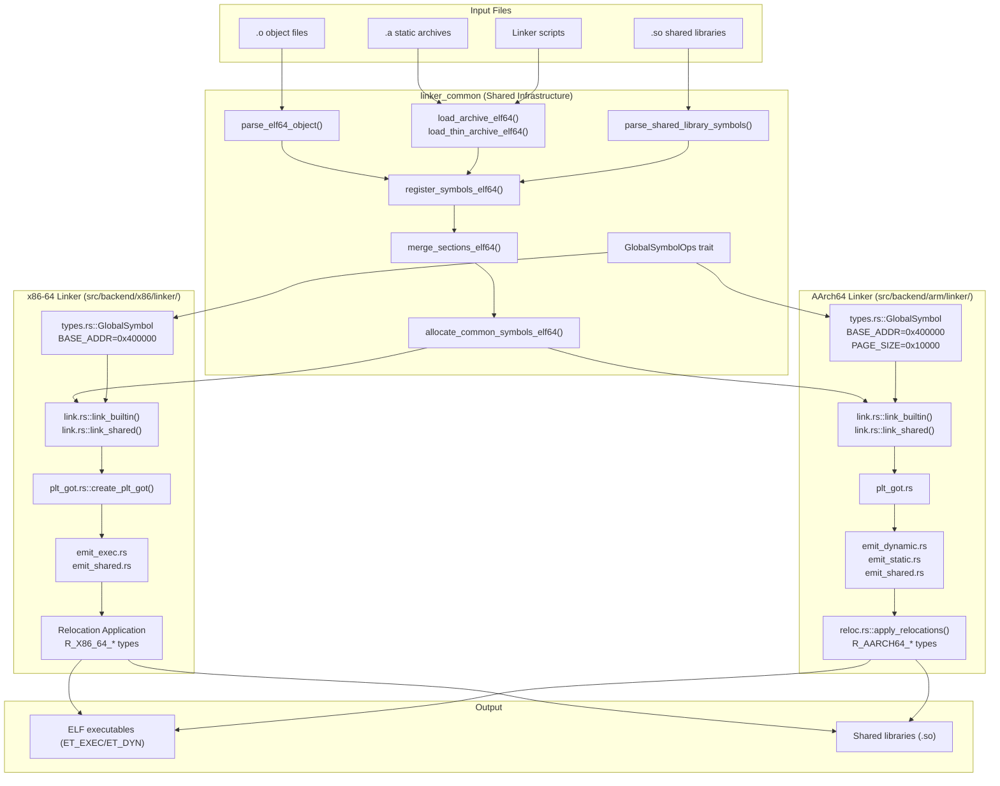
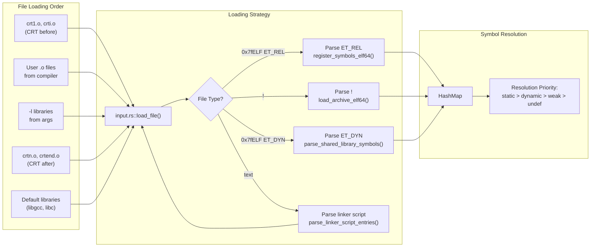
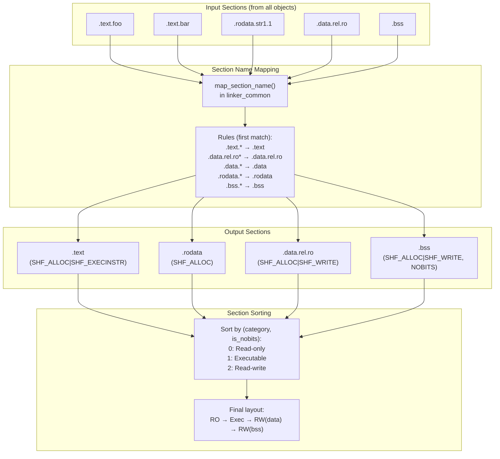
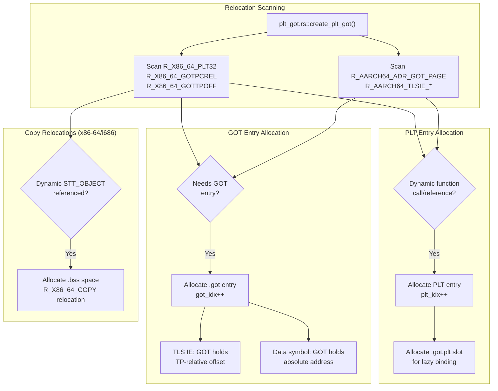
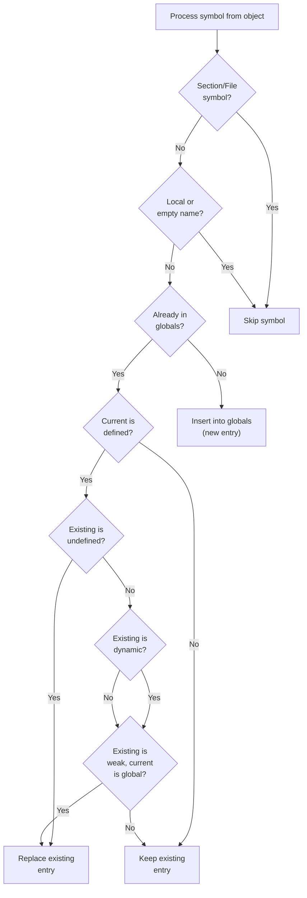
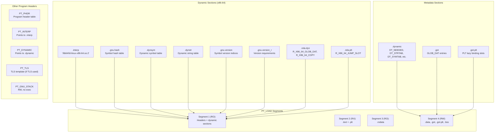
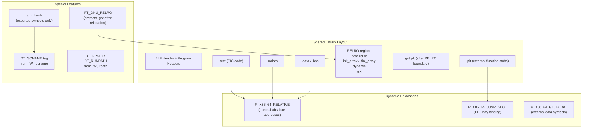
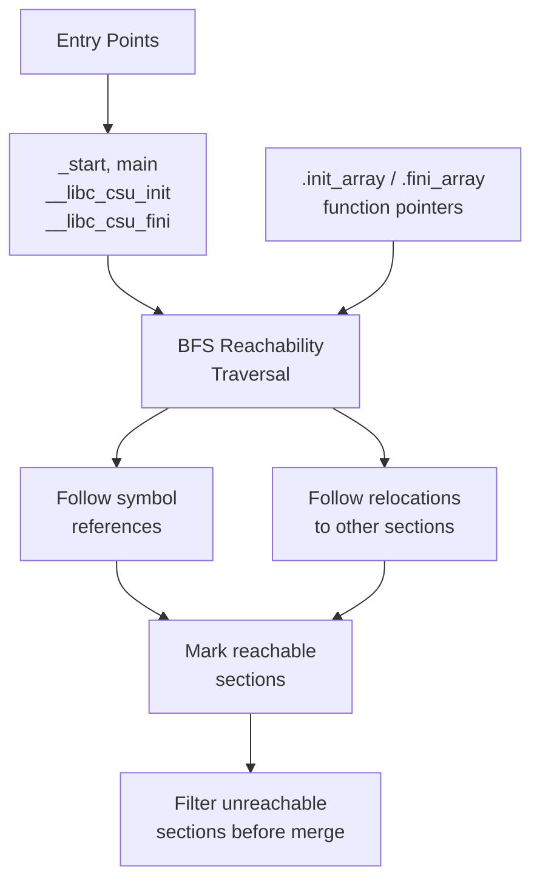

<!-- source: DeepWiki mcp.deepwiki.com · repo anthropics/claudes-c-compiler · page 7.5 Built-in Linker · fetched 2026-10-26 -->

# Built-in Linker

<details>
<summary>Relevant source files</summary>

The following files were used as context for generating this wiki page:

- [ideas/new_projects_myasm.txt](ideas/new_projects_myasm.txt)
- [src/backend/arm/linker/README.md](src/backend/arm/linker/README.md)
- [src/backend/arm/linker/elf.rs](src/backend/arm/linker/elf.rs)
- [src/backend/arm/linker/mod.rs](src/backend/arm/linker/mod.rs)
- [src/backend/x86/linker/README.md](src/backend/x86/linker/README.md)
- [src/backend/x86/linker/elf.rs](src/backend/x86/linker/elf.rs)
- [src/backend/x86/linker/mod.rs](src/backend/x86/linker/mod.rs)

</details>


## Purpose and Scope

The built-in linker combines ELF relocatable object files (`.o`) and static archives (`.a`) into executables or shared libraries (`.so`). It implements the complete linking pipeline: symbol resolution, section merging, PLT/GOT construction, TLS handling, relocation application, and ELF emission. The linker is architecture-specific, with implementations for x86-64, i686, AArch64, and RISC-V.

This page documents the linker infrastructure that follows the assembler in the toolchain. For information about assembly parsing and object file generation, see [Built-in Assembler Overview](#7.1). For architecture-specific assembler details, see [x86 and i686 Assembler](#7.2), [AArch64 Assembler](#7.3), or [RISC-V Assembler](#7.4).

---

## Architecture Overview

The linker is implemented per-architecture with significant shared infrastructure. Each architecture provides:

- Architecture-specific relocation type constants and application logic
- PLT/GOT construction and layout
- TLS model implementations (LE, IE, GD, LD where applicable)
- ABI-specific calling conventions and data structure layout

Common infrastructure is shared via the `linker_common` module, which provides:

- ELF64 parsing (`Elf64Object`, `Elf64Section`, `Elf64Symbol`, `Elf64Rela`)
- Symbol resolution via the `GlobalSymbolOps` trait
- Section merging and output section construction
- Archive loading with selective member extraction
- Dynamic symbol resolution against shared libraries
- Common symbol allocation (`.bss` placement)
- Linker-defined symbol generation



**Sources:** [src/backend/x86/linker/mod.rs:1-31](), [src/backend/arm/linker/mod.rs:1-43](), [src/backend/x86/linker/README.md:1-110](), [src/backend/arm/linker/README.md:1-73]()

---

## Linking Pipeline

The linking process follows a multi-phase pipeline implemented in `link.rs` for each architecture:

### Phase 1: Input Loading and Symbol Registration



**Archive loading** uses selective extraction with iterative fixed-point resolution. The algorithm (in `linker_common::load_archive_elf64()`):

1. Parse all archive members
2. For each member, check if it defines an undefined symbol
3. If yes, extract the member and register its symbols
4. Repeat until no new members are extracted (fixed point)

This handles circular dependencies between archive members without requiring explicit `--start-group` flags.

**Sources:** [src/backend/x86/linker/link.rs:1-386](), [src/backend/arm/linker/link.rs:1-411](), [src/backend/x86/linker/input.rs:1-78](), [src/backend/x86/linker/README.md:258-320]()

### Phase 2: Section Merging



The section map (built by `merge_sections_elf64()`) provides `(object_idx, section_idx) -> (output_section_idx, offset)` mappings used during relocation application.

**Sources:** [src/backend/x86/linker/README.md:338-376](), [src/backend/arm/linker/README.md:207-220]()

### Phase 3: PLT/GOT Construction



**x86-64 PLT stub format** (16 bytes each):

```asm
# PLT[0] (resolver stub):
pushq  GOT[1](%rip)      # push link_map
jmpq   *GOT[2](%rip)     # jump to _dl_runtime_resolve
nop; nop; nop; nop

# PLT[N] (function stub):
jmpq   *GOT[3+N](%rip)   # indirect jump via GOT
pushq  $N                # push relocation index
jmpq   PLT[0]            # jump to resolver
```

Initially, `GOT[3+N]` points to `PLT[N]+6` (the `pushq` instruction), causing lazy binding on first call. After resolution, `GOT[3+N]` contains the actual function address.

**Sources:** [src/backend/x86/linker/plt_got.rs:1-141](), [src/backend/arm/linker/plt_got.rs:1-130](), [src/backend/x86/linker/README.md:388-427]()

---

## Key Data Structures

### GlobalSymbol

The `GlobalSymbol` struct implements the `GlobalSymbolOps` trait from `linker_common` and represents a resolved global symbol:

| Field | Type | Purpose |
|-------|------|---------|
| `value` | `u64` | Final virtual address (after layout) |
| `size` | `u64` | Symbol size |
| `info` | `u8` | ELF `st_info` (binding << 4 \| type) |
| `defined_in` | `Option<usize>` | Index of defining object, or `None` if undefined/dynamic |
| `from_lib` | `Option<String>` | SONAME of shared library providing symbol |
| `plt_idx` | `Option<usize>` | PLT entry index if allocated |
| `got_idx` | `Option<usize>` | GOT entry index if allocated |
| `section_idx` | `u16` | Section index in defining object |
| `is_dynamic` | `bool` | True if resolved from `.so` file |
| `copy_reloc` | `bool` | True if requires `R_X86_64_COPY` relocation |
| `lib_sym_value` | `u64` | Original value from shared library symbol table |
| `version` | `Option<String>` | Symbol version (e.g., "GLIBC_2.17") |

**Sources:** [src/backend/x86/linker/types.rs:1-89](), [src/backend/arm/linker/types.rs:1-93]()

### ELF Object Representation

```mermaid
graph TB
    subgraph "Elf64Object (from linker_common)"
        OBJ["Elf64Object"]
        SECS["sections: Vec<Elf64Section>"]
        SYMS["symbols: Vec<Elf64Symbol>"]
        DATA["section_data: Vec<Vec<u8>>"]
        RELA["relocations: Vec<Vec<Elf64Rela>>"]
        SRC["source_name: String"]
    end
    
    subgraph "Elf64Section"
        SECNAME["name: String"]
        SECTYPE["sh_type: u32 (SHT_PROGBITS, etc.)"]
        SECFLAGS["flags: u64 (SHF_ALLOC|SHF_WRITE|SHF_EXECINSTR)"]
        SECADDR["addr: u64, offset: u64, size: u64"]
        SECALIGN["addralign: u64"]
    end
    
    subgraph "Elf64Symbol"
        SYMNAME["name: String"]
        SYMINFO["info: u8 (binding << 4 | type)"]
        SYMSHNDX["shndx: u16 (SHN_UNDEF, SHN_ABS, section index)"]
        SYMVAL["value: u64, size: u64"]
    end
    
    subgraph "Elf64Rela"
        RELOFF["offset: u64 (within section)"]
        RELSYM["sym_idx: u32"]
        RELTYPE["rela_type: u32 (R_X86_64_*, R_AARCH64_*)"]
        RELADD["addend: i64"]
    end
    
    OBJ --> SECS
    OBJ --> SYMS
    OBJ --> DATA
    OBJ --> RELA
    OBJ --> SRC
    
    SECS --> SECNAME
    SECS --> SECTYPE
    SECS --> SECFLAGS
    SECS --> SECADDR
    SECS --> SECALIGN
    
    SYMS --> SYMNAME
    SYMS --> SYMINFO
    SYMS --> SYMSHNDX
    SYMS --> SYMVAL
    
    RELA --> RELOFF
    RELA --> RELSYM
    RELA --> RELTYPE
    RELA --> RELADD
```



**Sources:** [src/backend/x86/linker/README.md:129-241](), [src/backend/arm/linker/README.md:120-140]()

### OutputSection

The `OutputSection` struct (from `linker_common`) represents a merged output section:

| Field | Type | Purpose |
|-------|------|---------|
| `name` | `String` | Section name (e.g., ".text", ".data") |
| `sh_type` | `u32` | Section type (`SHT_PROGBITS`, `SHT_NOBITS`) |
| `flags` | `u64` | Section flags (alloc, write, exec, TLS) |
| `alignment` | `u64` | Maximum alignment requirement |
| `inputs` | `Vec<InputSection>` | Contributing input sections |
| `data` | `Vec<u8>` | Merged section data |
| `addr` | `u64` | Assigned virtual address |
| `file_offset` | `u64` | File offset in output |
| `mem_size` | `u64` | Total size in memory (> data.len() for NOBITS) |

Each `InputSection` reference contains `(object_idx, section_idx, output_offset, size)`.

**Sources:** [src/backend/x86/linker/README.md:214-241]()

---

## Symbol Resolution

Symbol resolution is handled by `linker_common::register_symbols_elf64()`, which processes each object's symbol table according to the following priority:

```
static defined > dynamic defined > weak > undefined
```

### Resolution Algorithm



Special cases:

1. **COMMON symbols** (`SHN_COMMON`): Treated as tentative definitions. Can be overridden by real definitions. The `value` field holds the alignment requirement.

2. **Weak undefined symbols**: Create placeholder entries but resolve to 0 if no definition is found.

3. **Dynamic symbols** (from `.so` files): Can be replaced by static definitions from later objects/archives (via the `arch_should_replace_extra` callback in `GlobalSymbolOps`).

**Sources:** [src/backend/x86/linker/README.md:321-337](), [src/backend/arm/linker/README.md:188-207]()

---

## Relocation Application

Relocation application occurs in architecture-specific modules after address layout is complete. The general process:

### Symbol Resolution During Relocation

The `resolve_sym()` function (in `emit_exec.rs`, `emit_shared.rs`, or `reloc.rs` depending on architecture) resolves a symbol reference to a final address:

| Symbol Type | Resolution Strategy |
|-------------|---------------------|
| `STT_SECTION` | Output section address + input section offset |
| Defined non-local | Lookup in `globals`, use `value` field |
| Weak undefined | Return 0 |
| Undefined | Return 0 (or error if not weak) |
| `SHN_ABS` | Use `sym.value` directly |
| Other local | Section map lookup + `sym.value` |

**Linker-defined symbols** (e.g., `_GLOBAL_OFFSET_TABLE_`, `__bss_start`, `_edata`, `_end`) are inserted into `globals` during layout via `get_standard_linker_symbols()` from `linker_common`.

**Sources:** [src/backend/x86/linker/emit_exec.rs:1-1239](), [src/backend/arm/linker/reloc.rs:1-540]()

### x86-64 Relocation Types

| Relocation | Type | Formula | Notes |
|------------|------|---------|-------|
| `R_X86_64_64` | 1 | `S + A` | 64-bit absolute address |
| `R_X86_64_PC32` | 2 | `S + A - P` | 32-bit PC-relative |
| `R_X86_64_PLT32` | 4 | `S + A - P` | PLT-routed call |
| `R_X86_64_GOTPCREL` | 9 | `G + A - P` | PC-relative GOT offset |
| `R_X86_64_32` | 10 | `S + A` | 32-bit unsigned absolute |
| `R_X86_64_32S` | 11 | `S + A` | 32-bit signed absolute |
| `R_X86_64_GOTTPOFF` | 22 | `G + A - P` | TLS IE GOT offset |
| `R_X86_64_TPOFF32` | 23 | `S - TLS_base - TLS_size + A` | TLS LE direct offset |
| `R_X86_64_PC64` | 24 | `S + A - P` | 64-bit PC-relative |
| `R_X86_64_GOTPCRELX` | 41 | `G + A - P` or relaxed | Relaxable to LEA |
| `R_X86_64_REX_GOTPCRELX` | 42 | `G + A - P` or relaxed | Relaxable with REX prefix |

**Dynamic relocations (output only):**

| Relocation | Type | Purpose |
|------------|------|---------|
| `R_X86_64_COPY` | 5 | Copy data object from shared library to `.bss` |
| `R_X86_64_GLOB_DAT` | 6 | Fill GOT entry at load time |
| `R_X86_64_JUMP_SLOT` | 7 | PLT lazy binding |
| `R_X86_64_RELATIVE` | 8 | Base-relative fixup (shared libraries) |
| `R_X86_64_IRELATIVE` | 37 | IFUNC resolver invocation |

**Sources:** [src/backend/x86/linker/elf.rs:30-51](), [src/backend/x86/linker/README.md:512-564]()

### AArch64 Relocation Types

AArch64 uses a richer set of relocations due to fixed-width 32-bit instructions:

#### Page-Relative Addressing

| Relocation | Formula | Usage |
|------------|---------|-------|
| `R_AARCH64_ADR_PREL_PG_HI21` | `Page(S+A) - Page(P)` | ADRP instruction |
| `R_AARCH64_ADD_ABS_LO12_NC` | `(S+A) & 0xFFF` | ADD :lo12: offset |
| `R_AARCH64_LDST64_ABS_LO12_NC` | `(S+A) & 0xFFF >> 3` | LDR/STR 64-bit |

#### Branch Relocations

| Relocation | Formula | Range |
|------------|---------|-------|
| `R_AARCH64_CALL26` | `(S+A-P) >> 2` | ±128 MB |
| `R_AARCH64_JUMP26` | `(S+A-P) >> 2` | ±128 MB |
| `R_AARCH64_CONDBR19` | `(S+A-P) >> 2` | ±1 MB |

Special handling: When the target resolves to 0 (undefined weak symbol), the instruction is replaced with `NOP` (0xd503201f).

#### MOVW Immediate Relocations

| Relocation | Formula | Bits |
|------------|---------|------|
| `R_AARCH64_MOVW_UABS_G0[_NC]` | `(S+A) & 0xFFFF` | [15:0] |
| `R_AARCH64_MOVW_UABS_G1_NC` | `(S+A) >> 16 & 0xFFFF` | [31:16] |
| `R_AARCH64_MOVW_UABS_G2_NC` | `(S+A) >> 32 & 0xFFFF` | [47:32] |
| `R_AARCH64_MOVW_UABS_G3` | `(S+A) >> 48 & 0xFFFF` | [63:48] |

**Sources:** [src/backend/arm/linker/elf.rs:33-61](), [src/backend/arm/linker/README.md:380-430]()

---

## TLS (Thread-Local Storage) Models

The linker supports multiple TLS access models with architecture-specific implementations:

### x86-64 TLS Variant II

x86-64 uses TLS Variant II: `%fs:0` points *past* the end of the TLS block. Thread-local variables are accessed at negative offsets:

```
TPOFF(sym) = (sym_addr - tls_segment_addr) - tls_mem_size
```

| Model | Relocations | Description |
|-------|-------------|-------------|
| **LE** (Local Exec) | `R_X86_64_TPOFF32` | Direct TP offset for executables |
| **IE** (Initial Exec) | `R_X86_64_GOTTPOFF` | GOT-indirect TP offset |
| **GD** (General Dynamic) | `R_X86_64_DTPMOD64`<br/>`R_X86_64_DTPOFF64` | Not yet implemented; IE used |
| **LD** (Local Dynamic) | Similar to GD | Not yet implemented |

**IE-to-LE relaxation** (for locally-defined TLS variables):

```asm
# Before:
movq symbol@GOTTPOFF(%rip), %reg   # 48 8b XX YY YY YY YY

# After:
movq $tpoff, %reg                   # 48 c7 CX YY YY YY YY
```

The `mov r/m64, reg` (opcode `0x8b`) is rewritten to `mov $imm32, reg` (opcode `0xc7`), and the ModR/M byte becomes `0xc0 | reg`.

**Sources:** [src/backend/x86/linker/README.md:474-580]()

### AArch64 TLS Variant I

AArch64 uses TLS Variant I: the TP points to the start of the TLS block. TP offsets are computed as:

```
tp_offset = (sym_addr - tls_start_addr) + 16   // +16 for TCB
```

| Model | Relocations | Strategy |
|-------|-------------|----------|
| **LE** | `R_AARCH64_TLSLE_*` | Direct computation via MOVZ/MOVK or ADD |
| **IE** | `R_AARCH64_TLSIE_ADR_GOTTPREL_PAGE21`<br/>`R_AARCH64_TLSIE_LD64_GOTTPREL_LO12_NC` | GOT entry holds TP offset |
| **TLSDESC** | `R_AARCH64_TLSDESC_*` | Relaxed to LE in static linking |
| **GD** | `R_AARCH64_TLSGD_*` | Relaxed to LE in static linking |

**TLSDESC-to-LE relaxation** (4-instruction sequence):

```asm
# Before:
adrp  x0, :tlsdesc:var      # R_AARCH64_TLSDESC_ADR_PAGE21
ldr   x1, [x0, :tlsdesc_lo12:var]  # R_AARCH64_TLSDESC_LD64_LO12
add   x0, x0, :tlsdesc_lo12:var    # R_AARCH64_TLSDESC_ADD_LO12
blr   x1                    # R_AARCH64_TLSDESC_CALL

# After (LE):
movz  x0, #tprel_g1, lsl #16   # High 16 bits
movk  x0, #tprel_lo            # Low 16 bits
nop
nop
```

**Sources:** [src/backend/arm/linker/README.md:441-487](), [src/backend/arm/linker/reloc.rs:1-540]()

---

## Dynamic Linking and Shared Libraries

### Dynamic Executable Layout

For dynamically-linked executables, the linker generates additional sections:



**Sources:** [src/backend/x86/linker/README.md:428-473](), [src/backend/x86/linker/emit_exec.rs:1-1239]()

### .dynamic Section Tags

The `.dynamic` section contains an array of `Elf64_Dyn` entries (tag-value pairs):

| Tag | Purpose |
|-----|---------|
| `DT_NEEDED` | Required shared library SONAME (one per library) |
| `DT_STRTAB` / `DT_SYMTAB` | Addresses of `.dynstr` and `.dynsym` |
| `DT_STRSZ` / `DT_SYMENT` | Sizes for string table and symbol entries |
| `DT_GNU_HASH` | Address of `.gnu.hash` |
| `DT_PLTGOT` / `DT_PLTRELSZ` | `.got.plt` address and `.rela.plt` size |
| `DT_JMPREL` | Address of `.rela.plt` |
| `DT_RELA` / `DT_RELASZ` | `.rela.dyn` address and size |
| `DT_DEBUG` | Reserved for debugger (executables only) |
| `DT_INIT_ARRAY` / `DT_FINI_ARRAY` | Constructor/destructor arrays |
| `DT_VERSYM` / `DT_VERNEED` | Symbol versioning (executables only) |
| `DT_SONAME` | Shared library name (shared libraries only) |
| `DT_RPATH` / `DT_RUNPATH` | Runtime library search paths |
| `DT_RELACOUNT` | Count of `R_X86_64_RELATIVE` entries (shared libraries) |

**Sources:** [src/backend/x86/linker/README.md:582-616](), [src/backend/arm/linker/elf.rs:21-28]()

### Copy Relocations

When an executable references a global data object (e.g., `stdin`, `environ`) from a shared library, the linker:

1. Allocates space in `.bss` for a copy of the object
2. Emits an `R_X86_64_COPY` relocation in `.rela.dyn`
3. Updates the symbol's `value` to point to the `.bss` copy
4. At runtime, the dynamic linker copies the initial value from the shared library

This ensures that all references (from the executable and shared libraries) see the same memory location.

**Sources:** [src/backend/x86/linker/README.md:633-642]()

### Symbol Versioning

For executables with versioned dynamic symbols (e.g., `realpath@@GLIBC_2.3`), the linker emits:

1. **`.gnu.version`** (`SHT_GNU_VERSYM`): Array of 16-bit version indices, one per `.dynsym` entry
   - 0 = `VER_NDX_LOCAL` (null symbol)
   - 1 = `VER_NDX_GLOBAL` (unversioned)
   - 2+ = specific versions from `.gnu.version_r`

2. **`.gnu.version_r`** (`SHT_GNU_VERNEED`): Version requirement entries for each shared library
   - `vn_version` = 1
   - `vn_cnt` = number of required versions
   - `vn_file` = offset into `.dynstr` (library name)
   - `vn_aux` = offset to first `Vernaux` entry
   - Each `Vernaux` contains: `vna_hash`, `vna_flags`, `vna_other` (version index), `vna_name`

The `vna_hash` field uses `sysv_hash()` for compatibility with older dynamic linkers.

**Sources:** [src/backend/x86/linker/README.md:644-657]()

---

## Shared Library Output

When invoked with `-shared`, the linker produces position-independent shared libraries (`ET_DYN`):



**Key differences from executables:**

1. **Base address 0x0** (position-independent)
2. **`R_X86_64_RELATIVE` relocations** for all internal absolute addresses
3. **`.gnu.hash` exports only defined symbols**, with undefined symbols before the `symoffset` boundary
4. **PT_GNU_RELRO** protects `.got`, `.dynamic`, and `.init_array`/`.fini_array` after load-time relocations
5. **No `.interp`** or symbol versioning sections
6. **`DT_SONAME`** tag for library identification
7. **Conditional PLT** (only emitted if external functions are called)

**Sources:** [src/backend/x86/linker/README.md:659-737](), [src/backend/x86/linker/emit_shared.rs:1-1137](), [src/backend/arm/linker/emit_shared.rs:1-1098]()

---

## IFUNC Support

The linker handles GNU IFUNC (indirect function) symbols, which resolve to different implementations based on runtime CPU features:

```mermaid
graph LR
    subgraph "IFUNC Symbol Processing"
        DETECT["Detect STT_GNU_IFUNC<br/>in symbol table"]
        ALLOCIPLT["Allocate IPLT GOT slot<br/>in RW segment"]
        GENRELA["Generate .rela.iplt entry<br/>R_X86_64_IRELATIVE<br/>R_AARCH64_IRELATIVE"]
        GENSTUB["Generate IPLT stub<br/>in RX segment"]
        REDIRECT["Redirect symbol value<br/>to PLT stub address"]
    end
    
    subgraph "Runtime Resolution"
        STARTUP["glibc startup code<br/>(__libc_start_main)"]
        PROCESS["Process .rela.iplt"]
        CALL["Call resolver function"]
        FILL["Fill GOT slot with<br/>returned address"]
    end
    
    DETECT --> ALLOCIPLT
    ALLOCIPLT --> GENRELA
    GENRELA --> GENSTUB
    GENSTUB --> REDIRECT
    
    REDIRECT --> STARTUP
    STARTUP --> PROCESS
    PROCESS --> CALL
    CALL --> FILL
```



**x86-64 IPLT stub** (similar to regular PLT):

```asm
jmpq   *got_slot(%rip)   # Indirect jump via GOT
# No pushq/jmpq fallback -- GOT slot is pre-filled by resolver
```

**AArch64 IPLT stub**:

```asm
adrp  x16, page_of(got_slot)
ldr   x17, [x16, #lo12(got_slot)]
br    x17
nop
```

The symbol type is changed from `STT_GNU_IFUNC` to `STT_FUNC` after redirection to avoid confusing tools.

**Sources:** [src/backend/x86/linker/plt_got.rs:1-141](), [src/backend/arm/linker/README.md:297-318]()

---

## Architecture-Specific Differences

| Feature | x86-64 | i686 | AArch64 | RISC-V |
|---------|--------|------|---------|--------|
| **Base address** | 0x400000 | 0x08048000 | 0x400000 | 0x10000 |
| **Page size** | 0x1000 | 0x1000 | 0x10000 | 0x1000 |
| **Interp path** | `/lib64/ld-linux-x86-64.so.2` | `/lib/ld-linux.so.2` | `/lib/ld-linux-aarch64.so.1` | `/lib/ld-linux-riscv64-lp64d.so.1` |
| **TLS variant** | II (TP past end) | II | I (TP at start + 16) | I |
| **PLT stub size** | 16 bytes | 16 bytes | 16 bytes | 16 bytes |
| **Copy relocations** | Yes | Yes | No (GOT-indirect) | No |
| **Instruction width** | Variable (1-15 bytes) | Variable (1-15 bytes) | Fixed (32-bit) | Fixed (32-bit) |
| **GOTPCREL relaxation** | Yes (→ LEA) | Limited | No (real GOT used) | No |
| **TLS IE relaxation** | Yes (→ MOVQ $imm) | Yes | No (GOT used) | No |

**i686 special handling:**

- `R_386_32` for absolute 32-bit relocations
- `R_386_PC32` for PC-relative relocations
- `R_386_GOTPC` for `_GLOBAL_OFFSET_TABLE_` PIC base calculation
- `R_386_GOTOFF` for GOT-relative data access
- Severe register pressure requires different codegen strategies

**Sources:** [src/backend/x86/linker/types.rs:1-89](), [src/backend/arm/linker/types.rs:1-93]()

---

## Garbage Collection (--gc-sections)

When `--gc-sections` is enabled, the linker performs dead code elimination:



The algorithm:

1. Start with entry point symbols (`_start`, `main`) and init/fini array contents
2. Mark their defining sections as reachable
3. Process relocations in reachable sections:
   - For each relocation, resolve the target symbol
   - If the symbol is defined in a section, mark that section as reachable
4. Repeat until no new sections are marked (fixed point)
5. Exclude unreachable sections from the link

**Sources:** [src/backend/x86/linker/link.rs:1-386](), [src/backend/arm/linker/link.rs:1-411]()

---

## Linker Scripts and GROUP/INPUT

The linker handles basic linker scripts via `parse_linker_script_entries()` in `crate::backend::elf`:

```
/* GNU ld script */
GROUP ( /lib/x86_64-linux-gnu/libc.so.6 /usr/lib/x86_64-linux-gnu/libc_nonshared.a AS_NEEDED ( /lib/x86_64-linux-gnu/libmvec.so.1 ) )
```

The parser:

1. Finds `GROUP ( ... )` or `INPUT ( ... )` directives
2. Extracts file paths and `-l` library references
3. Skips `AS_NEEDED()` blocks (not implemented)
4. Returns a list of `LinkerScriptEntry::Path` or `LinkerScriptEntry::Lib` values

The linker recursively loads referenced files. This enables linking against system libraries whose `.so` files are actually linker scripts.

**Sources:** [src/backend/x86/linker/README.md:818-840]()

---

## Testing and Validation

The linker has been validated by successfully linking 200+ projects from the test suite tracked in [ideas/new_projects_myasm.txt]():

| Project | Complexity | Architectures | Notes |
|---------|-----------|---------------|-------|
| **FFmpeg** | 7,331 checkasm tests | x86-64, ARM | Heavy SIMD, inline asm, PLT/GOT |
| **CPython** | Full interpreter | x86-64 | Complex startup, symbol versioning |
| **PostgreSQL** | Database + extensions | x86-64, i686, ARM, RISC-V | Shared library plugins (`.so`) |
| **QEMU** | Emulator | x86-64 | IFUNC, copy relocations |
| **ghostscript** | PostScript interpreter | All architectures | Large codebase, TLS |
| **coreutils (GNU)** | 100+ utilities | All architectures | Diverse features |

Key fixes discovered during validation:

- Copy relocation weak alias resolution (`environ` vs `__environ`)
- Local symbol collision handling (multiple `.o` files with same local name)
- COMDAT group deduplication (template instantiations)
- Symbol versioning filtering (hidden non-default versions)
- IFUNC PLT/GOT layout (separate from regular PLT)
- TLS `.tbss`-only handling (PT_TLS with zero file size)

**Sources:** [ideas/new_projects_myasm.txt:1-291]()

---

## Module Inventory

### x86-64 Linker

| File | Lines | Purpose |
|------|-------|---------|
| `mod.rs` | ~28 | Module declarations, re-exports `link_builtin`/`link_shared` |
| `types.rs` | ~89 | `GlobalSymbol`, `BASE_ADDR=0x400000`, `INTERP` |
| `elf.rs` | ~81 | x86-64 relocation constants, type aliases, parsing wrappers |
| `input.rs` | ~78 | File loading dispatch |
| `plt_got.rs` | ~141 | PLT/GOT construction, IFUNC collection |
| `link.rs` | ~386 | Orchestration, symbol resolution, library loading |
| `emit_exec.rs` | ~1,239 | Executable emission (static and dynamic) |
| `emit_shared.rs` | ~1,137 | Shared library emission |
| **Total** | **~3,179** | (plus shared `linker_common`) |

**Sources:** [src/backend/x86/linker/README.md:113-124]()

### AArch64 Linker

| File | Lines | Purpose |
|------|-------|---------|
| `mod.rs` | ~40 | Module declarations, re-exports |
| `types.rs` | ~93 | `GlobalSymbol`, `BASE_ADDR=0x400000`, `PAGE_SIZE=0x10000` |
| `elf.rs` | ~75 | AArch64 relocation constants, type aliases |
| `input.rs` | ~91 | File loading dispatch |
| `plt_got.rs` | ~130 | PLT/GOT construction |
| `link.rs` | ~411 | Orchestration |
| `emit_dynamic.rs` | ~869 | Dynamic executable emission |
| `emit_static.rs` | ~645 | Static executable emission |
| `emit_shared.rs` | ~1,098 | Shared library emission |
| `reloc.rs` | ~540 | Relocation application (40+ types), TLS relaxation |
| **Total** | **~4,000** | (plus shared `linker_common`) |

**Sources:** [src/backend/arm/linker/README.md:619-633]()

---

