<!-- source: DeepWiki mcp.deepwiki.com · repo anthropics/claudes-c-compiler · page 8 Advanced Topics · fetched 2026-10-26 -->

# Advanced Topics

<details>
<summary>Relevant source files</summary>

The following files were used as context for generating this wiki page:

- [ideas/new_projects.txt](ideas/new_projects.txt)
- [src/common/const_arith.rs](src/common/const_arith.rs)
- [src/common/long_double.rs](src/common/long_double.rs)
- [src/frontend/preprocessor/README.md](src/frontend/preprocessor/README.md)
- [src/frontend/preprocessor/includes.rs](src/frontend/preprocessor/includes.rs)
- [src/frontend/preprocessor/utils.rs](src/frontend/preprocessor/utils.rs)
- [src/frontend/sema/const_eval.rs](src/frontend/sema/const_eval.rs)
- [src/frontend/sema/type_checker.rs](src/frontend/sema/type_checker.rs)
- [src/ir/lowering/complex.rs](src/ir/lowering/complex.rs)
- [src/ir/lowering/const_eval.rs](src/ir/lowering/const_eval.rs)
- [src/ir/lowering/expr_calls.rs](src/ir/lowering/expr_calls.rs)
- [src/ir/lowering/expr_types.rs](src/ir/lowering/expr_types.rs)
- [src/ir/lowering/global_init.rs](src/ir/lowering/global_init.rs)
- [src/ir/lowering/global_init_bytes.rs](src/ir/lowering/global_init_bytes.rs)
- [src/ir/lowering/global_init_compound.rs](src/ir/lowering/global_init_compound.rs)
- [src/ir/lowering/stmt_init.rs](src/ir/lowering/stmt_init.rs)
- [src/ir/lowering/stmt_return.rs](src/ir/lowering/stmt_return.rs)

</details>


This page covers specialized compiler features that require deep platform-specific knowledge and sophisticated handling across multiple compiler phases. These topics involve complex interactions between the frontend, IR lowering, and backend code generation.

The three main areas covered are:
- **Complex number support**: C99 `_Complex` types with platform-specific ABI handling
- **Long double precision**: 80-bit x87 vs 128-bit IEEE 754 binary128 representations
- **Constant evaluation**: Compile-time expression evaluation with architecture-aware semantics

For basic type system information, see [Type System](#3.2). For ABI handling in general, see [ABI Handling](#3.5). For backend code generation, see [Backend Code Generation](#5).

---

## 8.1 Complex Number Support

C99 `_Complex` types (`_Complex float`, `_Complex double`, `_Complex long double`) are represented in IR as stack-allocated pairs of floating-point values: `{real, imag}`. A complex value is always passed around as a pointer to this pair.

### Memory Layout

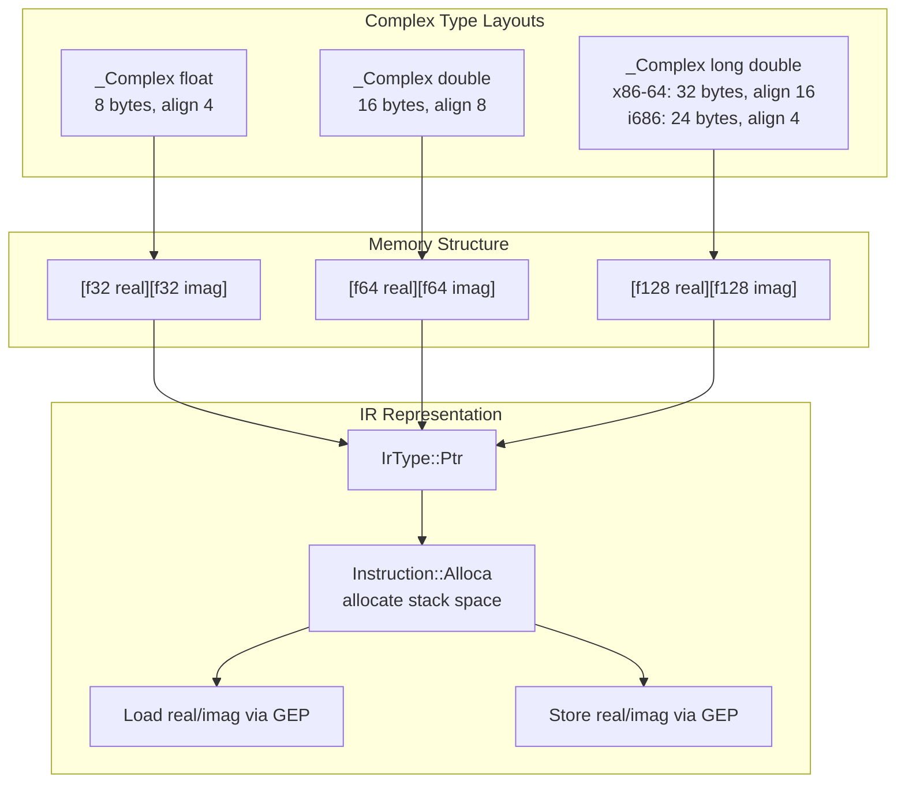

**Sources**: [src/ir/lowering/complex.rs:1-48]()

### Core Complex Operations

The `Lowerer` struct in [src/ir/lowering/complex.rs]() provides methods for all complex operations:

| Method | Purpose | Formula |
|--------|---------|---------|
| `alloca_complex` | Allocate stack space for complex value | Returns `Value` pointer to `{real, imag}` |
| `store_complex_parts` | Store `(real, imag)` into alloca | Stores at offset 0 and `comp_size` |
| `load_complex_real` | Load real component | GEP offset 0 |
| `load_complex_imag` | Load imaginary component | GEP offset `comp_size` |
| `lower_complex_add` | Complex addition | `(a+bi) + (c+di) = (a+c) + (b+d)i` |
| `lower_complex_sub` | Complex subtraction | `(a+bi) - (c+di) = (a-c) + (b-d)i` |
| `lower_complex_mul` | Complex multiplication | `(a+bi)(c+di) = (ac-bd) + (ad+bc)i` |
| `lower_complex_div` | Complex division | `(a+bi)/(c+di) = ((ac+bd) + (bc-ad)i) / (c²+d²)` |
| `lower_complex_neg` | Complex negation | `-(a+bi) = (-a) + (-b)i` |
| `lower_complex_conj` | Complex conjugate | `conj(a+bi) = a + (-b)i` |

**Sources**: [src/ir/lowering/complex.rs:73-366]()

### Platform-Specific ABI Decomposition

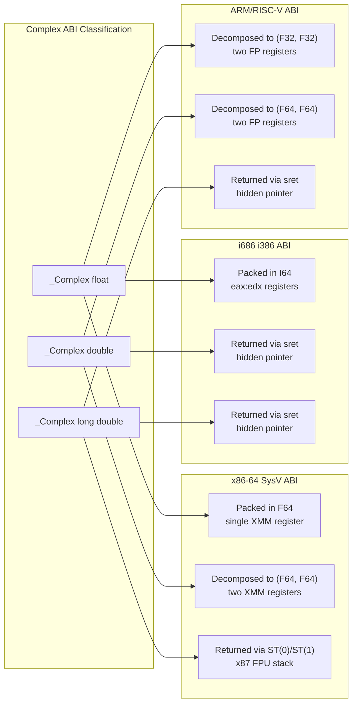

**Sources**: [src/ir/lowering/expr_calls.rs:192-213](), [src/backend/common.rs]()

The function `decompose_complex_call_args` in [src/ir/lowering/expr_calls.rs:530-679]() handles ABI-compliant decomposition:

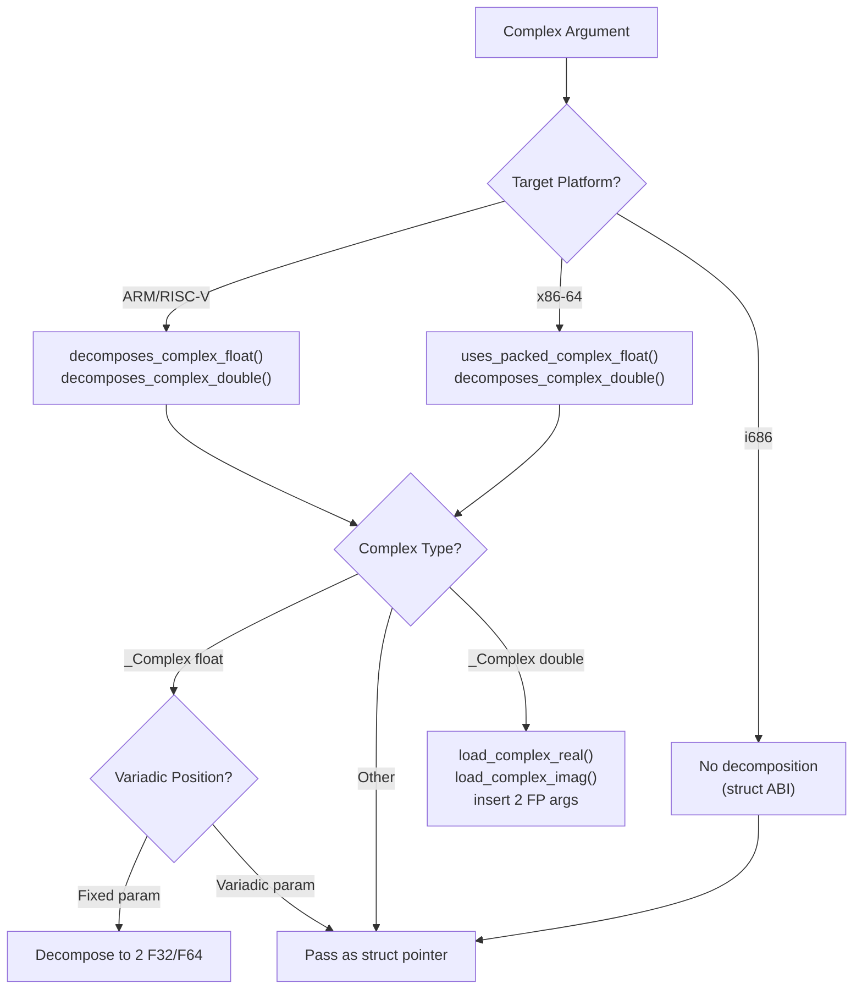

**Sources**: [src/ir/lowering/expr_calls.rs:530-679]()

### Complex Type Detection and Conversions

The `expr_ctype` method in [src/ir/lowering/complex.rs:424-519]() determines expression types with complex-aware overrides:

| Expression Pattern | Type Resolution |
|-------------------|-----------------|
| `__builtin_complex(real, imag)` | Depends on argument types |
| `conj(z)` / `conjf(z)` / `conjl(z)` | Same as argument |
| Arithmetic on complex operands | Uses `common_complex_type` for promotion |
| Conditionals with complex branches | Complex-aware type resolution |

The conversion helpers handle all type combinations:

- `real_to_complex`: Scalar to complex `(real, 0i)`
- `scalar_to_complex`: IR type to complex (preferred for calls)
- `complex_to_complex`: Between complex precisions
- `lower_complex_to_bool`: `(real != 0) || (imag != 0)` per C11 6.3.1.2

**Sources**: [src/ir/lowering/complex.rs:368-519]()

### Global Initialization with Complex Values

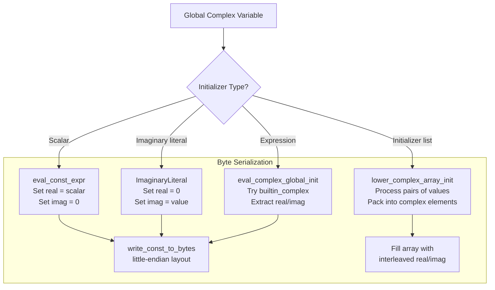

The function `eval_complex_global_init` in [src/ir/lowering/global_init.rs:1462-1515]() handles complex constant evaluation, while `lower_complex_array_init` in [src/ir/lowering/global_init.rs:1517-1581]() handles arrays of complex values.

**Sources**: [src/ir/lowering/global_init.rs:1462-1581](), [src/ir/lowering/global_init_bytes.rs:456-488]()

---

## 8.2 Long Double Handling

The `long double` type has different representations depending on architecture:
- **x86-64**: 80-bit x87 extended precision (16 bytes with padding)
- **AArch64/RISC-V**: IEEE 754 binary128 quad precision (16 bytes)

### Format Structures

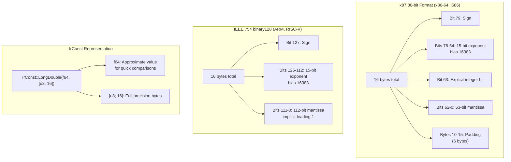

**Sources**: [src/common/long_double.rs:1-21]()

### Parsing Long Double Literals

The parsing pipeline in [src/common/long_double.rs]() uses `BigUint` for arbitrary-precision decimal arithmetic:

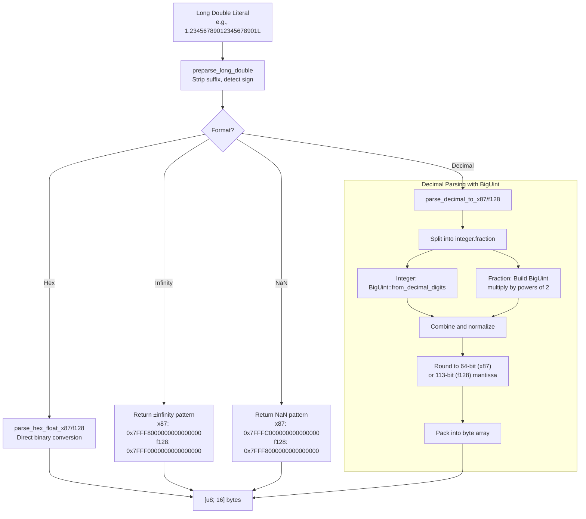

The key functions are:
- `parse_long_double_x87`: x86/i686 target, returns 80-bit x87 format
- `parse_long_double_f128`: ARM/RISC-V target, returns 128-bit IEEE format
- `BigUint::from_decimal_digits`: Converts decimal digit array to binary limbs
- `BigUint::shl` and `BigUint::mul_u32`: High-precision arithmetic operations

**Sources**: [src/common/long_double.rs:35-270](), [src/common/long_double.rs:68-171]()

### Software Arithmetic Operations

All long double arithmetic is implemented in pure software without inline assembly:

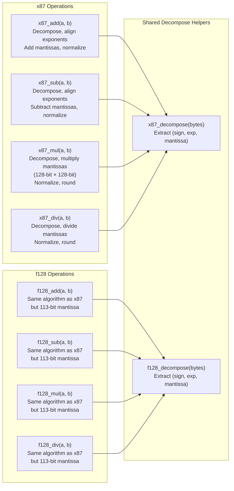

The decompose helpers return `(sign, exponent, mantissa)` tuples:
- `x87_decompose`: Returns `(bool, i32, u128)` with 64-bit mantissa (including explicit integer bit)
- `f128_decompose`: Returns `(bool, i32, u128)` with 113-bit mantissa (implicit leading 1 added)
- `f64_decompose`: Helper for conversions between precisions

**Sources**: [src/common/long_double.rs:272-1047]()

### Architecture-Specific Conversions

```mermaid
graph TB
    subgraph "Conversion Matrix"
        F64_TO_X87["f64_to_x87<br/>Widen 52-bit mantissa<br/>to 64-bit with explicit bit"]
        X87_TO_F64["x87_to_f64<br/>Round 64-bit mantissa<br/>to 52-bit, check overflow"]
        
        F64_TO_F128["f64_to_f128<br/>Widen 52-bit mantissa<br/>to 113-bit"]
        F128_TO_F64["f128_to_f64<br/>Round 113-bit mantissa<br/>to 52-bit"]
        
        X87_TO_F128["x87_to_f128<br/>Widen 64-bit to 113-bit<br/>Remove explicit int bit"]
        F128_TO_X87["f128_to_x87<br/>Round 113-bit to 64-bit<br/>Add explicit int bit"]
    end
    
    subgraph "Integer Conversions"
        I64_TO_X87["x87_from_i64<br/>Convert signed integer<br/>to normalized mantissa"]
        U64_TO_X87["x87_from_u64<br/>Convert unsigned integer<br/>to normalized mantissa"]
        I128_TO_X87["x87_from_i128<br/>Full 128-bit precision"]
        U128_TO_X87["x87_from_u128<br/>Full 128-bit precision"]
        
        X87_TO_I64["x87_to_i64<br/>Round to integer<br/>saturate on overflow"]
        X87_TO_U64["x87_to_u64<br/>Round to integer<br/>saturate on overflow"]
    end
    
    subgraph "Used By"
        CONST_EVAL["Constant Evaluation<br/>eval_const_expr"]
        GLOBAL_INIT["Global Initialization<br/>promote_to_long_double"]
        BACKEND["Backend Code Generation<br/>emit_cast"]
    end
    
    I64_TO_X87 --> CONST_EVAL
    X87_TO_F64 --> CONST_EVAL
    F64_TO_X87 --> GLOBAL_INIT
    X87_TO_I64 --> BACKEND
```

The conversion functions handle special cases:
- **Denormals**: x87 uses explicit integer bit, f128 uses implicit leading 1
- **Infinity**: Exponent all-ones, mantissa zero (with explicit bit set for x87)
- **NaN**: Exponent all-ones, mantissa non-zero (quiet NaN: high bit set)
- **Overflow**: When converting to narrower precision, clamp to ±infinity

**Sources**: [src/common/long_double.rs:1049-1380]()

### Long Double in Constant Evaluation

The constant evaluator handles long double literals with full precision:

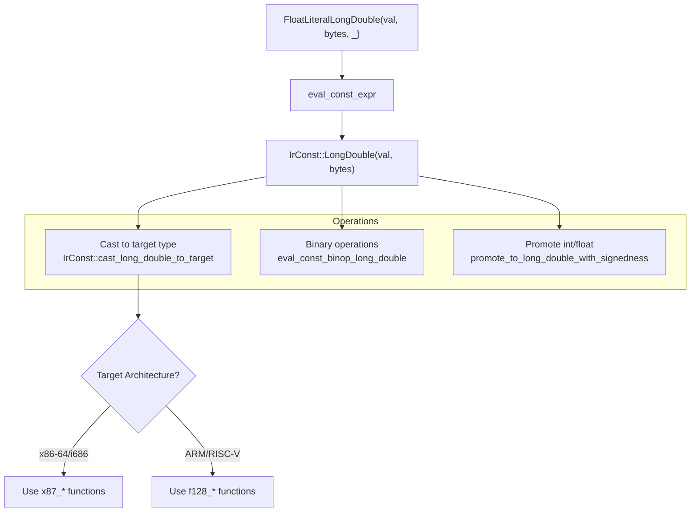

**Sources**: [src/ir/lowering/const_eval.rs:256-294](), [src/ir/lowering/global_init.rs:269-283]()

---

## 8.3 Constant Evaluation

Constant expression evaluation occurs at two levels: during semantic analysis (sema) and during IR lowering. Both share common arithmetic logic but have different type systems and state availability.

### Two-Phase Evaluation Architecture

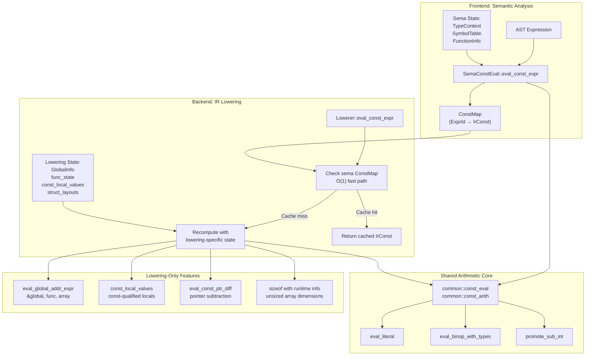

**Sources**: [src/frontend/sema/const_eval.rs:49-68](), [src/ir/lowering/const_eval.rs:26-255]()

### Constant Evaluation with Type-Aware Arithmetic

The shared arithmetic core in [src/common/const_arith.rs]() implements C semantics with width and signedness tracking:

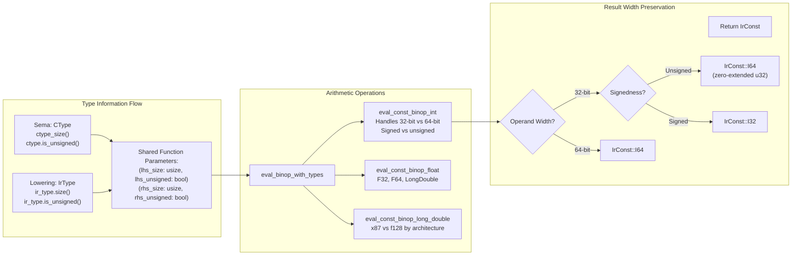

**Sources**: [src/common/const_arith.rs:14-226]()

### Integer Promotion and Usual Arithmetic Conversions

C11 6.3.1.1 integer promotion and 6.3.1.8 usual arithmetic conversions are critical for correct constant folding:

| Operation | Rule | Implementation |
|-----------|------|----------------|
| Unary `+`, `-`, `~` | Promote operand to `int` (I32) | `promote_sub_int`: I8/U8/I16/U16 → I32 |
| Binary `+`, `-`, `*`, `/`, `%` | Convert both operands to common type | `eval_binop_with_types`: Compare sizes, promote |
| Bitwise `&`, `\|`, `^` | Integer promotion + usual arithmetic conversions | Same as binary arithmetic |
| Shift `<<`, `>>` | Promote left operand only | Left: `promote_sub_int`, Right: unchanged |
| Comparison `<`, `<=`, `>`, `>=` | Usual arithmetic conversions on operands | Result is always `int` (I32) |

The function `promote_sub_int` in [src/common/const_eval.rs:44-58]() handles sub-int types:

```rust
// Pseudocode based on actual implementation
fn promote_sub_int(val: IrConst, is_unsigned: bool) -> IrConst {
    match val {
        I8(v) => I32(v as i32),
        U8(v) => I32(v as u8 as i32),
        I16(v) => I32(v as i32),
        U16(v) => I32(v as u16 as i32),
        other => other,  // Already promoted
    }
}
```

**Sources**: [src/common/const_eval.rs:44-58](), [src/common/const_arith.rs:54-140]()

### Architecture-Aware sizeof Evaluation

The `sizeof` operator requires different handling in sema vs lowering:

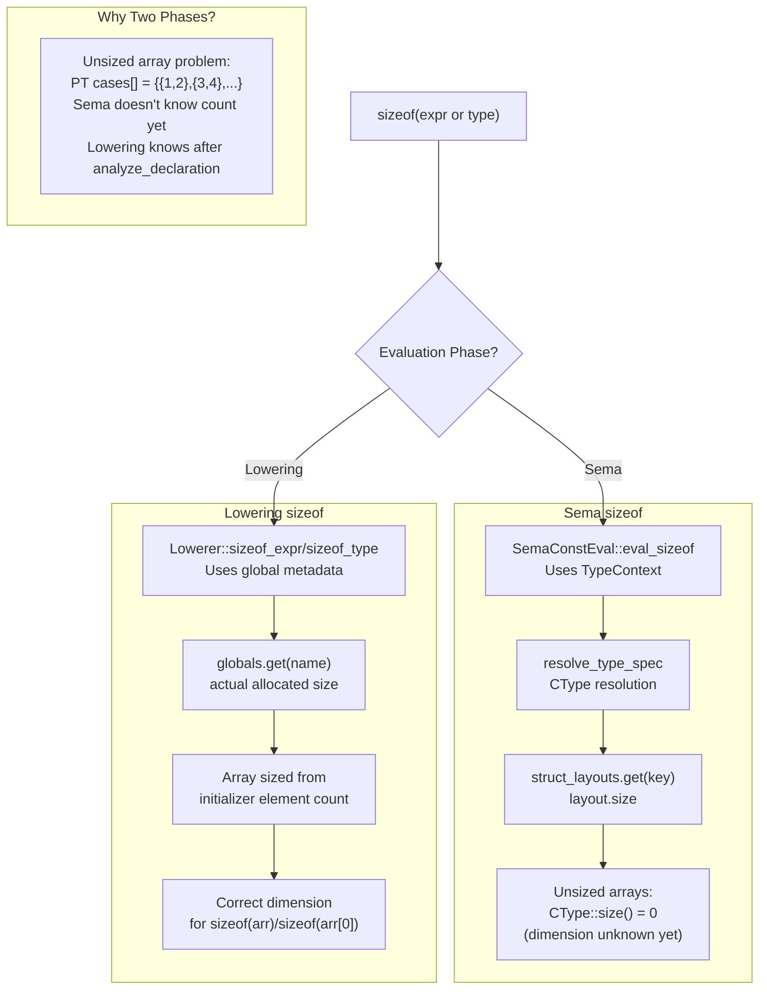

This is why `eval_const_expr` in the lowerer skips sema's cache for expressions containing `sizeof`:

```
if !matches!(expr, Expr::Identifier(_, _)) && !Self::expr_contains_sizeof(expr) {
    if let Some(val) = self.lookup_sema_const(expr) {
        return Some(val);  // Fast path: use pre-computed value
    }
}
```

**Sources**: [src/ir/lowering/const_eval.rs:34-87](), [src/frontend/sema/const_eval.rs:324-369]()

### Cast Chain Evaluation with Bit Tracking

Cast expressions require careful tracking of bit width and signedness through chains:

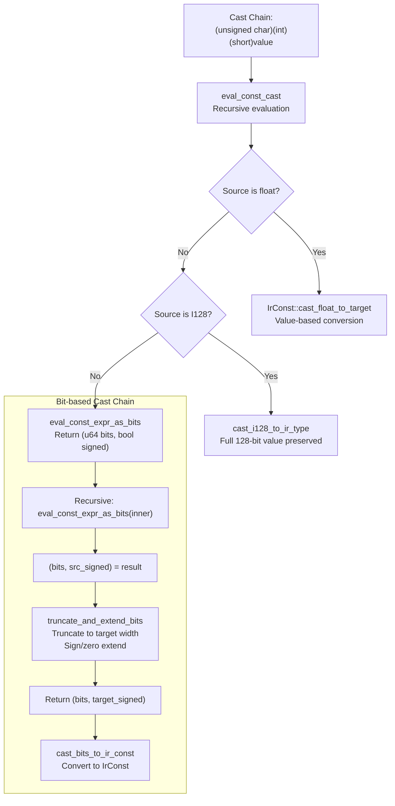

The function `truncate_and_extend_bits` in [src/common/const_arith.rs:228-243]() handles the width adjustment:

```rust
// Pseudocode based on actual implementation
fn truncate_and_extend_bits(bits: u64, target_width: u32, target_signed: bool) -> (u64, bool) {
    let mask = if target_width >= 64 { !0 } else { (1u64 << target_width) - 1 };
    let truncated = bits & mask;
    
    // Sign extend if target is signed and high bit is set
    let extended = if target_signed && (truncated & (1u64 << (target_width - 1))) != 0 {
        truncated | !mask  // Set all upper bits
    } else {
        truncated
    };
    
    (extended, target_signed)
}
```

**Sources**: [src/ir/lowering/const_eval.rs:257-294](), [src/common/const_arith.rs:228-243]()

### Global Address and Pointer Arithmetic

The lowering evaluator extends sema's capabilities with address expressions:

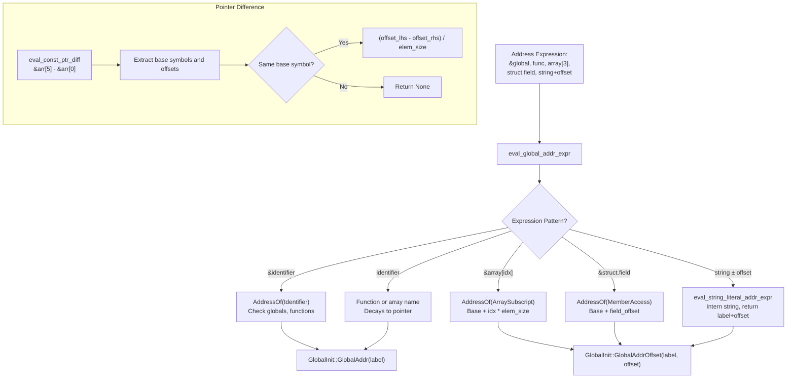

**Sources**: [src/ir/lowering/const_eval_global_addr.rs:1-520](), [src/ir/lowering/const_eval.rs:158-165]()

### Constant Propagation in Optimization Passes

The IPCP (Interprocedural Constant Propagation) pass in [src/opt/ipcp.rs]() uses constant evaluation to propagate values across function boundaries:

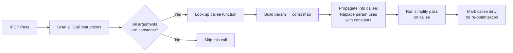

**Sources**: [src/opt/ipcp.rs]()

---

## Summary

These advanced topics demonstrate the compiler's deep integration of platform-specific knowledge:

1. **Complex numbers**: Platform-specific ABI handling ensures correct parameter passing and return value conventions across all four target architectures, with decomposition for efficiency where applicable.

2. **Long double**: Full software arithmetic with arbitrary precision ensures correctness on both x87 (80-bit) and IEEE binary128 (128-bit) platforms, with careful handling of denormals, infinity, and NaN.

3. **Constant evaluation**: Two-phase evaluation (sema + lowering) with shared arithmetic core provides correct C semantics while allowing lowering-specific features like global address resolution and runtime sizeof computation.

**Sources**: [src/ir/lowering/complex.rs](), [src/common/long_double.rs](), [src/ir/lowering/const_eval.rs](), [src/frontend/sema/const_eval.rs](), [src/common/const_arith.rs]()

---

