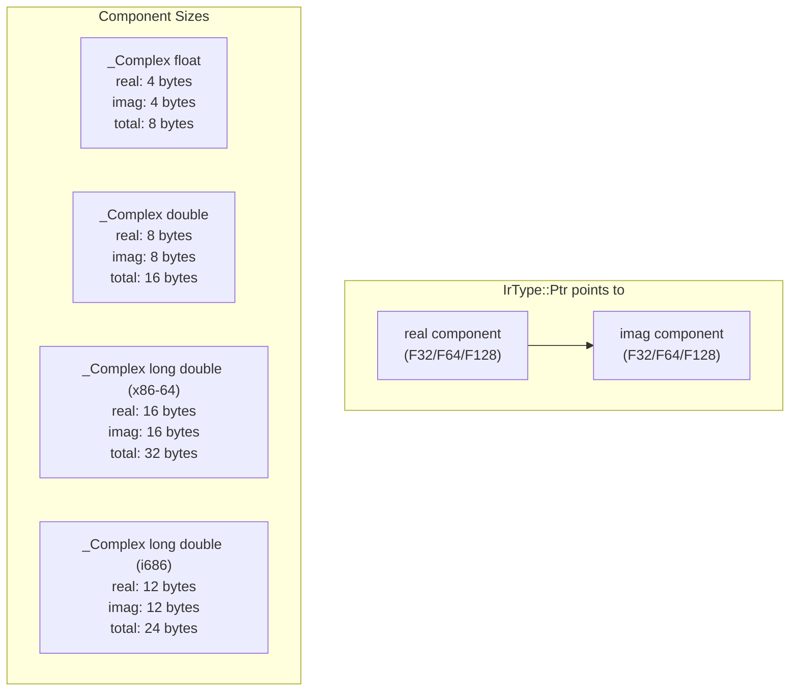
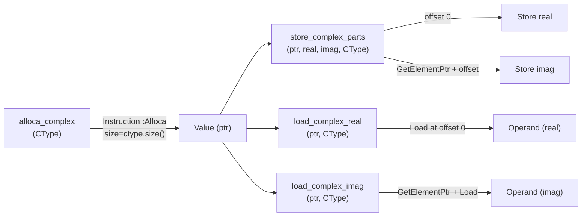
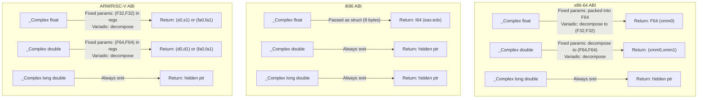
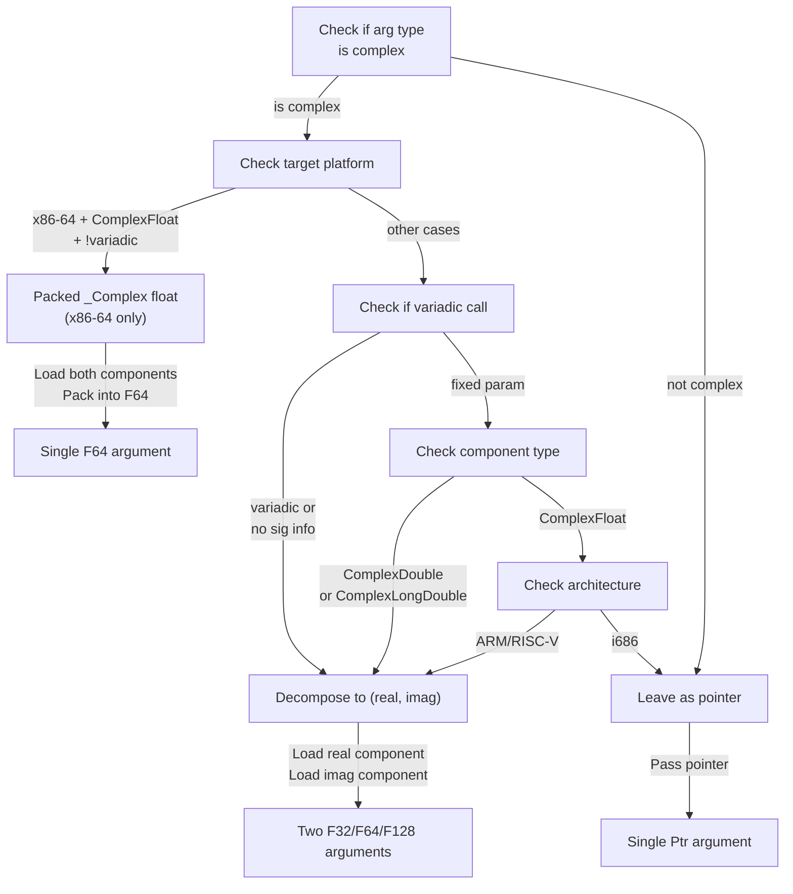
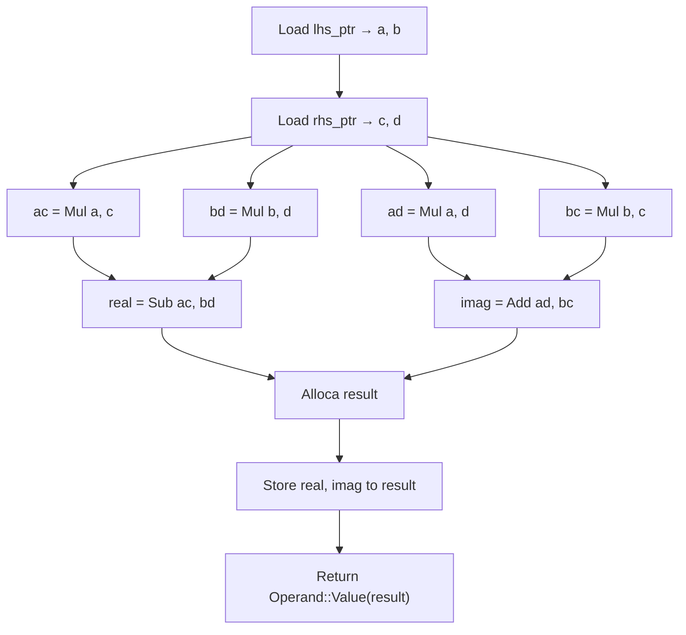
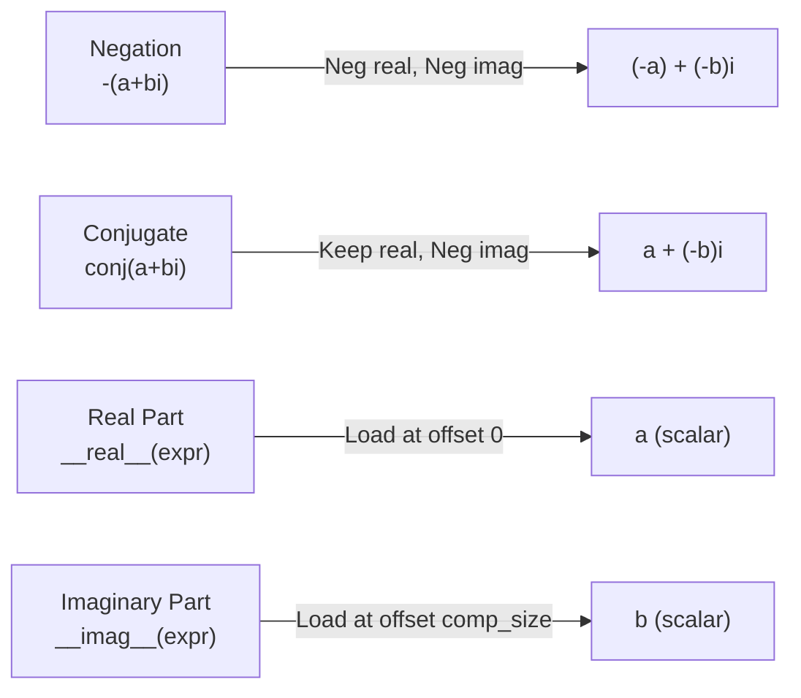
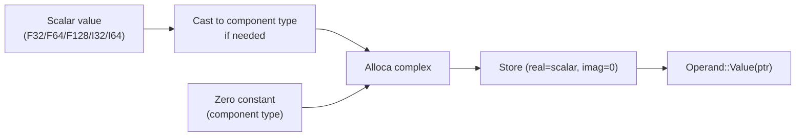
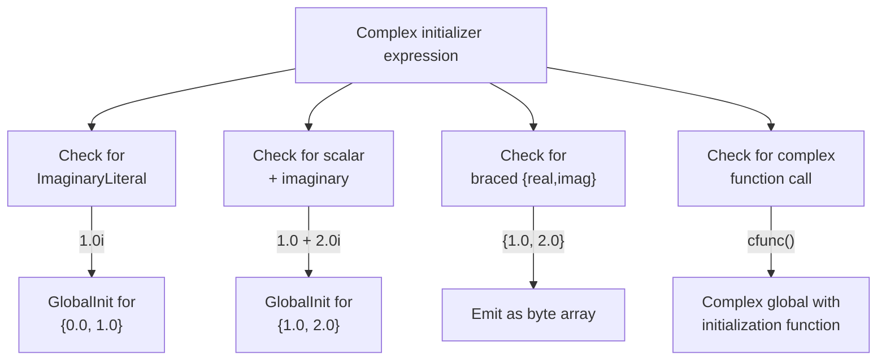
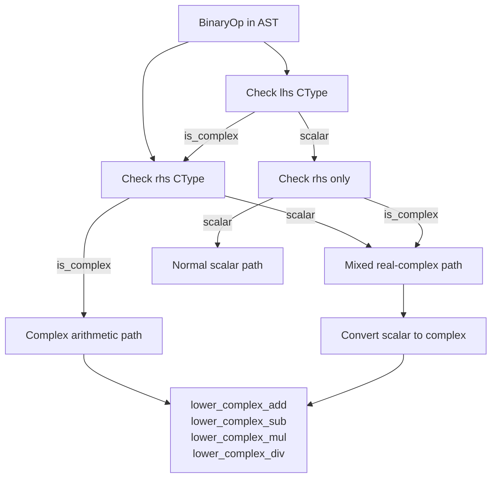

<!-- source: DeepWiki mcp.deepwiki.com · repo anthropics/claudes-c-compiler · page 8.1 Complex Number Support · fetched 2026-10-26 -->

# Complex Number Support

<details>
<summary>Relevant source files</summary>

The following files were used as context for generating this wiki page:

- [src/backend/arm/codegen/intrinsics.rs](src/backend/arm/codegen/intrinsics.rs)
- [src/backend/i686/codegen/intrinsics.rs](src/backend/i686/codegen/intrinsics.rs)
- [src/backend/riscv/codegen/intrinsics.rs](src/backend/riscv/codegen/intrinsics.rs)
- [src/backend/x86/codegen/intrinsics.rs](src/backend/x86/codegen/intrinsics.rs)
- [src/frontend/sema/builtins.rs](src/frontend/sema/builtins.rs)
- [src/frontend/sema/const_eval.rs](src/frontend/sema/const_eval.rs)
- [src/frontend/sema/type_checker.rs](src/frontend/sema/type_checker.rs)
- [src/ir/intrinsics.rs](src/ir/intrinsics.rs)
- [src/ir/lowering/complex.rs](src/ir/lowering/complex.rs)
- [src/ir/lowering/const_eval.rs](src/ir/lowering/const_eval.rs)
- [src/ir/lowering/expr_builtins.rs](src/ir/lowering/expr_builtins.rs)
- [src/ir/lowering/expr_calls.rs](src/ir/lowering/expr_calls.rs)
- [src/ir/lowering/expr_types.rs](src/ir/lowering/expr_types.rs)
- [src/ir/lowering/func_lowering.rs](src/ir/lowering/func_lowering.rs)
- [src/ir/lowering/global_init.rs](src/ir/lowering/global_init.rs)
- [src/ir/lowering/global_init_bytes.rs](src/ir/lowering/global_init_bytes.rs)
- [src/ir/lowering/global_init_compound.rs](src/ir/lowering/global_init_compound.rs)
- [src/ir/lowering/stmt_init.rs](src/ir/lowering/stmt_init.rs)
- [src/ir/lowering/stmt_return.rs](src/ir/lowering/stmt_return.rs)
- [src/ir/module.rs](src/ir/module.rs)

</details>


This page documents the implementation of C99 `_Complex` types in CCC, covering their internal representation, platform-specific ABI conventions, arithmetic operations, and builtin function support. Complex types enable representing mathematical complex numbers (a + bi) at the language level.

For general type system information, see [Type System](#3.2). For ABI handling of other aggregate types (structs, unions), see [ABI Handling](#3.5). For floating-point arithmetic without complex numbers, see the optimization and code generation sections.

## Overview

CCC implements the three standard complex floating-point types from C99:
- `_Complex float` (or `float _Complex`) - 8 bytes, components are F32
- `_Complex double` (or `double _Complex`) - 16 bytes, components are F64  
- `_Complex long double` (or `long double _Complex`) - 32 bytes on x86-64 (16 on i686), components are F128

Complex values are represented in memory as contiguous pairs `{real, imag}` and passed through the IR as pointers to these pairs, never as direct values. This design enables platform-specific ABI decomposition for function calls while maintaining uniform IR operations for arithmetic.

**Sources**: [src/ir/lowering/complex.rs:1-12]()

## Memory Representation

### Stack Layout

Complex values exist as stack allocations with their real and imaginary components laid out contiguously:



**Sources**: [src/ir/lowering/complex.rs:7-12](), [src/ir/lowering/complex.rs:37-48]()

### IR Type Mapping

The lowering system maps C complex types to IR types via pointer indirection:

| C Type | IR Representation | Component Type | Access Method |
|--------|------------------|----------------|---------------|
| `_Complex float` | `IrType::Ptr` → stack allocation | `IrType::F32` | Load/Store at offsets 0 and 4 |
| `_Complex double` | `IrType::Ptr` → stack allocation | `IrType::F64` | Load/Store at offsets 0 and 8 |
| `_Complex long double` | `IrType::Ptr` → stack allocation | `IrType::F128` | Load/Store at offsets 0 and 12/16 |

The `complex_component_ir_type` function determines the scalar type for operations:

**Sources**: [src/ir/lowering/complex.rs:29-36]()

## Component Access Operations

### Allocation and Storage



**Sources**: [src/ir/lowering/complex.rs:73-109](), [src/ir/lowering/complex.rs:112-143]()

The `GetElementPtr` instruction computes the imaginary component's address by adding `complex_component_size(ctype)` bytes to the base pointer. On i686, long double components are 12 bytes (80-bit x87 padded); on x86-64 they are 16 bytes.

**Sources**: [src/ir/lowering/complex.rs:40-48]()

## Platform-Specific ABI Decomposition

Complex types have different calling conventions depending on the target architecture and the function context (fixed parameters vs variadic arguments).

### ABI Classification by Platform



**Sources**: [src/ir/lowering/func_lowering.rs:107-149](), [src/ir/lowering/expr_calls.rs:201-255]()

### Decomposition Implementation

The `decompose_complex_call_args` function handles platform-specific argument decomposition:



**Sources**: [src/ir/lowering/expr_calls.rs:390-572]()

The key insight is that x86-64 uses a packed representation for `_Complex float` in fixed parameters (both components in a single XMM register), while ARM and RISC-V always decompose complex parameters into separate floating-point registers.

**Sources**: [src/ir/lowering/expr_calls.rs:421-502]()

## Arithmetic Operations

### Binary Operations

Complex arithmetic follows the mathematical definitions, implemented as component-wise operations on the real and imaginary parts:

| Operation | Formula | Implementation |
|-----------|---------|----------------|
| Addition | `(a+bi) + (c+di) = (a+c) + (b+d)i` | `lower_complex_add` |
| Subtraction | `(a+bi) - (c+di) = (a-c) + (b-d)i` | `lower_complex_sub` |
| Multiplication | `(a+bi)(c+di) = (ac-bd) + (ad+bc)i` | `lower_complex_mul` |
| Division | `(a+bi)/(c+di) = [(ac+bd) + (bc-ad)i] / (c²+d²)` | `lower_complex_div` |

**Sources**: [src/ir/lowering/complex.rs:208-326]()

### Multiplication Example

The complex multiplication `(a+bi) * (c+di)` generates the following IR instruction sequence:



**Sources**: [src/ir/lowering/complex.rs:268-293]()

### Unary Operations



**Sources**: [src/ir/lowering/complex.rs:329-366](), [src/ir/lowering/complex.rs:174-206]()

For negation, both components are negated. For conjugate, only the imaginary part is negated. The `UnaryOp::RealPart` and `UnaryOp::ImagPart` AST nodes map directly to component loads.

**Sources**: [src/ir/lowering/complex.rs:329-343](), [src/ir/lowering/complex.rs:346-366]()

## Type Conversions

### Scalar to Complex

Converting a real scalar to a complex value creates a complex number with zero imaginary part:



**Sources**: [src/ir/lowering/complex.rs:369-396]()

The `scalar_to_complex` function handles this conversion and is preferred over `real_to_complex` when the source IR type is already known, avoiding potentially inaccurate CType lookups for function call results.

**Sources**: [src/ir/lowering/complex.rs:373-396]()

### Complex to Complex

Converting between complex types of different precisions (e.g., `_Complex float` to `_Complex double`) involves casting both components:

**Sources**: [src/ir/lowering/complex.rs:399-422]()

### Complex to Bool

C11 6.3.1.2 specifies that converting a complex value to `_Bool` returns true if either component is nonzero:

```
_Bool result = (real != 0) || (imag != 0)
```

**Sources**: [src/ir/lowering/complex.rs:50-61]()

## Global Initialization

### Static Complex Variables

Global and static local complex variables are initialized via the `eval_complex_global_init` function, which handles several initialization patterns:



**Sources**: [src/ir/lowering/global_init.rs:101-110](), [src/ir/lowering/global_init.rs:413-416]()

For complex arrays, the initializer list is processed element-by-element, with each complex value serialized as consecutive real and imaginary components:

**Sources**: [src/ir/lowering/global_init_bytes.rs:166-169]()

## Builtin Functions

### Component Extraction

The compiler provides builtins for extracting components of complex values:

| Builtin | Return Type | Operation |
|---------|-------------|-----------|
| `creal(z)`, `__builtin_creal(z)` | `double` | Extract real part |
| `crealf(z)`, `__builtin_crealf(z)` | `float` | Extract real part |
| `creall(z)`, `__builtin_creall(z)` | `long double` | Extract real part |
| `cimag(z)`, `__builtin_cimag(z)` | `double` | Extract imaginary part |
| `cimagf(z)`, `__builtin_cimagf(z)` | `float` | Extract imaginary part |
| `cimagl(z)`, `__builtin_cimagl(z)` | `long double` | Extract imaginary part |

**Sources**: [src/ir/lowering/expr_types.rs:344-347](), [src/ir/lowering/expr_builtins.rs:27-34]()

These functions lower to direct component loads without function call overhead:

**Sources**: [src/ir/lowering/expr_builtins.rs:276-306]()

### Complex Construction

The `__builtin_complex` function constructs a complex value from real and imaginary parts:

```c
double _Complex z = __builtin_complex(1.0, 2.0);  // 1.0 + 2.0i
```

**Sources**: [src/ir/lowering/expr_builtins.rs:308-324]()

### Other Complex Builtins

| Builtin | Operation | Implementation |
|---------|-----------|----------------|
| `conj(z)`, `conjf(z)`, `conjl(z)` | Complex conjugate | Negate imaginary part |
| `cabs(z)`, `cabsf(z)`, `cabsl(z)` | Absolute value | Call to libm |
| `carg(z)`, `cargf(z)` | Phase angle | Call to libm |

**Sources**: [src/ir/lowering/expr_types.rs:348-353](), [src/ir/lowering/expr_builtins.rs:326-343]()

The conjugate function is implemented as an intrinsic operation, while `cabs` and `carg` dispatch to library functions since they require transcendental operations.

**Sources**: [src/ir/lowering/expr_builtins.rs:326-343]()

## Integration with Expression Lowering

### Binary Operation Dispatch

The expression lowering system detects complex operands and dispatches to specialized handlers:



**Sources**: [src/ir/lowering/expr_types.rs:410-448](), [src/ir/lowering/complex.rs:432-465]()

The `expr_ctype` function provides complex-aware type inference, enabling the binary operation lowering to distinguish complex arithmetic from scalar operations. When one operand is complex and the other is scalar (e.g., `z + 1.0`), the scalar is automatically converted to a complex value with zero imaginary part before performing the operation.

**Sources**: [src/ir/lowering/complex.rs:432-465]()

### Return Value Handling

Complex return values require special handling depending on whether they exceed the sret threshold:

**Sources**: [src/ir/lowering/stmt_return.rs:51-59](), [src/ir/lowering/func_lowering.rs:107-149]()

For `_Complex long double`, the function always uses sret (hidden pointer parameter). For `_Complex double` and `_Complex float`, the ABI determines whether components are returned in registers or via sret.

**Sources**: [src/ir/lowering/func_lowering.rs:125-149]()

---

