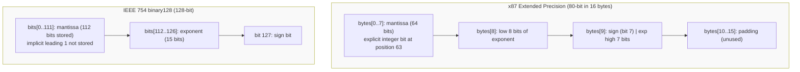
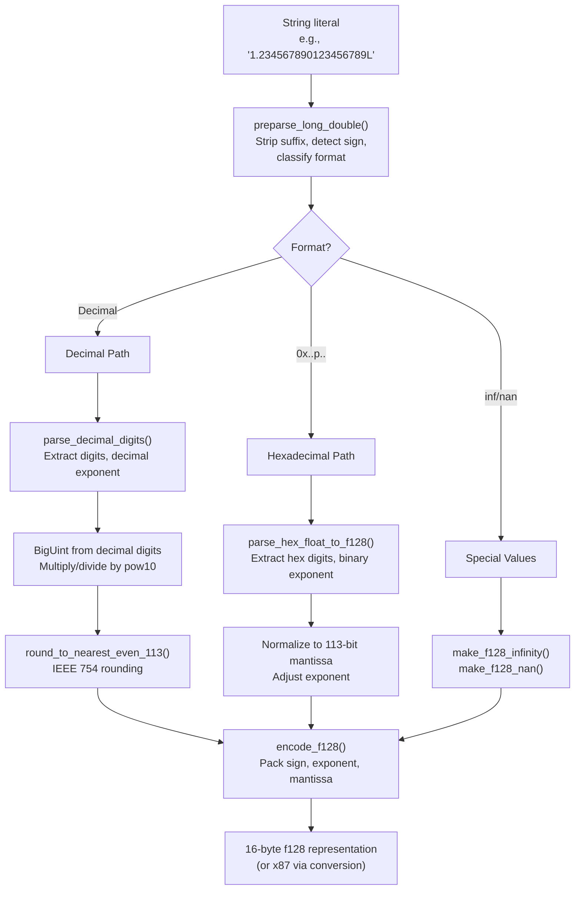
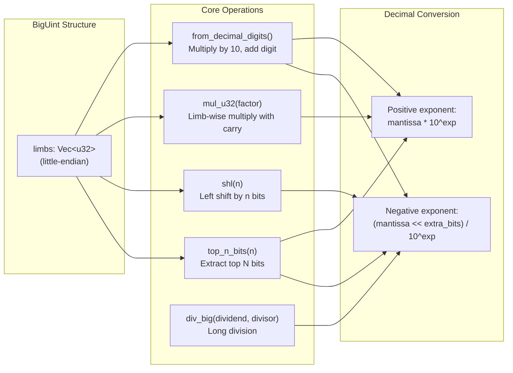
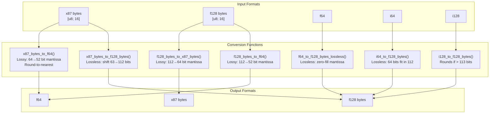
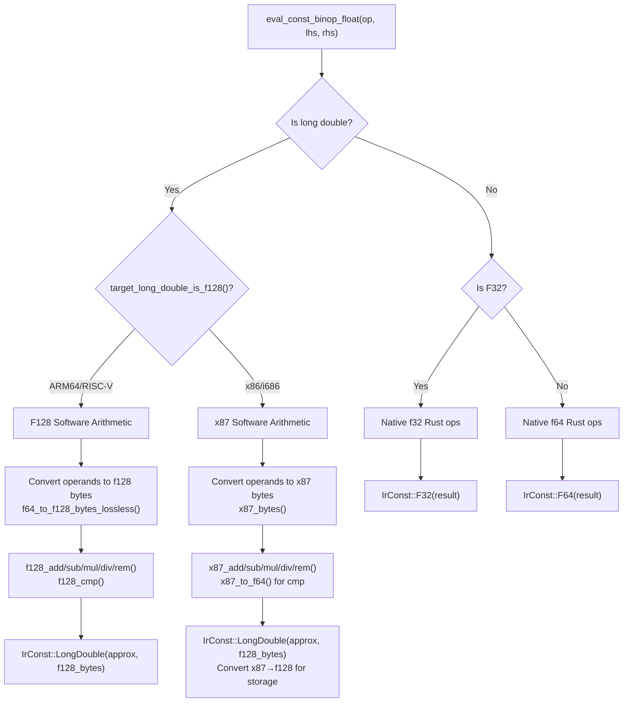
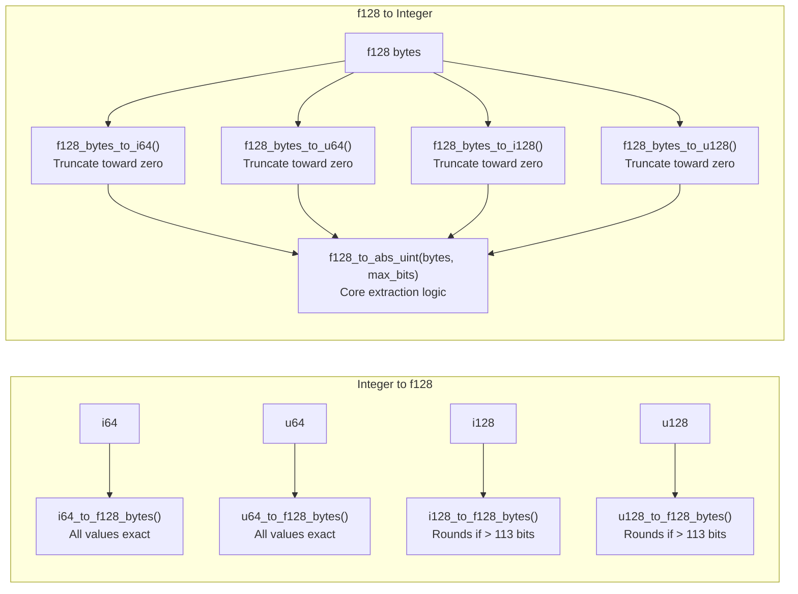

<!-- source: DeepWiki mcp.deepwiki.com · repo anthropics/claudes-c-compiler · page 8.2 Long Double Handling · fetched 2026-10-26 -->

# Long Double Handling

<details>
<summary>Relevant source files</summary>

The following files were used as context for generating this wiki page:

- [ideas/new_projects.txt](ideas/new_projects.txt)
- [src/common/const_arith.rs](src/common/const_arith.rs)
- [src/common/long_double.rs](src/common/long_double.rs)
- [src/frontend/preprocessor/README.md](src/frontend/preprocessor/README.md)
- [src/frontend/preprocessor/includes.rs](src/frontend/preprocessor/includes.rs)
- [src/frontend/preprocessor/utils.rs](src/frontend/preprocessor/utils.rs)

</details>


## Purpose and Scope

This page documents the compiler's handling of C's `long double` type, which has architecture-specific representations: 80-bit x87 extended precision on x86-64/i686, and 128-bit IEEE 754 binary128 (quad precision) on AArch64/RISC-V. The system provides parsing of decimal and hexadecimal float literals to full precision, lossless format conversions, pure software arithmetic for constant folding, and conversions to/from integer types.

For information about compile-time constant evaluation using these long double operations, see [Constant Evaluation](#8.3). For complex number handling which uses long double for `long double _Complex`, see [Complex Number Support](#8.1).

**Sources:** [src/common/long_double.rs:1-10]()

---

## Architecture-Specific Representations

The `long double` type uses different binary representations depending on the target architecture:

| Architecture | Format | Storage Size | Mantissa | Exponent | Bias | Special Features |
|--------------|--------|--------------|----------|----------|------|------------------|
| x86-64, i686 | x87 extended precision | 16 bytes (10 used, 6 padding) | 64 bits (explicit integer bit) | 15 bits | 16383 | Explicit integer bit at position 63 |
| AArch64, RISC-V | IEEE 754 binary128 | 16 bytes | 112 bits stored (implicit leading 1) | 15 bits | 16383 | Implicit leading 1 (113 bits total) |

Both formats share the same exponent bias (16383) but differ fundamentally in mantissa encoding. The x87 format stores the integer bit explicitly, while f128 uses an implicit leading 1 (standard IEEE format).

**Format Layout Diagram**



**Sources:** [src/common/long_double.rs:1-21](), [src/common/long_double.rs:550-578]()

---

## Parsing Pipeline

Long double literals are parsed through a multi-stage pipeline that handles decimal and hexadecimal formats with full precision.

**Parsing Architecture**



**Sources:** [src/common/long_double.rs:36-65](), [src/common/long_double.rs:709-728](), [src/common/long_double.rs:770-862]()

### Decimal Parsing with BigUint

Decimal literals require arbitrary-precision arithmetic to achieve full 113-bit mantissa precision. The system uses a custom `BigUint` implementation with `Vec<u32>` limbs in little-endian order.

**BigUint Operations**



The decimal-to-float conversion algorithm:
1. **Positive decimal exponent** (e.g., `1.23e45`): Multiply digits by 10^exp using `mul_big()`, extract top 113 bits
2. **Negative decimal exponent** (e.g., `1.23e-45`): Shift digits left by extra bits, divide by 10^exp using `div_big()`, extract quotient's top 113 bits
3. Apply IEEE 754 round-to-nearest-even via `round_to_nearest_even_113()` which examines guard and sticky bits

**Sources:** [src/common/long_double.rs:67-268](), [src/common/long_double.rs:336-352](), [src/common/long_double.rs:356-422](), [src/common/long_double.rs:424-498]()

### Hexadecimal Float Parsing

Hexadecimal float literals (`0x1.23p45L`) bypass BigUint arithmetic since binary exponents map directly to the floating-point representation.

The parsing steps:
1. Skip `0x` prefix, extract hex digits before and after decimal point
2. Parse binary exponent from `p` suffix
3. Build 128-bit mantissa from hex digits (4 bits per digit)
4. Calculate effective binary exponent: `p_exponent - 4 * hex_digits_after_point`
5. Normalize mantissa to have bit 112 set (113-bit representation)
6. Encode via `encode_f128()`

**Sources:** [src/common/long_double.rs:770-862]()

---

## Format Conversions

The compiler performs lossless widening conversions and precision-aware narrowing conversions between x87, f128, and f64 formats.

**Conversion Matrix**



### Key Conversion Details

**x87 ↔ f128 Conversion**

The exponent fields are identical (15-bit, bias 16383), so only mantissa conversion is needed:
- **x87 → f128**: Strip explicit integer bit (bit 63), shift remaining 63 bits left by 49 positions to fill 112-bit stored mantissa
- **f128 → x87**: Take top 64 bits of 113-bit mantissa (including implicit bit), set bit 63 as explicit integer bit

**Decompose Helpers**

The module provides shared decomposition functions to eliminate boilerplate:
- `x87_decompose()`: Extract `(sign, biased_exp, mantissa64)` from 16-byte array
- `f64_decompose()`: Extract `(sign, biased_exp, mantissa52)` from f64 bits
- `f128_decompose()`: Extract `(sign, biased_exp, mantissa113)` from 16-byte array (adds implicit bit)

These are used by all arithmetic and conversion functions.

**Sources:** [src/common/long_double.rs:550-677](), [src/common/long_double.rs:681-702](), [src/common/long_double.rs:883-939]()

---

## Software Arithmetic

Since native CPU instructions for f128 and x87 arithmetic are not available (or not portable across architectures), the compiler implements pure software arithmetic for constant folding.

**Arithmetic Function Table**

| Operation | x86/i686 Functions | ARM64/RISC-V Functions | Precision |
|-----------|-------------------|------------------------|-----------|
| Addition | `x87_add()` | `f128_add()` | 64-bit mantissa (x87)<br/>112-bit mantissa (f128) |
| Subtraction | `x87_sub()` | `f128_sub()` | Same as above |
| Multiplication | `x87_mul()` | `f128_mul()` | Same as above |
| Division | `x87_div()` | `f128_div()` | Same as above |
| Remainder | `x87_rem()` | `f128_rem()` | Same as above |
| Comparison | `x87_cmp()` | `f128_cmp()` | Returns -1, 0, or 1 |
| Negation | Sign bit flip | Sign bit flip | Bit manipulation only |

**Constant Evaluation Integration**

The arithmetic functions are called from `eval_const_binop_float()` in `const_arith.rs`, which dispatches based on target architecture:



**Sources:** [src/common/const_arith.rs:142-298](), [src/common/long_double.rs:1232-1532]() (arithmetic implementations in truncated section)

### IrConst Representation

Long double constants are stored in `IrConst::LongDouble(f64, [u8; 16])` with two components:
1. **Approximation f64**: Used for quick comparisons and debugging display
2. **Full precision bytes**: 16-byte f128 representation (IEEE 754 binary128), used for all arithmetic

The x87 format is only used during x87 arithmetic operations; results are immediately converted to f128 for storage. This ensures cross-architecture consistency in the IR.

**Sources:** [src/common/const_arith.rs:162-176](), [src/common/const_arith.rs:223-240]()

---

## Integer Conversions

The long double system provides direct conversion between f128 bytes and integer types without lossy intermediate conversions through f64.

**Integer Conversion Functions**



### Direct f128 Integer Extraction

The `f128_to_abs_uint()` function extracts integer values directly from f128 mantissa and exponent without converting to f64, preserving full precision:

1. Decompose f128 to `(sign, biased_exp, mantissa113)`
2. Calculate shift: `unbiased_exp - 112` (position of binary point relative to mantissa)
3. If shift ≥ 0: left-shift mantissa (value ≥ 1.0)
4. If shift < 0: right-shift mantissa (value < 1.0, truncates to zero)
5. Check for overflow against `max_bits` parameter
6. Return `(sign, abs_value)` tuple

This approach correctly handles values up to 2^127 (i128 range) without intermediate f64 conversion that would lose precision for large integers.

**Sources:** [src/common/long_double.rs:941-1139](), [src/common/long_double.rs:1047-1086]()

---

## Integration with Type System

Long double handling integrates with the compiler's type system through target-specific queries.

**Target Detection**

The function `target_long_double_is_f128()` determines which arithmetic implementation to use:

```rust
// From src/common/types.rs (referenced pattern)
fn target_long_double_is_f128() -> bool {
    matches!(target_arch(), "aarch64" | "riscv64")
}
```

This affects:
- **Parsing**: All architectures parse to f128 first, then convert to x87 if needed
- **Arithmetic**: Dispatch to `f128_*` or `x87_*` functions based on target
- **Storage**: IR always stores f128 bytes for cross-platform consistency
- **Code generation**: Backend converts f128→x87 for x86/i686 emission

**Constant Folding Usage**

Long double values flow through constant evaluation in these contexts:
1. **Sema constant evaluation**: Pre-compute initializers, array sizes (via [Constant Evaluation](#8.3))
2. **IR lowering constant evaluation**: Fold arithmetic during IR construction
3. **Optimization passes**: Constant folding pass uses `eval_const_binop_float()`

All three paths use the shared `eval_const_binop_float()` function in `const_arith.rs`, ensuring consistent precision across compilation stages.

**Sources:** [src/common/const_arith.rs:150-268](), [src/common/long_double.rs:1-10]()

---

## Decompose Helper Pattern

To eliminate code duplication across conversion and arithmetic functions, the module provides shared decomposition functions that extract components from raw bytes:

**Decompose Functions**

| Function | Returns | Used By |
|----------|---------|---------|
| `x87_decompose(&[u8; 16])` | `X87Decomposed { sign, biased_exp, mantissa }` | x87 arithmetic, x87→f64, x87→f128 |
| `f64_decompose(f64)` | `F64Decomposed { sign, biased_exp, mantissa }` | f64→f128 |
| `f128_decompose(&[u8; 16])` | `(bool, u16, u128)` | f128 arithmetic, f128→x87, f128→f64, f128→int |

The decomposed structures include helper methods:
- `.is_zero()`: Check for zero value
- `.is_special()`: Check for infinity or NaN (max exponent)
- `.is_inf()`: Check specifically for infinity
- `.unbiased_exp()`: Get exponent with bias removed

For f128, the decompose function adds the implicit leading bit: a normal value with stored mantissa M becomes `mantissa113 = (1 << 112) | M`, so bit 112 is always set for normals.

**Sources:** [src/common/long_double.rs:546-603](), [src/common/long_double.rs:550-578]()

---

## Summary

The long double handling system provides:

1. **Architecture-aware precision**: 80-bit x87 for x86/i686, 128-bit f128 for ARM64/RISC-V
2. **Full-precision parsing**: BigUint-based decimal parsing achieves 113-bit mantissa precision
3. **Lossless conversions**: Widening conversions preserve all bits; narrowing conversions use IEEE 754 rounding
4. **Pure software arithmetic**: Constant folding operates at full precision without native CPU instructions
5. **Direct integer extraction**: f128→integer conversions bypass lossy f64 intermediate
6. **Cross-platform IR**: All architectures store f128 bytes in IR for consistency

The implementation prioritizes correctness over performance, using software arithmetic to ensure bit-exact constant folding across all supported targets.

**Sources:** [src/common/long_double.rs:1-21](), [src/common/const_arith.rs:142-298]()

---

