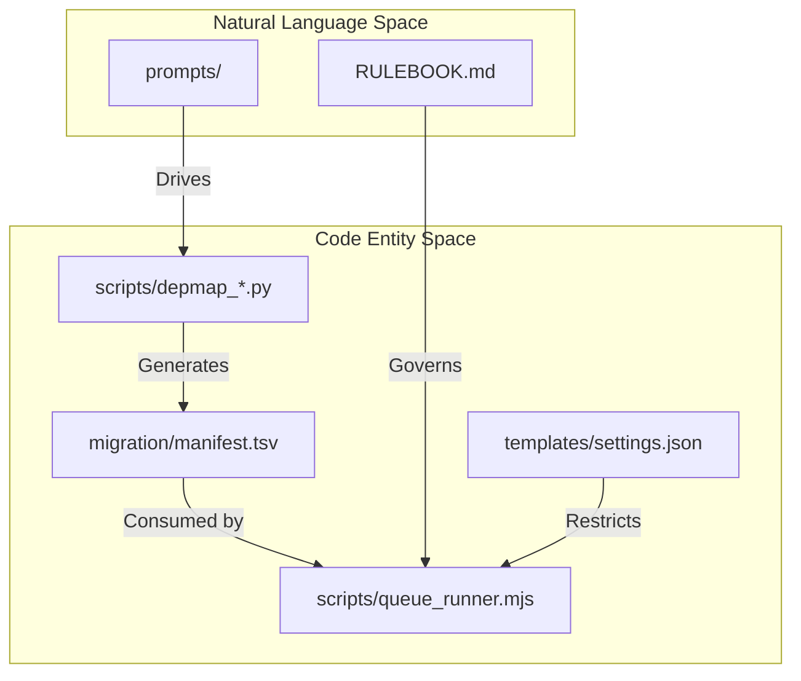
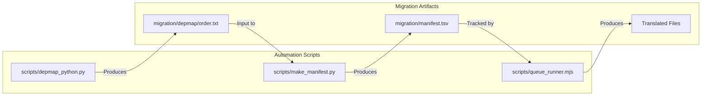

<!-- source: DeepWiki mcp.deepwiki.com · repo anthropics/code-migration-kit-with-claude-code · page 1 Overview · fetched 2026-10-26 -->

# Overview

Relevant source files

The following files were used as context for generating this wiki page:

- [.gitignore](.gitignore)
- [CLAUDE.md](CLAUDE.md)
- [LICENSE](LICENSE)
- [README.md](README.md)

The **Claude Code Migration Kit** is a technical framework and methodology for executing large-scale codebase migrations using Claude Code [README.md:1-5](). It is designed primarily for **structure-preserving migrations**, where the goal is to port a codebase to a new language while maintaining the existing architecture and data structures [README.md:7-9]().

The kit provides a structured, six-step pipeline that shifts the focus from fixing individual lines of code to fixing the underlying process [README.md:59-62](). It relies on a "process-first" doctrine, using deterministic scripts for dependency mapping and adversarial agent topologies for quality control [CLAUDE.md:6-12]().

### The Six-Step Pipeline

The migration follows a linear progression governed by sign-off gates. Each step is driven by specific prompts located in the `prompts/` directory [README.md:64-72]().

| Step | Focus | Key Code Entities / Artifacts |
| :--- | :--- | :--- |
| **0** | **Feasibility** | `prompts/00-feasibility.md`, `prompts/00b-judge-setup.md` |
| **1** | **Mapping** | `scripts/depmap_*.py`, `templates/RULEBOOK.md`, `templates/inventory.tsv` |
| **2** | **Stress-Test** | `prompts/03-stress-test.md`, `migration/stress-test/` |
| **3** | **Translation** | `scripts/queue_runner.mjs`, `migration/manifest.tsv` |
| **4** | **Compilation** | `prompts/05-survey-build.md`, `templates/settings.json` |
| **5/6** | **Parity** | `prompts/06-post-parity.md`, existing test suites |

For a detailed breakdown of the philosophy and foundational rules (such as the read-only rulebook and queue-on-disk state), see **[Core Principles and Standing Rules](#1.2)**.

### System Architecture and Code Entities

The kit bridges the gap between high-level migration intent and concrete file-system state. The following diagram illustrates how the migration state is managed through specific files and scripts.

**Migration State and Execution Flow**

Sources: [README.md:73-93](), [CLAUDE.md:58-72]()

### Repository Organization

The repository is organized into functional directories that support the pipeline:

*   **`prompts/`**: The operational heart of the kit. Contains the numbered Markdown files that orchestrate Claude Code through each phase [README.md:47]().
*   **`scripts/`**: Automation tools including language-specific dependency mappers (`depmap_python.py`, `depmap_ts.mjs`, `depmap_c.py`) and the `queue_runner.mjs` for managing the translation fan-out [README.md:66-68]().
*   **`templates/`**: Reusable blueprints for the `RULEBOOK.md`, `inventory.tsv`, and `.claude/settings.json` configuration [README.md:77-92]().
*   **`skill/`**: Contains the `SKILL.md` file which can be installed into Claude Code to provide context-aware routing for migration tasks [README.md:30-31]().

**Entity Relationship: Scripts to Output**

Sources: [CLAUDE.md:58-72](), [README.md:111-117]()

### Getting Started

To begin a migration, the kit must be integrated into the target repository. This involves:
1.  Cloning the kit and configuring `CLAUDE.md` [README.md:25-29]().
2.  Running the feasibility check (`prompts/00-feasibility.md`) [README.md:49-56]().
3.  Establishing a "Judge" (test suite or parity harness) [README.md:34-39]().

For detailed installation and configuration steps, see **[Getting Started](#1.1)**.

### Reference Implementation: Run 1
The repository includes a complete example of a migration from Python to TypeScript (a port of the `toml` library) located in `examples/run1-toml/`. This serves as a reference for the expected quality and structure of migration artifacts [Wiki TOC: 6]().

---

