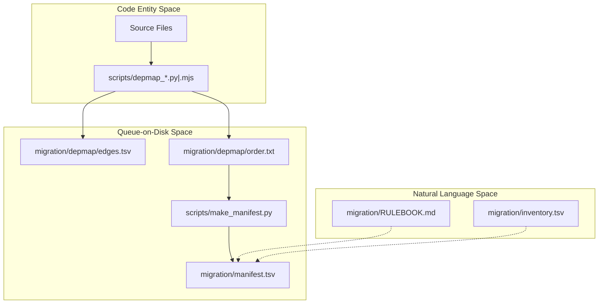
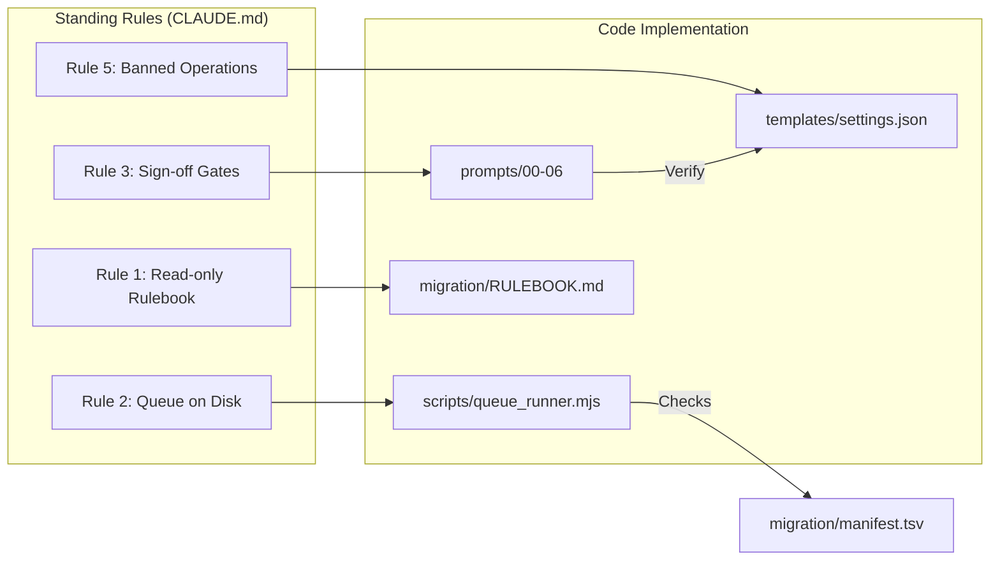

<!-- source: DeepWiki mcp.deepwiki.com · repo anthropics/code-migration-kit-with-claude-code · page 1.2 Core Principles and Standing Rules · fetched 2026-10-26 -->

# Core Principles and Standing Rules

Relevant source files

The following files were used as context for generating this wiki page:

- [CLAUDE.md](CLAUDE.md)
- [README.md](README.md)
- [RUN-NOTES.md](RUN-NOTES.md)

The Claude Code Migration Kit operates on a foundational philosophy that prioritizes process over individual agent intelligence. By enforcing rigid state management and adversarial review structures, the kit ensures that migrations of hundreds of thousands of lines remain deterministic and resumable.

## Process-First Doctrine

The kit is built on the principle that **you don't fix the code—you fix the process that produced the code** [README.md:60-62](). In a manual migration, a developer might fix a recurring pattern by hand; in this kit, a recurring failure triggers a rulebook amendment, and the affected slice of the codebase is regenerated [CLAUDE.md:44-47]().

### The Rulebook Meta-Rule
The Rulebook (`migration/RULEBOOK.md`) is the single source of truth for all translation decisions. The meta-rule is: **if two agents could answer differently, it goes in the rulebook** [README.md:79-80](). 

Key constraints on the Rulebook include:
*   **Read-Only Inside Loops:** Implementers and reviewers cite the rulebook but never edit it during a task. Amendments are queued for human review and applied only at sign-off gates [CLAUDE.md:16-19]().
*   **Immutability:** The graded party (the LLM) is never allowed to relax its own grader (the rules) [CLAUDE.md:18-19]().

## Queue-on-Disk State Management

To ensure 100% resumability and prevent "context drift," the kit maintains all state on the filesystem rather than in the LLM's conversation memory [CLAUDE.md:20-23]().

*   **Manifest-Driven:** The `migration/manifest.tsv` defines the work queue [CLAUDE.md:65]().
*   **Existence as Completion:** A unit of work is considered "done" only when its output file exists at the path dictated by the rulebook naming rules [CLAUDE.md:20-22]().
*   **Resumability:** Because state is on disk, a session can be interrupted or a repo relocated mid-run without losing progress. New sessions resume by scanning the manifest against the filesystem [RUN-NOTES.md:111-114]().

### Data Flow: From Map to Manifest
This diagram illustrates how the kit converts static code analysis into a disk-based work queue.

**Diagram: State Management Pipeline**

Sources: [CLAUDE.md:62-65](), [README.md:73-92](), [README.md:113-117]()

## Adversarial Review Topology

The kit rejects the "one-and-done" translation model in favor of an adversarial topology. For every unit of work (typically a file), the kit mandates a four-agent structure [CLAUDE.md:28-31](), [README.md:68]():

1.  **Implementer:** Performs the initial translation based on the Rulebook.
2.  **Adversarial Reviewers (x2):** Two separate agents in isolated contexts who assume the work is wrong. They touch no code and must cite a rule or source line for every finding [CLAUDE.md:28-31]().
3.  **Referee/Fixer:** A final agent that applies only confirmed findings where the reviewers agree, or where a third-party referee breaks a tie [CLAUDE.md:30-31]().

## Sign-Off Gates and Banned Operations

The workflow is interrupted by explicit **Sign-off Gates**. A prompt will "stop and show" evidence to the human, and the human's re-invocation of the next prompt serves as the approval to proceed [CLAUDE.md:24-27]().

### Permission Hardening via settings.json
The kit uses `templates/settings.json` (copied to `.claude/settings.json`) to enforce "denies" by configuration. This prevents agents from taking shortcuts [CLAUDE.md:32-35]():
*   **Banned:** Mutating version control, running the compiler during translation, or executing long-running tests [CLAUDE.md:32-34]().
*   **The "Build Daemon" Pattern:** In Step 4, fixers are denied compiler access. They must rely on the `build_daemon.sh` output, which provides compiler diagnostics as a read-only queue [README.md:118-121]().

## Model Tiering Strategy

Token spend is optimized by concentrating high-reasoning models where the "blast radius" of an error is largest [CLAUDE.md:76-77]().

| Task | Tier | Rationale |
| :--- | :--- | :--- |
| **Rulebook Authorship** | Largest (e.g., Opus/3.5 Sonnet) | Errors here replicate into every file [CLAUDE.md:77-78](). |
| **Skeptic Reviewers** | Largest/Mid | High reasoning required to find subtle gaps [CLAUDE.md:79](). |
| **Implementers** | Mid/Small (e.g., Haiku) | High volume; backed by two reviewers and a compiler [CLAUDE.md:80-81](). |
| **Fixers** | Mid | The compiler acts as the ultimate referee [CLAUDE.md:81-82](). |

### Implementation Mapping: Process to Code
This diagram maps the philosophical "Standing Rules" to the specific code entities that enforce them.

**Diagram: Rule Enforcement Mapping**

Sources: [CLAUDE.md:14-56](), [README.md:40-47](), [RUN-NOTES.md:99-101]()

---

