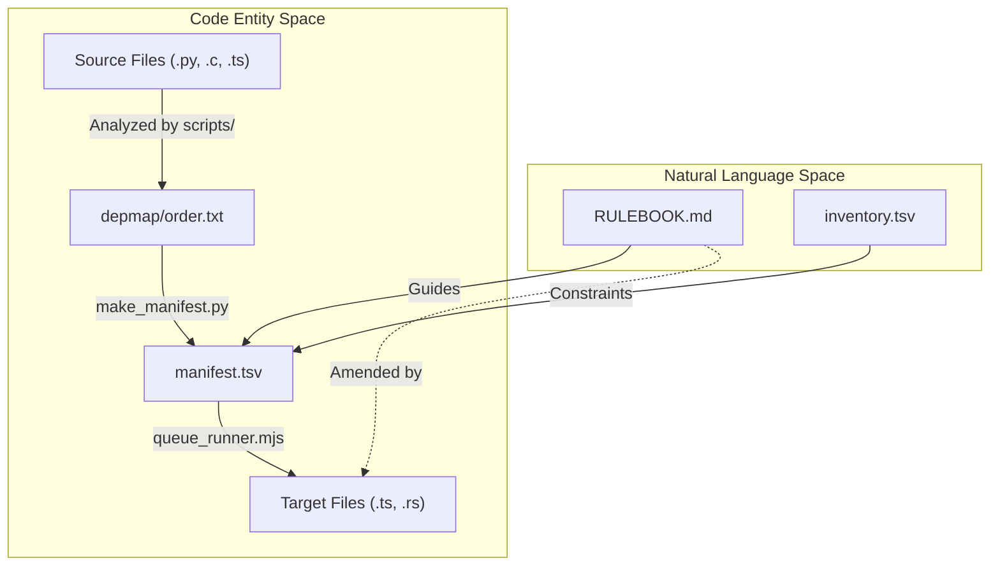
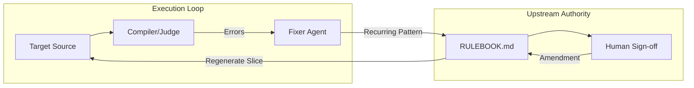

<!-- source: DeepWiki mcp.deepwiki.com · repo anthropics/code-migration-kit-with-claude-code · page 2 The Six-Step Migration Pipeline · fetched 2026-10-26 -->

# The Six-Step Migration Pipeline

Relevant source files

The following files were used as context for generating this wiki page:

- [CLAUDE.md](CLAUDE.md)
- [README.md](README.md)
- [RUN-NOTES.md](RUN-NOTES.md)

This page provides a high-level overview of the complete migration lifecycle within the Claude Code Migration Kit. The pipeline is designed to move a codebase from a source language to a target language through a series of deterministic gates, emphasizing process-level fixes over individual code patches.

The core philosophy of this pipeline is that **you don't fix the code — you fix the process that produced the code** [README.md:60-61](). By enforcing strict separation between implementers, adversarial reviewers, and compilers, the kit ensures that the resulting codebase adheres to a unified set of rules rather than the varying styles of individual LLM sessions.

## Pipeline Architecture

The migration is organized into six sequential steps, each producing specific artifacts stored in the `migration/` directory [CLAUDE.md:60-70]().

### Workflow Topology
The following diagram illustrates how the system transitions from natural language requirements (The Rulebook) into discrete code entities (The Manifest) and finally into the target codebase.

**Migration Entity Flow**

Sources: [CLAUDE.md:60-70](), [README.md:73-93](), [scripts/make_manifest.py:1-20]()

---

## Step 0: Feasibility and Judge Setup
Before any code is moved, a feasibility report determines if the migration should proceed. This step defines the **Model Plan** (which tiers of Claude to use for which tasks) and the **Posture** (Structure-preserving vs. Redesign) [CLAUDE.md:82-84](), [README.md:7-11](). If the existing test suite cannot survive the language transition, a portable parity judge is constructed here.

For details, see [Step 0: Feasibility and Judge Setup](#2.1).

## Step 1: Dependency Map and Gap Inventory
This step builds the "Map" and the "Rules." 
1.  **Dependency Map**: Uses language-specific scripts (e.g., `scripts/depmap_py.py`) to create a deterministic order of operations [README.md:84-88]().
2.  **Gap Inventory**: A flat table (`inventory.tsv`) identifying every site where the target language demands explicit handling of concepts the source language handled implicitly (e.g., lifetimes, nullability) [README.md:89-93]().
3.  **The Rulebook**: A central `RULEBOOK.md` that governs all translation decisions [README.md:77-83]().

For details, see [Step 1: Dependency Map and Gap Inventory](#2.2).

## Step 2: Stress-Testing the Rulebook
The rulebook is validated through a **Bakeoff** and a **Pilot run** [README.md:102-109](). In the bakeoff, two translators (one following rules, one "native") are compared by a diff inspector to find gaps in the rulebook. The pilot run tests the full four-agent pipeline on a small slice of code. No fan-out occurs until the rulebook is amended based on these results.

For details, see [Step 2: Stress-Testing the Rulebook](#2.3).

## Step 3: Translation Fan-Out
This is the high-volume phase. The `scripts/queue_runner.mjs` drives the work based on `migration/manifest.tsv` [CLAUDE.md:65](). Each file is processed by a four-agent topology: one **Implementer**, two **Adversarial Reviewers**, and one **Fixer** [CLAUDE.md:28-31](). Crucially, the compiler is banned during this phase to ensure agents rely on the rulebook, not trial-and-error [CLAUDE.md:32-35]().

For details, see [Step 3: Translation Fan-Out](#2.4).

## Step 4: Survey Build and Step 5: Smoke Test
Once the queue is empty, the `templates/settings.json` compiler bans are lifted or delegated to a `build_daemon.sh` [CLAUDE.md:35-43](). A single "Survey Build" is run to identify cross-file type errors and linker issues. These are fed back into a machine queue for final adjustment. Step 5 involves running "Hello World" and basic smoke tests to prove the target environment is viable.

For details, see [Step 4: Survey Build and Step 5–6: Parity](#2.5).

## Step 6: Parity and Post-Parity Cleanup
The final gate is **Behavioral Parity**. The code is run against the judge established in Step 0. Once the inherited test suite passes, `prompts/06-post-parity.md` is used to burn down all `BUG(port)`, `TODO(port)`, and `PERF(port)` markers that were left during the mechanical translation [CLAUDE.md:53-56](), [RUN-NOTES.md:109-110]().

For details, see [Step 6 Post-Parity: Burndown and Cleanup](#2.6).

---

## The Feedback Loop
The pipeline is designed to move failures upstream. If a fixer agent encounters a recurring issue, the process dictates stopping the fix and instead amending the **Rulebook** [CLAUDE.md:44-47]().

**Rule Correction Cycle**

Sources: [CLAUDE.md:16-19](), [CLAUDE.md:44-47](), [README.md:60-63]()

### Related Pages
- [Core Principles and Standing Rules](#1.2) — The "Why" behind the "How."
- [Automation Scripts](#4) — Technical details on the `depmap` and `queue_runner` tools.

---

