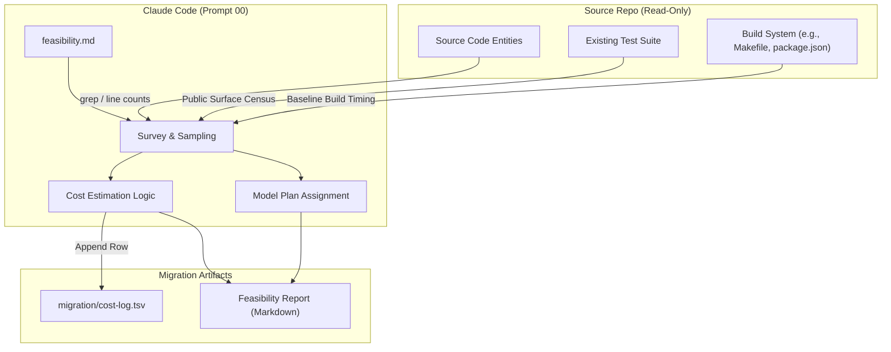
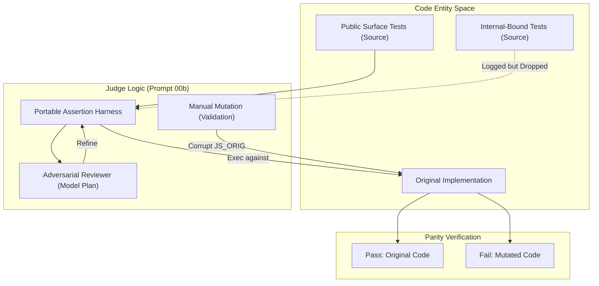

<!-- source: DeepWiki mcp.deepwiki.com · repo anthropics/code-migration-kit-with-claude-code · page 2.1 Step 0: Feasibility and Judge Setup · fetched 2026-10-26 -->

# Step 0: Feasibility and Judge Setup

Relevant source files

The following files were used as context for generating this wiki page:

- [RUN-NOTES.md](RUN-NOTES.md)
- [prompts/00-feasibility.md](prompts/00-feasibility.md)
- [prompts/00b-judge-setup.md](prompts/00b-judge-setup.md)

This stage establishes the economic and technical foundation of the migration. Before a single line of code is translated, the migration must be validated as viable, a structural posture must be chosen, and a mechanical "judge" must be established to define the exit condition.

## 0.1 Feasibility Report (Prompt 00)

The feasibility report is a read-only survey of the source repository. Its purpose is to move from general intentions to a concrete, data-backed plan. The agent is restricted from making any edits to the codebase, performing test runs, or executing the migration prompts (01–06) during this phase [prompts/00-feasibility.md:3-5]().

### The Three Critical Calls
The agent must make three specific technical calls, each backed by file paths or quantitative data [prompts/00-feasibility.md:28-45]():

| Call | Decision Point | Criteria |
| :--- | :--- | :--- |
| **Structure** | Structure-preserving vs. Redesign | Can the architecture translate 1:1 into idiomatic target language? |
| **Verification** | Verification Cost | Baseline build/typecheck timing vs. projected target scaling. |
| **Parity** | Test Survival | Do existing tests hit the public surface (portable) or import internals (die)? |

### Model Tiering and Costing
The feasibility report introduces the **Model Plan**, which prevents the migration from defaulting to a single model for all tasks. Tiers are assigned based on the "blast radius" of the task [prompts/00-feasibility.md:62-69]():
*   **High Tier (e.g., Claude 3.5 Sonnet):** Rulebook authorship, amendments, and skeptic reviewers. Errors here replicate across the entire fan-out.
*   **Mid/Small Tier (e.g., Claude 3 Haiku):** High-volume translation implementers and fixers where the compiler acts as the primary referee.

### Implementation Flow: Feasibility
The following diagram illustrates how the Feasibility prompt interacts with the codebase and generates the initial state.

**Feasibility Data Flow**

Sources: [prompts/00-feasibility.md:10-23](), [prompts/00-feasibility.md:75-80]()

---

## 0.2 Judge Setup (Prompt 00b)

A migration has no exit condition without a **Judge**: a single harness that evaluates the original code and the port on equal terms [prompts/00b-judge-setup.md:20-22](). If the feasibility report finds that existing tests are "internal-bound" (importing private functions or language-specific internals), they cannot serve as the judge.

### The Portability Requirement
The judge must interact with both implementations through an external interface (CLI, HTTP, File I/O, or Exported API) [prompts/00b-judge-setup.md:26-29](). This ensures that the judge remains valid even as the underlying language and internal structures change.

### The Three-Step Setup Process
1.  **Categorize:** Classify existing tests as **portable** or **internal-bound** [prompts/00b-judge-setup.md:31-34]().
2.  **Rewrite:** Convert portable tests into external assertions. Use two **adversarial reviewers** in separate contexts to ensure no assertions were weakened during the rewrite [prompts/00b-judge-setup.md:39-46]().
3.  **Validate:** 
    *   **Pass Case:** Run against the original code (must pass 100%).
    *   **Fail Case:** Manually mutate the original code (e.g., flip a comparison) and confirm the judge catches the failure [prompts/00b-judge-setup.md:51-58]().

### Implementation Flow: Judge Verification
This diagram maps the transition from source-specific tests to a language-agnostic parity judge.

**Judge Construction and Validation**

Sources: [prompts/00b-judge-setup.md:31-58](), [RUN-NOTES.md:48-52]()

---

## 0.3 Cost Tracking and State

Both Prompts 00 and 00b require the agent to maintain a `migration/cost-log.tsv`. This file tracks the wall-clock time, token usage, and model tiers used at each gate [prompts/00-feasibility.md:75-80](), [prompts/00b-judge-setup.md:65-70]().

**Cost Log Schema**
| Column | Description |
| :--- | :--- |
| `step` | The prompt number (0 or 00b). |
| `timestamp` | ISO 8601 UTC timestamp. |
| `wall_clock_min` | Active minutes spent by the operator/agent. |
| `tokens` | Total tokens consumed. |
| `subagents` | Number of sub-agent calls spawned. |
| `model` | The specific model string used (e.g., `claude-3-5-sonnet-20240620`). |

Sources: [prompts/00-feasibility.md:75-80](), [RUN-NOTES.md:107-108]()

---

