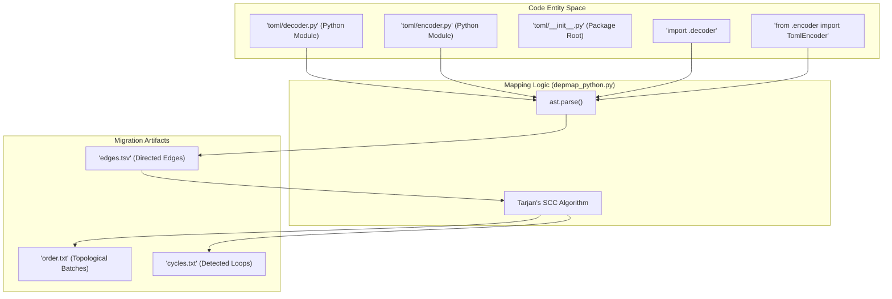
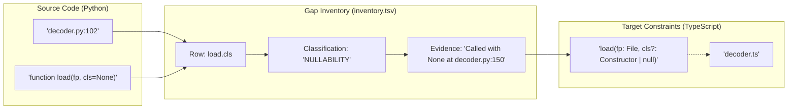

<!-- source: DeepWiki mcp.deepwiki.com · repo anthropics/code-migration-kit-with-claude-code · page 2.2 Step 1: Dependency Map and Gap Inventory · fetched 2026-10-26 -->

# Step 1: Dependency Map and Gap Inventory

<details>
<summary>Relevant source files</summary>

The following files were used as context for generating this wiki page:

- [prompts/01-dependency-map.md](prompts/01-dependency-map.md)
- [prompts/02-gap-inventory.md](prompts/02-gap-inventory.md)
- [scripts/depmap_c.py](scripts/depmap_c.py)
- [scripts/depmap_python.py](scripts/depmap_python.py)
- [scripts/depmap_ts.mjs](scripts/depmap_ts.mjs)
- [scripts/make_manifest.py](scripts/make_manifest.py)

</details>


The first technical step of the migration involves building a deterministic foundation for the work queue and identifying the semantic "gaps" that the rulebook must address. This phase transitions the project from feasibility assessment to actionable engineering artifacts.

## 1. Building the Deterministic Dependency Map

The **Dependency Map** is a non-negotiable prerequisite for migration. It ensures that files are translated in topological order (dependencies before dependents) and identifies **Strongly Connected Components (SCCs)**—circular dependencies that must be migrated as a single batch.

### Implementation Strategy
Rather than relying on LLM judgment to find imports, the kit uses deterministic scripts to parse the codebase. This ensures that the migration order is reproducible and verifiable [prompts/01-dependency-map.md:16-17]().

The kit provides three starter mappers:
*   **Python:** `scripts/depmap_python.py` uses the `ast` module to parse imports [scripts/depmap_python.py:25-26]().
*   **TypeScript/JS:** `scripts/depmap_ts.mjs` uses a line scanner for relative specifiers [scripts/depmap_ts.mjs:51-53]().
*   **C/C++:** `scripts/depmap_c.py` parses `#include` directives [scripts/depmap_c.py:30-30]().

### Data Flow: Code Entity Space to Dependency Graph
The following diagram illustrates how source code entities (files and imports) are transformed into the migration artifacts.

**Dependency Mapping Data Flow**

**Sources:** [scripts/depmap_python.py:88-107](), [scripts/depmap_python.py:110-160](), [prompts/01-dependency-map.md:25-31]()

### Adversarial Review of the Map
Once the script generates a map, it must pass a "Skeptic Review" before the manifest is built:
1.  **Two Reviewers:** Two separate agent contexts (per the Model Plan) verify the map [prompts/01-dependency-map.md:33-35]().
2.  **Sampling:** Each reviewer checks 20 files. One focuses on the largest/macro-heavy files; the other focuses on platform-specific and generated files to ensure they are correctly excluded [prompts/01-dependency-map.md:37-39]().
3.  **Evidence-Based:** Reviewers must provide file:line evidence for every edge they find [prompts/01-dependency-map.md:40-41]().
4.  **Zero-Tolerance:** Any confirmed discrepancy is treated as a bug in the **script**, not the map. The script is fixed, and the entire map is regenerated [prompts/01-dependency-map.md:47-49]().

**Sources:** [prompts/01-dependency-map.md:33-54]()

---

## 2. Manifest Generation

The `manifest.tsv` is the master work queue for the migration. It is generated from the topological `order.txt` using `scripts/make_manifest.py`.

### The Substitution Contract
The manifest builder applies string substitutions to map source paths to target paths, encoding the naming rules defined in Section 4 of the `RULEBOOK.md` [scripts/make_manifest.py:12-13]().

**Example Command:**
```bash
python3 scripts/make_manifest.py \
    --order migration/depmap/order.txt \
    --out migration/manifest.tsv \
    --sub 'toml/=src/' \
    --sub '.py=.ts'
```
[prompts/01-dependency-map.md:58-61]()

The script enforces a safety check: if a derived target path is identical to the source path, it exits with an error to prevent accidental overwrites [scripts/make_manifest.py:57-64]().

**Sources:** [scripts/make_manifest.py:4-15](), [scripts/make_manifest.py:47-72]()

---

## 3. Gap Inventory

The **Gap Inventory** identifies semantic concepts that exist in the target language but are implicit or "in the programmer's head" in the source language (e.g., Rust lifetimes, TypeScript strict nullability, or C++ ownership) [prompts/02-gap-inventory.md:5-9]().

### Inventory Structure
The inventory is a flat TSV file (`migration/inventory.tsv`) that implementers grep during Step 3 [prompts/02-gap-inventory.md:14-16]().

| Column | Purpose |
| :--- | :--- |
| **File** | Repo-relative path to the source file. |
| **Symbol** | The function, variable, or class name. |
| **Source Construct** | The specific code snippet (e.g., `def parse(s):`). |
| **Classification** | The gap type (e.g., `NULLABILITY`, `LIFETIME`). |
| **Target Translation** | The determined target representation (e.g., `string | null`). |
| **Evidence** | Call sites or logic that prove the classification. |
| **Status** | `PROPOSED`, `CONFIRMED`, or `UNKNOWN`. |

**Sources:** [prompts/02-gap-inventory.md:16-18](), [templates/inventory.tsv]() (referenced)

### Joint Audit and Skeptic Review
The inventory is built through a rigorous adversarial process:
1.  **Skeptic Review:** Two reviewers independently attack each entry, requiring line-level evidence to justify the proposed translation [prompts/02-gap-inventory.md:35-39]().
2.  **Handling Uncertainty:** If a row remains contested, it is marked `UNKNOWN`. It still receives a deterministic "most conservative" translation plus a greppable `TODO(port)` marker so the migration can proceed without stalling [prompts/02-gap-inventory.md:42-47]().
3.  **Joint Audit:** Adversarial agents read the inventory and the `RULEBOOK.md` together to find contradictions (e.g., a rule that contradicts a specific inventory row) [prompts/02-gap-inventory.md:62-66]().

### Mapping Gaps to Code Symbols
The following diagram shows how the Gap Inventory bridges the gap between source logic and target constraints.

**Gap Inventory Symbol Mapping**

**Sources:** [prompts/02-gap-inventory.md:14-22](), [prompts/02-gap-inventory.md:32-34]()

### Progress Invariants
During the fan-out phase of building the inventory, the orchestrator monitors "shard" files (`migration/inventory.<category>.tsv`). A progress invariant is enforced: shard row counts must grow every three minutes, or the worker is treated as failed [prompts/02-gap-inventory.md:51-60]().

**Sources:** [prompts/02-gap-inventory.md:51-60]()

---

