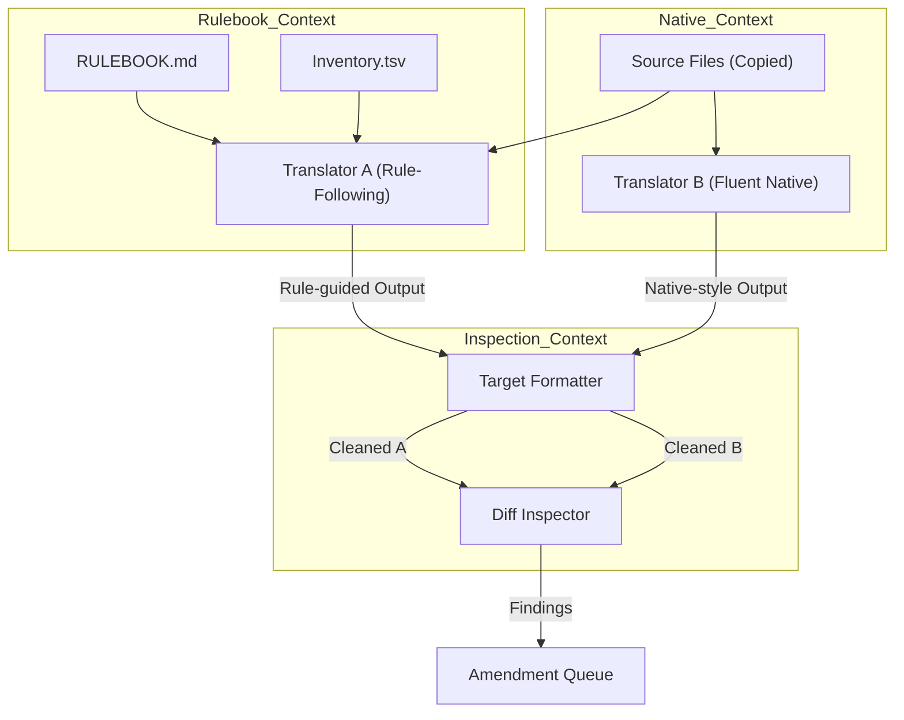

<!-- source: DeepWiki mcp.deepwiki.com · repo anthropics/code-migration-kit-with-claude-code · page 2.3 Step 2: Stress-Testing the Rulebook · fetched 2026-10-26 -->

# Step 2: Stress-Testing the Rulebook

<details>
<summary>Relevant source files</summary>

The following files were used as context for generating this wiki page:

- [RUN-NOTES.md](RUN-NOTES.md)
- [prompts/03-stress-test.md](prompts/03-stress-test.md)
- [templates/settings.README.md](templates/settings.README.md)
- [templates/settings.json](templates/settings.json)

</details>


Step 2 (Prompt 03) is the final validation gate before the high-volume translation fan-out begins. Its purpose is to expose gaps, silences, and contradictions in the `RULEBOOK.md` by forcing it to compete against a "Native" translation in a controlled bakeoff. This step ensures that the rules—rather than the model's unguided intuition—drive the migration [prompts/03-stress-test.md:13-17]().

## The Validation Logic

The stress test operates on a "Rulebook as Defendant" model. By the end of this step, the rulebook is either proven sufficient or amended via the **Amendment Queue**.

### 1. Settings Verification
Before execution, the orchestrator must verify the presence of `.claude/settings.json` [prompts/03-stress-test.md:19-22](). This file contains the `deny` rules that prevent sub-agents from accidentally mutating the git state or invoking the compiler prematurely [templates/settings.json:1-22]().
*   **Verification:** If the file is missing, the agent must halt and request installation [prompts/03-stress-test.md:22-24]().
*   **Model Plan Adherence:** Every sub-agent call (Translator, Reviewer, Inspector) must explicitly use the model tier defined in the Step 0 Feasibility Report [prompts/03-stress-test.md:30-34]().

### 2. File Selection (The "Risky" Subset)
The agent selects a small number of files (typically 3) based on objective criteria rather than random sampling [prompts/03-stress-test.md:36-39]().
*   **Scoring:** Candidates are scored by the density of **Gap Inventory** rows and **Rulebook** sections they exercise [prompts/03-stress-test.md:36-38]().
*   **Reporting:** The selection, with line-level proof of why these files are difficult, is recorded in `migration/stress-test/selection.md` [prompts/03-stress-test.md:38-41]().

## Dual-Translator Bakeoff

The bakeoff uses two independent translation paths to identify where the rulebook is failing to provide enough guidance or is providing the *wrong* guidance.

### Data Flow: The Bakeoff Architecture

The following diagram illustrates the isolation between the Rule-Following agent and the Native agent, and how the Diff Inspector reconciles them.

**Bakeoff Isolation and Inspection**

Sources: [prompts/03-stress-test.md:43-62](), [RUN-NOTES.md:32-37]()

| Agent | Context | Instruction | Goal |
| :--- | :--- | :--- | :--- |
| **Translator A** | Repo Worktree | Follow `RULEBOOK.md` to the letter. Cite rules for every choice. | Test rule coverage and clarity. |
| **Translator B** | Scratch Dir (Outside Repo) | Port as a fluent engineer in the target language. No access to Rulebook. | Establish a "gold standard" baseline. |
| **Diff Inspector** | Full Access | Compare A and B after formatting. Categorize every difference. | Identify rule silences or errors. |

## The Pilot Run

Simultaneous with the bakeoff, the agent executes a **Pilot Run**. This uses the production pipeline topology (Implementer + 2 Adversarial Reviewers + 1 Fixer) on the same selected files [prompts/03-stress-test.md:64-66]().

The Pilot Run tests **Process Adherence**:
*   Do the reviewers catch rule violations?
*   Does the fixer resolve conflicts without violating the rulebook?
*   Does the "Implementer" attempt to ignore the rules in favor of native intuition? [prompts/03-stress-test.md:67-70]()

## Amendment Queue and Re-round Logic

The output of Step 2 is not code, but a list of proposed changes to the `RULEBOOK.md`. These are queued for human approval at the gate [prompts/03-stress-test.md:72-74]().

### The Re-round Trigger
If material amendments are applied, a **Re-round** is triggered [prompts/03-stress-test.md:78-82]().
1.  **Fresh Files:** The bakeoff is repeated on a *new* set of files to ensure the amendments didn't just fix the specific instances but the underlying logic [prompts/03-stress-test.md:81-82]().
2.  **Weighted Selection:** New files are weighted toward the sections that were just amended [prompts/03-stress-test.md:81-82]().
3.  **Termination:** If the same section requires amendment twice, the loop halts for human intervention [prompts/03-stress-test.md:83-84]().

### Implementation: Step 2 State Machine

The following diagram maps the logical flow of Prompt 03 to the file system artifacts and gate conditions.

**Step 2 Execution Flow**
```mermaid
stateDiagram-v2
    [*] --> SettingsCheck
    SettingsCheck --> FileSelection: .claude/settings.json exists
    SettingsCheck --> HALT: Settings missing
    
    FileSelection --> Bakeoff_and_Pilot
    
    state Bakeoff_and_Pilot {
        direction LR
        Translator_A --> DiffInspector
        Translator_B --> DiffInspector
        Implementer --> Reviewers --> Fixer
    }
    
    Bakeoff_and_Pilot --> AmendmentQueue: Generate Report
    AmendmentQueue --> Gate: Human Review
    
    Gate --> ReRound: Amendments Applied
    Gate --> Step3_FanOut: Sign-off
    
    ReRound --> Bakeoff_and_Pilot: Fresh Files
```
Sources: [prompts/03-stress-test.md:19-86](), [RUN-NOTES.md:32-37]()

## Cost Logging
Upon completion of each round, the agent appends a row to `migration/cost-log.tsv` [prompts/03-stress-test.md:89-94](). This log tracks:
*   Wall-clock time for the stress test.
*   Total tokens consumed by sub-agents.
*   The specific model tiers used (e.g., `claude-3-5-sonnet-20240620`).

Sources:
* `prompts/03-stress-test.md`
* `templates/settings.json`
* `templates/settings.README.md`
* `RUN-NOTES.md`

---

