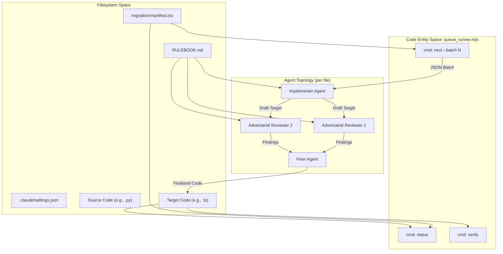

<!-- source: DeepWiki mcp.deepwiki.com · repo anthropics/code-migration-kit-with-claude-code · page 2.4 Step 3: Translation Fan-Out · fetched 2026-10-26 -->

# Step 3: Translation Fan-Out

Relevant source files

The following files were used as context for generating this wiki page:

- [RUN-NOTES.md](RUN-NOTES.md)
- [prompts/04-translation-kickoff.md](prompts/04-translation-kickoff.md)
- [scripts/queue_runner.mjs](scripts/queue_runner.mjs)

Step 3 is the primary execution phase of the migration. Driven by **prompt 04**, the system transitions from planning and validation into bulk translation. This phase utilizes a high-concurrency, multi-agent topology to process the work queue defined in the manifest, enforcing progress invariants through filesystem state rather than volatile memory.

## Overview and Objectives

The goal of Step 3 is to translate every source file listed in `migration/manifest.tsv` into its target equivalent while adhering strictly to the **RULEBOOK.md** [prompts/04-translation-kickoff.md:13-14](). 

Key characteristics of this phase include:
*   **Queue-on-Disk**: The "done-ness" of the migration is determined by the presence of target files on disk [scripts/queue_runner.mjs:8-10]().
*   **Adversarial Topology**: Each file is processed by a minimum of four agents to prevent "hallucinated" correctness [prompts/04-translation-kickoff.md:45-49]().
*   **Referee Enforcement**: Claude Code is forbidden from running the compiler/test-runner unless the "Cheap Referee" dissolve option is active [prompts/04-translation-kickoff.md:43-45]().

### Data Flow: Translation Loop

The following diagram illustrates how the `queue_runner.mjs` script interacts with the file system and the agent pool to drive the migration forward.

**Translation Orchestration Flow**

**Sources:** [scripts/queue_runner.mjs:18-35](), [prompts/04-translation-kickoff.md:34-42]()

---

## The Four-Agent Topology

To ensure high-fidelity translation, every manifest entry is subjected to a four-agent pipeline. This structure is designed to catch the "exact failure classes" that single-agent translations often miss, such as cross-file type conflicts or subtle logic shifts [RUN-NOTES.md:45-49]().

| Agent Role | Model | Responsibility |
| :--- | :--- | :--- |
| **Implementer** | `[implementer model]` | Translates one source file to the target language. Inserts `[TODO(port)]`, `[PERF(port)]`, or `[BUG(port)]` markers for any ambiguity [prompts/04-translation-kickoff.md:37-38](). |
| **Reviewer 1** | `[reviewer model]` | Adversarial review in a fresh context. Must cite specific rules or source lines for every finding [prompts/04-translation-kickoff.md:39-40](). |
| **Reviewer 2** | `[reviewer model]` | Independent adversarial review. Does not see Reviewer 1's findings [prompts/04-translation-kickoff.md:39-40](). |
| **Fixer** | `[implementer model]` | Reconciles findings. Applies only confirmed defects. If Reviewers disagree, a third referee agent defaults to "not-confirmed" [prompts/04-translation-kickoff.md:40-42](). |

**Sources:** [prompts/04-translation-kickoff.md:29-32](), [prompts/04-translation-kickoff.md:37-49](), [RUN-NOTES.md:56-62]()

---

## Mechanics of `queue_runner.mjs`

The `queue_runner.mjs` script provides the mechanical backbone for the fan-out. It treats the filesystem as the source of truth for the migration state, allowing for seamless resumption after crashes or session timeouts.

### Key Functions and Commands

*   **`status`**: Calculates burndown by checking `existsSync(target)` for every entry in the manifest [scripts/queue_runner.mjs:71-84]().
*   **`next --batch [N]`**: Returns a JSON array of the next `N` pending units. This is used by the orchestrator to define the current work scope [scripts/queue_runner.mjs:85-88]().
*   **`verify`**: Checks that all files marked as "done" have a non-zero size (`statSync(u.target).size !== 0`). This prevents the "touch-the-file" cheat where an agent creates an empty file to trick the status checker [scripts/queue_runner.mjs:89-96]().

### Progress Invariants
The orchestrator must enforce that the translated-file count on disk grows between polls. If a worker fails to produce growth for three minutes, it is treated as a stall and must be recovered from the journal or disk [prompts/04-translation-kickoff.md:51-53]().

**Sources:** [scripts/queue_runner.mjs:5-14](), [scripts/queue_runner.mjs:60-63](), [prompts/04-translation-kickoff.md:51-53]()

---

## The Cheap-Referee Dissolve Option

In some migrations, the target language compiler (e.g., `tsc` for TypeScript) is fast enough to be run inside the translation loop. This is known as the **Cheap-Referee Dissolve**.

*   **Standard Path**: Agents are forbidden from running the compiler via `.claude/settings.json` deny rules [prompts/04-translation-kickoff.md:18-28](). Errors are caught in Step 4.
*   **Dissolved Path**: If specified in the Rulebook (§0), the Implementer or Fixer may run the compiler to check the specific file being translated [prompts/04-translation-kickoff.md:43-45]().

In **Run 1 (Python to TS)**, the `tsc` compiler was used as a cheap referee. Even with this, skipping the adversarial review stage led to cross-file type conflicts that only the compiler caught, proving that the reviewer topology is necessary even with a cheap referee [RUN-NOTES.md:56-62]().

**Sources:** [RUN-NOTES.md:43-47](), [RUN-NOTES.md:66-68](), [prompts/04-translation-kickoff.md:43-45]()

---

## Cost Tracking and Reporting

At each batch gate, the orchestrator appends a timestamped entry to `migration/cost-log.tsv`. This ensures that migration costs are reconstructable and not lost to session history [prompts/04-translation-kickoff.md:58-63]().

**Cost Log Schema**
| Field | Description | Example |
| :--- | :--- | :--- |
| `step` | Current pipeline step (3) | `3` |
| `timestamp` | ISO 8601 UTC time | `2026-06-11T14:02Z` |
| `wall_clock_min` | Real-world minutes elapsed | `21` |
| `tokens` | Total tokens consumed | `2035336` |
| `subagents` | Number of subagent calls | `35` |
| `model` | Primary model used | `claude-sonnet-4-6` |

**Sources:** [prompts/04-translation-kickoff.md:58-63](), [RUN-NOTES.md:107-108]()

---

