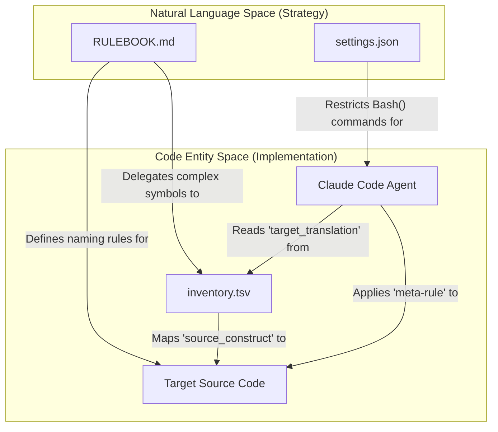
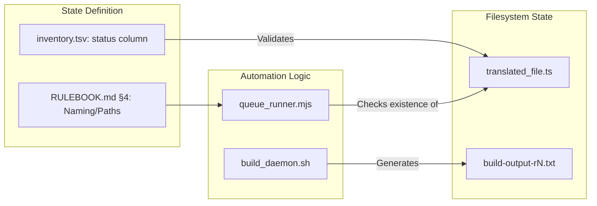

<!-- source: DeepWiki mcp.deepwiki.com · repo anthropics/code-migration-kit-with-claude-code · page 3 Templates and Configuration · fetched 2026-10-26 -->

# Templates and Configuration

Relevant source files

The following files were used as context for generating this wiki page:

- [templates/RULEBOOK.md](templates/RULEBOOK.md)
- [templates/inventory.tsv](templates/inventory.tsv)
- [templates/settings.README.md](templates/settings.README.md)
- [templates/settings.json](templates/settings.json)

The Claude Code Migration Kit relies on a set of standardized templates to ensure consistency across large-scale translation projects. These templates are not mere suggestions; they represent the "source of truth" for both human orchestrators and the automated Claude Code agents. By formalizing rules, inventorying technical gaps, and restricting environment mutations, the kit prevents the "museum of styles" that typically plagues multi-agent migrations.

### Configuration Overview

The migration environment is governed by three primary artifacts located in the `templates/` directory. These files must be customized and deployed to the target repository before the fan-out phase begins.

| Template | Role | Phase |
| :--- | :--- | :--- |
| `RULEBOOK.md` | The "Meta-Rule": Defines translation logic, naming, and posture. | Steps 2-6 |
| `settings.json` | The "Guardrails": Hard-coded command bans for Claude Code. | Steps 2-4, 6 |
| `inventory.tsv` | The "Gap Map": Pre-decided mappings for complex symbols. | Steps 1-3 |

### The Rulebook Template
The `templates/RULEBOOK.md` is the most critical document in the kit. It operates on a fundamental meta-rule: **if two agents could answer a question differently, the answer must go in this file** [templates/RULEBOOK.md:3-6](). 

It covers seven key sections, including the migration posture (e.g., structure-preserving), ecosystem adoption (what to ban from the target standard library), and the "BUG rule"—the requirement to reproduce source defects bug-for-bug to ensure parity before fixing them [templates/RULEBOOK.md:14-61]().

For details, see [The Rulebook Template](#3.1).

### Settings and Deny Rules
The `templates/settings.json` file is a Claude Code permissions configuration. It is designed to be copied into the target repository's `.claude/settings.json` [templates/settings.README.md:3-9](). 

Its primary purpose is to enforce the **process-first doctrine** by banning destructive or distracting commands. For example, `git reset` and `git clean` are banned because they can destroy the in-flight work of parallel agents [templates/settings.README.md:18-27](). Similarly, compilers are often banned during translation to prevent agents from "playing it safe" and deviating from the Rulebook just to satisfy a type-checker [templates/settings.README.md:29-37]().

For details, see [Settings and Deny Rules](#3.2).

### Gap Inventory Template
The `templates/inventory.tsv` provides a schema for tracking technical gaps that cannot be solved by a general rule. It uses a specific vocabulary to distinguish between different types of guards—specifically `allocation-guard` vs `precondition-guard`—to ensure error recovery logic is ported correctly [templates/inventory.tsv:1-2]().

The inventory serves as the delegation target for implementers: if a complex symbol or lifetime issue isn't in the inventory, it is treated as an "inventory bug" rather than something for the implementer to invent on the fly [templates/RULEBOOK.md:106-112]().

For details, see [Gap Inventory Template](#3.3).

### Template Interaction Model

The following diagram illustrates how these templates bridge the gap between high-level migration strategy and the specific code entities being manipulated.

**Figure 1: Configuration to Code Entity Mapping**

**Sources:** [templates/RULEBOOK.md:3-6](), [templates/RULEBOOK.md:106-112](), [templates/settings.json:1-33](), [templates/inventory.tsv:2-5]()

### Resumability and State
The kit uses the filesystem as the state machine. The `RULEBOOK.md` defines the naming and output path conventions that allow the `queue_runner.mjs` to detect "done-ness" simply by checking if a file exists on disk [templates/RULEBOOK.md:90-93](). This ensures that if a migration is interrupted, it can be resumed without re-translating files or losing track of the gap inventory status.

**Figure 2: State Detection via Configuration**

**Sources:** [templates/RULEBOOK.md:90-96](), [templates/inventory.tsv:2-5](), [templates/settings.README.md:33-37]()

***

**Child Pages:**
- [The Rulebook Template](#3.1)
- [Settings and Deny Rules](#3.2)
- [Gap Inventory Template](#3.3)

---

