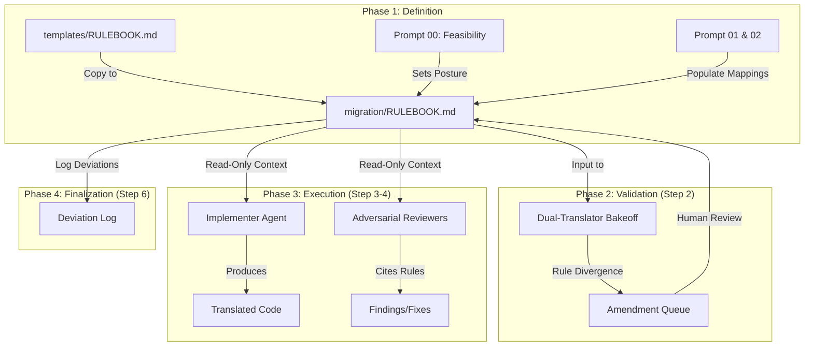
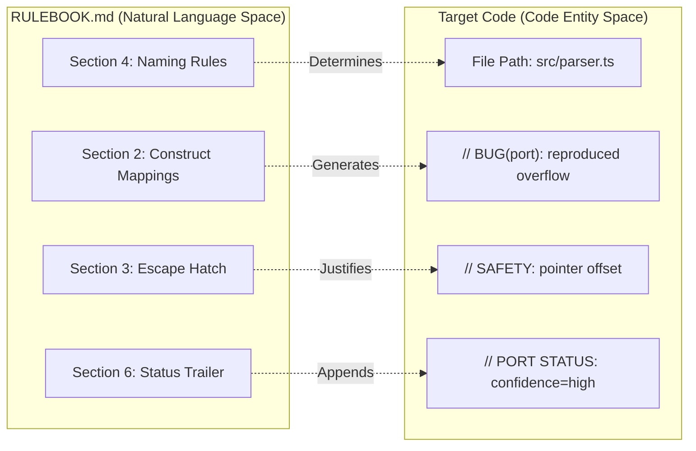

<!-- source: DeepWiki mcp.deepwiki.com · repo anthropics/code-migration-kit-with-claude-code · page 3.1 The Rulebook Template · fetched 2026-10-26 -->

# The Rulebook Template

Relevant source files

The following files were used as context for generating this wiki page:

- [CLAUDE.md](CLAUDE.md)
- [README.md](README.md)
- [templates/RULEBOOK.md](templates/RULEBOOK.md)

The Rulebook Template (`templates/RULEBOOK.md`) is the central governing document for any migration using this kit. It operates on the **Meta-Rule**: if two agents could answer a question differently, the answer belongs in the rulebook [templates/RULEBOOK.md:3-6](). It is designed to be read-only during active translation loops to prevent agents from relaxing their own grading criteria [CLAUDE.md:16-19]().

## Purpose and Posture

The rulebook serves as the primary prompt for implementers, reviewers, and fixers [templates/RULEBOOK.md:4-5](). Its core philosophy is that individual code failures are symptoms of process failures; fixing a recurring error requires amending the rulebook rather than patching instances [CLAUDE.md:44-47]().

By default, the kit assumes a **structure-preserving** posture: same architecture, same data structures, and same file boundaries [templates/RULEBOOK.md:16-19]().

### The Rulebook Lifecycle

**Sources:** [CLAUDE.md:62-69](), [README.md:73-83](), [templates/RULEBOOK.md:3-6]()

---

## The Seven Sections

### 0. Scope and Posture
Defines the high-level constraints of the migration. It explicitly bans running the compiler during the initial translation phase (unless a "cheap-referee" like `tsc` is authorized) to ensure agents focus on semantic fidelity rather than just satisfying a borrow checker [templates/RULEBOOK.md:20-22]().

### 1. Ecosystem Adoption
A decision matrix for mapping source paradigms to target idioms. This prevents the codebase from becoming a "museum of styles" by forcing a single choice for async models, I/O libraries, and string handling [templates/RULEBOOK.md:27-38]().

### 2. Construct Mappings
This section provides a canonical mapping for every source construct the target lacks (e.g., mapping C-style error unions to Rust `Result<T, E>`) [templates/RULEBOOK.md:41-55]().
*   **The BUG Rule:** Defective source behavior must be reproduced bug-for-bug and marked with `BUG(port):` to ensure parity is reachable before improvements are made [templates/RULEBOOK.md:57-61]().
*   **The UNKNOWN Rule:** If a mapping is missing, agents must use the most conservative representation and a `TODO(port):` marker rather than stalling the batch [templates/RULEBOOK.md:72-75]().

### 3. The Sanctioned Escape Hatch
Defines the "pressure valves" for code that cannot be expressed safely (e.g., `unsafe` blocks). It mandates specific, greppable markers: `TODO(port):`, `PERF(port):`, `BUG(port):`, and `SAFETY:` [templates/RULEBOOK.md:77-88]().

### 4. Naming and Output Paths
Crucial for the `queue_runner.mjs` logic. Because "done-ness" is determined by the presence of files on disk, naming rules must be deterministic (e.g., `.py` -> `.ts`) [templates/RULEBOOK.md:90-104]().

### 5. The Gap Inventory Delegation
Directs agents to `migration/inventory.tsv` for site-specific decisions regarding lifetimes, ownership, and nullability that cannot be generalized into global rules [templates/RULEBOOK.md:106-111]().

### 6. Per-file Obligations & 7. Deviation Log
Mandates a status trailer at the end of every file (`// PORT STATUS: confidence=...`) for reviewer verification [templates/RULEBOOK.md:113-119](). The Deviation Log records every departure from the process (e.g., skipped review passes), identified by IDs like `DEV-001` [templates/RULEBOOK.md:124-135]().

---

## Technical Data Flow: Rulebook to Code

The following diagram illustrates how specific rulebook sections map to code entities and markers during the `translation-kickoff` (Step 3).

**Sources:** [templates/RULEBOOK.md:57-61](), [templates/RULEBOOK.md:85-88](), [templates/RULEBOOK.md:92-96](), [templates/RULEBOOK.md:115-119]()

## Implementation Details

### Marker Schema
The kit enforces a strict format for markers to ensure they are machine-searchable for the Step 6 burndown:
| Marker | Purpose | Section |
|---|---|---|
| `BUG(port):` | Replicated source defect for parity | §2 |
| `TODO(port):` | Deferred decision/UNKNOWN rule | §2, §3 |
| `PERF(port):` | Correct but slow translation | §0, §3 |
| `SAFETY:` | Justification for escape hatch use | §3 |

**Sources:** [templates/RULEBOOK.md:58-61](), [templates/RULEBOOK.md:74-75](), [templates/RULEBOOK.md:85-88]()

### The Meta-Rule Enforcement
The `CLAUDE.md` operating manual enforces that the rulebook is read-only inside loops [CLAUDE.md:16-19](). If an agent encounters a recurring failure, it is forbidden from fixing the instances manually; it must stop, document the rule failure, and queue an amendment for the human [CLAUDE.md:44-47](). This ensures that the model tiering strategy (where the largest models handle rule authorship) is not undermined by smaller models making ad-hoc decisions [CLAUDE.md:76-87]().

---

