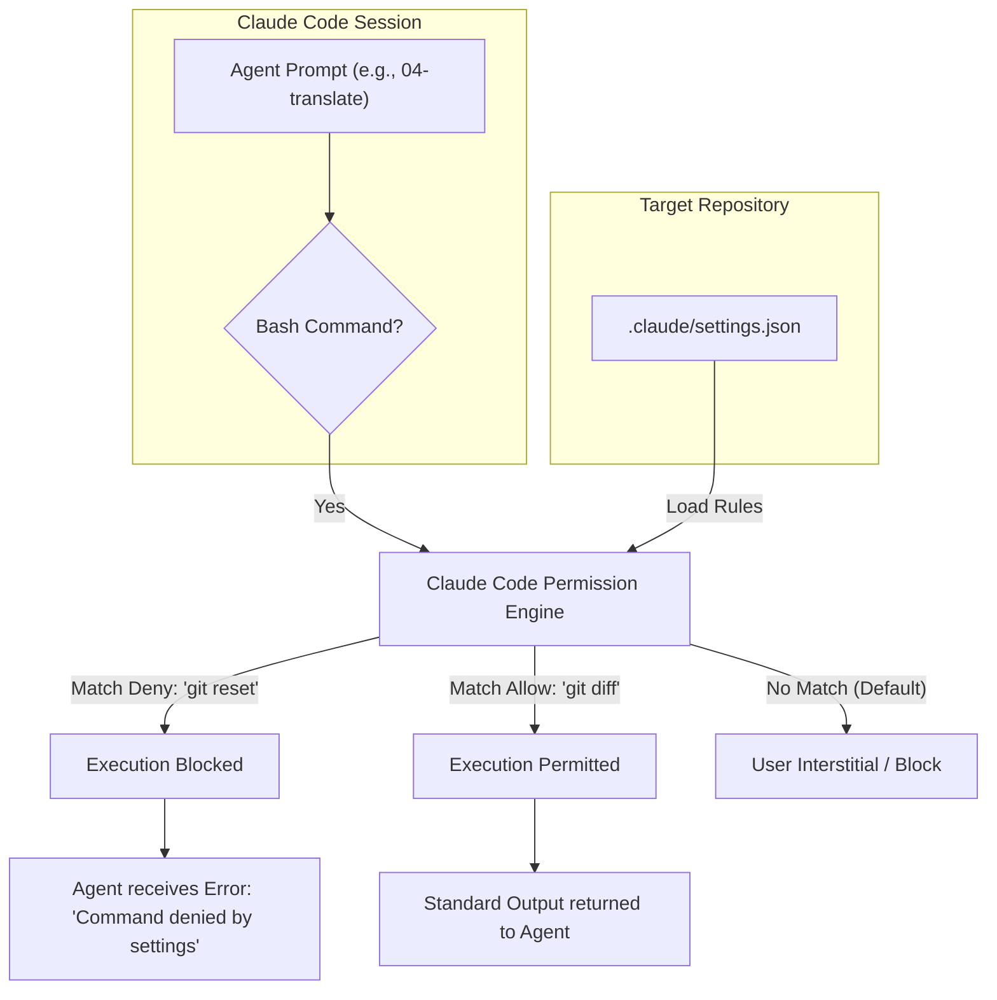
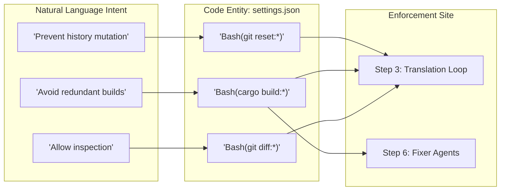

<!-- source: DeepWiki mcp.deepwiki.com · repo anthropics/code-migration-kit-with-claude-code · page 3.2 Settings and Deny Rules · fetched 2026-10-26 -->

# Settings and Deny Rules

Relevant source files

The following files were used as context for generating this wiki page:

- [RUN-NOTES.md](RUN-NOTES.md)
- [templates/settings.README.md](templates/settings.README.md)
- [templates/settings.json](templates/settings.json)

The `templates/settings.json` file serves as the mandatory permissions configuration for Claude Code during a migration. It enforces the "process-first" doctrine by programmatically restricting agents from performing destructive actions, bypassing the intended pipeline stages, or optimizing for the compiler at the expense of the Rulebook.

## Purpose and Scope

In a high-concurrency migration where dozens of agents may operate in parallel, the `settings.json` file acts as a mechanical guardrail. It ensures that agents remain within their assigned roles—such as "Implementer" or "Reviewer"—without accidentally mutating the global state of the repository or triggering expensive, redundant build processes [templates/settings.README.md:11-16]().

The rules are categorized into three primary bans:
1.  **Git Mutation Bans**: Prevent agents from destroying peer work or polluting the history.
2.  **Compiler Bans**: Force agents to prioritize Rulebook fidelity over "making it green."
3.  **Test Bans**: Prevent resource exhaustion and ensure fixers work from static evidence.

## Data Flow and Enforcement

The `settings.json` file must be manually installed into the target repository's `.claude/` directory before Step 2 (the Pilot run) [templates/settings.README.md:3-5](). The kit's prompts are designed to verify the presence of these rules before proceeding with fan-out operations.

### Configuration Lifecycle

| Phase | `settings.json` State | Rationale |
| :--- | :--- | :--- |
| **Step 0-1** | Not yet installed | Human/Architect needs full git/build access to assess the repo. |
| **Step 2-3** | **Fully Active** | Prevents agents from running the compiler during translation [templates/settings.README.md:31-37](). |
| **Step 4** | **Compiler Allowed** | The Build Daemon requires access to the compiler to generate the error queue [templates/settings.README.md:36-37](). |
| **Step 5-6** | **Tests Denied** | Fixers must read provided logs; only the Build Daemon/Referee runs tests [templates/settings.README.md:45-47](). |

### System Interaction Diagram

This diagram shows how the Claude Code Skill interacts with the `settings.json` file to permit or deny Bash commands during the translation fan-out.

**Claude Code Permission Flow**

Sources: [templates/settings.json:1-33](), [templates/settings.README.md:11-16]()

## Deny Categories and Rationales

### 1. Git Mutation Bans
In a shared worktree, commands like `git reset` or `git checkout` are destructive. If sixteen agents share a worktree, a single `git reset` by one agent destroys the in-flight work of the other fifteen [templates/settings.README.md:20-22](). 

*   **Banned**: `rebase`, `reset`, `checkout`, `stash`, `push`, `commit`, `merge`, `switch`, `restore`, `clean` [templates/settings.json:4-13]().
*   **Allowed**: `status`, `diff`, `log` [templates/settings.json:24-26](). These are essential for reviewers to verify changes against the source.
*   **Special Note on `git clean`**: This is the most destructive command during fan-out because translated files are untracked until the final batch commit [templates/settings.README.md:24-27]().

### 2. Compiler Bans
The compiler is banned during Step 3 (Translation) for two reasons:
1.  **Computational Cost**: 64 agents running `cargo build` or `npm install` simultaneously will exhaust system resources [templates/settings.README.md:31-32]().
2.  **Incentive Alignment**: If an agent can compile, it will "play it safe" to satisfy the compiler, often ignoring the Rulebook's specific mapping requirements to achieve a successful build. The kit's philosophy is that drafts do not need to compile; they must follow the Rulebook [templates/settings.README.md:33-35]().

### 3. Test Bans
During Step 6 (Parity), fixers are denied the ability to run tests. They must rely on the evidence provided in the `migration/build-output-rN.txt` files generated by the `build_daemon.sh` [templates/settings.README.md:45-47](). This prevents "flailing"—where an agent makes small, unverified changes and repeatedly runs tests to see what sticks.

## Technical Implementation

The `settings.json` uses the Claude Code permission schema. It relies on pattern matching against the `Bash` tool.

**Logic Mapping: Permission Engine to Code Entities**

Sources: [templates/settings.json:1-33](), [templates/settings.README.md:1-16]()

## Installation and Maintenance

### Manual Installation
The human operator must copy the template to the target repository:
`cp templates/settings.json <target_repo>/.claude/settings.json` [templates/settings.README.md:7-8]().

### Verification Gate
The kit's prompts (specifically `03-pilot.md` and `04-translate.md`) include instructions for Claude to verify that the deny rules are active. If Claude can successfully run a banned command (like `git commit --version`), it must refuse to proceed with the migration [RUN-NOTES.md:99-101]().

### Customization
The provided `settings.json` is a template. Users should append their specific build and test tools (e.g., `mvn`, `pytest`, `go test`) to the `deny` list [templates/settings.README.md:14-16]().

| Banned Command (Template) | Target Ecosystem Equivalent |
| :--- | :--- |
| `cargo build` | `mvn compile`, `go build`, `make` |
| `npm test` | `pytest`, `rspec`, `go test` |
| `npx tsc` | `javac`, `gcc` |

Sources: [templates/settings.json:14-21](), [templates/settings.README.md:13-16]()

---

