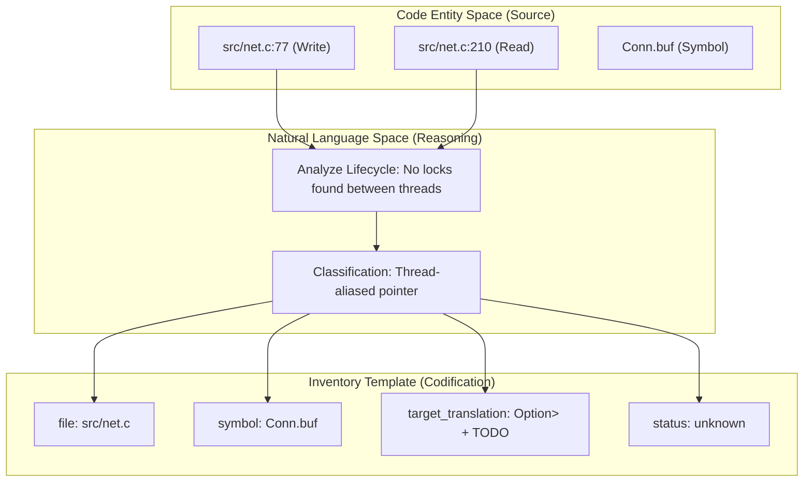
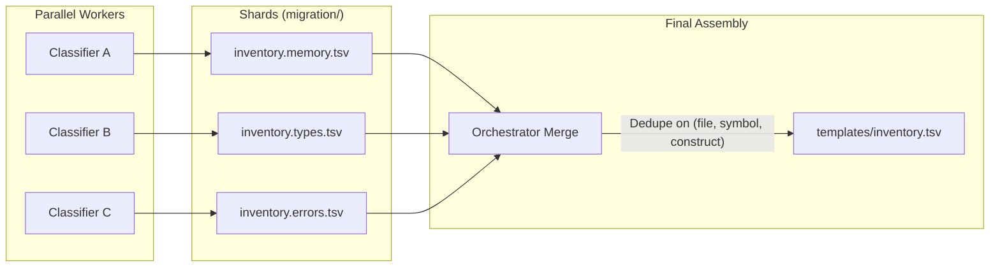

<!-- source: DeepWiki mcp.deepwiki.com · repo anthropics/code-migration-kit-with-claude-code · page 3.3 Gap Inventory Template · fetched 2026-10-26 -->

# Gap Inventory Template

Relevant source files

The following files were used as context for generating this wiki page:

- [prompts/02-gap-inventory.md](prompts/02-gap-inventory.md)
- [templates/inventory.tsv](templates/inventory.tsv)

The **Gap Inventory** is a deterministic, tabular record of semantic "gaps" that the target language demands but the source language leaves implicit. While the **Rulebook** defines global translation defaults, the inventory handles specific sites where those defaults are insufficient or where manual architectural mapping is required (e.g., mapping C `void*` to specific Rust types, or identifying nullability in Python for TypeScript strict mode).

The inventory is defined in `templates/inventory.tsv` [templates/inventory.tsv:1-6]() and is populated during **Step 1** of the migration pipeline [prompts/02-gap-inventory.md:1-4]().

## Column Schema and Specification

The inventory uses a strict Tab-Separated Values (TSV) format to ensure it remains greppable by both human implementers and automated agents.

| Column | Description |
| :--- | :--- |
| `file` | The source file path containing the construct. |
| `symbol` | The specific variable, function, or struct member name. |
| `source_construct` | The raw implementation detail in the source (e.g., "borrowed char*"). |
| `classification` | The architectural category (e.g., `BORROWED`, `OWNED_MUTABLE`). |
| `target_translation` | The exact code snippet or type to be used in the target language. |
| `evidence` | A trace of the value's lifecycle (creation, escape, destruction) with line citations. |
| `status` | The current state of the row: `confirmed` or `unknown`. |

### Data Flow: From Source to Inventory
The following diagram illustrates how "Natural Language" architectural concepts are extracted from "Code Entity Space" and codified into the inventory.

**Gap Extraction Logic**

Sources: [templates/inventory.tsv:5-5](), [prompts/02-gap-inventory.md:32-34]()

## Guard Classifications

A critical function of the inventory is disambiguating overloaded sentinels (like `NULL`, `None`, or `-1`). When the source uses a single sentinel for multiple failure modes, the `evidence` column must carry specific tags to guide the implementation of the target language's error recovery [templates/inventory.tsv:1-1]().

*   **allocation-guard**: Indicates the sentinel represents a resource exhaustion or memory failure.
*   **precondition-guard**: Indicates the sentinel represents an invalid input or state that should have been prevented by the caller.

These tags are required by the **Rulebook §2 (Error-Recovery Rule)** to determine whether to map a return value to an `Option<T>`, a `Result<T, E>`, or a panic/exception [templates/inventory.tsv:1-1]().

## Handling UNKNOWN Rows

The migration kit prohibits "guessing" during the inventory phase. If two **skeptic reviewers** cannot agree on the behavior of a site after tracing its lifecycle, the row is marked as `UNKNOWN` [prompts/02-gap-inventory.md:41-43]().

1.  **Status**: The `status` column is set to `unknown`.
2.  **Target Translation**: The agent provides the most conservative representation possible (e.g., `Option<NonNull<u8>>` for a pointer) [templates/inventory.tsv:5-5]().
3.  **TODO Marker**: A greppable `TODO(port)` marker is appended to the translation. This ensures the implementation can proceed mechanically without stalling the translation queue, while leaving a searchable artifact for post-parity cleanup [prompts/02-gap-inventory.md:43-47]().

Sources: [prompts/02-gap-inventory.md:41-47](), [templates/inventory.tsv:5-5]()

## Implementation and Sharding

To prevent file contention during fan-out, the inventory is built using a sharding pattern.

**Inventory Generation Topology**

The orchestrator monitors the `wc -l` output of the shards to ensure progress. A progress invariant is enforced: shard row counts must grow within any three-minute window, or the worker is treated as failed and its rows are recovered from the disk journal [prompts/02-gap-inventory.md:54-60]().

Sources: [prompts/02-gap-inventory.md:51-61]()

---

