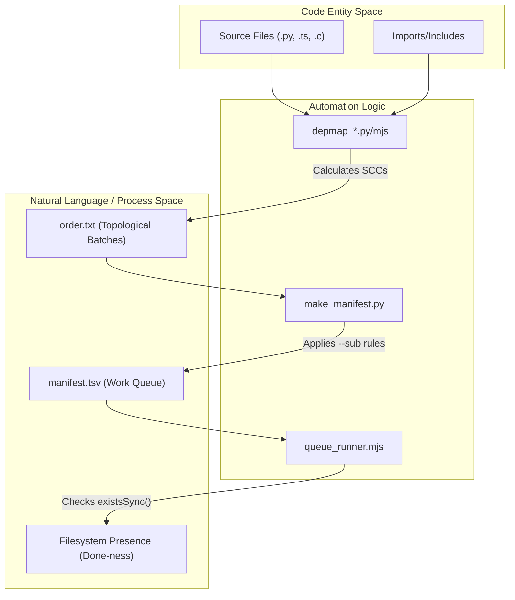
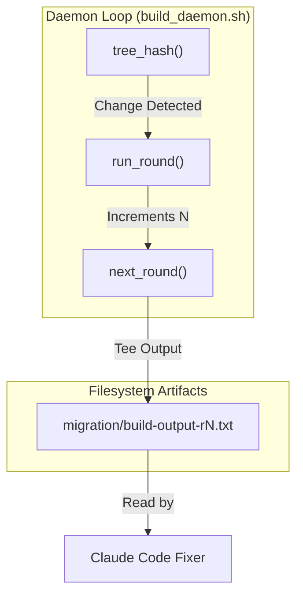

<!-- source: DeepWiki mcp.deepwiki.com · repo anthropics/code-migration-kit-with-claude-code · page 4 Automation Scripts · fetched 2026-10-26 -->

# Automation Scripts

Relevant source files

The following files were used as context for generating this wiki page:

- [scripts/build_daemon.sh](scripts/build_daemon.sh)
- [scripts/depmap_c.py](scripts/depmap_c.py)
- [scripts/depmap_python.py](scripts/depmap_python.py)
- [scripts/depmap_ts.mjs](scripts/depmap_ts.mjs)
- [scripts/make_manifest.py](scripts/make_manifest.py)
- [scripts/queue_runner.mjs](scripts/queue_runner.mjs)

The `scripts/` directory contains the core automation logic for the Claude Code Migration Kit. These scripts are designed to be deterministic, resumable, and "process-first," ensuring that the migration state is always reflected on the filesystem rather than in a volatile orchestrator memory.

The automation suite is divided into three functional categories:
1.  **Dependency Mappers**: Language-specific tools that build the migration graph.
2.  **Execution Infrastructure**: The queue runner and manifest builder that manage the work lifecycle.
3.  **Build Daemon**: The single owner of the compiler during the survey build phase.

### Automation Architecture

The following diagram illustrates how the automation scripts bridge the gap between the source code entities (files, imports) and the migration work queue.

**Migration State Flow**

Sources: [scripts/depmap_python.py:9-13](), [scripts/make_manifest.py:4-10](), [scripts/queue_runner.mjs:7-11]()

---

## Dependency Mappers

The kit provides three language-specific dependency mappers: `depmap_python.py`, `depmap_ts.mjs`, and `depmap_c.py`. These scripts implement a strict contract: they must produce a deterministic topological sort of the codebase, grouping files into batches based on Strongly Connected Components (SCCs).

*   **Python**: Uses the `ast` module to parse imports [scripts/depmap_python.py:58-86]().
*   **TypeScript**: Uses a regex-based line scanner for relative imports [scripts/depmap_ts.mjs:51-59]().
*   **C/C++**: Parses quoted `#include` directives and maps implementation files to their same-stem headers [scripts/depmap_c.py:7-10]().

All mappers use the **Tarjan SCC algorithm** to detect cycles and ensure that dependencies are migrated before their dependents [scripts/depmap_python.py:110-159](), [scripts/depmap_ts.mjs:61-96](), [scripts/depmap_c.py:68-114]().

For details on AST parsing, cycle detection, and the 0-edge warning, see **[Dependency Mappers (depmap_python.py, depmap_ts.mjs, depmap_c.py)](#4.1)**.

---

## Manifest Builder and Queue Runner

Once a migration order is established, the `make_manifest.py` script converts the raw file list into a structured work queue. It applies string substitutions (via `--sub`) to transform source paths into target paths, ensuring the output matches the project's `RULEBOOK.md` naming conventions [scripts/make_manifest.py:7-15]().

The `queue_runner.mjs` script then manages the execution of this queue. It follows a **queue-on-disk** pattern: a task is considered "done" if its target file exists on the filesystem and is non-empty [scripts/queue_runner.mjs:7-11](). This allows the migration to resume instantly after a crash or session timeout without a central database.

| Command | Purpose |
| :--- | :--- |
| `status` | Reports burndown percentage and per-directory progress [scripts/queue_runner.mjs:71-84](). |
| `next` | Returns a JSON array of the next `N` pending tasks [scripts/queue_runner.mjs:85-88](). |
| `verify` | Validates that "done" files aren't zero-byte "touch" cheats [scripts/queue_runner.mjs:89-96](). |

For details on path substitutions and resumability guarantees, see **[Manifest Builder and Queue Runner](#4.2)**.

---

## Build Daemon

The `build_daemon.sh` script is the exclusive owner of the compiler during the survey build phase (Step 4). It enforces a strict security and process boundary: **Fixer agents are never allowed to run the compiler themselves** [scripts/build_daemon.sh:6-9]().

**Build Loop Logic**

Sources: [scripts/build_daemon.sh:78-90](), [scripts/build_daemon.sh:92-103](), [scripts/build_daemon.sh:105-113]()

The daemon monitors the source tree using content hashes (via `shasum` or `sha256sum`). When a change is detected, it runs the provided `--cmd` and captures the output into a numbered file (e.g., `build-output-r1.txt`) [scripts/build_daemon.sh:13-19]().

For details on change detection and the fixer-daemon contract, see **[Build Daemon](#4.3)**.

---

## Test Fixtures

The `fixtures/` directory contains sample codebases used to verify the correctness of the automation scripts. Each fixture includes:
*   A set of source files with complex dependency patterns (including cycles).
*   `expected_edges.tsv`, `expected_order.txt`, and `expected_cycles.txt` to validate the mappers.
*   `expected_manifest.tsv` to validate the manifest builder.

For details on running the built-in tests, see **[Test Fixtures](#4.4)**.

---

