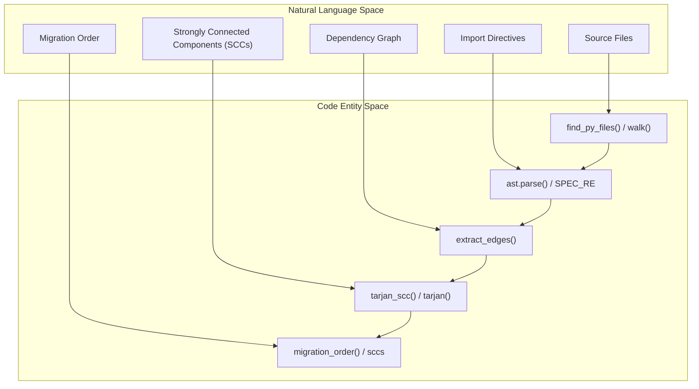
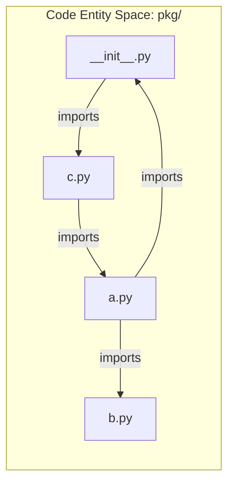

<!-- source: DeepWiki mcp.deepwiki.com · repo anthropics/code-migration-kit-with-claude-code · page 4.1 Dependency Mappers (depmap_python.py, depmap_ts.mjs, depmap_c.py) · fetched 2026-10-26 -->

# Dependency Mappers (depmap_python.py, depmap_ts.mjs, depmap_c.py)

Relevant source files

The following files were used as context for generating this wiki page:

- [fixtures/c/expected_cycles.txt](fixtures/c/expected_cycles.txt)
- [fixtures/c/expected_edges.tsv](fixtures/c/expected_edges.tsv)
- [fixtures/c/expected_order.txt](fixtures/c/expected_order.txt)
- [fixtures/python/expected_cycles.txt](fixtures/python/expected_cycles.txt)
- [fixtures/python/expected_edges.tsv](fixtures/python/expected_edges.tsv)
- [fixtures/python/expected_order.txt](fixtures/python/expected_order.txt)
- [fixtures/ts/expected_cycles.txt](fixtures/ts/expected_cycles.txt)
- [fixtures/ts/expected_edges.tsv](fixtures/ts/expected_edges.tsv)
- [fixtures/ts/expected_order.txt](fixtures/ts/expected_order.txt)
- [scripts/depmap_c.py](scripts/depmap_c.py)
- [scripts/depmap_python.py](scripts/depmap_python.py)
- [scripts/depmap_ts.mjs](scripts/depmap_ts.mjs)

The dependency mappers are deterministic scripts designed to build a complete graph of internal code dependencies. They implement the "Dependency Map" contract required by Step 1 of the migration pipeline, ensuring that the LLM translates files in an order where dependencies are already available as context.

## Overview and Purpose

The primary goal of these scripts is to produce a topological ordering of files within a repository. By translating low-level utilities before high-level consumers, the migration kit provides the LLM with the necessary target-language context (types, signatures, and patterns) for each subsequent file.

### Key Invariants
1.  **In-Repo Only**: The mappers only track edges between files inside the specified `--root`. External libraries (npm packages, Python stdlib, C angle-bracket includes) are ignored [scripts/depmap_python.py:55-57](), [scripts/depmap_ts.mjs:53-54](), [scripts/depmap_c.py:7-9]().
2.  **Deterministic**: Output is strictly sorted by file path. Two runs on the same codebase produce byte-identical results [scripts/depmap_python.py:20-22]().
3.  **SCC-Aware**: Circular dependencies are detected and grouped into single "batches" using Tarjan's algorithm, as they must be translated together [scripts/depmap_python.py:162-170](), [scripts/depmap_ts.mjs:118-119]().

---

## Implementation Details

### Data Flow: From Source to Order

The following diagram bridges the **Natural Language Space** (concepts like "Imports" and "Cycles") to the **Code Entity Space** (the specific functions and variables that process them).

**Sources**: [scripts/depmap_python.py:35-170](), [scripts/depmap_ts.mjs:36-120]().

### Language-Specific Parsing Logic

| Language | Parsing Mechanism | Edge Logic |
| :--- | :--- | :--- |
| **Python** | `ast.parse` & `ast.walk` | Resolves dotted module names and relative imports (e.g., `from .. import x`) against a file index [scripts/depmap_python.py:55-86](). |
| **TypeScript** | Regex (`SPEC_RE`) | Scans for `import`, `export ... from`, and `require`. Resolves relative paths to physical files [scripts/depmap_ts.mjs:50-59](). |
| **C/C++** | Regex (`INCLUDE_RE`) | Parses `#include "..."`. Also automatically links implementation files (`.c`) to their headers (`.h`) [scripts/depmap_c.py:30-64](). |

**Sources**: [scripts/depmap_python.py:91-107](), [scripts/depmap_ts.mjs:104-111](), [scripts/depmap_c.py:42-65]().

---

## The Tarjan SCC Algorithm

To handle circular dependencies, all three mappers implement an iterative version of Tarjan's Strongly Connected Components algorithm. This algorithm identifies sets of files that form cycles and treats them as a single unit in the topological sort.

### Output Contract
The scripts generate three files in the `--out` directory:
1.  `edges.tsv`: A raw list of `from` -> `to` file paths [scripts/depmap_python.py:185-186]().
2.  `order.txt`: The migration sequence. One batch per line; dependencies appear on earlier lines than their consumers [scripts/depmap_python.py:187-189]().
3.  `cycles.txt`: A report of all files involved in circular dependencies [scripts/depmap_python.py:190-192]().

### Zero-Edge Warning
If a repository contains multiple files but the mapper finds 0 edges, a warning is issued to `stderr`. This usually indicates that `--root` is misconfigured or that the codebase uses path aliases (like `tsconfig` paths) which the basic mappers do not resolve by default [scripts/depmap_python.py:137-145](), [scripts/depmap_ts.mjs:128-134](), [scripts/depmap_c.py:137-145]().

---

## Verification via Fixtures

The repository includes `fixtures/` for each language to ensure the mappers remain correct. These fixtures represent edge cases like deep directory nesting and complex cycles.

### Fixture Mapping Example (Python)
The `fixtures/python` directory contains a package structure designed to test cycle detection.

**Sources**: [fixtures/python/expected_edges.tsv:1-6]().

The resulting `expected_order.txt` for this fixture demonstrates that `pkg/b.py` (a leaf dependency) is migrated first, followed by the cycle containing the rest of the package:
1. `pkg/b.py`
2. `pkg/__init__.py    pkg/a.py    pkg/c.py`

**Sources**: [fixtures/python/expected_order.txt:1-4](), [fixtures/python/expected_cycles.txt:1-3]().

### C Fixture Specifics
In the C fixture, the mapper demonstrates the `implementation -> own header` rule. Even without an explicit include, `main.c` depends on `foo.h` if they share a stem, and `bar.h` and `foo.h` are identified as a cycle if they include each other [fixtures/c/expected_edges.tsv:1-4](), [fixtures/c/expected_cycles.txt:1-2]().

---

