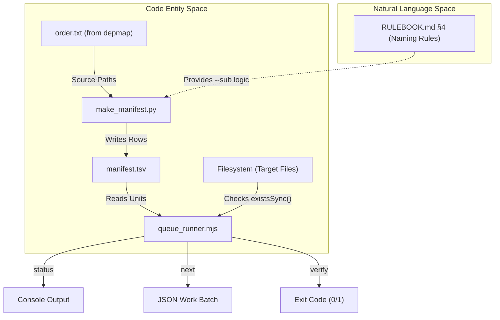
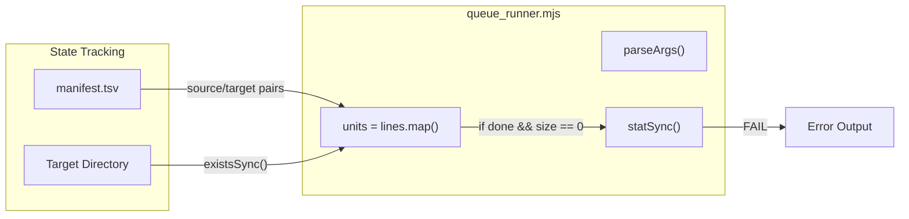

<!-- source: DeepWiki mcp.deepwiki.com · repo anthropics/code-migration-kit-with-claude-code · page 4.2 Manifest Builder and Queue Runner · fetched 2026-10-26 -->

# Manifest Builder and Queue Runner

<details>
<summary>Relevant source files</summary>

The following files were used as context for generating this wiki page:

- [fixtures/python/expected_manifest.tsv](fixtures/python/expected_manifest.tsv)
- [scripts/make_manifest.py](scripts/make_manifest.py)
- [scripts/queue_runner.mjs](scripts/queue_runner.mjs)

</details>


The Manifest Builder and Queue Runner provide the mechanical infrastructure for Step 1 (Dependency Map) and Step 3 (Translation Fan-Out) of the migration pipeline. These tools transition the migration from an abstract dependency graph into a concrete, resumable work queue managed on the filesystem.

## Overview and Purpose

The migration kit uses a **queue-on-disk** pattern [scripts/queue_runner.mjs:7-11](). Instead of maintaining state in a database or memory, the system determines "done-ness" by the presence of a non-empty target file on the disk. This approach provides:
- **Resumability**: If a migration session crashes or is interrupted, the queue naturally resumes at the first missing file [scripts/queue_runner.mjs:7-11]().
- **Zero-Orchestrator State**: No external state tracking is required; the filesystem is the single source of truth [scripts/queue_runner.mjs:9-10]().
- **Determinism**: Work is handed out in the exact order specified by the dependency analysis [scripts/make_manifest.py:9-10]().

### Data Flow: From Order to Execution

The following diagram illustrates how raw dependency data is transformed into an executable queue.

**Migration Work Queue Pipeline**

Sources: [scripts/make_manifest.py:4-15](), [scripts/queue_runner.mjs:7-27]()

---

## Manifest Builder (make_manifest.py)

`make_manifest.py` is a Python utility that converts the topological sort produced by dependency mappers (`order.txt`) into a `manifest.tsv` file [scripts/make_manifest.py:4-9]().

### Implementation Details
The script reads `order.txt`, which contains tab-separated batches of source file paths [scripts/make_manifest.py:48-51](). For each source path, it applies a series of string substitutions provided via the `--sub` flag to derive the target path [scripts/make_manifest.py:54-56]().

Key constraints enforced by `make_manifest.py`:
1. **Rulebook Alignment**: Substitutions must match the naming rules defined in `RULEBOOK.md §4` [scripts/make_manifest.py:12-13]().
2. **Collision Prevention**: The script exits with an error if a derived target path is identical to its source path, preventing accidental overwrites [scripts/make_manifest.py:57-64]().
3. **Order Preservation**: It preserves the dependency-first order of the input, ensuring that `queue_runner.mjs` hands out work in an order that respects the dependency graph [scripts/make_manifest.py:9-10]().

### Example Execution
```bash
python3 scripts/make_manifest.py \
    --order migration/depmap/order.txt \
    --out migration/manifest.tsv \
    --sub 'pkg/=ts/' \
    --sub '.py=.ts'
```
Sources: [scripts/make_manifest.py:17-21](), [scripts/make_manifest.py:40-46]()

---

## Queue Runner (queue_runner.mjs)

`queue_runner.mjs` is a Node.js utility that manages the execution state of the migration [scripts/queue_runner.mjs:5-11](). It treats the `manifest.tsv` as a list of "units" and checks the filesystem to determine which units remain pending [scripts/queue_runner.mjs:60-63]().

### Commands and Logic

| Command | Logic | Output / Effect |
|:---|:---|:---|
| `status` | Calculates `done` count by checking `existsSync(target)` for every row [scripts/queue_runner.mjs:71-79](). | Prints overall percentage and per-directory breakdown [scripts/queue_runner.mjs:80-84](). |
| `next` | Filters for units where `done` is false and limits to `--batch` size [scripts/queue_runner.mjs:85-88](). | Returns a JSON array of `{source, target}` pairs for the AI to process [scripts/queue_runner.mjs:88](). |
| `verify` | Checks if any "done" target file has a size of 0 bytes [scripts/queue_runner.mjs:89-90](). | Exits 1 if "touch-the-file" cheats are detected; exits 0 otherwise [scripts/queue_runner.mjs:91-96](). |

### System Integration Diagram

The following diagram shows how `queue_runner.mjs` interacts with the filesystem to provide state to the Claude Code skill.

**Queue State Management**

Sources: [scripts/queue_runner.mjs:40-48](), [scripts/queue_runner.mjs:60-63](), [scripts/queue_runner.mjs:89-96]()

---

## Resumability and Verification

The combination of these two scripts ensures that the migration is robust against environment failures.

### The "Touch-the-File" Cheat
A common failure mode in LLM-driven migrations is the model "touching" a file (creating an empty file) to satisfy a progress check without actually performing the translation. `queue_runner.mjs verify` explicitly guards against this by checking `statSync(u.target).size === 0` [scripts/queue_runner.mjs:89-95]().

### Manifest Schema
The `manifest.tsv` follows a strict tab-separated format with a mandatory header [scripts/make_manifest.py:69-71]().

| source | target |
|:---|:---|
| `pkg/b.py` | `ts/b.ts` |
| `pkg/a.py` | `ts/a.ts` |

Sources: [fixtures/python/expected_manifest.tsv:1-5](), [scripts/queue_runner.mjs:55-59]()

---

