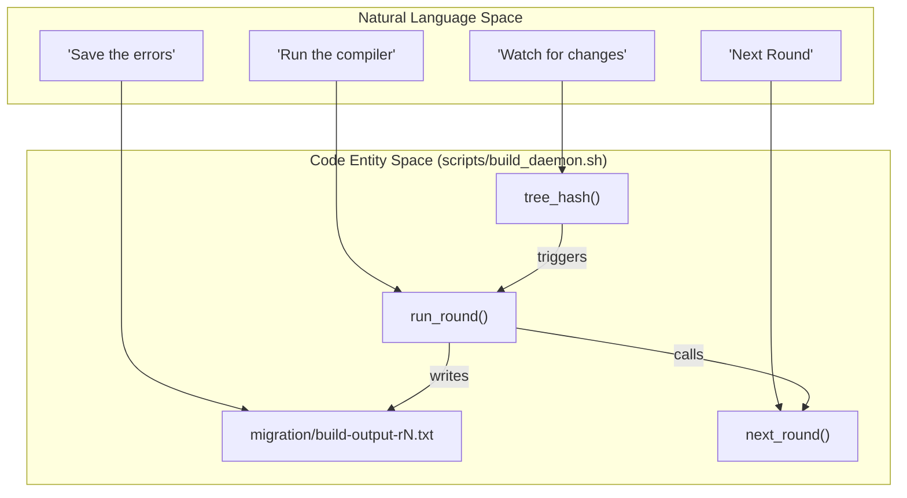
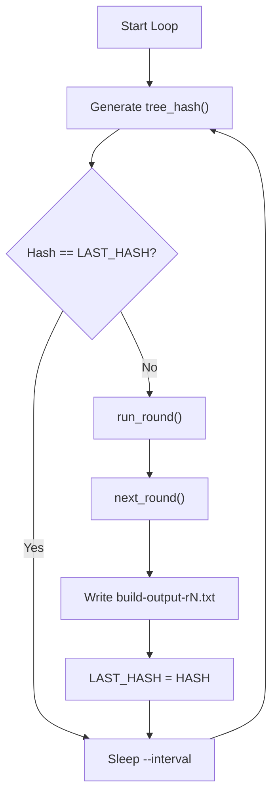

<!-- source: DeepWiki mcp.deepwiki.com · repo anthropics/code-migration-kit-with-claude-code · page 4.3 Build Daemon · fetched 2026-10-26 -->

# Build Daemon

Relevant source files

The following files were used as context for generating this wiki page:

- [prompts/05-survey-build.md](prompts/05-survey-build.md)
- [scripts/build_daemon.sh](scripts/build_daemon.sh)

The Build Daemon is a shell-based automation utility designed to manage the compiler during the **Step 4: Survey Build** phase of a migration. It serves as the exclusive "owner" of the build process, enforcing a strict separation between the compilation environment and the AI fixers who resolve build errors.

## Purpose and Scope

During large-scale migrations, the survey build phase (Step 4) involves iteratively fixing compiler errors across hundreds of files. To maintain process integrity and prevent "hallucination loops" where an AI agent might try to fix errors by changing the build command or ignoring diagnostics, the kit mandates that **fixers never run the compiler themselves** [prompts/05-survey-build.md:18-19]().

The `build_daemon.sh` script automates this by:
1.  **Watching the source tree** for changes using content hashing [scripts/build_daemon.sh:13-14]().
2.  **Executing the build command** only when changes are detected [scripts/build_daemon.sh:116-121]().
3.  **Capturing diagnostics** into versioned, immutable output files (`build-output-rN.txt`) [scripts/build_daemon.sh:15-16]().
4.  **Providing a stable interface** for fixers to consume error logs without having execution permissions for the compiler [scripts/build_daemon.sh:6-9]().

Sources: [scripts/build_daemon.sh:1-19](), [prompts/05-survey-build.md:28-31]()

## Execution Model and Data Flow

The daemon operates on a polling loop. It calculates a recursive hash of the project directory (excluding build artifacts and the `migration/` directory) to detect when a fixer has landed a patch.

### System Architecture: Natural Language to Code Entity

The following diagram maps the conceptual "Survey Build" workflow to the specific script functions and filesystem artifacts.

Sources: [scripts/build_daemon.sh:78-90](), [scripts/build_daemon.sh:92-103](), [scripts/build_daemon.sh:105-113]()

### Change Detection Logic
The `tree_hash` function ensures that only relevant source changes trigger a rebuild. It explicitly prunes directories that would cause infinite loops or false positives, such as `.git`, `node_modules`, and the `migration/` directory where the daemon writes its own logs [scripts/build_daemon.sh:82-84]().

Sources: [scripts/build_daemon.sh:116-124](), [scripts/build_daemon.sh:78-90]()

## Implementation Details

### Key Functions

| Function | Description |
| :--- | :--- |
| `tree_hash()` | Uses `find`, `sort`, and `shasum`/`sha256sum` to create a deterministic hash of the source tree. It prunes `target`, `dist`, `node_modules`, and `migration` to avoid noise [scripts/build_daemon.sh:78-90](). |
| `next_round()` | Scans the `migration/` directory for existing `build-output-r*.txt` files and calculates the next integer. This ensures state is recovered from the filesystem, not memory [scripts/build_daemon.sh:92-103](). |
| `run_round()` | Executes the command provided via `--cmd`, redirects `stderr` to `stdout`, and uses `tee` to write the output to the next round file while still showing it in the daemon console [scripts/build_daemon.sh:105-113](). |

Sources: [scripts/build_daemon.sh:78-113]()

### Command Line Interface
The script supports three primary flags:
*   `--cmd`: The exact string to execute (e.g., `"npm run build"` or `"cargo check"`) [scripts/build_daemon.sh:50]().
*   `--interval`: Polling frequency in seconds (default: 30) [scripts/build_daemon.sh:37]().
*   `--once`: Executes a single round and exits, primarily used for testing or CI integration [scripts/build_daemon.sh:122]().

Sources: [scripts/build_daemon.sh:25-28](), [scripts/build_daemon.sh:42-57]()

## The "No Compiler" Constraint

The Build Daemon is the technical enforcement mechanism for a core migration principle: **Fixers must not run the compiler.**

### Why Fixers are Banned from the Build
1.  **Context Contamination**: If a fixer runs the build, it may attempt to "fix" the build system (e.g., modifying `tsconfig.json` or `Makefile`) to hide errors rather than resolving the underlying translation issue [prompts/05-survey-build.md:18-19]().
2.  **Cost Control**: Compilers are computationally expensive. By centralizing the build in the daemon, the project avoids $N$ fixers redundantly triggering full-tree recompilations.
3.  **Deterministic Input**: Every fixer in a specific "Round N" works from the exact same `build-output-rN.txt` file. This prevents race conditions where one fixer's changes cause a compiler error that confuses another fixer in the same batch [prompts/05-survey-build.md:28-31]().

### Workflow Integration
1.  The human/operator starts `./build_daemon.sh --cmd "[build command]"`.
2.  The daemon generates `migration/build-output-r1.txt`.
3.  The operator provides `build-output-r1.txt` to the AI session.
4.  The AI parses the file into a queue and dispatches sub-agents (fixers).
5.  As fixers write files, the daemon detects the change and automatically generates `build-output-r2.txt`.

Sources: [prompts/05-survey-build.md:12-16](), [prompts/05-survey-build.md:28-35](), [scripts/build_daemon.sh:6-11]()

---

