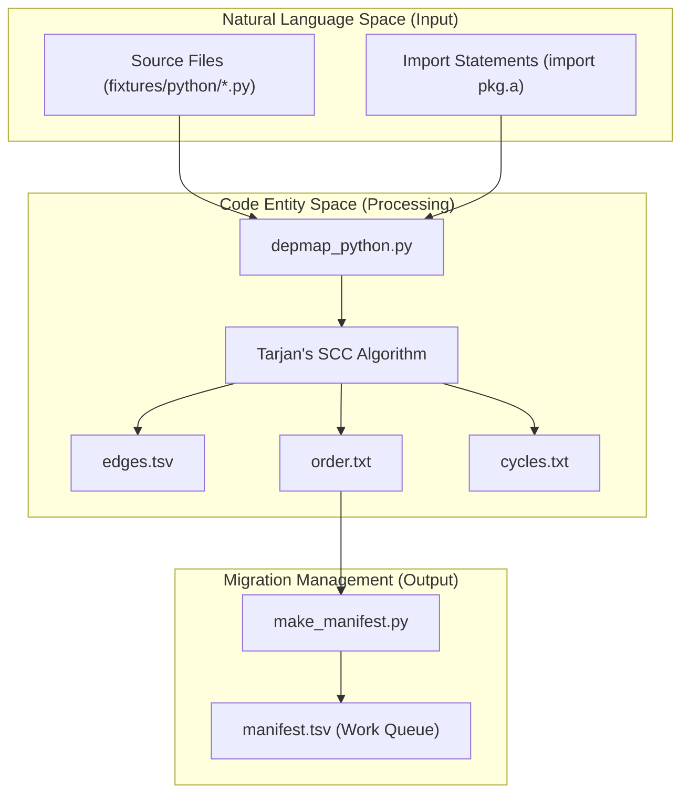
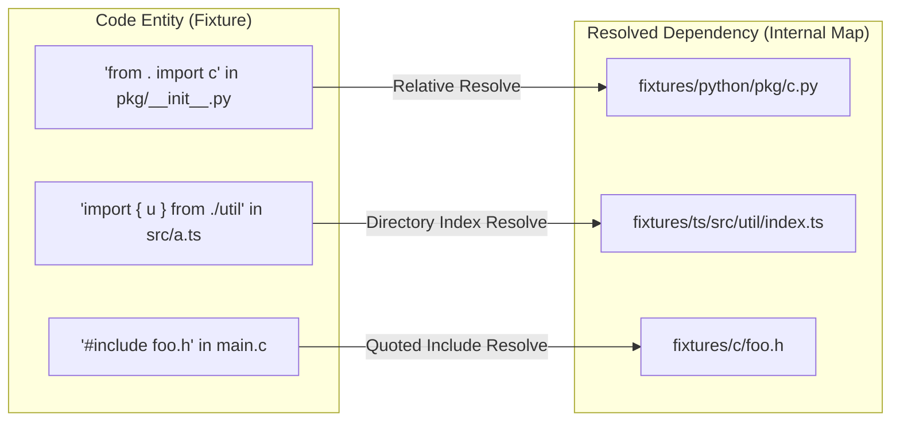

<!-- source: DeepWiki mcp.deepwiki.com · repo anthropics/code-migration-kit-with-claude-code · page 4.4 Test Fixtures · fetched 2026-10-26 -->

# Test Fixtures

<details>
<summary>Relevant source files</summary>

The following files were used as context for generating this wiki page:

- [fixtures/c/bar.h](fixtures/c/bar.h)
- [fixtures/c/foo.h](fixtures/c/foo.h)
- [fixtures/c/main.c](fixtures/c/main.c)
- [fixtures/c/vendor/vendored.h](fixtures/c/vendor/vendored.h)
- [fixtures/python/generated/gen.py](fixtures/python/generated/gen.py)
- [fixtures/python/pkg/__init__.py](fixtures/python/pkg/__init__.py)
- [fixtures/python/pkg/a.py](fixtures/python/pkg/a.py)
- [fixtures/python/pkg/b.py](fixtures/python/pkg/b.py)
- [fixtures/python/pkg/c.py](fixtures/python/pkg/c.py)
- [fixtures/ts/dist/gen.js](fixtures/ts/dist/gen.js)
- [fixtures/ts/src/a.ts](fixtures/ts/src/a.ts)
- [fixtures/ts/src/b.ts](fixtures/ts/src/b.ts)
- [fixtures/ts/src/c.ts](fixtures/ts/src/c.ts)
- [fixtures/ts/src/util/index.ts](fixtures/ts/src/util/index.ts)

</details>


The `fixtures/` directory contains sample codebases in Python, TypeScript, and C designed to validate the correctness of the dependency mapping scripts (`scripts/depmap_*.py/mjs`). These fixtures serve as the ground truth for self-testing the AST parsing, import resolution, and cycle detection logic used in Step 1 of the migration pipeline.

## Structure of a Fixture Set

Each language fixture is designed to exercise specific edge cases of the dependency mappers:
1.  **Circular Dependencies**: Ensuring the Tarjan SCC (Strongly Connected Components) algorithm correctly identifies and reports cycles.
2.  **External/System Exclusions**: Verifying that standard libraries (e.g., `json`, `node:fs`, `<stdio.h>`) and third-party packages are ignored.
3.  **Directory Exclusions**: Confirming that `SKIP_DIRS` (like `dist/`, `vendor/`, or `generated/`) are respected.
4.  **Import Resolution**: Testing relative imports, directory-to-index resolution, and header inclusion logic.

### Python Fixture (`fixtures/python/`)

The Python fixture implements a complex three-file cycle involving a package `__init__.py`.

*   **`pkg/__init__.py`**: Performs a relative import `from . import c` [fixtures/python/pkg/__init__.py:6-6]().
*   **`pkg/c.py`**: Imports `pkg.a` [fixtures/python/pkg/c.py:3-3]().
*   **`pkg/a.py`**: Imports `pkg.b` and `pkg/__init__.py` [fixtures/python/pkg/a.py:4-4]().
*   **Exclusions**: `pkg/a.py` imports the stdlib `json` [fixtures/python/pkg/a.py:3-3](), and `pkg/b.py` imports the third-party `requests` [fixtures/python/pkg/b.py:3-3](). Neither should appear in the output.
*   **Skip Logic**: `generated/gen.py` [fixtures/python/generated/gen.py:5-5]() is located in a directory listed in `SKIP_DIRS` and must be ignored.

**Sources:** [fixtures/python/pkg/__init__.py:1-7](), [fixtures/python/pkg/a.py:1-9](), [fixtures/python/pkg/b.py:1-10](), [fixtures/python/pkg/c.py:1-8](), [fixtures/python/generated/gen.py:1-6]()

### TypeScript Fixture (`fixtures/ts/`)

The TypeScript fixture tests ESM import syntax and Node.js resolution rules.

*   **`src/a.ts`**: Imports `b.ts` and a directory `./util` [fixtures/ts/src/a.ts:4-5](). The mapper must resolve `./util` to `fixtures/ts/src/util/index.ts`.
*   **`src/b.ts`**: Uses `export { c } from "./c"` [fixtures/ts/src/b.ts:3-3](), which constitutes a dependency edge from `b` to `c`.
*   **Exclusions**: `src/a.ts` imports `node:fs` [fixtures/ts/src/a.ts:3-3](), which is a bare specifier and must be ignored.
*   **Skip Logic**: `dist/gen.js` [fixtures/ts/dist/gen.js:1-5]() must be excluded via the `dist` skip rule.

**Sources:** [fixtures/ts/src/a.ts:1-8](), [fixtures/ts/src/b.ts:1-6](), [fixtures/ts/dist/gen.js:1-5]()

### C Fixture (`fixtures/c/`)

The C fixture focuses on preprocessor `#include` resolution.

*   **`main.c`**: Includes `"foo.h"` [fixtures/c/main.c:2-2](). It also includes `<stdio.h>` [fixtures/c/main.c:1-1](), which must be ignored as a system header.
*   **Header Cycle**: `foo.h` includes `bar.h` [fixtures/c/foo.h:3-3](), and `bar.h` includes `foo.h` [fixtures/c/bar.h:3-3](), creating a direct circular dependency.
*   **Skip Logic**: `vendor/vendored.h` [fixtures/c/vendor/vendored.h:1-2]() must be excluded.

**Sources:** [fixtures/c/main.c:1-8](), [fixtures/c/foo.h:1-6](), [fixtures/c/bar.h:1-6](), [fixtures/c/vendor/vendored.h:1-2]()

## Data Flow: From Fixture to Manifest

The following diagram illustrates how a fixture codebase is processed by the dependency scripts to produce the migration work queue.

**Fixture Processing Pipeline**

**Sources:** [scripts/depmap_python.py:1-50](), [scripts/make_manifest.py:1-30]()

## Expected Outputs and Validation

When running the mappers against these fixtures, the following invariants are checked:

| Fixture | Expected Edges | Expected Cycles |
| :--- | :--- | :--- |
| **Python** | `pkg/a.py -> pkg/b.py`, `pkg/c.py -> pkg/a.py`, `pkg/__init__.py -> pkg/c.py` | `pkg/__init__.py`, `pkg/c.py`, `pkg/a.py` |
| **TypeScript** | `src/a.ts -> src/b.ts`, `src/b.ts -> src/c.ts`, `src/c.ts -> src/a.ts` | `src/a.ts`, `src/b.ts`, `src/c.ts` |
| **C** | `main.c -> foo.h`, `foo.h -> bar.h`, `bar.h -> foo.h` | `foo.h`, `bar.h` |

### Import Resolution Mapping

The following diagram maps specific code constructs in the fixtures to their resolved entities in the dependency graph.

**Entity Resolution Map**

**Sources:** [fixtures/python/pkg/__init__.py:6-6](), [fixtures/ts/src/a.ts:5-5](), [fixtures/c/main.c:2-2]()

## Running Tests

To verify the dependency mappers against these fixtures, run the scripts directly from the root of the repository targeting the fixture directories.

### Python Test
```bash
python3 scripts/depmap_python.py fixtures/python
```
This generates `edges.tsv`, `order.txt`, and `cycles.txt` in the current directory. The `cycles.txt` should contain the `pkg` cycle.

### TypeScript Test
```bash
node scripts/depmap_ts.mjs fixtures/ts/src
```
Note that for TypeScript, you point the mapper at the `src` directory to avoid the `dist` exclusion logic.

### C Test
```bash
python3 scripts/depmap_c.py fixtures/c
```
This will identify the header cycle between `foo.h` and `bar.h`.

**Sources:** [scripts/depmap_python.py:1-20](), [scripts/depmap_ts.mjs:1-20](), [scripts/depmap_c.py:1-20]()

---

