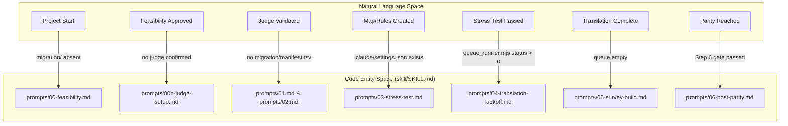
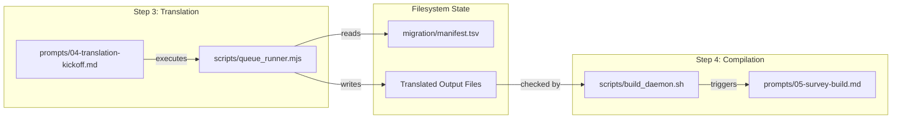

<!-- source: DeepWiki mcp.deepwiki.com · repo anthropics/code-migration-kit-with-claude-code · page 5 Claude Code Skill · fetched 2026-10-26 -->

# Claude Code Skill

Relevant source files

The following files were used as context for generating this wiki page:

- [CLAUDE.md](CLAUDE.md)
- [README.md](README.md)
- [skill/SKILL.md](skill/SKILL.md)

The Claude Code skill (`skill/SKILL.md`) is the integration layer that transforms Claude Code from a general-purpose assistant into a specialized migration orchestrator. It enforces the six-step pipeline, manages state-aware routing, and ensures compliance with the kit's standing rules.

## Purpose and Scope

The skill serves as the entry point for all migration activities. It is designed for large-scale language migrations (e.g., "Port our Python CLI to TypeScript") rather than incremental adoption or single-file conversions [skill/SKILL.md:6-10](). 

When installed, the skill provides Claude Code with:
1.  **State-Aware Routing:** Logic to determine which prompt from `prompts/` should be executed based on the current filesystem state [skill/SKILL.md:22-62]().
2.  **Process Enforcement:** Strict adherence to the "process-first" doctrine, where the rulebook is read-only and reviewers are adversarial [skill/SKILL.md:15-20]().
3.  **Standardized Reporting:** Progress is reported via burndown numbers from `scripts/queue_runner.mjs` rather than conversational prose [skill/SKILL.md:66-66]().

## Installation and Path Configuration

The skill must be installed in the local Claude Code configuration directory.

| Component | Path |
| :--- | :--- |
| **Installation Path** | `~/.claude/skills/code-migration/` |
| **Source File** | `skill/SKILL.md` |
| **Configuration Requirement** | Replace `[kit path]` placeholders with the absolute path to the migration kit [README.md:30-31](). |

Sources: [README.md:30-31](), [skill/SKILL.md:16-17]()

## State-Based Routing Logic

The skill uses the presence or absence of specific artifacts in the `migration/` directory to determine the current phase of the project. It maps these states to the appropriate prompts.

### Routing Table: Natural Language to Code Entity Space

The following diagram maps the logical migration phase to the specific code entities (prompts and scripts) the skill invokes.

**Migration State Routing**

Sources: [skill/SKILL.md:22-62]()

## Implementation of Standing Rules

The skill acts as a runtime enforcer for the rules defined in `CLAUDE.md`. It prevents the model from improvising or bypassing the established safety gates.

### 1. Read-Only Rulebook
The skill explicitly forbids editing `migration/RULEBOOK.md` during active loops. If a rule is found to be deficient (failing three times), the skill instructs the agent to stop fixing instances and queue an amendment for the human to review [skill/SKILL.md:67-68](), [CLAUDE.md:16-19]().

### 2. Forbidden Operations (Deny Rules)
The skill enforces the use of `templates/settings.json` which must be installed by the human in `.claude/settings.json`.
*   **Prompt 03/04 Verification:** The skill requires the agent to verify these denies are live before starting the pilot or fan-out [skill/SKILL.md:41-43]().
*   **No Self-Modification:** The agent is strictly forbidden from installing or modifying its own `settings.json` to prevent it from granting itself permission to run expensive or destructive commands [skill/SKILL.md:43-43](), [skill/SKILL.md:51-52]().

### 3. Data Flow and Orchestration
The skill manages the transition from Step 3 (Translation) to Step 4 (Compilation) by monitoring the `queue_runner.mjs` status.

**Data Flow: Translation to Build**

Sources: [skill/SKILL.md:47-53](), [CLAUDE.md:20-23](), [README.md:113-122]()

## Constant Behaviors

The skill defines "Constant Behaviors" that override any specific prompt instructions to maintain process integrity:

*   **Sign-off Gates:** Every prompt ends with a hard stop. The skill prevents the agent from proceeding to the next step on inferred approval; the human must manually trigger the next phase [CLAUDE.md:24-27](), [skill/SKILL.md:24-27]().
*   **Adversarial Review:** The skill enforces a topology where reviewers are separate from implementers and must remain read-only, assuming the work is incorrect by default [CLAUDE.md:28-31]().
*   **Conservative Translation:** When encountering ambiguity (the "Unknown is an answer" rule), the skill directs the agent to use the most conservative representation and leave a `TODO(port)` marker rather than stalling [CLAUDE.md:53-56]().

Sources: [skill/SKILL.md:64-70](), [CLAUDE.md:14-57]()

---

