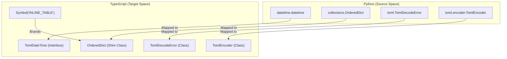
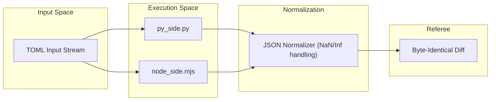

<!-- source: DeepWiki mcp.deepwiki.com · repo anthropics/code-migration-kit-with-claude-code · page 6 Example: Run 1 — Python toml → TypeScript · fetched 2026-10-26 -->

# Example: Run 1 — Python toml → TypeScript

Relevant source files

The following files were used as context for generating this wiki page:

- [RUN-NOTES.md](RUN-NOTES.md)
- [examples/run1-toml/README.md](examples/run1-toml/README.md)

This page provides an overview of the first dogfooding run of the Code Migration Kit, which successfully migrated the **toml 0.10.2** Python library to TypeScript. The artifacts generated during this run are preserved in `examples/run1-toml/` as a reference for how the kit handles a structure-preserving migration with a focus on byte-identical parity.

## Project Scope and Results

The target was a widely-used Python TOML parser and encoder. The migration aimed for high fidelity, including the reproduction of specific upstream behaviors and error message formats.

| Metric | Value |
| :--- | :--- |
| **Source Target** | `toml 0.10.2` (Python) |
| **Target Language** | TypeScript (Strict) |
| **Scale** | 5 files, 1,425 lines |
| **Result** | 12/12 scenarios passing byte-identical parity |
| **Status** | COMPLETE |

Sources: [RUN-NOTES.md:6-16]()

## Architecture of the Port

The migration followed an **S0 (Structure-Preserving)** posture. This means the TypeScript implementation mirrors the Python internal structure, including private helper functions and the specific dispatch table logic used in the encoder.

### System Mapping Overview

The following diagram illustrates how Python-specific constructs were mapped to TypeScript equivalents as defined in the Rulebook.

**Diagram: Language Construct Mapping (Python to TypeScript)**

Sources: [RUN-NOTES.md:30-31](), [examples/run1-toml/RULEBOOK.md:1-50]() (referenced via child page 6.1 context)

## The Parity Harness

Because the original Python test suite relied heavily on internal Python behaviors, a custom dual-sided parity harness was developed. This harness allowed the `py_side.py` (original) and `node_side.mjs` (port) to be compared against the same set of TOML inputs, normalizing their outputs to JSON for byte-for-byte comparison.

**Diagram: Parity Verification Flow**

Sources: [RUN-NOTES.md:48-52](), [examples/run1-toml/README.md:4-4]()

## Key Findings and Artifacts

The run demonstrated the kit's ability to catch subtle translation errors through its adversarial review and bakeoff phases.

*   **Rulebook Amendments:** The process caught 14 material differences during the Step 2 bakeoff, leading to 10 rulebook amendments before the full fan-out began. [RUN-NOTES.md:32-37]()
*   **Bug-for-Bug Fidelity:** The port successfully reproduced a specific upstream bug involving embedded control characters in strings, as mandated by the `BUG(port)` rule. [RUN-NOTES.md:14-16]()
*   **Type Safety:** The use of `tsc` as a "cheap referee" caught cross-file type conflicts that were missed by the implementer but caught during the Step 4 survey build. [RUN-NOTES.md:43-47]()

## Detailed Child Pages

For deep dives into the specific artifacts and findings of Run 1, see the following pages:

*   **[Run 1 Rulebook and Inventory](#6.1)**: Detailed look at the `RULEBOOK.md` and the `inventory.tsv` used to track the 20+ architectural gaps identified.
*   **[Run 1 Parity Harness](#6.2)**: Technical details on how the `py_side.py` and `node_side.mjs` drivers were implemented to ensure strict parity.
*   **[Run 1 Audit Notes and Diff Report](#6.3)**: Analysis of the skeptic findings in `audit-notes.md` and the divergence reports from the bakeoff phase.

---

