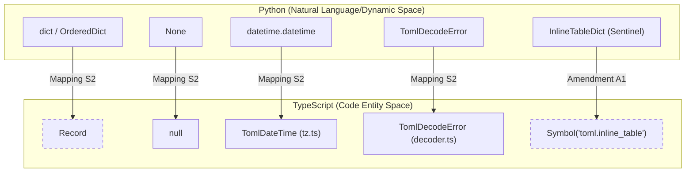
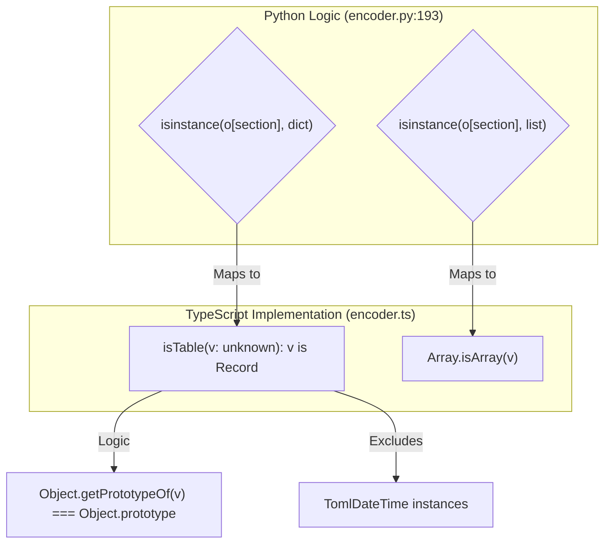

<!-- source: DeepWiki mcp.deepwiki.com · repo anthropics/code-migration-kit-with-claude-code · page 6.1 Run 1 Rulebook and Inventory · fetched 2026-10-26 -->

# Run 1 Rulebook and Inventory

Relevant source files

The following files were used as context for generating this wiki page:

- [examples/run1-toml/RULEBOOK.md](examples/run1-toml/RULEBOOK.md)
- [examples/run1-toml/inventory.tsv](examples/run1-toml/inventory.tsv)
- [examples/run1-toml/selection.md](examples/run1-toml/selection.md)

This page documents the foundational configuration and gap analysis for the first reference migration: porting the `toml` 0.10.2 library from Python to TypeScript. It details the specific translation rules, type mapping decisions, and the inventory of architectural gaps identified during Step 1 and Step 2 of the pipeline.

## 1. Translation Strategy and Posture

The migration follows a **structure-preserving** posture. The goal is to maintain a 1:1 mapping between source and target entities to ensure that logic remains verifiable and the existing Python test suite can be used as a source of truth for parity.

### 1.1 Core Directives
*   **Structure Preservation:** Each `.py` file maps to exactly one `.ts` file. Function and class boundaries, as well as control flow, are preserved exactly [examples/run1-toml/RULEBOOK.md:8-9]().
*   **Cheap-Referee Variant:** Unlike the standard "no-compiler" rule in Step 3, this run allows `tsc` (TypeScript Compiler) to run inside the loop. A translation is not considered complete unless it passes strict type checking [examples/run1-toml/RULEBOOK.md:10-12]().
*   **Naming Invariants:** All function, class, and parameter names are preserved in `snake_case` to facilitate easier debugging against the Python source [examples/run1-toml/RULEBOOK.md:41-42]().

### 1.2 Data Flow and Entity Mapping

The following diagram illustrates how Python constructs are mapped to TypeScript entities, specifically focusing on the translation of Python's dynamic typing into TypeScript's structural typing.

**Entity Mapping: Python to TypeScript**

Sources: [examples/run1-toml/RULEBOOK.md:23-34](), [examples/run1-toml/RULEBOOK.md:50-55]()

## 2. Technical Mapping Decisions

### 2.1 Type System and Symbols
*   **Dictionary Preservation:** Python `dict` objects are mapped to plain JavaScript objects. Because JS objects preserve insertion order, the `OrderedDict` variant in `ordered.py` is implemented as a no-op shim to maintain the 1:1 file structure [examples/run1-toml/RULEBOOK.md:25]().
*   **Inline Table Sentinel:** Python uses dynamic multiple inheritance to create an `InlineTableDict` [toml/decoder.py:644](). Since TypeScript cannot express this easily, the rulebook mandates a `Symbol` brand: `const INLINE_TABLE = Symbol('toml.inline_table')`. This allows objects to satisfy both the table check and the specific inline-table check [examples/run1-toml/RULEBOOK.md:50-55]().
*   **Date/Time Handling:** Standard `JS Date` is banned due to mutability and precision loss. Instead, custom `TomlDateTime`, `TomlDate`, and `TomlTime` classes are implemented in `tz.ts` to store raw components and offset strings [examples/run1-toml/RULEBOOK.md:30]().

### 2.2 Error and Nullability Handling
*   **Nullability:** `None` in Python data structures maps strictly to `null`, never `undefined` [examples/run1-toml/RULEBOOK.md:26]().
*   **Exception Fidelity:** Python's `IndexError` behavior must be replicated. Any index access that could raise an error in Python must include an explicit bounds check or a `TODO(port)` marker in TypeScript [examples/run1-toml/RULEBOOK.md:60-61]().

## 3. Gap Inventory and Classifications

The gap inventory (Step 1.2) identified 19+ critical sites where automated translation would likely fail or require a specific architectural decision.

### 3.1 Key Inventory Rows
| File | Symbol | Classification | Decision |
| :--- | :--- | :--- | :--- |
| `decoder.py` | `_load_date` | `NULLABLE_RETURN` | Returns `TomlDateTime \| TomlDate \| null`. `None` -> `null` per Rulebook S2. [examples/run1-toml/inventory.tsv:10-11]() |
| `encoder.py` | `dump_sections` | `TYPE_NARROWING` | Uses `isTable()` guard to exclude arrays and `tz.ts` class instances. [examples/run1-toml/inventory.tsv:16]() |
| `encoder.py` | `dump_sections` | `UNKNOWN` | Identified the `InlineTableDict` sentinel gap, leading to Amendment A1 (Symbol brand). [examples/run1-toml/inventory.tsv:19]() |

### 3.2 Logic Flow: Type Narrowing

The following diagram shows the logic flow for type narrowing in the encoder, bridging the Python `isinstance` checks to the TypeScript `isTable` implementation.

**Type Narrowing Logic Flow**

Sources: [examples/run1-toml/inventory.tsv:15-18](), [examples/run1-toml/RULEBOOK.md:68-69]()

## 4. Amendment Log and Deviations

The Rulebook was updated post-stress-test (Step 2) with several critical amendments to handle edge cases found during the bakeoff.

*   **A1 (Sentinels):** Established the `Symbol` brand for inline tables to resolve the `UNKNOWN` classification in the inventory [examples/run1-toml/RULEBOOK.md:50-55]().
*   **A2 (Bug-for-Bug):** Mandated that source defects (e.g., specific control character handling in `_dump_str`) must be reproduced "bug-for-bug" and marked with `BUG(port):` to ensure parity [examples/run1-toml/RULEBOOK.md:58-59]().
*   **Deviations:** The pilot run was folded into Step 3's first unit due to the scaled-down nature of this dogfooding project [examples/run1-toml/selection.md:10-11]().

Sources: [examples/run1-toml/RULEBOOK.md:49-79](), [examples/run1-toml/selection.md:1-12]()

---

