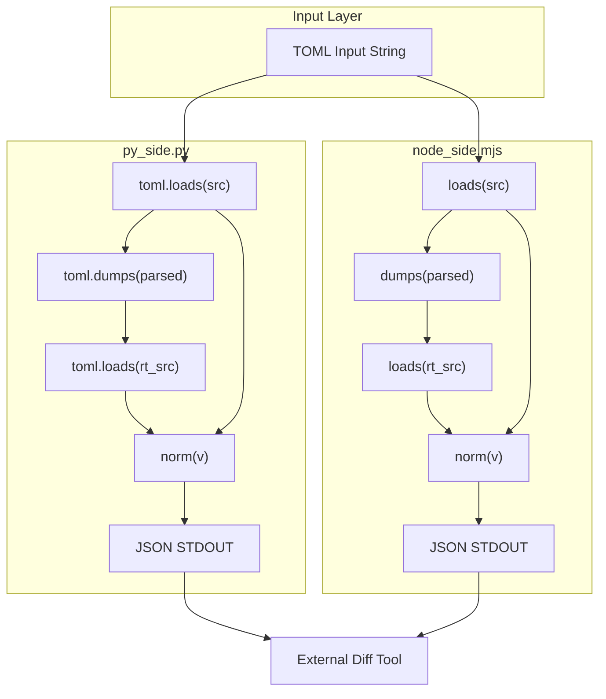
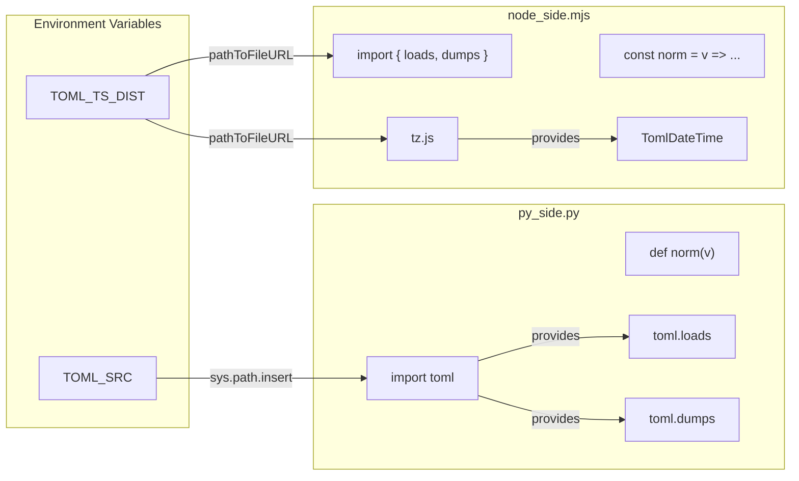

<!-- source: DeepWiki mcp.deepwiki.com · repo anthropics/code-migration-kit-with-claude-code · page 6.2 Run 1 Parity Harness · fetched 2026-10-26 -->

# Run 1 Parity Harness

<details>
<summary>Relevant source files</summary>

The following files were used as context for generating this wiki page:

- [examples/run1-toml/README.md](examples/run1-toml/README.md)
- [examples/run1-toml/node_side.mjs](examples/run1-toml/node_side.mjs)
- [examples/run1-toml/py_side.py](examples/run1-toml/py_side.py)

</details>


The Run 1 Parity Harness is a dual-sided execution environment designed to verify the behavioral equivalence of the Python `toml` library and its TypeScript port. It implements a strict normalization layer that allows for direct comparison of complex data types (dates, infinities, NaNs) and structural properties (key ordering) across language boundaries.

## Overview and Purpose

The harness validates two primary invariants for every test case:
1.  **Parse Parity**: Given a TOML input, the Python `loads` and TypeScript `loads` functions must produce identical data structures.
2.  **Roundtrip Parity**: Given a parsed data structure, re-encoding it via `dumps` and parsing it again must result in the same data structure as the original parse.

The system utilizes two scripts, `py_side.py` and `node_side.mjs`, which act as standard-input/standard-output (STDIN/STDOUT) filters. They ingest raw TOML and emit a single line of normalized JSON containing both the initial parse result and the roundtrip result.

## Data Flow and Architecture

The harness operates by piping the same TOML source into both language-specific drivers. The drivers load the target libraries from configurable paths and apply a recursive normalization function (`norm`) before serializing the results to JSON.

### Parity Execution Flow

The following diagram illustrates the flow from a TOML source through the dual-sided harness to the final comparison.

**Harness Execution and Normalization Flow**

**Sources:** [examples/run1-toml/py_side.py:13-20](), [examples/run1-toml/node_side.mjs:9-23]()

## Implementation Details

### Normalization Logic
To ensure a bit-for-bit match in the final JSON output, both sides implement a `norm(v)` function that handles non-JSON-standard types and non-deterministic structures.

| Feature | Python Implementation (`py_side.py`) | TypeScript Implementation (`node_side.mjs`) |
| :--- | :--- | :--- |
| **Dates/Times** | Uses `v.isoformat()` for `datetime`, `date`, and `time` objects [examples/run1-toml/py_side.py:9](). | Uses `v.toISOString()` for `TomlDateTime`, `TomlDate`, and `TomlTime` [examples/run1-toml/node_side.mjs:12](). |
| **Floats (Inf/NaN)** | Maps `math.isnan` to `"nan"` and `math.isinf` to `"inf"`/`"-inf"` [examples/run1-toml/py_side.py:8](). | Maps `!Number.isFinite` to `"nan"`, `"inf"`, or `"-inf"` [examples/run1-toml/node_side.mjs:13](). |
| **Dictionaries** | Sorts keys using `sorted(v)` to ensure stable JSON order [examples/run1-toml/py_side.py:11](). | Sorts keys using `Object.keys(v).sort()` [examples/run1-toml/node_side.mjs:15](). |
| **Arrays** | Recursively calls `norm(x)` on all elements [examples/run1-toml/py_side.py:10](). | Recursively calls `norm(v)` on all elements [examples/run1-toml/node_side.mjs:14](). |

### Error Handling
If a parser fails, the harness catches the exception and returns a JSON object containing the error class name and message. This allows the parity checker to distinguish between "successful parse mismatch" and "one side failed to parse valid input."
*   **Python**: Catches `Exception` and returns `type(e).__name__` [examples/run1-toml/py_side.py:18-19]().
*   **Node**: Catches `e` and returns `e.constructor.name` [examples/run1-toml/node_side.mjs:22]().

## Configuration

The harness is configured via environment variables to point at the respective source and build directories.

| Variable | Description | Usage |
| :--- | :--- | :--- |
| `TOML_SRC` | Path to the original Python `toml` source checkout. | Added to `sys.path` in `py_side.py` [examples/run1-toml/py_side.py:4](). |
| `TOML_TS_DIST` | Path to the TypeScript `dist` directory containing the compiled JS. | Used to import `loads`/`dumps` from `index.js` and date classes from `tz.js` [examples/run1-toml/node_side.mjs:5-7](). |

### System Mapping

The following diagram maps the logical components of the parity harness to the specific files and variables used in the Run 1 migration.

**Code Entity Mapping**

**Sources:** [examples/run1-toml/py_side.py:4-5](), [examples/run1-toml/node_side.mjs:5-7](), [examples/run1-toml/README.md:4]()

## Usage Example

To compare a specific TOML file across both implementations:

```bash
# Set up paths
export TOML_SRC=/path/to/python-toml
export TOML_TS_DIST=/path/to/toml-ts/dist

# Run comparison
python3 py_side.py < test.toml > py_out.json
node node_side.mjs < test.toml > node_out.json

# Diff the normalized results
diff py_out.json node_out.json
```
**Sources:** [examples/run1-toml/README.md:4](), [examples/run1-toml/py_side.py:13-20](), [examples/run1-toml/node_side.mjs:9-23]()

---

