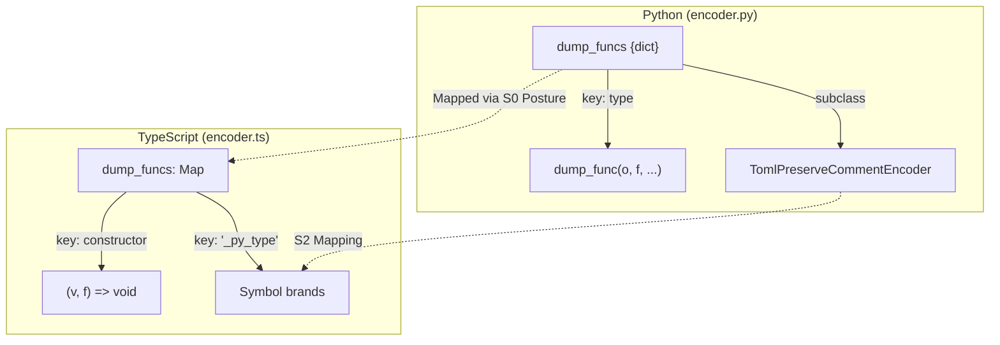
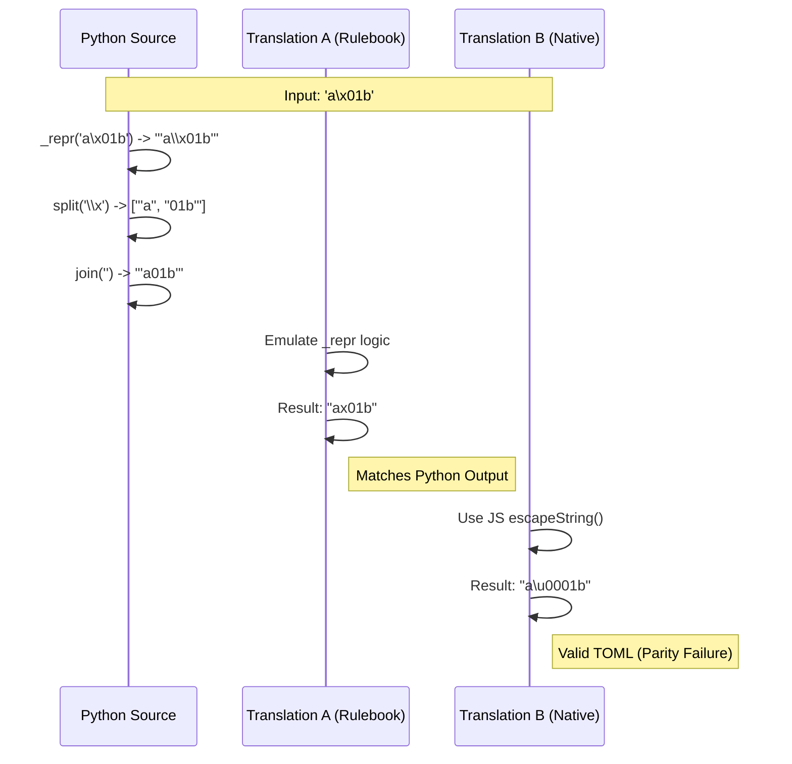

<!-- source: DeepWiki mcp.deepwiki.com · repo anthropics/code-migration-kit-with-claude-code · page 6.3 Run 1 Audit Notes and Diff Report · fetched 2026-10-26 -->

# Run 1 Audit Notes and Diff Report

Relevant source files

The following files were used as context for generating this wiki page:

- [RUN-NOTES.md](RUN-NOTES.md)
- [examples/run1-toml/audit-notes.md](examples/run1-toml/audit-notes.md)
- [examples/run1-toml/diff-report.md](examples/run1-toml/diff-report.md)

This page details the findings from the first dogfooding run of the Claude Code Migration Kit, specifically the migration of the `toml 0.10.2` Python library to TypeScript. It covers the adversarial audit of the gap inventory and the results of the Step 2 "Bakeoff" between a rulebook-constrained translator and a native (scratch) translator.

## Overview of Audit and Bakeoff
The Step 1 and Step 2 processes for the `toml` migration identified significant edge cases in Python's TOML encoding behavior, particularly regarding control characters and type dispatching. The audit and bakeoff served to harden the **Rulebook** before the bulk translation of the library.

### Key Statistics
*   **Inventory Audit**: 20/20 rows confirmed; 7 evidence-quality defects identified. [RUN-NOTES.md:27-28]()
*   **Bakeoff Divergences**: 14 material differences found between Translation A (Rulebook) and Translation B (Native). [RUN-NOTES.md:32-33]()
*   **Outcome**: 10 amendments applied to the Rulebook at the Step 2 gate. [RUN-NOTES.md:35-37]()

---

## Inventory Audit Findings (Skeptic Round 1)
The skeptic reviewers analyzed the `inventory.tsv` generated in Step 1. While the mapping classifications were largely accurate, several defects in "evidence quality" (citations and behavioral claims) were surfaced.

| Source Location | Finding | Impact on Migration |
|:---|:---|:---|
| `decoder.py` | Off-by-one line citations (e.g., 35->36). [examples/run1-toml/audit-notes.md:3-3]() | Fixed citations to ensure implementer accuracy. |
| `encoder.py:197` | Claim that Python/JS "misbehave identically" was false. Python raises `TypeError`, JS `for...in` silently no-ops. [examples/run1-toml/audit-notes.md:4-4]() | Added `TODO(port)` requirement to the site to flag divergence. |
| `encoder.py:260` | Type narrowing issue: `t` must be declared `Array<string|number|(string|number)[]>` or strict `tsc` kills the branch. [examples/run1-toml/audit-notes.md:5-5]() | Informed the type mapping for the encoder dispatch. |
| `encoder.py:302` | Cited a nonexistent rulebook row. [examples/run1-toml/audit-notes.md:7-7]() | Validated that the Rulebook was silent on this construct. |

**Sources**: [examples/run1-toml/audit-notes.md:1-8](), [RUN-NOTES.md:27-31]()

---

## The Bakeoff: Translation A vs. Translation B
The bakeoff compared two translations of `encoder.py`. Translation A followed the **S0 Posture** (structure-preserving), while Translation B was a "Native" rewrite.

### The S0 Posture and Bug-for-Bug Fidelity
A primary finding was that the S0 posture correctly preserved "bugs" in the original Python implementation that a native translator would "fix," leading to parity failures.

**Example: The `_dump_str` Control Character Bug**
*   **Python Source**: `_dump_str('a\x01b')` produces `"ax01b"` (it incorrectly drops the escape backslash). [examples/run1-toml/diff-report.md:14-14]()
*   **Translation A (Rulebook)**: Reproduced the corruption via a literal port of the `_repr` split/join logic. [examples/run1-toml/diff-report.md:14-14]()
*   **Translation B (Native)**: Emitted valid TOML `"a\u0001b"`. [examples/run1-toml/diff-report.md:14-14]()
*   **Verdict**: **Rulebook Right**. While B's output is "better," it would fail the parity referee's byte-identical check. The fix must be a post-parity patch. [examples/run1-toml/diff-report.md:14-14]()

### Technical Divergence Summary

| # | Feature | Divergence Detail | Verdict |
|:---|:---|:---|:---|
| 2 | `IndexError` | Python `\x01` causes `IndexError`. Translation A returned `"01xundefined"` due to JS array behavior. [examples/run1-toml/diff-report.md:15-15]() | **Both Wrong** (Rulebook Gap) |
| 4 | `inf/nan` | Translation A used `TODO(port)` for `Infinity`. Translation B achieved byte-parity with `inf`. [examples/run1-toml/diff-report.md:17-17]() | **Native Right** |
| 7 | Datetime | Translation B used JS `Date`, losing naive datetime support and non-UTC offsets. [examples/run1-toml/diff-report.md:20-20]() | **Rulebook Right** |
| 8 | Dispatch Table | Translation A ported the `Map<string\|Function, DumpFunc>` architecture. B used a `switch` which broke extension points. [examples/run1-toml/diff-report.md:21-21]() | **Rulebook Right** |

**Sources**: [examples/run1-toml/diff-report.md:12-21](), [RUN-NOTES.md:32-42]()

---

## Data Flow: From Python Dispatch to TypeScript Types

The following diagram illustrates how the Python `dump_funcs` dispatch table was mapped to TypeScript, bridging the gap between Python's dynamic types and the TypeScript type system defined during the audit.

### Dispatch Table Architecture

**Sources**: [examples/run1-toml/diff-report.md:21-21](), [examples/run1-toml/audit-notes.md:5-6]()

---

## Control Character Reproduction Logic
The `_dump_str` reproduction was a critical test of the "Bug-for-Bug" requirement. The following diagram traces the data flow that leads to the intentional corruption required for parity.

### Bug-for-Bug String Encoding Flow

**Sources**: [examples/run1-toml/diff-report.md:14-14](), [RUN-NOTES.md:14-16]()

---

## SILENCE Markers and Amendments
The bakeoff identified several "Silences"—areas where the translator had to invent logic because the Rulebook was mute.

1.  **SILENCE #3 (Type-keyed dict)**: No canonical mapping for Python's type-keyed dispatch. → **Amendment 5**: Define `Map<string|Function, DumpFunc>`. [examples/run1-toml/diff-report.md:21-21]()
2.  **SILENCE #4 (Integral Floats)**: `5.0` in Python becomes `5` in JS. → **Amendment 4**: Declare loss of `.0` as an accepted divergence for the parity harness. [examples/run1-toml/diff-report.md:19-19]()
3.  **SILENCE #5 (`%r` repr)**: No mapping for Python's string representation. → **Amendment 1**: Create `_repr` shim for bug-for-bug fidelity. [examples/run1-toml/diff-report.md:14-14]()

**Sources**: [examples/run1-toml/diff-report.md:14-21](), [RUN-NOTES.md:35-37]()

---

