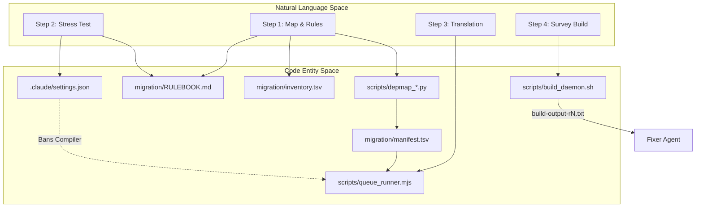
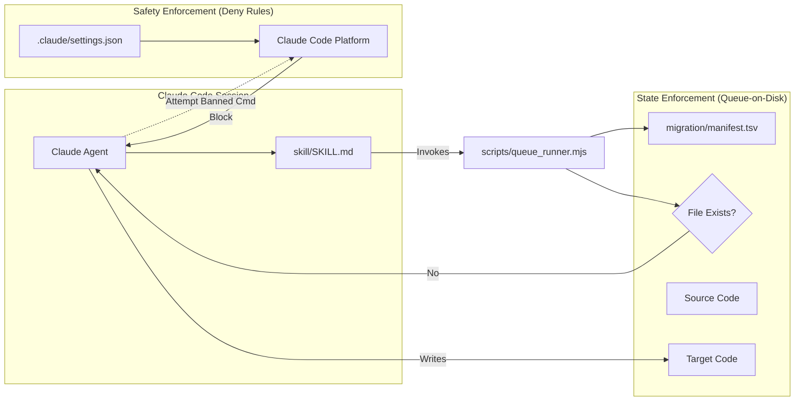

<!-- source: DeepWiki mcp.deepwiki.com · repo anthropics/code-migration-kit-with-claude-code · page 7 Glossary · fetched 2026-10-26 -->

# Glossary

Relevant source files

The following files were used as context for generating this wiki page:

- [CLAUDE.md](CLAUDE.md)
- [README.md](README.md)
- [RUN-NOTES.md](RUN-NOTES.md)
- [examples/run1-toml/RULEBOOK.md](examples/run1-toml/RULEBOOK.md)
- [examples/run1-toml/diff-report.md](examples/run1-toml/diff-report.md)
- [scripts/build_daemon.sh](scripts/build_daemon.sh)
- [scripts/queue_runner.mjs](scripts/queue_runner.mjs)
- [skill/SKILL.md](skill/SKILL.md)
- [templates/RULEBOOK.md](templates/RULEBOOK.md)
- [templates/settings.json](templates/settings.json)

This page provides definitions for the codebase-specific terms, abbreviations, and domain concepts used within the Claude Code Migration Kit. These terms bridge the gap between the natural language migration process and the specific scripts, templates, and files that implement them.

## Core Concepts

### 1. Rulebook
The **Rulebook** is the authoritative governing document for a migration project. It contains the "Meta-Rule": if two agents could answer a question differently, the answer must be in the Rulebook [templates/RULEBOOK.md:3-6](). It is treated as **read-only** during active translation loops to prevent agents from relaxing the standards they are being graded against [CLAUDE.md:16-19]().

*   **Implementation:** A markdown file located at `migration/RULEBOOK.md`, initialized from `templates/RULEBOOK.md` [CLAUDE.md:62-62]().
*   **Key Sections:** Scope/Posture, Ecosystem Adoption, Canonical Mappings, Escape Hatches, Naming/Output Paths, Gap Inventory, and the Deviation Log [templates/RULEBOOK.md:14-135]().

### 2. Gap Inventory
A structured catalog of every location in the source code where the target language requires a decision that the source language allowed the developer to keep "in their head" (e.g., nullability, ownership, lifetimes) [README.md:89-92]().

*   **Implementation:** A TSV file at `migration/inventory.tsv` [CLAUDE.md:64-64]().
*   **Data Flow:** Generated in Step 1 (Prompt 02) and consumed by implementers in Step 3 [README.md:89-92]().

### 3. Dependency Map (Depmap)
A deterministic graph of the source codebase used to establish the translation order and identify circular dependencies [README.md:84-88]().

*   **Implementation:** Generated by language-specific scripts (e.g., `scripts/depmap_python.py`) [CLAUDE.md:63-63]().
*   **Outputs:** 
    *   `edges.tsv`: The raw dependency graph.
    *   `order.txt`: A topological sort of files (the work order).
    *   `cycles.txt`: A list of detected Strongly Connected Components (SCCs) [CLAUDE.md:63-63]().

### 4. Manifest
A machine-readable work queue derived from the Dependency Map's `order.txt`. It defines the specific source-to-target file mappings [CLAUDE.md:65-65]().

*   **Implementation:** A TSV file at `migration/manifest.tsv` created by `scripts/make_manifest.py` [CLAUDE.md:65-65]().
*   **Format:** Two columns: `source` and `target` [scripts/queue_runner.mjs:55-56]().

---

## Technical Jargon & Abbreviations

| Term | Definition | Code Pointer |
| :--- | :--- | :--- |
| **Bakeoff** | A stress-test where two translators (one following rules, one "native") port the same file to find rule gaps. | [README.md:105-107]() |
| **BUG(port)** | A marker for source-code defects that must be reproduced bug-for-bug to maintain parity. | [templates/RULEBOOK.md:57-61]() |
| **Cheap-Referee** | A variant where a fast compiler (like `tsc`) is allowed inside the translation loop. | [examples/run1-toml/RULEBOOK.md:10-12]() |
| **Dissolve** | The act of merging the Step 4 (Compile) phase into Step 3 (Translate) when using a Cheap-Referee. | [README.md:124-126]() |
| **Fan-out** | Parallel execution of translation tasks across multiple subagents or workflows. | [README.md:98-100]() |
| **Judge** | A portable test suite or parity harness used to verify the migration's exit condition. | [README.md:34-39]() |
| **S0 Posture** | The "Structure-Preserving" posture: same architecture, same data structures, same files. | [templates/RULEBOOK.md:16-19]() |
| **Skeptic** | An adversarial reviewer role tasked with finding flaws in the Gap Inventory or Rulebook. | [CLAUDE.md:79-79]() |
| **TODO(port)** | A marker for deferred decisions where the Rulebook or Inventory was silent. | [CLAUDE.md:53-56]() |

---

## System Architecture Diagrams

### Natural Language Process to Code Entities (The Pipeline)
This diagram maps the conceptual six-step pipeline to the specific files and scripts that execute them.

**Sources:** [CLAUDE.md:60-70](), [README.md:64-71](), [scripts/queue_runner.mjs:7-12](), [scripts/build_daemon.sh:4-11]()

### Execution State & Guardrails
This diagram illustrates how the kit enforces state through the filesystem and safety through configuration.

**Sources:** [CLAUDE.md:20-23](), [CLAUDE.md:32-43](), [scripts/queue_runner.mjs:7-12](), [skill/SKILL.md:15-21]()

---

## Key Automation Components

### Build Daemon (`scripts/build_daemon.sh`)
The exclusive owner of the compiler during the Survey Build phase. It monitors the source tree via content hashing and generates numbered output files [scripts/build_daemon.sh:6-19]().
*   **Input:** A build command (e.g., `cargo check`) [scripts/build_daemon.sh:25-26]().
*   **Output:** `migration/build-output-r<N>.txt` [scripts/build_daemon.sh:108-112]().

### Queue Runner (`scripts/queue_runner.mjs`)
The mechanical orchestrator for the translation fan-out. It defines "done-ness" as the existence of a non-empty target file on disk [scripts/queue_runner.mjs:7-12]().
*   **Command `status`:** Provides a burndown report [scripts/queue_runner.mjs:71-84]().
*   **Command `next`:** Returns a JSON batch of pending work for subagents [scripts/queue_runner.mjs:85-88]().
*   **Command `verify`:** Ensures target files are not zero-byte "touch cheats" [scripts/queue_runner.mjs:89-96]().

### Settings Deny Rules (`templates/settings.json`)
A configuration file for Claude Code that explicitly bans expensive or dangerous operations (git mutations, compilers, test runners) during translation loops [templates/settings.json:1-22](). This forces agents to escalate issues to the process/Rulebook rather than attempting to "fix" their way out of a local error [CLAUDE.md:32-43]().

**Sources:** [CLAUDE.md:1-88](), [README.md:1-130](), [scripts/build_daemon.sh:1-125](), [scripts/queue_runner.mjs:1-101](), [templates/RULEBOOK.md:1-135](), [templates/settings.json:1-33]()