# Page: Overview

# Overview

<details>
<summary>Relevant source files</summary>

The following files were used as context for generating this wiki page:

- [.gitignore](.gitignore)
- [CLAUDE.md](CLAUDE.md)
- [LICENSE](LICENSE)
- [README.md](README.md)

</details>


The **Claude Code Migration Kit** is a technical framework and methodology for executing large-scale codebase migrations using Claude Code [README.md:1-5](). It is designed primarily for **structure-preserving migrations**, where the goal is to port a codebase to a new language while maintaining the existing architecture and data structures [README.md:7-9]().

The kit provides a structured, six-step pipeline that shifts the focus from fixing individual lines of code to fixing the underlying process [README.md:59-62](). It relies on a "process-first" doctrine, using deterministic scripts for dependency mapping and adversarial agent topologies for quality control [CLAUDE.md:6-12]().

### The Six-Step Pipeline

The migration follows a linear progression governed by sign-off gates. Each step is driven by specific prompts located in the `prompts/` directory [README.md:64-72]().

| Step | Focus | Key Code Entities / Artifacts |
| :--- | :--- | :--- |
| **0** | **Feasibility** | `prompts/00-feasibility.md`, `prompts/00b-judge-setup.md` |
| **1** | **Mapping** | `scripts/depmap_*.py`, `templates/RULEBOOK.md`, `templates/inventory.tsv` |
| **2** | **Stress-Test** | `prompts/03-stress-test.md`, `migration/stress-test/` |
| **3** | **Translation** | `scripts/queue_runner.mjs`, `migration/manifest.tsv` |
| **4** | **Compilation** | `prompts/05-survey-build.md`, `templates/settings.json` |
| **5/6** | **Parity** | `prompts/06-post-parity.md`, existing test suites |

For a detailed breakdown of the philosophy and foundational rules (such as the read-only rulebook and queue-on-disk state), see **[Core Principles and Standing Rules](#1.2)**.

### System Architecture and Code Entities

The kit bridges the gap between high-level migration intent and concrete file-system state. The following diagram illustrates how the migration state is managed through specific files and scripts.

**Migration State and Execution Flow**
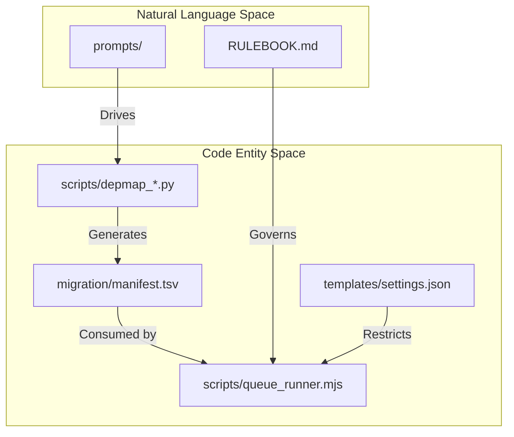
Sources: [README.md:73-93](), [CLAUDE.md:58-72]()

### Repository Organization

The repository is organized into functional directories that support the pipeline:

*   **`prompts/`**: The operational heart of the kit. Contains the numbered Markdown files that orchestrate Claude Code through each phase [README.md:47]().
*   **`scripts/`**: Automation tools including language-specific dependency mappers (`depmap_python.py`, `depmap_ts.mjs`, `depmap_c.py`) and the `queue_runner.mjs` for managing the translation fan-out [README.md:66-68]().
*   **`templates/`**: Reusable blueprints for the `RULEBOOK.md`, `inventory.tsv`, and `.claude/settings.json` configuration [README.md:77-92]().
*   **`skill/`**: Contains the `SKILL.md` file which can be installed into Claude Code to provide context-aware routing for migration tasks [README.md:30-31]().

**Entity Relationship: Scripts to Output**
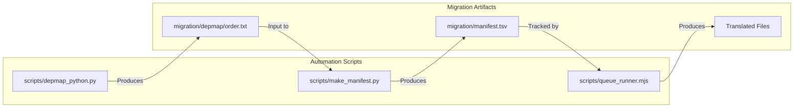
Sources: [CLAUDE.md:58-72](), [README.md:111-117]()

### Getting Started

To begin a migration, the kit must be integrated into the target repository. This involves:
1.  Cloning the kit and configuring `CLAUDE.md` [README.md:25-29]().
2.  Running the feasibility check (`prompts/00-feasibility.md`) [README.md:49-56]().
3.  Establishing a "Judge" (test suite or parity harness) [README.md:34-39]().

For detailed installation and configuration steps, see **[Getting Started](#1.1)**.

### Reference Implementation: Run 1
The repository includes a complete example of a migration from Python to TypeScript (a port of the `toml` library) located in `examples/run1-toml/`. This serves as a reference for the expected quality and structure of migration artifacts [Wiki TOC: 6]().

---

# Page: Getting Started

# Getting Started

<details>
<summary>Relevant source files</summary>

The following files were used as context for generating this wiki page:

- [README.md](README.md)
- [skill/SKILL.md](skill/SKILL.md)
- [templates/settings.README.md](templates/settings.README.md)
- [templates/settings.json](templates/settings.json)

</details>


This section details the initial installation and configuration of the **Claude Code Migration Kit** within a target repository. Proper setup ensures that Claude Code operates under the kit's "process-first" doctrine, utilizing standing rules and specialized skills to manage the migration lifecycle.

The kit is designed to be installed either inside or adjacent to the repository being migrated. It establishes a `migration/` directory as the central workspace for all generated artifacts, ensuring the source code remains clean while the migration progress is tracked via on-disk state.

### 1. Installation and Integration

The kit integrates with Claude Code through two primary mechanisms: a project-specific `CLAUDE.md` and a global Claude Code "skill".

#### 1.1. Cloning and Project Initialization
The kit should be cloned into the target repository or an adjacent directory. The primary entry point for the AI is the `CLAUDE.md` file, which acts as the operating manual for every session [README.md:25-29]().

#### 1.2. Installing the Claude Code Skill
The `code-migration` skill provides the routing logic necessary to map the current state of the `migration/` directory to the correct prompt in the six-step pipeline [skill/SKILL.md:1-10]().

**Installation Steps:**
1. Copy the `skill/` directory to the Claude Code skills path:
   `cp -r migration-kit/skill ~/.claude/skills/code-migration` [README.md:30-31]().
2. Edit the installed `SKILL.md` to replace the `[kit path]` placeholder with the absolute path to your cloned kit [README.md:31]().

**Skill Execution Logic:**
The skill uses a routing table based on the presence of specific files to determine the next action:
| Current State | Action / Prompt |
| :--- | :--- |
| `migration/` directory absent | Run `00-feasibility.md` [skill/SKILL.md:24-25]() |
| Feasibility done, no judge setup | Run `00b-judge-setup.md` [skill/SKILL.md:28-32]() |
| Judge exists, no map/rules | Run Step 1 (`01` and `02`) [skill/SKILL.md:36-40]() |
| Step 1 signed off | Run `03-stress-test.md` [skill/SKILL.md:41-43]() |

#### 1.3. The `migration/` Directory Convention
The kit enforces a "queue-on-disk" pattern. All state is stored in the `migration/` directory within the target repo. This allows for resumable workflows where stopping is free and resuming is a simple re-invocation [README.md:94-97]().

**Core Migration Artifacts:**
* `migration/RULEBOOK.md`: The immutable (inside loops) decision log [README.md:77-83]().
* `migration/manifest.tsv`: The work queue generated from the dependency map [README.md:114-117]().
* `migration/inventory.tsv`: The gap inventory for language-specific requirements [README.md:89-92]().

**Sources:**
* [README.md:25-33]()
* [README.md:77-83]()
* [README.md:94-97]()
* [skill/SKILL.md:1-10]()
* [skill/SKILL.md:24-43]()

---

### 2. Configuring Safeguards (settings.json)

Before starting Step 2 (Stress-Testing) or Step 3 (Translation), you must configure `.claude/settings.json`. This file implements **in-loop bans** by configuration rather than instruction [templates/settings.README.md:11-12]().

#### 2.1. The Role of Deny Rules
The `settings.json` file prevents agents from performing destructive actions or bypassing the migration pipeline. For example, mutating `git` commands are banned because a single `git reset` by one agent would destroy the in-flight work of all other parallel agents in a shared worktree [templates/settings.README.md:18-22]().

#### 2.2. Configuration Implementation
The human must copy `templates/settings.json` to the target repo's `.claude/settings.json`. Prompts 03 and 04 explicitly verify the existence of this file and will refuse to proceed if it is missing [README.md:40-46](); [templates/settings.README.md:7-9]().

**Key Constraints in `templates/settings.json`:**
* **Git Bans:** `git checkout`, `git reset`, `git clean` [templates/settings.json:5-13]().
* **Compiler Bans:** `cargo build`, `npm test`, `make`, etc. [templates/settings.json:14-21]().
* **Allowed:** `git status`, `git diff`, `grep`, `rg` [templates/settings.json:23-30]().

**Installation Flow:**
```mermaid
graph TD
    subgraph "Natural Language Space"
        "UserInstruction"["User: 'Start Step 2'"]
    end

    subgraph "Code Entity Space"
        "Prompt03"["prompts/03-stress-test.md"]
        "SettingsFile"["target-repo/.claude/settings.json"]
        "CheckAction"["Verify settings.json exists"]
        "DenyRules"["templates/settings.json"]
    end

    "UserInstruction" --> "Prompt03"
    "Prompt03" --> "CheckAction"
    "CheckAction" -- "If Missing" --> "Abort"["Abort: Human must copy settings.json"]
    "DenyRules" -- "Manual Copy" --> "SettingsFile"
    "SettingsFile" --> "CheckAction"
    "CheckAction" -- "If Present" --> "Proceed"["Proceed with Pilot Run"]
```

**Sources:**
* [README.md:40-46]()
* [templates/settings.README.md:1-16]()
* [templates/settings.README.md:18-22]()
* [templates/settings.json:1-32]()

---

### 3. Data Flow and System Architecture

The kit operates by transitioning the codebase from a "Source Language" state to a "Target Language" state through a series of structured gates. The `code-migration` skill acts as the orchestrator, ensuring that agents do not skip essential validation steps like the parity judge setup.

**Migration Lifecycle Data Flow:**
```mermaid
graph LR
    subgraph "Input"
        "SourceCode"["Source Repository"]
        "Templates"["Kit Templates & Scripts"]
    end

    subgraph "Skill Orchestration (skill/SKILL.md)"
        "Feasibility"["00-feasibility.md"]
        "JudgeSetup"["00b-judge-setup.md"]
        "Step1"["01-depmap & 02-inventory"]
    end

    subgraph "Output (migration/)"
        "Rulebook"["RULEBOOK.md"]
        "Manifest"["manifest.tsv"]
        "Inventory"["inventory.tsv"]
    end

    "SourceCode" --> "Feasibility"
    "Templates" --> "Step1"
    "Feasibility" -- "Verdict: GO" --> "JudgeSetup"
    "JudgeSetup" -- "Judge Validated" --> "Step1"
    "Step1" --> "Rulebook"
    "Step1" --> "Manifest"
    "Step1" --> "Inventory"
```

#### 3.1. The "Judge" Requirement
A critical "Getting Started" requirement is the establishment of a **Judge** before Step 1 begins. If the existing test suite cannot be used (e.g., it imports internals that are being deleted), `prompts/00b-judge-setup.md` must be used to create a portable parity harness. The kit enforces a "No judge, no exit condition" policy [README.md:34-39]().

**Sources:**
* [README.md:34-39]()
* [skill/SKILL.md:13-21]()
* [skill/SKILL.md:28-35]()

---

# Page: Core Principles and Standing Rules

# Core Principles and Standing Rules

<details>
<summary>Relevant source files</summary>

The following files were used as context for generating this wiki page:

- [CLAUDE.md](CLAUDE.md)
- [README.md](README.md)
- [RUN-NOTES.md](RUN-NOTES.md)

</details>


The Claude Code Migration Kit operates on a foundational philosophy that prioritizes process over individual agent intelligence. By enforcing rigid state management and adversarial review structures, the kit ensures that migrations of hundreds of thousands of lines remain deterministic and resumable.

## Process-First Doctrine

The kit is built on the principle that **you don't fix the code—you fix the process that produced the code** [README.md:60-62](). In a manual migration, a developer might fix a recurring pattern by hand; in this kit, a recurring failure triggers a rulebook amendment, and the affected slice of the codebase is regenerated [CLAUDE.md:44-47]().

### The Rulebook Meta-Rule
The Rulebook (`migration/RULEBOOK.md`) is the single source of truth for all translation decisions. The meta-rule is: **if two agents could answer differently, it goes in the rulebook** [README.md:79-80](). 

Key constraints on the Rulebook include:
*   **Read-Only Inside Loops:** Implementers and reviewers cite the rulebook but never edit it during a task. Amendments are queued for human review and applied only at sign-off gates [CLAUDE.md:16-19]().
*   **Immutability:** The graded party (the LLM) is never allowed to relax its own grader (the rules) [CLAUDE.md:18-19]().

## Queue-on-Disk State Management

To ensure 100% resumability and prevent "context drift," the kit maintains all state on the filesystem rather than in the LLM's conversation memory [CLAUDE.md:20-23]().

*   **Manifest-Driven:** The `migration/manifest.tsv` defines the work queue [CLAUDE.md:65]().
*   **Existence as Completion:** A unit of work is considered "done" only when its output file exists at the path dictated by the rulebook naming rules [CLAUDE.md:20-22]().
*   **Resumability:** Because state is on disk, a session can be interrupted or a repo relocated mid-run without losing progress. New sessions resume by scanning the manifest against the filesystem [RUN-NOTES.md:111-114]().

### Data Flow: From Map to Manifest
This diagram illustrates how the kit converts static code analysis into a disk-based work queue.

**Diagram: State Management Pipeline**
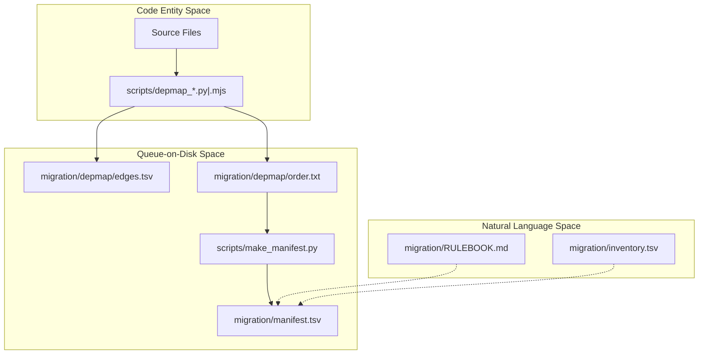
Sources: [CLAUDE.md:62-65](), [README.md:73-92](), [README.md:113-117]()

## Adversarial Review Topology

The kit rejects the "one-and-done" translation model in favor of an adversarial topology. For every unit of work (typically a file), the kit mandates a four-agent structure [CLAUDE.md:28-31](), [README.md:68]():

1.  **Implementer:** Performs the initial translation based on the Rulebook.
2.  **Adversarial Reviewers (x2):** Two separate agents in isolated contexts who assume the work is wrong. They touch no code and must cite a rule or source line for every finding [CLAUDE.md:28-31]().
3.  **Referee/Fixer:** A final agent that applies only confirmed findings where the reviewers agree, or where a third-party referee breaks a tie [CLAUDE.md:30-31]().

## Sign-Off Gates and Banned Operations

The workflow is interrupted by explicit **Sign-off Gates**. A prompt will "stop and show" evidence to the human, and the human's re-invocation of the next prompt serves as the approval to proceed [CLAUDE.md:24-27]().

### Permission Hardening via settings.json
The kit uses `templates/settings.json` (copied to `.claude/settings.json`) to enforce "denies" by configuration. This prevents agents from taking shortcuts [CLAUDE.md:32-35]():
*   **Banned:** Mutating version control, running the compiler during translation, or executing long-running tests [CLAUDE.md:32-34]().
*   **The "Build Daemon" Pattern:** In Step 4, fixers are denied compiler access. They must rely on the `build_daemon.sh` output, which provides compiler diagnostics as a read-only queue [README.md:118-121]().

## Model Tiering Strategy

Token spend is optimized by concentrating high-reasoning models where the "blast radius" of an error is largest [CLAUDE.md:76-77]().

| Task | Tier | Rationale |
| :--- | :--- | :--- |
| **Rulebook Authorship** | Largest (e.g., Opus/3.5 Sonnet) | Errors here replicate into every file [CLAUDE.md:77-78](). |
| **Skeptic Reviewers** | Largest/Mid | High reasoning required to find subtle gaps [CLAUDE.md:79](). |
| **Implementers** | Mid/Small (e.g., Haiku) | High volume; backed by two reviewers and a compiler [CLAUDE.md:80-81](). |
| **Fixers** | Mid | The compiler acts as the ultimate referee [CLAUDE.md:81-82](). |

### Implementation Mapping: Process to Code
This diagram maps the philosophical "Standing Rules" to the specific code entities that enforce them.

**Diagram: Rule Enforcement Mapping**
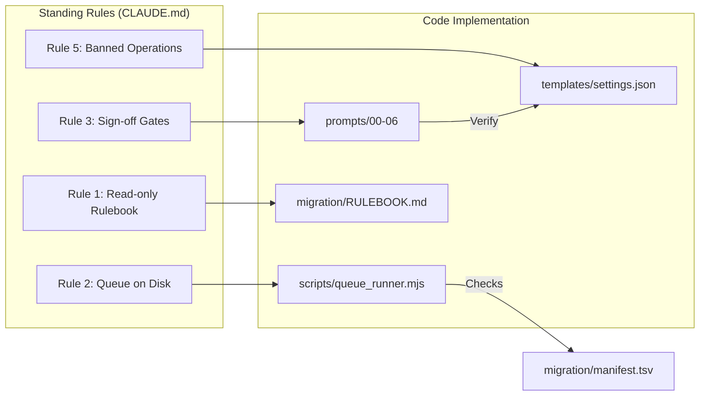
Sources: [CLAUDE.md:14-56](), [README.md:40-47](), [RUN-NOTES.md:99-101]()

---

# Page: The Six-Step Migration Pipeline

# The Six-Step Migration Pipeline

<details>
<summary>Relevant source files</summary>

The following files were used as context for generating this wiki page:

- [CLAUDE.md](CLAUDE.md)
- [README.md](README.md)
- [RUN-NOTES.md](RUN-NOTES.md)

</details>


This page provides a high-level overview of the complete migration lifecycle within the Claude Code Migration Kit. The pipeline is designed to move a codebase from a source language to a target language through a series of deterministic gates, emphasizing process-level fixes over individual code patches.

The core philosophy of this pipeline is that **you don't fix the code — you fix the process that produced the code** [README.md:60-61](). By enforcing strict separation between implementers, adversarial reviewers, and compilers, the kit ensures that the resulting codebase adheres to a unified set of rules rather than the varying styles of individual LLM sessions.

## Pipeline Architecture

The migration is organized into six sequential steps, each producing specific artifacts stored in the `migration/` directory [CLAUDE.md:60-70]().

### Workflow Topology
The following diagram illustrates how the system transitions from natural language requirements (The Rulebook) into discrete code entities (The Manifest) and finally into the target codebase.

**Migration Entity Flow**
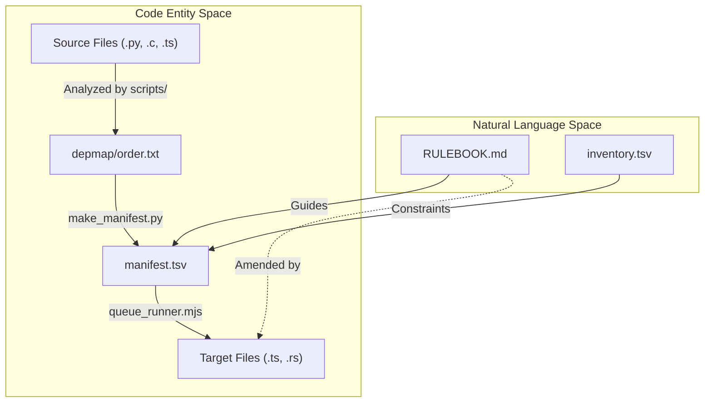
Sources: [CLAUDE.md:60-70](), [README.md:73-93](), [scripts/make_manifest.py:1-20]()

---

## Step 0: Feasibility and Judge Setup
Before any code is moved, a feasibility report determines if the migration should proceed. This step defines the **Model Plan** (which tiers of Claude to use for which tasks) and the **Posture** (Structure-preserving vs. Redesign) [CLAUDE.md:82-84](), [README.md:7-11](). If the existing test suite cannot survive the language transition, a portable parity judge is constructed here.

For details, see [Step 0: Feasibility and Judge Setup](#2.1).

## Step 1: Dependency Map and Gap Inventory
This step builds the "Map" and the "Rules." 
1.  **Dependency Map**: Uses language-specific scripts (e.g., `scripts/depmap_py.py`) to create a deterministic order of operations [README.md:84-88]().
2.  **Gap Inventory**: A flat table (`inventory.tsv`) identifying every site where the target language demands explicit handling of concepts the source language handled implicitly (e.g., lifetimes, nullability) [README.md:89-93]().
3.  **The Rulebook**: A central `RULEBOOK.md` that governs all translation decisions [README.md:77-83]().

For details, see [Step 1: Dependency Map and Gap Inventory](#2.2).

## Step 2: Stress-Testing the Rulebook
The rulebook is validated through a **Bakeoff** and a **Pilot run** [README.md:102-109](). In the bakeoff, two translators (one following rules, one "native") are compared by a diff inspector to find gaps in the rulebook. The pilot run tests the full four-agent pipeline on a small slice of code. No fan-out occurs until the rulebook is amended based on these results.

For details, see [Step 2: Stress-Testing the Rulebook](#2.3).

## Step 3: Translation Fan-Out
This is the high-volume phase. The `scripts/queue_runner.mjs` drives the work based on `migration/manifest.tsv` [CLAUDE.md:65](). Each file is processed by a four-agent topology: one **Implementer**, two **Adversarial Reviewers**, and one **Fixer** [CLAUDE.md:28-31](). Crucially, the compiler is banned during this phase to ensure agents rely on the rulebook, not trial-and-error [CLAUDE.md:32-35]().

For details, see [Step 3: Translation Fan-Out](#2.4).

## Step 4: Survey Build and Step 5: Smoke Test
Once the queue is empty, the `templates/settings.json` compiler bans are lifted or delegated to a `build_daemon.sh` [CLAUDE.md:35-43](). A single "Survey Build" is run to identify cross-file type errors and linker issues. These are fed back into a machine queue for final adjustment. Step 5 involves running "Hello World" and basic smoke tests to prove the target environment is viable.

For details, see [Step 4: Survey Build and Step 5–6: Parity](#2.5).

## Step 6: Parity and Post-Parity Cleanup
The final gate is **Behavioral Parity**. The code is run against the judge established in Step 0. Once the inherited test suite passes, `prompts/06-post-parity.md` is used to burn down all `BUG(port)`, `TODO(port)`, and `PERF(port)` markers that were left during the mechanical translation [CLAUDE.md:53-56](), [RUN-NOTES.md:109-110]().

For details, see [Step 6 Post-Parity: Burndown and Cleanup](#2.6).

---

## The Feedback Loop
The pipeline is designed to move failures upstream. If a fixer agent encounters a recurring issue, the process dictates stopping the fix and instead amending the **Rulebook** [CLAUDE.md:44-47]().

**Rule Correction Cycle**
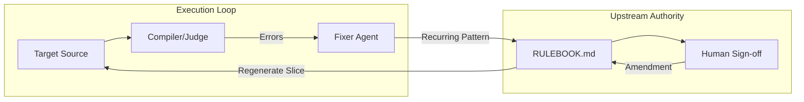
Sources: [CLAUDE.md:16-19](), [CLAUDE.md:44-47](), [README.md:60-63]()

### Related Pages
- [Core Principles and Standing Rules](#1.2) — The "Why" behind the "How."
- [Automation Scripts](#4) — Technical details on the `depmap` and `queue_runner` tools.

---

# Page: Step 0: Feasibility and Judge Setup

# Step 0: Feasibility and Judge Setup

<details>
<summary>Relevant source files</summary>

The following files were used as context for generating this wiki page:

- [RUN-NOTES.md](RUN-NOTES.md)
- [prompts/00-feasibility.md](prompts/00-feasibility.md)
- [prompts/00b-judge-setup.md](prompts/00b-judge-setup.md)

</details>


This stage establishes the economic and technical foundation of the migration. Before a single line of code is translated, the migration must be validated as viable, a structural posture must be chosen, and a mechanical "judge" must be established to define the exit condition.

## 0.1 Feasibility Report (Prompt 00)

The feasibility report is a read-only survey of the source repository. Its purpose is to move from general intentions to a concrete, data-backed plan. The agent is restricted from making any edits to the codebase, performing test runs, or executing the migration prompts (01–06) during this phase [prompts/00-feasibility.md:3-5]().

### The Three Critical Calls
The agent must make three specific technical calls, each backed by file paths or quantitative data [prompts/00-feasibility.md:28-45]():

| Call | Decision Point | Criteria |
| :--- | :--- | :--- |
| **Structure** | Structure-preserving vs. Redesign | Can the architecture translate 1:1 into idiomatic target language? |
| **Verification** | Verification Cost | Baseline build/typecheck timing vs. projected target scaling. |
| **Parity** | Test Survival | Do existing tests hit the public surface (portable) or import internals (die)? |

### Model Tiering and Costing
The feasibility report introduces the **Model Plan**, which prevents the migration from defaulting to a single model for all tasks. Tiers are assigned based on the "blast radius" of the task [prompts/00-feasibility.md:62-69]():
*   **High Tier (e.g., Claude 3.5 Sonnet):** Rulebook authorship, amendments, and skeptic reviewers. Errors here replicate across the entire fan-out.
*   **Mid/Small Tier (e.g., Claude 3 Haiku):** High-volume translation implementers and fixers where the compiler acts as the primary referee.

### Implementation Flow: Feasibility
The following diagram illustrates how the Feasibility prompt interacts with the codebase and generates the initial state.

**Feasibility Data Flow**
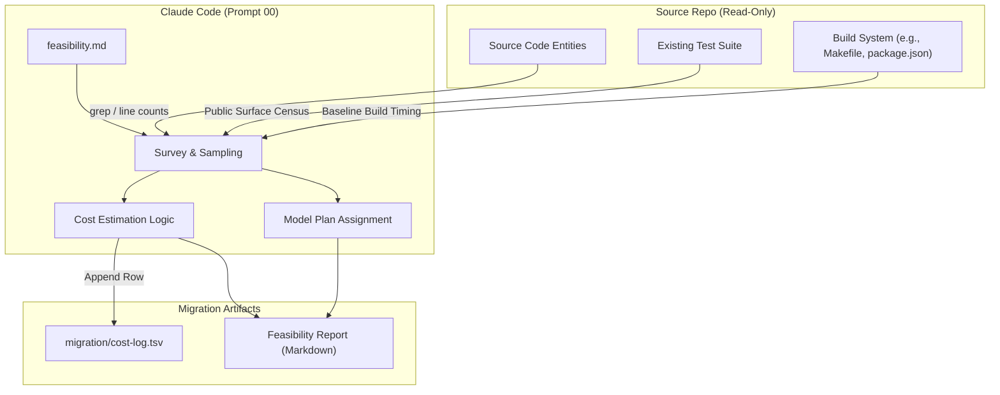
Sources: [prompts/00-feasibility.md:10-23](), [prompts/00-feasibility.md:75-80]()

---

## 0.2 Judge Setup (Prompt 00b)

A migration has no exit condition without a **Judge**: a single harness that evaluates the original code and the port on equal terms [prompts/00b-judge-setup.md:20-22](). If the feasibility report finds that existing tests are "internal-bound" (importing private functions or language-specific internals), they cannot serve as the judge.

### The Portability Requirement
The judge must interact with both implementations through an external interface (CLI, HTTP, File I/O, or Exported API) [prompts/00b-judge-setup.md:26-29](). This ensures that the judge remains valid even as the underlying language and internal structures change.

### The Three-Step Setup Process
1.  **Categorize:** Classify existing tests as **portable** or **internal-bound** [prompts/00b-judge-setup.md:31-34]().
2.  **Rewrite:** Convert portable tests into external assertions. Use two **adversarial reviewers** in separate contexts to ensure no assertions were weakened during the rewrite [prompts/00b-judge-setup.md:39-46]().
3.  **Validate:** 
    *   **Pass Case:** Run against the original code (must pass 100%).
    *   **Fail Case:** Manually mutate the original code (e.g., flip a comparison) and confirm the judge catches the failure [prompts/00b-judge-setup.md:51-58]().

### Implementation Flow: Judge Verification
This diagram maps the transition from source-specific tests to a language-agnostic parity judge.

**Judge Construction and Validation**
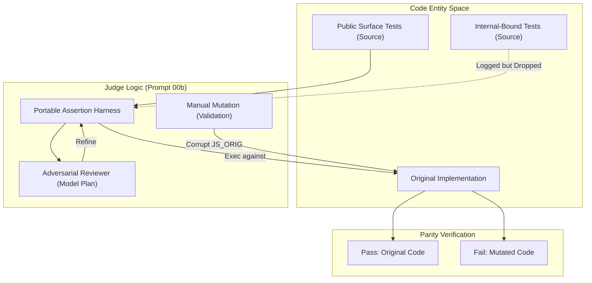
Sources: [prompts/00b-judge-setup.md:31-58](), [RUN-NOTES.md:48-52]()

---

## 0.3 Cost Tracking and State

Both Prompts 00 and 00b require the agent to maintain a `migration/cost-log.tsv`. This file tracks the wall-clock time, token usage, and model tiers used at each gate [prompts/00-feasibility.md:75-80](), [prompts/00b-judge-setup.md:65-70]().

**Cost Log Schema**
| Column | Description |
| :--- | :--- |
| `step` | The prompt number (0 or 00b). |
| `timestamp` | ISO 8601 UTC timestamp. |
| `wall_clock_min` | Active minutes spent by the operator/agent. |
| `tokens` | Total tokens consumed. |
| `subagents` | Number of sub-agent calls spawned. |
| `model` | The specific model string used (e.g., `claude-3-5-sonnet-20240620`). |

Sources: [prompts/00-feasibility.md:75-80](), [RUN-NOTES.md:107-108]()

---

# Page: Step 1: Dependency Map and Gap Inventory

# Step 1: Dependency Map and Gap Inventory

<details>
<summary>Relevant source files</summary>

The following files were used as context for generating this wiki page:

- [prompts/01-dependency-map.md](prompts/01-dependency-map.md)
- [prompts/02-gap-inventory.md](prompts/02-gap-inventory.md)
- [scripts/depmap_c.py](scripts/depmap_c.py)
- [scripts/depmap_python.py](scripts/depmap_python.py)
- [scripts/depmap_ts.mjs](scripts/depmap_ts.mjs)
- [scripts/make_manifest.py](scripts/make_manifest.py)

</details>


The first technical step of the migration involves building a deterministic foundation for the work queue and identifying the semantic "gaps" that the rulebook must address. This phase transitions the project from feasibility assessment to actionable engineering artifacts.

## 1. Building the Deterministic Dependency Map

The **Dependency Map** is a non-negotiable prerequisite for migration. It ensures that files are translated in topological order (dependencies before dependents) and identifies **Strongly Connected Components (SCCs)**—circular dependencies that must be migrated as a single batch.

### Implementation Strategy
Rather than relying on LLM judgment to find imports, the kit uses deterministic scripts to parse the codebase. This ensures that the migration order is reproducible and verifiable [prompts/01-dependency-map.md:16-17]().

The kit provides three starter mappers:
*   **Python:** `scripts/depmap_python.py` uses the `ast` module to parse imports [scripts/depmap_python.py:25-26]().
*   **TypeScript/JS:** `scripts/depmap_ts.mjs` uses a line scanner for relative specifiers [scripts/depmap_ts.mjs:51-53]().
*   **C/C++:** `scripts/depmap_c.py` parses `#include` directives [scripts/depmap_c.py:30-30]().

### Data Flow: Code Entity Space to Dependency Graph
The following diagram illustrates how source code entities (files and imports) are transformed into the migration artifacts.

**Dependency Mapping Data Flow**
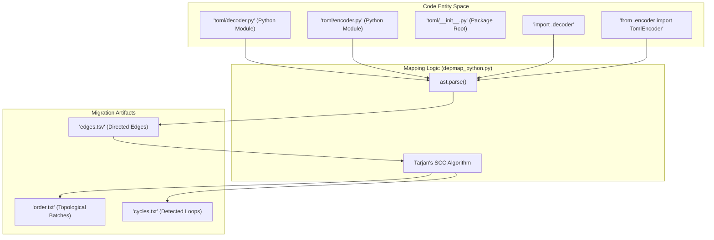
**Sources:** [scripts/depmap_python.py:88-107](), [scripts/depmap_python.py:110-160](), [prompts/01-dependency-map.md:25-31]()

### Adversarial Review of the Map
Once the script generates a map, it must pass a "Skeptic Review" before the manifest is built:
1.  **Two Reviewers:** Two separate agent contexts (per the Model Plan) verify the map [prompts/01-dependency-map.md:33-35]().
2.  **Sampling:** Each reviewer checks 20 files. One focuses on the largest/macro-heavy files; the other focuses on platform-specific and generated files to ensure they are correctly excluded [prompts/01-dependency-map.md:37-39]().
3.  **Evidence-Based:** Reviewers must provide file:line evidence for every edge they find [prompts/01-dependency-map.md:40-41]().
4.  **Zero-Tolerance:** Any confirmed discrepancy is treated as a bug in the **script**, not the map. The script is fixed, and the entire map is regenerated [prompts/01-dependency-map.md:47-49]().

**Sources:** [prompts/01-dependency-map.md:33-54]()

---

## 2. Manifest Generation

The `manifest.tsv` is the master work queue for the migration. It is generated from the topological `order.txt` using `scripts/make_manifest.py`.

### The Substitution Contract
The manifest builder applies string substitutions to map source paths to target paths, encoding the naming rules defined in Section 4 of the `RULEBOOK.md` [scripts/make_manifest.py:12-13]().

**Example Command:**
```bash
python3 scripts/make_manifest.py \
    --order migration/depmap/order.txt \
    --out migration/manifest.tsv \
    --sub 'toml/=src/' \
    --sub '.py=.ts'
```
[prompts/01-dependency-map.md:58-61]()

The script enforces a safety check: if a derived target path is identical to the source path, it exits with an error to prevent accidental overwrites [scripts/make_manifest.py:57-64]().

**Sources:** [scripts/make_manifest.py:4-15](), [scripts/make_manifest.py:47-72]()

---

## 3. Gap Inventory

The **Gap Inventory** identifies semantic concepts that exist in the target language but are implicit or "in the programmer's head" in the source language (e.g., Rust lifetimes, TypeScript strict nullability, or C++ ownership) [prompts/02-gap-inventory.md:5-9]().

### Inventory Structure
The inventory is a flat TSV file (`migration/inventory.tsv`) that implementers grep during Step 3 [prompts/02-gap-inventory.md:14-16]().

| Column | Purpose |
| :--- | :--- |
| **File** | Repo-relative path to the source file. |
| **Symbol** | The function, variable, or class name. |
| **Source Construct** | The specific code snippet (e.g., `def parse(s):`). |
| **Classification** | The gap type (e.g., `NULLABILITY`, `LIFETIME`). |
| **Target Translation** | The determined target representation (e.g., `string | null`). |
| **Evidence** | Call sites or logic that prove the classification. |
| **Status** | `PROPOSED`, `CONFIRMED`, or `UNKNOWN`. |

**Sources:** [prompts/02-gap-inventory.md:16-18](), [templates/inventory.tsv]() (referenced)

### Joint Audit and Skeptic Review
The inventory is built through a rigorous adversarial process:
1.  **Skeptic Review:** Two reviewers independently attack each entry, requiring line-level evidence to justify the proposed translation [prompts/02-gap-inventory.md:35-39]().
2.  **Handling Uncertainty:** If a row remains contested, it is marked `UNKNOWN`. It still receives a deterministic "most conservative" translation plus a greppable `TODO(port)` marker so the migration can proceed without stalling [prompts/02-gap-inventory.md:42-47]().
3.  **Joint Audit:** Adversarial agents read the inventory and the `RULEBOOK.md` together to find contradictions (e.g., a rule that contradicts a specific inventory row) [prompts/02-gap-inventory.md:62-66]().

### Mapping Gaps to Code Symbols
The following diagram shows how the Gap Inventory bridges the gap between source logic and target constraints.

**Gap Inventory Symbol Mapping**
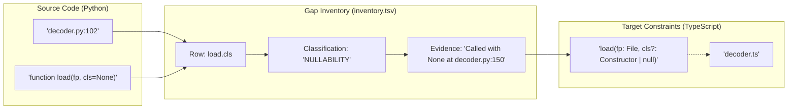
**Sources:** [prompts/02-gap-inventory.md:14-22](), [prompts/02-gap-inventory.md:32-34]()

### Progress Invariants
During the fan-out phase of building the inventory, the orchestrator monitors "shard" files (`migration/inventory.<category>.tsv`). A progress invariant is enforced: shard row counts must grow every three minutes, or the worker is treated as failed [prompts/02-gap-inventory.md:51-60]().

**Sources:** [prompts/02-gap-inventory.md:51-60]()

---

# Page: Step 2: Stress-Testing the Rulebook

# Step 2: Stress-Testing the Rulebook

<details>
<summary>Relevant source files</summary>

The following files were used as context for generating this wiki page:

- [RUN-NOTES.md](RUN-NOTES.md)
- [prompts/03-stress-test.md](prompts/03-stress-test.md)
- [templates/settings.README.md](templates/settings.README.md)
- [templates/settings.json](templates/settings.json)

</details>


Step 2 (Prompt 03) is the final validation gate before the high-volume translation fan-out begins. Its purpose is to expose gaps, silences, and contradictions in the `RULEBOOK.md` by forcing it to compete against a "Native" translation in a controlled bakeoff. This step ensures that the rules—rather than the model's unguided intuition—drive the migration [prompts/03-stress-test.md:13-17]().

## The Validation Logic

The stress test operates on a "Rulebook as Defendant" model. By the end of this step, the rulebook is either proven sufficient or amended via the **Amendment Queue**.

### 1. Settings Verification
Before execution, the orchestrator must verify the presence of `.claude/settings.json` [prompts/03-stress-test.md:19-22](). This file contains the `deny` rules that prevent sub-agents from accidentally mutating the git state or invoking the compiler prematurely [templates/settings.json:1-22]().
*   **Verification:** If the file is missing, the agent must halt and request installation [prompts/03-stress-test.md:22-24]().
*   **Model Plan Adherence:** Every sub-agent call (Translator, Reviewer, Inspector) must explicitly use the model tier defined in the Step 0 Feasibility Report [prompts/03-stress-test.md:30-34]().

### 2. File Selection (The "Risky" Subset)
The agent selects a small number of files (typically 3) based on objective criteria rather than random sampling [prompts/03-stress-test.md:36-39]().
*   **Scoring:** Candidates are scored by the density of **Gap Inventory** rows and **Rulebook** sections they exercise [prompts/03-stress-test.md:36-38]().
*   **Reporting:** The selection, with line-level proof of why these files are difficult, is recorded in `migration/stress-test/selection.md` [prompts/03-stress-test.md:38-41]().

## Dual-Translator Bakeoff

The bakeoff uses two independent translation paths to identify where the rulebook is failing to provide enough guidance or is providing the *wrong* guidance.

### Data Flow: The Bakeoff Architecture

The following diagram illustrates the isolation between the Rule-Following agent and the Native agent, and how the Diff Inspector reconciles them.

**Bakeoff Isolation and Inspection**
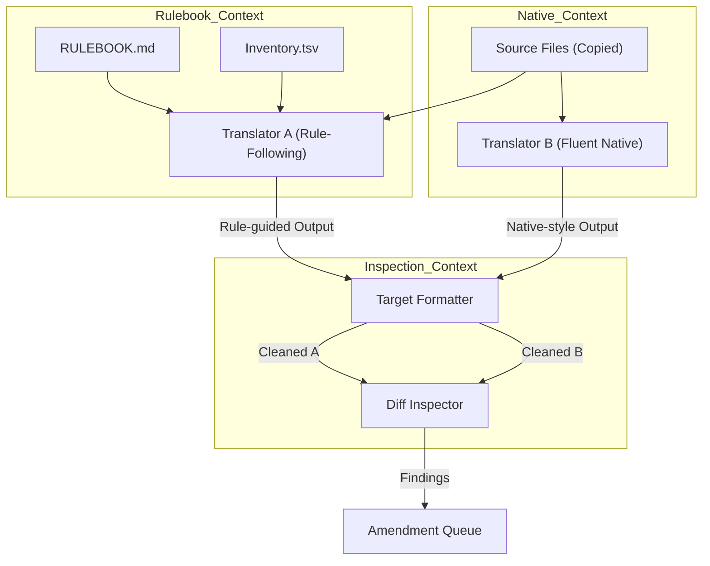
Sources: [prompts/03-stress-test.md:43-62](), [RUN-NOTES.md:32-37]()

| Agent | Context | Instruction | Goal |
| :--- | :--- | :--- | :--- |
| **Translator A** | Repo Worktree | Follow `RULEBOOK.md` to the letter. Cite rules for every choice. | Test rule coverage and clarity. |
| **Translator B** | Scratch Dir (Outside Repo) | Port as a fluent engineer in the target language. No access to Rulebook. | Establish a "gold standard" baseline. |
| **Diff Inspector** | Full Access | Compare A and B after formatting. Categorize every difference. | Identify rule silences or errors. |

## The Pilot Run

Simultaneous with the bakeoff, the agent executes a **Pilot Run**. This uses the production pipeline topology (Implementer + 2 Adversarial Reviewers + 1 Fixer) on the same selected files [prompts/03-stress-test.md:64-66]().

The Pilot Run tests **Process Adherence**:
*   Do the reviewers catch rule violations?
*   Does the fixer resolve conflicts without violating the rulebook?
*   Does the "Implementer" attempt to ignore the rules in favor of native intuition? [prompts/03-stress-test.md:67-70]()

## Amendment Queue and Re-round Logic

The output of Step 2 is not code, but a list of proposed changes to the `RULEBOOK.md`. These are queued for human approval at the gate [prompts/03-stress-test.md:72-74]().

### The Re-round Trigger
If material amendments are applied, a **Re-round** is triggered [prompts/03-stress-test.md:78-82]().
1.  **Fresh Files:** The bakeoff is repeated on a *new* set of files to ensure the amendments didn't just fix the specific instances but the underlying logic [prompts/03-stress-test.md:81-82]().
2.  **Weighted Selection:** New files are weighted toward the sections that were just amended [prompts/03-stress-test.md:81-82]().
3.  **Termination:** If the same section requires amendment twice, the loop halts for human intervention [prompts/03-stress-test.md:83-84]().

### Implementation: Step 2 State Machine

The following diagram maps the logical flow of Prompt 03 to the file system artifacts and gate conditions.

**Step 2 Execution Flow**
```mermaid
stateDiagram-v2
    [*] --> SettingsCheck
    SettingsCheck --> FileSelection: .claude/settings.json exists
    SettingsCheck --> HALT: Settings missing
    
    FileSelection --> Bakeoff_and_Pilot
    
    state Bakeoff_and_Pilot {
        direction LR
        Translator_A --> DiffInspector
        Translator_B --> DiffInspector
        Implementer --> Reviewers --> Fixer
    }
    
    Bakeoff_and_Pilot --> AmendmentQueue: Generate Report
    AmendmentQueue --> Gate: Human Review
    
    Gate --> ReRound: Amendments Applied
    Gate --> Step3_FanOut: Sign-off
    
    ReRound --> Bakeoff_and_Pilot: Fresh Files
```
Sources: [prompts/03-stress-test.md:19-86](), [RUN-NOTES.md:32-37]()

## Cost Logging
Upon completion of each round, the agent appends a row to `migration/cost-log.tsv` [prompts/03-stress-test.md:89-94](). This log tracks:
*   Wall-clock time for the stress test.
*   Total tokens consumed by sub-agents.
*   The specific model tiers used (e.g., `claude-3-5-sonnet-20240620`).

Sources:
* `prompts/03-stress-test.md`
* `templates/settings.json`
* `templates/settings.README.md`
* `RUN-NOTES.md`

---

# Page: Step 3: Translation Fan-Out

# Step 3: Translation Fan-Out

<details>
<summary>Relevant source files</summary>

The following files were used as context for generating this wiki page:

- [RUN-NOTES.md](RUN-NOTES.md)
- [prompts/04-translation-kickoff.md](prompts/04-translation-kickoff.md)
- [scripts/queue_runner.mjs](scripts/queue_runner.mjs)

</details>


Step 3 is the primary execution phase of the migration. Driven by **prompt 04**, the system transitions from planning and validation into bulk translation. This phase utilizes a high-concurrency, multi-agent topology to process the work queue defined in the manifest, enforcing progress invariants through filesystem state rather than volatile memory.

## Overview and Objectives

The goal of Step 3 is to translate every source file listed in `migration/manifest.tsv` into its target equivalent while adhering strictly to the **RULEBOOK.md** [prompts/04-translation-kickoff.md:13-14](). 

Key characteristics of this phase include:
*   **Queue-on-Disk**: The "done-ness" of the migration is determined by the presence of target files on disk [scripts/queue_runner.mjs:8-10]().
*   **Adversarial Topology**: Each file is processed by a minimum of four agents to prevent "hallucinated" correctness [prompts/04-translation-kickoff.md:45-49]().
*   **Referee Enforcement**: Claude Code is forbidden from running the compiler/test-runner unless the "Cheap Referee" dissolve option is active [prompts/04-translation-kickoff.md:43-45]().

### Data Flow: Translation Loop

The following diagram illustrates how the `queue_runner.mjs` script interacts with the file system and the agent pool to drive the migration forward.

**Translation Orchestration Flow**
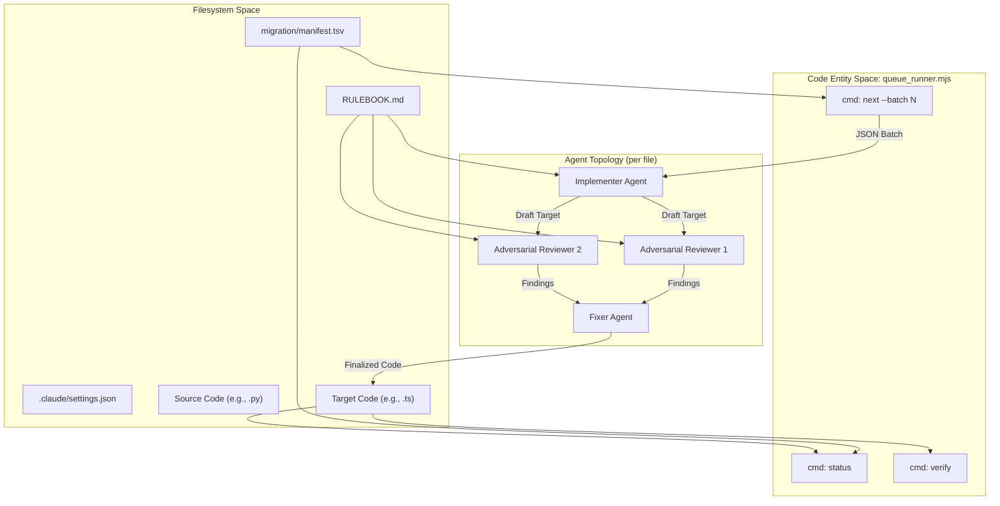
**Sources:** [scripts/queue_runner.mjs:18-35](), [prompts/04-translation-kickoff.md:34-42]()

---

## The Four-Agent Topology

To ensure high-fidelity translation, every manifest entry is subjected to a four-agent pipeline. This structure is designed to catch the "exact failure classes" that single-agent translations often miss, such as cross-file type conflicts or subtle logic shifts [RUN-NOTES.md:45-49]().

| Agent Role | Model | Responsibility |
| :--- | :--- | :--- |
| **Implementer** | `[implementer model]` | Translates one source file to the target language. Inserts `[TODO(port)]`, `[PERF(port)]`, or `[BUG(port)]` markers for any ambiguity [prompts/04-translation-kickoff.md:37-38](). |
| **Reviewer 1** | `[reviewer model]` | Adversarial review in a fresh context. Must cite specific rules or source lines for every finding [prompts/04-translation-kickoff.md:39-40](). |
| **Reviewer 2** | `[reviewer model]` | Independent adversarial review. Does not see Reviewer 1's findings [prompts/04-translation-kickoff.md:39-40](). |
| **Fixer** | `[implementer model]` | Reconciles findings. Applies only confirmed defects. If Reviewers disagree, a third referee agent defaults to "not-confirmed" [prompts/04-translation-kickoff.md:40-42](). |

**Sources:** [prompts/04-translation-kickoff.md:29-32](), [prompts/04-translation-kickoff.md:37-49](), [RUN-NOTES.md:56-62]()

---

## Mechanics of `queue_runner.mjs`

The `queue_runner.mjs` script provides the mechanical backbone for the fan-out. It treats the filesystem as the source of truth for the migration state, allowing for seamless resumption after crashes or session timeouts.

### Key Functions and Commands

*   **`status`**: Calculates burndown by checking `existsSync(target)` for every entry in the manifest [scripts/queue_runner.mjs:71-84]().
*   **`next --batch [N]`**: Returns a JSON array of the next `N` pending units. This is used by the orchestrator to define the current work scope [scripts/queue_runner.mjs:85-88]().
*   **`verify`**: Checks that all files marked as "done" have a non-zero size (`statSync(u.target).size !== 0`). This prevents the "touch-the-file" cheat where an agent creates an empty file to trick the status checker [scripts/queue_runner.mjs:89-96]().

### Progress Invariants
The orchestrator must enforce that the translated-file count on disk grows between polls. If a worker fails to produce growth for three minutes, it is treated as a stall and must be recovered from the journal or disk [prompts/04-translation-kickoff.md:51-53]().

**Sources:** [scripts/queue_runner.mjs:5-14](), [scripts/queue_runner.mjs:60-63](), [prompts/04-translation-kickoff.md:51-53]()

---

## The Cheap-Referee Dissolve Option

In some migrations, the target language compiler (e.g., `tsc` for TypeScript) is fast enough to be run inside the translation loop. This is known as the **Cheap-Referee Dissolve**.

*   **Standard Path**: Agents are forbidden from running the compiler via `.claude/settings.json` deny rules [prompts/04-translation-kickoff.md:18-28](). Errors are caught in Step 4.
*   **Dissolved Path**: If specified in the Rulebook (§0), the Implementer or Fixer may run the compiler to check the specific file being translated [prompts/04-translation-kickoff.md:43-45]().

In **Run 1 (Python to TS)**, the `tsc` compiler was used as a cheap referee. Even with this, skipping the adversarial review stage led to cross-file type conflicts that only the compiler caught, proving that the reviewer topology is necessary even with a cheap referee [RUN-NOTES.md:56-62]().

**Sources:** [RUN-NOTES.md:43-47](), [RUN-NOTES.md:66-68](), [prompts/04-translation-kickoff.md:43-45]()

---

## Cost Tracking and Reporting

At each batch gate, the orchestrator appends a timestamped entry to `migration/cost-log.tsv`. This ensures that migration costs are reconstructable and not lost to session history [prompts/04-translation-kickoff.md:58-63]().

**Cost Log Schema**
| Field | Description | Example |
| :--- | :--- | :--- |
| `step` | Current pipeline step (3) | `3` |
| `timestamp` | ISO 8601 UTC time | `2026-06-11T14:02Z` |
| `wall_clock_min` | Real-world minutes elapsed | `21` |
| `tokens` | Total tokens consumed | `2035336` |
| `subagents` | Number of subagent calls | `35` |
| `model` | Primary model used | `claude-sonnet-4-6` |

**Sources:** [prompts/04-translation-kickoff.md:58-63](), [RUN-NOTES.md:107-108]()

---

# Page: Step 4: Survey Build and Step 5–6: Parity

# Step 4: Survey Build and Step 5–6: Parity

<details>
<summary>Relevant source files</summary>

The following files were used as context for generating this wiki page:

- [RUN-NOTES.md](RUN-NOTES.md)
- [prompts/05-survey-build.md](prompts/05-survey-build.md)
- [scripts/build_daemon.sh](scripts/build_daemon.sh)

</details>


This section details the final stages of the migration pipeline, moving from individual file translations to system-wide integration. It covers the execution of the **Survey Build** (Step 4), which resolves cross-file type and symbol conflicts, followed by **Smoke Testing** (Step 5) and the **Parity Referee** (Step 6) to ensure functional equivalence with the source system.

## Step 4: The Survey Build

The Survey Build phase resolves integration errors that only appear when the translated files are compiled or linked together. This phase is governed by `prompts/05-survey-build.md` [prompts/05-survey-build.md:1-53]().

### The Build Daemon Strategy
In high-integrity migrations, fixers (LLMs) are denied direct access to the compiler to prevent "guess-and-check" loops that bypass the Rulebook. Instead, a central process—the `build_daemon.sh`—owns the compiler [scripts/build_daemon.sh:6-11]().

1.  **Change Detection**: The daemon monitors the source tree using a content hash, excluding directories like `.git`, `node_modules`, and the `migration/` output folder [scripts/build_daemon.sh:78-90]().
2.  **Round Management**: Every time a change is detected, the daemon executes the configured `[build command]` and captures the output into a new file: `migration/build-output-r<N>.txt` [scripts/build_daemon.sh:105-113]().
3.  **State Persistence**: The daemon auto-increments round numbers based on the filesystem, ensuring the migration state is resumable even if the session restarts [scripts/build_daemon.sh:92-103]().

### Data Flow: Build to Fixer
The following diagram illustrates the quarantine boundary between the compiler and the fix agents.

**Figure 1: Survey Build Quarantine Topology**
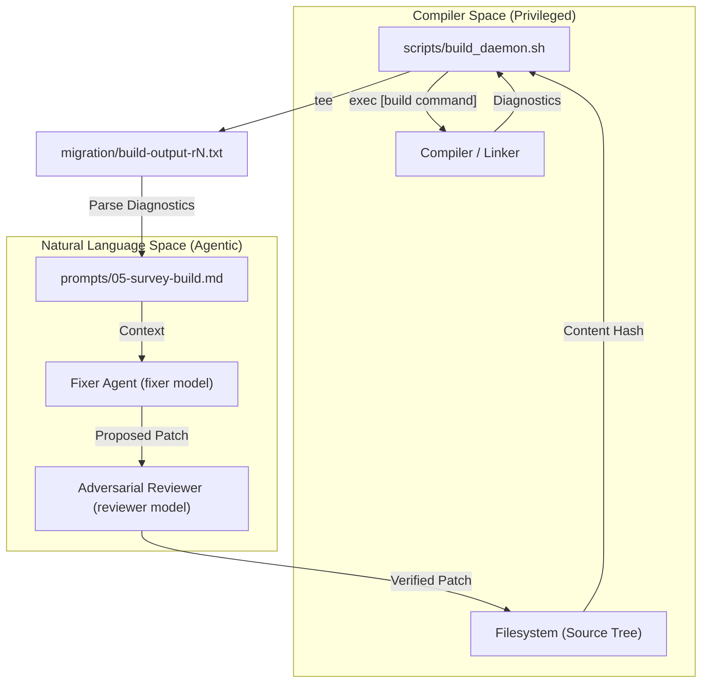
**Sources:** [prompts/05-survey-build.md:12-26](), [scripts/build_daemon.sh:1-33]()

### Fixer Workflow
Fixers process the `build-output-rN.txt` file by:
*   Parsing diagnostics into a machine queue (TSV) containing file, module, error code, and message [prompts/05-survey-build.md:12-16]().
*   Ordering the queue from **leaves to root** based on the dependency map generated in Step 1 [prompts/05-survey-build.md:13-16]().
*   Writing patches without running the compiler, relying solely on the error text and the Rulebook [prompts/05-survey-build.md:18-19]().
*   Performing a **Mechanical Trailer Check**: Verifying that the `grep -c 'TODO(port)'` count matches the `todos=` value in the file's `PORT STATUS` trailer [prompts/05-survey-build.md:37-40]().

## Step 5: Smoke Testing

Step 5 is the "Hello World" of the migrated system. It involves running the minimal execution path to verify the target environment is correctly configured.

*   **Objective**: Verify that the translated code can load, resolve its own dependencies, and execute a trivial entry point.
*   **Protocol**: If the smoke test fails, the failure is treated as a Survey Build error. The `build_daemon.sh` is used to capture the runtime crash/traceback, and the fixer cycle repeats.

## Step 6: Parity and the Referee

The migration exit condition is defined by **Parity**: the translated code must behave identically to the source code across a defined suite of inputs.

### The Parity Referee
When the original test suite cannot be easily ported (e.g., it relies on language-specific internals), a **Parity Referee** is used [RUN-NOTES.md:8-10](). This is a dual-sided harness that:
1.  Feeds the same input to both the **Source Implementation** and the **Target Implementation**.
2.  Normalizes both outputs (e.g., converting to JSON, sorting keys, handling floating-point NaN/-Infinity) [RUN-NOTES.md:48-52]().
3.  Diffs the results.

### Inherited Suite Burndown
If the source project has a portable test suite (e.g., a set of C integration tests being migrated to Rust), Step 6 focuses on "Burndown"—systematically fixing failures until the target passes all tests inherited from the source [RUN-NOTES.md:78-80]().

**Figure 2: Parity Referee Execution**
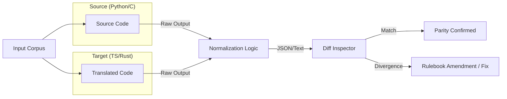
**Sources:** [RUN-NOTES.md:11-16](), [RUN-NOTES.md:48-52]()

### Exit Conditions
A migration is considered complete when:
1.  **Zero Diagnostics**: The `build_daemon.sh` reports a clean exit for the build command [prompts/05-survey-build.md:26-26]().
2.  **Zero Divergence**: The Parity Referee or inherited suite reports 100% pass rate [RUN-NOTES.md:12-13]().
3.  **Trailer Invariant**: All files have a `PORT STATUS` trailer where `todos=0` and `status=parity` [prompts/05-survey-build.md:37-40]().
4.  **Cost Logged**: A final entry is appended to `migration/cost-log.tsv` [prompts/05-survey-build.md:44-52]().

| Phase | Referee Type | Primary Tool | Exit Criteria |
| :--- | :--- | :--- | :--- |
| **Step 4** | Static/Compiler | `build_daemon.sh` | Zero errors in `build-output-rN.txt` |
| **Step 5** | Runtime/Basic | `node` / `cargo run` | Successful execution of entry point |
| **Step 6** | Functional/Adversarial | Parity Harness | Byte-identical output or 0 test failures |

**Sources:** [prompts/05-survey-build.md:1-53](), [scripts/build_daemon.sh:1-125](), [RUN-NOTES.md:6-16]()

---

# Page: Step 6 Post-Parity: Burndown and Cleanup

# Step 6 Post-Parity: Burndown and Cleanup

<details>
<summary>Relevant source files</summary>

The following files were used as context for generating this wiki page:

- [RUN-NOTES.md](RUN-NOTES.md)
- [prompts/06-post-parity.md](prompts/06-post-parity.md)

</details>


Step 6 represents the final phase of the migration lifecycle. It is initiated only after the "Step 6 done-gate" has been satisfied: every parity test must pass, and the original suite must run clean on the original code [prompts/06-post-parity.md:3-5](). This phase shifts the focus from "bug-for-bug fidelity" to "production readiness" by resolving the technical debt deliberately deferred during the translation process.

## Purpose and Scope

The primary objective of Step 6 is to process the markers left by implementers during Step 3 and Step 4. These markers—`BUG(port)`, `TODO(port)`, and `PERF(port)`—represent known divergences or optimizations that were sidelined to maintain a structure-preserving posture [prompts/06-post-parity.md:11-12]().

The scope includes:
1.  **Mechanical Discovery**: Exhaustive collection of all markers via grep [prompts/06-post-parity.md:13-14]().
2.  **Classification**: Determining which markers require immediate fixes versus those that are documented and closed [prompts/06-post-parity.md:16-17]().
3.  **Atomic Fixes**: Shipping each "fix-now" item as an individual, verified change that re-runs the parity referee [prompts/06-post-parity.md:20-22]().

Sources: [prompts/06-post-parity.md:1-25]()

## Implementation Workflow

The burndown process follows a strict sequence to ensure that the parity achieved in Step 5 is not compromised by cleanup efforts.

### The Burndown Pipeline

Title: Step 6 Burndown Logic
```mermaid
graph TD
    "START[Step 6 Gate]" --> "GREP[Mechanical Grep]"
    "GREP" --> "REPORT[Marker Count Receipt]"
    "REPORT" --> "CLASS[Classification Table]"
    
    subgraph "Classification Logic"
    "CLASS" --> "FIX_NOW[Fix Now]"
    "CLASS" --> "DOC_CLOSE[Document & Close]"
    end
    
    "DOC_CLOSE" --> "RM_MARKER[Remove Marker + Document]"
    "FIX_NOW" --> "ATOMIC_FIX[Atomic Change]"
    
    "ATOMIC_FIX" --> "REF_CHECK[Parity Referee Run]"
    "REF_CHECK" --> "VERIFY[Verify: Only Target Behavior Changed]"
    
    "VERIFY" --> "SIGN_OFF[Human Sign-off]"
    "RM_MARKER" --> "SIGN_OFF"
    "SIGN_OFF" --> "COST[Append migration/cost-log.tsv]"
    "COST" --> "END[Migration Complete]"
```
Sources: [prompts/06-post-parity.md:11-30]()

### Marker Classifications

Implementers are required to use specific markers during the translation fan-out. Prompt 06 treats these as the source of truth for the burndown [prompts/06-post-parity.md:12-14]().

| Marker | Description | Handling in Step 6 |
| :--- | :--- | :--- |
| `BUG(port)` | A known bug in the source that was replicated for fidelity. | Usually **Fix Now** if the target environment allows, or **Document** if it's a "feature-bug". |
| `TODO(port)` | A deferred implementation detail (e.g., a complex regex or a library shim). | Classified based on criticality to the production release. |
| `PERF(port)` | An optimization opportunity where structure-preservation caused a slowdown. | Evaluated against performance requirements defined in Step 0. |

Sources: [prompts/06-post-parity.md:11-18](), [RUN-NOTES.md:41-42](), [RUN-NOTES.md:79-80]()

## Data Flow: From Code to Cost Log

The burndown process bridges the "Natural Language Space" of the classification table with the "Code Entity Space" of the repository and the "Accounting Space" of the migration log.

Title: Step 6 Data Flow and State Transitions
```mermaid
flowchart LR
    subgraph "Code Entity Space"
    "FILES[Target Tree]" -- "grep" --> "MARKERS[BUG/TODO/PERF Markers]"
    "MARKERS" -- "apply fix" --> "DIFF[Atomic Git Change]"
    end

    subgraph "Natural Language Space"
    "MARKERS" -- "classify" --> "TABLE[Classification Table]"
    "TABLE" -- "reasoning" --> "DECISION[Fix vs Document]"
    "DECISION" --> "DIFF"
    end

    subgraph "Accounting Space"
    "DIFF" -- "verify" --> "PARITY_RES[Parity Results]"
    "PARITY_RES" -- "timestamp" --> "COST_LOG[migration/cost-log.tsv]"
    end
```
Sources: [prompts/06-post-parity.md:13-18](), [prompts/06-post-parity.md:27-33]()

## Key Requirements for Verification

### Atomic Changes
Each "fix-now" marker must be shipped as its own change. If a fix impacts more than the specific behavior identified by the marker, it is rejected by the reviewer and must be split into two separate changes [prompts/06-post-parity.md:20-23]().

### The Reviewer Model
Reviews must be conducted using the `[reviewer model]` specified in the Model Plan from the feasibility gate (Step 0). Inheriting the session default model without explicit authorization is considered a process deviation and must be logged [prompts/06-post-parity.md:6-7](), [prompts/06-post-parity.md:23-24]().

### Cost Logging
Upon completion, a single timestamped entry is appended to `migration/cost-log.tsv`. This file tracks the wall-clock time, token usage, and subagent counts for the burndown [prompts/06-post-parity.md:29-34]().

| Column | Example Value |
| :--- | :--- |
| `step` | `6` |
| `timestamp` | `2026-06-11T14:02Z` |
| `wall_clock_min` | `21` |
| `tokens` | `2035336` |
| `subagents` | `35` |
| `model` | `claude-sonnet-4-6` |

Sources: [prompts/06-post-parity.md:29-34](), [RUN-NOTES.md:107-108]()

---

# Page: Templates and Configuration

# Templates and Configuration

<details>
<summary>Relevant source files</summary>

The following files were used as context for generating this wiki page:

- [templates/RULEBOOK.md](templates/RULEBOOK.md)
- [templates/inventory.tsv](templates/inventory.tsv)
- [templates/settings.README.md](templates/settings.README.md)
- [templates/settings.json](templates/settings.json)

</details>


The Claude Code Migration Kit relies on a set of standardized templates to ensure consistency across large-scale translation projects. These templates are not mere suggestions; they represent the "source of truth" for both human orchestrators and the automated Claude Code agents. By formalizing rules, inventorying technical gaps, and restricting environment mutations, the kit prevents the "museum of styles" that typically plagues multi-agent migrations.

### Configuration Overview

The migration environment is governed by three primary artifacts located in the `templates/` directory. These files must be customized and deployed to the target repository before the fan-out phase begins.

| Template | Role | Phase |
| :--- | :--- | :--- |
| `RULEBOOK.md` | The "Meta-Rule": Defines translation logic, naming, and posture. | Steps 2-6 |
| `settings.json` | The "Guardrails": Hard-coded command bans for Claude Code. | Steps 2-4, 6 |
| `inventory.tsv` | The "Gap Map": Pre-decided mappings for complex symbols. | Steps 1-3 |

### The Rulebook Template
The `templates/RULEBOOK.md` is the most critical document in the kit. It operates on a fundamental meta-rule: **if two agents could answer a question differently, the answer must go in this file** [templates/RULEBOOK.md:3-6](). 

It covers seven key sections, including the migration posture (e.g., structure-preserving), ecosystem adoption (what to ban from the target standard library), and the "BUG rule"—the requirement to reproduce source defects bug-for-bug to ensure parity before fixing them [templates/RULEBOOK.md:14-61]().

For details, see [The Rulebook Template](#3.1).

### Settings and Deny Rules
The `templates/settings.json` file is a Claude Code permissions configuration. It is designed to be copied into the target repository's `.claude/settings.json` [templates/settings.README.md:3-9](). 

Its primary purpose is to enforce the **process-first doctrine** by banning destructive or distracting commands. For example, `git reset` and `git clean` are banned because they can destroy the in-flight work of parallel agents [templates/settings.README.md:18-27](). Similarly, compilers are often banned during translation to prevent agents from "playing it safe" and deviating from the Rulebook just to satisfy a type-checker [templates/settings.README.md:29-37]().

For details, see [Settings and Deny Rules](#3.2).

### Gap Inventory Template
The `templates/inventory.tsv` provides a schema for tracking technical gaps that cannot be solved by a general rule. It uses a specific vocabulary to distinguish between different types of guards—specifically `allocation-guard` vs `precondition-guard`—to ensure error recovery logic is ported correctly [templates/inventory.tsv:1-2]().

The inventory serves as the delegation target for implementers: if a complex symbol or lifetime issue isn't in the inventory, it is treated as an "inventory bug" rather than something for the implementer to invent on the fly [templates/RULEBOOK.md:106-112]().

For details, see [Gap Inventory Template](#3.3).

### Template Interaction Model

The following diagram illustrates how these templates bridge the gap between high-level migration strategy and the specific code entities being manipulated.

**Figure 1: Configuration to Code Entity Mapping**
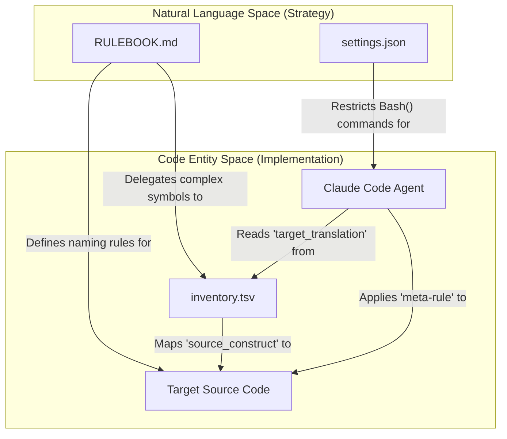
**Sources:** [templates/RULEBOOK.md:3-6](), [templates/RULEBOOK.md:106-112](), [templates/settings.json:1-33](), [templates/inventory.tsv:2-5]()

### Resumability and State
The kit uses the filesystem as the state machine. The `RULEBOOK.md` defines the naming and output path conventions that allow the `queue_runner.mjs` to detect "done-ness" simply by checking if a file exists on disk [templates/RULEBOOK.md:90-93](). This ensures that if a migration is interrupted, it can be resumed without re-translating files or losing track of the gap inventory status.

**Figure 2: State Detection via Configuration**
```mermaid
graph LR
    subgraph "State Definition"
        PathRule["RULEBOOK.md §4: Naming/Paths"]
        Inventory["inventory.tsv: status column"]
    end

    subgraph "Automation Logic"
        QR["queue_runner.mjs"]
        BD["build_daemon.sh"]
    end

    subgraph "Filesystem State"
        TargetFile["translated_file.ts"]
        BuildOut["build-output-rN.txt"]
    end

    PathRule --> QR
    QR -- "Checks existence of" --> TargetFile
    Inventory -- "Validates" --> TargetFile
    BD -- "Generates" --> BuildOut
```
**Sources:** [templates/RULEBOOK.md:90-96](), [templates/inventory.tsv:2-5](), [templates/settings.README.md:33-37]()

***

**Child Pages:**
- [The Rulebook Template](#3.1)
- [Settings and Deny Rules](#3.2)
- [Gap Inventory Template](#3.3)

---

# Page: The Rulebook Template

# The Rulebook Template

<details>
<summary>Relevant source files</summary>

The following files were used as context for generating this wiki page:

- [CLAUDE.md](CLAUDE.md)
- [README.md](README.md)
- [templates/RULEBOOK.md](templates/RULEBOOK.md)

</details>


The Rulebook Template (`templates/RULEBOOK.md`) is the central governing document for any migration using this kit. It operates on the **Meta-Rule**: if two agents could answer a question differently, the answer belongs in the rulebook [templates/RULEBOOK.md:3-6](). It is designed to be read-only during active translation loops to prevent agents from relaxing their own grading criteria [CLAUDE.md:16-19]().

## Purpose and Posture

The rulebook serves as the primary prompt for implementers, reviewers, and fixers [templates/RULEBOOK.md:4-5](). Its core philosophy is that individual code failures are symptoms of process failures; fixing a recurring error requires amending the rulebook rather than patching instances [CLAUDE.md:44-47]().

By default, the kit assumes a **structure-preserving** posture: same architecture, same data structures, and same file boundaries [templates/RULEBOOK.md:16-19]().

### The Rulebook Lifecycle

```mermaid
graph TD
    subgraph "Phase 1: Definition"
        A["templates/RULEBOOK.md"] -- "Copy to" --> B["migration/RULEBOOK.md"]
        C["Prompt 00: Feasibility"] -- "Sets Posture" --> B
        D["Prompt 01 & 02"] -- "Populate Mappings" --> B
    end

    subgraph "Phase 2: Validation (Step 2)"
        B -- "Input to" --> E["Dual-Translator Bakeoff"]
        E -- "Rule Divergence" --> F["Amendment Queue"]
        F -- "Human Review" --> B
    end

    subgraph "Phase 3: Execution (Step 3-4)"
        B -- "Read-Only Context" --> G["Implementer Agent"]
        B -- "Read-Only Context" --> H["Adversarial Reviewers"]
        G -- "Produces" --> I["Translated Code"]
        H -- "Cites Rules" --> J["Findings/Fixes"]
    end

    subgraph "Phase 4: Finalization (Step 6)"
        B -- "Log Deviations" --> K["Deviation Log"]
    end
```
**Sources:** [CLAUDE.md:62-69](), [README.md:73-83](), [templates/RULEBOOK.md:3-6]()

---

## The Seven Sections

### 0. Scope and Posture
Defines the high-level constraints of the migration. It explicitly bans running the compiler during the initial translation phase (unless a "cheap-referee" like `tsc` is authorized) to ensure agents focus on semantic fidelity rather than just satisfying a borrow checker [templates/RULEBOOK.md:20-22]().

### 1. Ecosystem Adoption
A decision matrix for mapping source paradigms to target idioms. This prevents the codebase from becoming a "museum of styles" by forcing a single choice for async models, I/O libraries, and string handling [templates/RULEBOOK.md:27-38]().

### 2. Construct Mappings
This section provides a canonical mapping for every source construct the target lacks (e.g., mapping C-style error unions to Rust `Result<T, E>`) [templates/RULEBOOK.md:41-55]().
*   **The BUG Rule:** Defective source behavior must be reproduced bug-for-bug and marked with `BUG(port):` to ensure parity is reachable before improvements are made [templates/RULEBOOK.md:57-61]().
*   **The UNKNOWN Rule:** If a mapping is missing, agents must use the most conservative representation and a `TODO(port):` marker rather than stalling the batch [templates/RULEBOOK.md:72-75]().

### 3. The Sanctioned Escape Hatch
Defines the "pressure valves" for code that cannot be expressed safely (e.g., `unsafe` blocks). It mandates specific, greppable markers: `TODO(port):`, `PERF(port):`, `BUG(port):`, and `SAFETY:` [templates/RULEBOOK.md:77-88]().

### 4. Naming and Output Paths
Crucial for the `queue_runner.mjs` logic. Because "done-ness" is determined by the presence of files on disk, naming rules must be deterministic (e.g., `.py` -> `.ts`) [templates/RULEBOOK.md:90-104]().

### 5. The Gap Inventory Delegation
Directs agents to `migration/inventory.tsv` for site-specific decisions regarding lifetimes, ownership, and nullability that cannot be generalized into global rules [templates/RULEBOOK.md:106-111]().

### 6. Per-file Obligations & 7. Deviation Log
Mandates a status trailer at the end of every file (`// PORT STATUS: confidence=...`) for reviewer verification [templates/RULEBOOK.md:113-119](). The Deviation Log records every departure from the process (e.g., skipped review passes), identified by IDs like `DEV-001` [templates/RULEBOOK.md:124-135]().

---

## Technical Data Flow: Rulebook to Code

The following diagram illustrates how specific rulebook sections map to code entities and markers during the `translation-kickoff` (Step 3).

```mermaid
graph LR
    subgraph "RULEBOOK.md (Natural Language Space)"
        R2["Section 2: Construct Mappings"]
        R3["Section 3: Escape Hatch"]
        R4["Section 4: Naming Rules"]
        R6["Section 6: Status Trailer"]
    end

    subgraph "Target Code (Code Entity Space)"
        T1["File Path: src/parser.ts"]
        T2["// BUG(port): reproduced overflow"]
        T3["// SAFETY: pointer offset"]
        T4["// PORT STATUS: confidence=high"]
    end

    R4 -.->|"Determines"| T1
    R2 -.->|"Generates"| T2
    R3 -.->|"Justifies"| T3
    R6 -.->|"Appends"| T4
```
**Sources:** [templates/RULEBOOK.md:57-61](), [templates/RULEBOOK.md:85-88](), [templates/RULEBOOK.md:92-96](), [templates/RULEBOOK.md:115-119]()

## Implementation Details

### Marker Schema
The kit enforces a strict format for markers to ensure they are machine-searchable for the Step 6 burndown:
| Marker | Purpose | Section |
|---|---|---|
| `BUG(port):` | Replicated source defect for parity | §2 |
| `TODO(port):` | Deferred decision/UNKNOWN rule | §2, §3 |
| `PERF(port):` | Correct but slow translation | §0, §3 |
| `SAFETY:` | Justification for escape hatch use | §3 |

**Sources:** [templates/RULEBOOK.md:58-61](), [templates/RULEBOOK.md:74-75](), [templates/RULEBOOK.md:85-88]()

### The Meta-Rule Enforcement
The `CLAUDE.md` operating manual enforces that the rulebook is read-only inside loops [CLAUDE.md:16-19](). If an agent encounters a recurring failure, it is forbidden from fixing the instances manually; it must stop, document the rule failure, and queue an amendment for the human [CLAUDE.md:44-47](). This ensures that the model tiering strategy (where the largest models handle rule authorship) is not undermined by smaller models making ad-hoc decisions [CLAUDE.md:76-87]().

---

# Page: Settings and Deny Rules

# Settings and Deny Rules

<details>
<summary>Relevant source files</summary>

The following files were used as context for generating this wiki page:

- [RUN-NOTES.md](RUN-NOTES.md)
- [templates/settings.README.md](templates/settings.README.md)
- [templates/settings.json](templates/settings.json)

</details>


The `templates/settings.json` file serves as the mandatory permissions configuration for Claude Code during a migration. It enforces the "process-first" doctrine by programmatically restricting agents from performing destructive actions, bypassing the intended pipeline stages, or optimizing for the compiler at the expense of the Rulebook.

## Purpose and Scope

In a high-concurrency migration where dozens of agents may operate in parallel, the `settings.json` file acts as a mechanical guardrail. It ensures that agents remain within their assigned roles—such as "Implementer" or "Reviewer"—without accidentally mutating the global state of the repository or triggering expensive, redundant build processes [templates/settings.README.md:11-16]().

The rules are categorized into three primary bans:
1.  **Git Mutation Bans**: Prevent agents from destroying peer work or polluting the history.
2.  **Compiler Bans**: Force agents to prioritize Rulebook fidelity over "making it green."
3.  **Test Bans**: Prevent resource exhaustion and ensure fixers work from static evidence.

## Data Flow and Enforcement

The `settings.json` file must be manually installed into the target repository's `.claude/` directory before Step 2 (the Pilot run) [templates/settings.README.md:3-5](). The kit's prompts are designed to verify the presence of these rules before proceeding with fan-out operations.

### Configuration Lifecycle

| Phase | `settings.json` State | Rationale |
| :--- | :--- | :--- |
| **Step 0-1** | Not yet installed | Human/Architect needs full git/build access to assess the repo. |
| **Step 2-3** | **Fully Active** | Prevents agents from running the compiler during translation [templates/settings.README.md:31-37](). |
| **Step 4** | **Compiler Allowed** | The Build Daemon requires access to the compiler to generate the error queue [templates/settings.README.md:36-37](). |
| **Step 5-6** | **Tests Denied** | Fixers must read provided logs; only the Build Daemon/Referee runs tests [templates/settings.README.md:45-47](). |

### System Interaction Diagram

This diagram shows how the Claude Code Skill interacts with the `settings.json` file to permit or deny Bash commands during the translation fan-out.

**Claude Code Permission Flow**
```mermaid
graph TD
    subgraph "Claude Code Session"
        A["Agent Prompt (e.g., 04-translate)"] --> B{"Bash Command?"}
    end

    subgraph "Target Repository"
        C[".claude/settings.json"]
    end

    B -- "Yes" --> D["Claude Code Permission Engine"]
    C -- "Load Rules" --> D
    
    D -- "Match Deny: 'git reset'" --> E["Execution Blocked"]
    D -- "Match Allow: 'git diff'" --> F["Execution Permitted"]
    D -- "No Match (Default)" --> G["User Interstitial / Block"]

    E --> H["Agent receives Error: 'Command denied by settings'"]
    F --> I["Standard Output returned to Agent"]
```
Sources: [templates/settings.json:1-33](), [templates/settings.README.md:11-16]()

## Deny Categories and Rationales

### 1. Git Mutation Bans
In a shared worktree, commands like `git reset` or `git checkout` are destructive. If sixteen agents share a worktree, a single `git reset` by one agent destroys the in-flight work of the other fifteen [templates/settings.README.md:20-22](). 

*   **Banned**: `rebase`, `reset`, `checkout`, `stash`, `push`, `commit`, `merge`, `switch`, `restore`, `clean` [templates/settings.json:4-13]().
*   **Allowed**: `status`, `diff`, `log` [templates/settings.json:24-26](). These are essential for reviewers to verify changes against the source.
*   **Special Note on `git clean`**: This is the most destructive command during fan-out because translated files are untracked until the final batch commit [templates/settings.README.md:24-27]().

### 2. Compiler Bans
The compiler is banned during Step 3 (Translation) for two reasons:
1.  **Computational Cost**: 64 agents running `cargo build` or `npm install` simultaneously will exhaust system resources [templates/settings.README.md:31-32]().
2.  **Incentive Alignment**: If an agent can compile, it will "play it safe" to satisfy the compiler, often ignoring the Rulebook's specific mapping requirements to achieve a successful build. The kit's philosophy is that drafts do not need to compile; they must follow the Rulebook [templates/settings.README.md:33-35]().

### 3. Test Bans
During Step 6 (Parity), fixers are denied the ability to run tests. They must rely on the evidence provided in the `migration/build-output-rN.txt` files generated by the `build_daemon.sh` [templates/settings.README.md:45-47](). This prevents "flailing"—where an agent makes small, unverified changes and repeatedly runs tests to see what sticks.

## Technical Implementation

The `settings.json` uses the Claude Code permission schema. It relies on pattern matching against the `Bash` tool.

**Logic Mapping: Permission Engine to Code Entities**
```mermaid
graph LR
    subgraph "Natural Language Intent"
        NL1["'Prevent history mutation'"]
        NL2["'Avoid redundant builds'"]
        NL3["'Allow inspection'"]
    end

    subgraph "Code Entity: settings.json"
        CE1["'Bash(git reset:*)'"]
        CE2["'Bash(cargo build:*)'"]
        CE3["'Bash(git diff:*)'"]
    end

    subgraph "Enforcement Site"
        ES1["Step 3: Translation Loop"]
        ES2["Step 6: Fixer Agents"]
    end

    NL1 --> CE1
    NL2 --> CE2
    NL3 --> CE3

    CE1 --> ES1
    CE2 --> ES1
    CE2 --> ES2
    CE3 --> ES1
```
Sources: [templates/settings.json:1-33](), [templates/settings.README.md:1-16]()

## Installation and Maintenance

### Manual Installation
The human operator must copy the template to the target repository:
`cp templates/settings.json <target_repo>/.claude/settings.json` [templates/settings.README.md:7-8]().

### Verification Gate
The kit's prompts (specifically `03-pilot.md` and `04-translate.md`) include instructions for Claude to verify that the deny rules are active. If Claude can successfully run a banned command (like `git commit --version`), it must refuse to proceed with the migration [RUN-NOTES.md:99-101]().

### Customization
The provided `settings.json` is a template. Users should append their specific build and test tools (e.g., `mvn`, `pytest`, `go test`) to the `deny` list [templates/settings.README.md:14-16]().

| Banned Command (Template) | Target Ecosystem Equivalent |
| :--- | :--- |
| `cargo build` | `mvn compile`, `go build`, `make` |
| `npm test` | `pytest`, `rspec`, `go test` |
| `npx tsc` | `javac`, `gcc` |

Sources: [templates/settings.json:14-21](), [templates/settings.README.md:13-16]()

---

# Page: Gap Inventory Template

# Gap Inventory Template

<details>
<summary>Relevant source files</summary>

The following files were used as context for generating this wiki page:

- [prompts/02-gap-inventory.md](prompts/02-gap-inventory.md)
- [templates/inventory.tsv](templates/inventory.tsv)

</details>


The **Gap Inventory** is a deterministic, tabular record of semantic "gaps" that the target language demands but the source language leaves implicit. While the **Rulebook** defines global translation defaults, the inventory handles specific sites where those defaults are insufficient or where manual architectural mapping is required (e.g., mapping C `void*` to specific Rust types, or identifying nullability in Python for TypeScript strict mode).

The inventory is defined in `templates/inventory.tsv` [templates/inventory.tsv:1-6]() and is populated during **Step 1** of the migration pipeline [prompts/02-gap-inventory.md:1-4]().

## Column Schema and Specification

The inventory uses a strict Tab-Separated Values (TSV) format to ensure it remains greppable by both human implementers and automated agents.

| Column | Description |
| :--- | :--- |
| `file` | The source file path containing the construct. |
| `symbol` | The specific variable, function, or struct member name. |
| `source_construct` | The raw implementation detail in the source (e.g., "borrowed char*"). |
| `classification` | The architectural category (e.g., `BORROWED`, `OWNED_MUTABLE`). |
| `target_translation` | The exact code snippet or type to be used in the target language. |
| `evidence` | A trace of the value's lifecycle (creation, escape, destruction) with line citations. |
| `status` | The current state of the row: `confirmed` or `unknown`. |

### Data Flow: From Source to Inventory
The following diagram illustrates how "Natural Language" architectural concepts are extracted from "Code Entity Space" and codified into the inventory.

**Gap Extraction Logic**
```mermaid
graph TD
    subgraph "Code Entity Space (Source)"
        A["src/net.c:77 (Write)"]
        B["src/net.c:210 (Read)"]
        C["Conn.buf (Symbol)"]
    end

    subgraph "Natural Language Space (Reasoning)"
        D["Analyze Lifecycle: No locks found between threads"]
        E["Classification: Thread-aliased pointer"]
    end

    subgraph "Inventory Template (Codification)"
        F["file: src/net.c"]
        G["symbol: Conn.buf"]
        H["target_translation: Option<NonNull<u8>> + TODO"]
        I["status: unknown"]
    end

    A --> D
    B --> D
    D --> E
    E --> F
    E --> G
    E --> H
    E --> I
```
Sources: [templates/inventory.tsv:5-5](), [prompts/02-gap-inventory.md:32-34]()

## Guard Classifications

A critical function of the inventory is disambiguating overloaded sentinels (like `NULL`, `None`, or `-1`). When the source uses a single sentinel for multiple failure modes, the `evidence` column must carry specific tags to guide the implementation of the target language's error recovery [templates/inventory.tsv:1-1]().

*   **allocation-guard**: Indicates the sentinel represents a resource exhaustion or memory failure.
*   **precondition-guard**: Indicates the sentinel represents an invalid input or state that should have been prevented by the caller.

These tags are required by the **Rulebook §2 (Error-Recovery Rule)** to determine whether to map a return value to an `Option<T>`, a `Result<T, E>`, or a panic/exception [templates/inventory.tsv:1-1]().

## Handling UNKNOWN Rows

The migration kit prohibits "guessing" during the inventory phase. If two **skeptic reviewers** cannot agree on the behavior of a site after tracing its lifecycle, the row is marked as `UNKNOWN` [prompts/02-gap-inventory.md:41-43]().

1.  **Status**: The `status` column is set to `unknown`.
2.  **Target Translation**: The agent provides the most conservative representation possible (e.g., `Option<NonNull<u8>>` for a pointer) [templates/inventory.tsv:5-5]().
3.  **TODO Marker**: A greppable `TODO(port)` marker is appended to the translation. This ensures the implementation can proceed mechanically without stalling the translation queue, while leaving a searchable artifact for post-parity cleanup [prompts/02-gap-inventory.md:43-47]().

Sources: [prompts/02-gap-inventory.md:41-47](), [templates/inventory.tsv:5-5]()

## Implementation and Sharding

To prevent file contention during fan-out, the inventory is built using a sharding pattern.

**Inventory Generation Topology**
```mermaid
graph LR
    subgraph "Parallel Workers"
        W1["Classifier A"]
        W2["Classifier B"]
        W3["Classifier C"]
    end

    subgraph "Shards (migration/)"
        S1["inventory.memory.tsv"]
        S2["inventory.types.tsv"]
        S3["inventory.errors.tsv"]
    end

    subgraph "Final Assembly"
        M["Orchestrator Merge"]
        F["templates/inventory.tsv"]
    end

    W1 --> S1
    W2 --> S2
    W3 --> S3
    S1 --> M
    S2 --> M
    S3 --> M
    M -->|"Dedupe on (file, symbol, construct)"| F
```

The orchestrator monitors the `wc -l` output of the shards to ensure progress. A progress invariant is enforced: shard row counts must grow within any three-minute window, or the worker is treated as failed and its rows are recovered from the disk journal [prompts/02-gap-inventory.md:54-60]().

Sources: [prompts/02-gap-inventory.md:51-61]()

---

# Page: Automation Scripts

# Automation Scripts

<details>
<summary>Relevant source files</summary>

The following files were used as context for generating this wiki page:

- [scripts/build_daemon.sh](scripts/build_daemon.sh)
- [scripts/depmap_c.py](scripts/depmap_c.py)
- [scripts/depmap_python.py](scripts/depmap_python.py)
- [scripts/depmap_ts.mjs](scripts/depmap_ts.mjs)
- [scripts/make_manifest.py](scripts/make_manifest.py)
- [scripts/queue_runner.mjs](scripts/queue_runner.mjs)

</details>


The `scripts/` directory contains the core automation logic for the Claude Code Migration Kit. These scripts are designed to be deterministic, resumable, and "process-first," ensuring that the migration state is always reflected on the filesystem rather than in a volatile orchestrator memory.

The automation suite is divided into three functional categories:
1.  **Dependency Mappers**: Language-specific tools that build the migration graph.
2.  **Execution Infrastructure**: The queue runner and manifest builder that manage the work lifecycle.
3.  **Build Daemon**: The single owner of the compiler during the survey build phase.

### Automation Architecture

The following diagram illustrates how the automation scripts bridge the gap between the source code entities (files, imports) and the migration work queue.

**Migration State Flow**
```mermaid
graph TD
    subgraph "Code Entity Space"
        A["Source Files (.py, .ts, .c)"]
        B["Imports/Includes"]
    end

    subgraph "Automation Logic"
        C["depmap_*.py/mjs"]
        D["make_manifest.py"]
        E["queue_runner.mjs"]
    end

    subgraph "Natural Language / Process Space"
        F["order.txt (Topological Batches)"]
        G["manifest.tsv (Work Queue)"]
        H["Filesystem Presence (Done-ness)"]
    end

    A --> C
    B --> C
    C -- "Calculates SCCs" --> F
    F --> D
    D -- "Applies --sub rules" --> G
    G --> E
    E -- "Checks existsSync()" --> H
```
Sources: [scripts/depmap_python.py:9-13](), [scripts/make_manifest.py:4-10](), [scripts/queue_runner.mjs:7-11]()

---

## Dependency Mappers

The kit provides three language-specific dependency mappers: `depmap_python.py`, `depmap_ts.mjs`, and `depmap_c.py`. These scripts implement a strict contract: they must produce a deterministic topological sort of the codebase, grouping files into batches based on Strongly Connected Components (SCCs).

*   **Python**: Uses the `ast` module to parse imports [scripts/depmap_python.py:58-86]().
*   **TypeScript**: Uses a regex-based line scanner for relative imports [scripts/depmap_ts.mjs:51-59]().
*   **C/C++**: Parses quoted `#include` directives and maps implementation files to their same-stem headers [scripts/depmap_c.py:7-10]().

All mappers use the **Tarjan SCC algorithm** to detect cycles and ensure that dependencies are migrated before their dependents [scripts/depmap_python.py:110-159](), [scripts/depmap_ts.mjs:61-96](), [scripts/depmap_c.py:68-114]().

For details on AST parsing, cycle detection, and the 0-edge warning, see **[Dependency Mappers (depmap_python.py, depmap_ts.mjs, depmap_c.py)](#4.1)**.

---

## Manifest Builder and Queue Runner

Once a migration order is established, the `make_manifest.py` script converts the raw file list into a structured work queue. It applies string substitutions (via `--sub`) to transform source paths into target paths, ensuring the output matches the project's `RULEBOOK.md` naming conventions [scripts/make_manifest.py:7-15]().

The `queue_runner.mjs` script then manages the execution of this queue. It follows a **queue-on-disk** pattern: a task is considered "done" if its target file exists on the filesystem and is non-empty [scripts/queue_runner.mjs:7-11](). This allows the migration to resume instantly after a crash or session timeout without a central database.

| Command | Purpose |
| :--- | :--- |
| `status` | Reports burndown percentage and per-directory progress [scripts/queue_runner.mjs:71-84](). |
| `next` | Returns a JSON array of the next `N` pending tasks [scripts/queue_runner.mjs:85-88](). |
| `verify` | Validates that "done" files aren't zero-byte "touch" cheats [scripts/queue_runner.mjs:89-96](). |

For details on path substitutions and resumability guarantees, see **[Manifest Builder and Queue Runner](#4.2)**.

---

## Build Daemon

The `build_daemon.sh` script is the exclusive owner of the compiler during the survey build phase (Step 4). It enforces a strict security and process boundary: **Fixer agents are never allowed to run the compiler themselves** [scripts/build_daemon.sh:6-9]().

**Build Loop Logic**
```mermaid
graph TD
    subgraph "Daemon Loop (build_daemon.sh)"
        I["tree_hash()"]
        J["run_round()"]
        K["next_round()"]
    end

    subgraph "Filesystem Artifacts"
        L["migration/build-output-rN.txt"]
    end

    I -- "Change Detected" --> J
    J -- "Increments N" --> K
    K -- "Tee Output" --> L
    L -- "Read by" --> M["Claude Code Fixer"]
```
Sources: [scripts/build_daemon.sh:78-90](), [scripts/build_daemon.sh:92-103](), [scripts/build_daemon.sh:105-113]()

The daemon monitors the source tree using content hashes (via `shasum` or `sha256sum`). When a change is detected, it runs the provided `--cmd` and captures the output into a numbered file (e.g., `build-output-r1.txt`) [scripts/build_daemon.sh:13-19]().

For details on change detection and the fixer-daemon contract, see **[Build Daemon](#4.3)**.

---

## Test Fixtures

The `fixtures/` directory contains sample codebases used to verify the correctness of the automation scripts. Each fixture includes:
*   A set of source files with complex dependency patterns (including cycles).
*   `expected_edges.tsv`, `expected_order.txt`, and `expected_cycles.txt` to validate the mappers.
*   `expected_manifest.tsv` to validate the manifest builder.

For details on running the built-in tests, see **[Test Fixtures](#4.4)**.

---

# Page: Dependency Mappers (depmap_python.py, depmap_ts.mjs, depmap_c.py)

# Dependency Mappers (depmap_python.py, depmap_ts.mjs, depmap_c.py)

<details>
<summary>Relevant source files</summary>

The following files were used as context for generating this wiki page:

- [fixtures/c/expected_cycles.txt](fixtures/c/expected_cycles.txt)
- [fixtures/c/expected_edges.tsv](fixtures/c/expected_edges.tsv)
- [fixtures/c/expected_order.txt](fixtures/c/expected_order.txt)
- [fixtures/python/expected_cycles.txt](fixtures/python/expected_cycles.txt)
- [fixtures/python/expected_edges.tsv](fixtures/python/expected_edges.tsv)
- [fixtures/python/expected_order.txt](fixtures/python/expected_order.txt)
- [fixtures/ts/expected_cycles.txt](fixtures/ts/expected_cycles.txt)
- [fixtures/ts/expected_edges.tsv](fixtures/ts/expected_edges.tsv)
- [fixtures/ts/expected_order.txt](fixtures/ts/expected_order.txt)
- [scripts/depmap_c.py](scripts/depmap_c.py)
- [scripts/depmap_python.py](scripts/depmap_python.py)
- [scripts/depmap_ts.mjs](scripts/depmap_ts.mjs)

</details>


The dependency mappers are deterministic scripts designed to build a complete graph of internal code dependencies. They implement the "Dependency Map" contract required by Step 1 of the migration pipeline, ensuring that the LLM translates files in an order where dependencies are already available as context.

## Overview and Purpose

The primary goal of these scripts is to produce a topological ordering of files within a repository. By translating low-level utilities before high-level consumers, the migration kit provides the LLM with the necessary target-language context (types, signatures, and patterns) for each subsequent file.

### Key Invariants
1.  **In-Repo Only**: The mappers only track edges between files inside the specified `--root`. External libraries (npm packages, Python stdlib, C angle-bracket includes) are ignored [scripts/depmap_python.py:55-57](), [scripts/depmap_ts.mjs:53-54](), [scripts/depmap_c.py:7-9]().
2.  **Deterministic**: Output is strictly sorted by file path. Two runs on the same codebase produce byte-identical results [scripts/depmap_python.py:20-22]().
3.  **SCC-Aware**: Circular dependencies are detected and grouped into single "batches" using Tarjan's algorithm, as they must be translated together [scripts/depmap_python.py:162-170](), [scripts/depmap_ts.mjs:118-119]().

---

## Implementation Details

### Data Flow: From Source to Order

The following diagram bridges the **Natural Language Space** (concepts like "Imports" and "Cycles") to the **Code Entity Space** (the specific functions and variables that process them).

```mermaid
graph TD
    subgraph "Natural Language Space"
        A["Source Files"]
        B["Import Directives"]
        C["Dependency Graph"]
        D["Strongly Connected Components (SCCs)"]
        E["Migration Order"]
    end

    subgraph "Code Entity Space"
        A1["find_py_files() / walk()"]
        B1["ast.parse() / SPEC_RE"]
        C1["extract_edges()"]
        D1["tarjan_scc() / tarjan()"]
        E1["migration_order() / sccs"]
    end

    A --> A1
    B --> B1
    C --> C1
    D --> D1
    E --> E1

    A1 --> B1
    B1 --> C1
    C1 --> D1
    D1 --> E1
```
**Sources**: [scripts/depmap_python.py:35-170](), [scripts/depmap_ts.mjs:36-120]().

### Language-Specific Parsing Logic

| Language | Parsing Mechanism | Edge Logic |
| :--- | :--- | :--- |
| **Python** | `ast.parse` & `ast.walk` | Resolves dotted module names and relative imports (e.g., `from .. import x`) against a file index [scripts/depmap_python.py:55-86](). |
| **TypeScript** | Regex (`SPEC_RE`) | Scans for `import`, `export ... from`, and `require`. Resolves relative paths to physical files [scripts/depmap_ts.mjs:50-59](). |
| **C/C++** | Regex (`INCLUDE_RE`) | Parses `#include "..."`. Also automatically links implementation files (`.c`) to their headers (`.h`) [scripts/depmap_c.py:30-64](). |

**Sources**: [scripts/depmap_python.py:91-107](), [scripts/depmap_ts.mjs:104-111](), [scripts/depmap_c.py:42-65]().

---

## The Tarjan SCC Algorithm

To handle circular dependencies, all three mappers implement an iterative version of Tarjan's Strongly Connected Components algorithm. This algorithm identifies sets of files that form cycles and treats them as a single unit in the topological sort.

### Output Contract
The scripts generate three files in the `--out` directory:
1.  `edges.tsv`: A raw list of `from` -> `to` file paths [scripts/depmap_python.py:185-186]().
2.  `order.txt`: The migration sequence. One batch per line; dependencies appear on earlier lines than their consumers [scripts/depmap_python.py:187-189]().
3.  `cycles.txt`: A report of all files involved in circular dependencies [scripts/depmap_python.py:190-192]().

### Zero-Edge Warning
If a repository contains multiple files but the mapper finds 0 edges, a warning is issued to `stderr`. This usually indicates that `--root` is misconfigured or that the codebase uses path aliases (like `tsconfig` paths) which the basic mappers do not resolve by default [scripts/depmap_python.py:137-145](), [scripts/depmap_ts.mjs:128-134](), [scripts/depmap_c.py:137-145]().

---

## Verification via Fixtures

The repository includes `fixtures/` for each language to ensure the mappers remain correct. These fixtures represent edge cases like deep directory nesting and complex cycles.

### Fixture Mapping Example (Python)
The `fixtures/python` directory contains a package structure designed to test cycle detection.

```mermaid
graph LR
    subgraph "Code Entity Space: pkg/"
        INIT["__init__.py"]
        A["a.py"]
        B["b.py"]
        C["c.py"]
    end

    A -- "imports" --> B
    A -- "imports" --> INIT
    INIT -- "imports" --> C
    C -- "imports" --> A
```
**Sources**: [fixtures/python/expected_edges.tsv:1-6]().

The resulting `expected_order.txt` for this fixture demonstrates that `pkg/b.py` (a leaf dependency) is migrated first, followed by the cycle containing the rest of the package:
1. `pkg/b.py`
2. `pkg/__init__.py    pkg/a.py    pkg/c.py`

**Sources**: [fixtures/python/expected_order.txt:1-4](), [fixtures/python/expected_cycles.txt:1-3]().

### C Fixture Specifics
In the C fixture, the mapper demonstrates the `implementation -> own header` rule. Even without an explicit include, `main.c` depends on `foo.h` if they share a stem, and `bar.h` and `foo.h` are identified as a cycle if they include each other [fixtures/c/expected_edges.tsv:1-4](), [fixtures/c/expected_cycles.txt:1-2]().

---

# Page: Manifest Builder and Queue Runner

# Manifest Builder and Queue Runner

<details>
<summary>Relevant source files</summary>

The following files were used as context for generating this wiki page:

- [fixtures/python/expected_manifest.tsv](fixtures/python/expected_manifest.tsv)
- [scripts/make_manifest.py](scripts/make_manifest.py)
- [scripts/queue_runner.mjs](scripts/queue_runner.mjs)

</details>


The Manifest Builder and Queue Runner provide the mechanical infrastructure for Step 1 (Dependency Map) and Step 3 (Translation Fan-Out) of the migration pipeline. These tools transition the migration from an abstract dependency graph into a concrete, resumable work queue managed on the filesystem.

## Overview and Purpose

The migration kit uses a **queue-on-disk** pattern [scripts/queue_runner.mjs:7-11](). Instead of maintaining state in a database or memory, the system determines "done-ness" by the presence of a non-empty target file on the disk. This approach provides:
- **Resumability**: If a migration session crashes or is interrupted, the queue naturally resumes at the first missing file [scripts/queue_runner.mjs:7-11]().
- **Zero-Orchestrator State**: No external state tracking is required; the filesystem is the single source of truth [scripts/queue_runner.mjs:9-10]().
- **Determinism**: Work is handed out in the exact order specified by the dependency analysis [scripts/make_manifest.py:9-10]().

### Data Flow: From Order to Execution

The following diagram illustrates how raw dependency data is transformed into an executable queue.

**Migration Work Queue Pipeline**
```mermaid
graph TD
    subgraph "Natural Language Space"
        R["RULEBOOK.md §4 (Naming Rules)"]
    end

    subgraph "Code Entity Space"
        OT["order.txt (from depmap)"]
        MM["make_manifest.py"]
        MT["manifest.tsv"]
        QR["queue_runner.mjs"]
        FS["Filesystem (Target Files)"]

        OT -->|"Source Paths"| MM
        R -.->|"Provides --sub logic"| MM
        MM -->|"Writes Rows"| MT
        MT -->|"Reads Units"| QR
        FS -->|"Checks existsSync()"| QR
    end

    QR -->|"status"| ST["Console Output"]
    QR -->|"next"| NX["JSON Work Batch"]
    QR -->|"verify"| VF["Exit Code (0/1)"]
```
Sources: [scripts/make_manifest.py:4-15](), [scripts/queue_runner.mjs:7-27]()

---

## Manifest Builder (make_manifest.py)

`make_manifest.py` is a Python utility that converts the topological sort produced by dependency mappers (`order.txt`) into a `manifest.tsv` file [scripts/make_manifest.py:4-9]().

### Implementation Details
The script reads `order.txt`, which contains tab-separated batches of source file paths [scripts/make_manifest.py:48-51](). For each source path, it applies a series of string substitutions provided via the `--sub` flag to derive the target path [scripts/make_manifest.py:54-56]().

Key constraints enforced by `make_manifest.py`:
1. **Rulebook Alignment**: Substitutions must match the naming rules defined in `RULEBOOK.md §4` [scripts/make_manifest.py:12-13]().
2. **Collision Prevention**: The script exits with an error if a derived target path is identical to its source path, preventing accidental overwrites [scripts/make_manifest.py:57-64]().
3. **Order Preservation**: It preserves the dependency-first order of the input, ensuring that `queue_runner.mjs` hands out work in an order that respects the dependency graph [scripts/make_manifest.py:9-10]().

### Example Execution
```bash
python3 scripts/make_manifest.py \
    --order migration/depmap/order.txt \
    --out migration/manifest.tsv \
    --sub 'pkg/=ts/' \
    --sub '.py=.ts'
```
Sources: [scripts/make_manifest.py:17-21](), [scripts/make_manifest.py:40-46]()

---

## Queue Runner (queue_runner.mjs)

`queue_runner.mjs` is a Node.js utility that manages the execution state of the migration [scripts/queue_runner.mjs:5-11](). It treats the `manifest.tsv` as a list of "units" and checks the filesystem to determine which units remain pending [scripts/queue_runner.mjs:60-63]().

### Commands and Logic

| Command | Logic | Output / Effect |
|:---|:---|:---|
| `status` | Calculates `done` count by checking `existsSync(target)` for every row [scripts/queue_runner.mjs:71-79](). | Prints overall percentage and per-directory breakdown [scripts/queue_runner.mjs:80-84](). |
| `next` | Filters for units where `done` is false and limits to `--batch` size [scripts/queue_runner.mjs:85-88](). | Returns a JSON array of `{source, target}` pairs for the AI to process [scripts/queue_runner.mjs:88](). |
| `verify` | Checks if any "done" target file has a size of 0 bytes [scripts/queue_runner.mjs:89-90](). | Exits 1 if "touch-the-file" cheats are detected; exits 0 otherwise [scripts/queue_runner.mjs:91-96](). |

### System Integration Diagram

The following diagram shows how `queue_runner.mjs` interacts with the filesystem to provide state to the Claude Code skill.

**Queue State Management**
```mermaid
graph LR
    subgraph "State Tracking"
        M["manifest.tsv"]
        D["Target Directory"]
    end

    subgraph "queue_runner.mjs"
        P["parseArgs()"]
        U["units = lines.map()"]
        S["statSync()"]
    end

    M -->|"source/target pairs"| U
    D -->|"existsSync()"| U
    U -->|"if done && size == 0"| S
    S -->|"FAIL"| E["Error Output"]
```
Sources: [scripts/queue_runner.mjs:40-48](), [scripts/queue_runner.mjs:60-63](), [scripts/queue_runner.mjs:89-96]()

---

## Resumability and Verification

The combination of these two scripts ensures that the migration is robust against environment failures.

### The "Touch-the-File" Cheat
A common failure mode in LLM-driven migrations is the model "touching" a file (creating an empty file) to satisfy a progress check without actually performing the translation. `queue_runner.mjs verify` explicitly guards against this by checking `statSync(u.target).size === 0` [scripts/queue_runner.mjs:89-95]().

### Manifest Schema
The `manifest.tsv` follows a strict tab-separated format with a mandatory header [scripts/make_manifest.py:69-71]().

| source | target |
|:---|:---|
| `pkg/b.py` | `ts/b.ts` |
| `pkg/a.py` | `ts/a.ts` |

Sources: [fixtures/python/expected_manifest.tsv:1-5](), [scripts/queue_runner.mjs:55-59]()

---

# Page: Build Daemon

# Build Daemon

<details>
<summary>Relevant source files</summary>

The following files were used as context for generating this wiki page:

- [prompts/05-survey-build.md](prompts/05-survey-build.md)
- [scripts/build_daemon.sh](scripts/build_daemon.sh)

</details>


The Build Daemon is a shell-based automation utility designed to manage the compiler during the **Step 4: Survey Build** phase of a migration. It serves as the exclusive "owner" of the build process, enforcing a strict separation between the compilation environment and the AI fixers who resolve build errors.

## Purpose and Scope

During large-scale migrations, the survey build phase (Step 4) involves iteratively fixing compiler errors across hundreds of files. To maintain process integrity and prevent "hallucination loops" where an AI agent might try to fix errors by changing the build command or ignoring diagnostics, the kit mandates that **fixers never run the compiler themselves** [prompts/05-survey-build.md:18-19]().

The `build_daemon.sh` script automates this by:
1.  **Watching the source tree** for changes using content hashing [scripts/build_daemon.sh:13-14]().
2.  **Executing the build command** only when changes are detected [scripts/build_daemon.sh:116-121]().
3.  **Capturing diagnostics** into versioned, immutable output files (`build-output-rN.txt`) [scripts/build_daemon.sh:15-16]().
4.  **Providing a stable interface** for fixers to consume error logs without having execution permissions for the compiler [scripts/build_daemon.sh:6-9]().

Sources: [scripts/build_daemon.sh:1-19](), [prompts/05-survey-build.md:28-31]()

## Execution Model and Data Flow

The daemon operates on a polling loop. It calculates a recursive hash of the project directory (excluding build artifacts and the `migration/` directory) to detect when a fixer has landed a patch.

### System Architecture: Natural Language to Code Entity

The following diagram maps the conceptual "Survey Build" workflow to the specific script functions and filesystem artifacts.

```mermaid
graph TD
    subgraph "Natural Language Space"
        A["'Watch for changes'"]
        B["'Run the compiler'"]
        C["'Save the errors'"]
        D["'Next Round'"]
    end

    subgraph "Code Entity Space (scripts/build_daemon.sh)"
        A --> E["tree_hash()"]
        B --> F["run_round()"]
        C --> G["migration/build-output-rN.txt"]
        D --> H["next_round()"]
    end

    E -- "triggers" --> F
    F -- "calls" --> H
    F -- "writes" --> G
```
Sources: [scripts/build_daemon.sh:78-90](), [scripts/build_daemon.sh:92-103](), [scripts/build_daemon.sh:105-113]()

### Change Detection Logic
The `tree_hash` function ensures that only relevant source changes trigger a rebuild. It explicitly prunes directories that would cause infinite loops or false positives, such as `.git`, `node_modules`, and the `migration/` directory where the daemon writes its own logs [scripts/build_daemon.sh:82-84]().

```mermaid
flowchart TD
    Start["Start Loop"] --> Hash["Generate tree_hash()"]
    Hash --> Compare{"Hash == LAST_HASH?"}
    Compare -- "Yes" --> Sleep["Sleep --interval"]
    Compare -- "No" --> Run["run_round()"]
    Run --> Increment["next_round()"]
    Increment --> Write["Write build-output-rN.txt"]
    Write --> UpdateHash["LAST_HASH = HASH"]
    UpdateHash --> Sleep
    Sleep --> Hash
```
Sources: [scripts/build_daemon.sh:116-124](), [scripts/build_daemon.sh:78-90]()

## Implementation Details

### Key Functions

| Function | Description |
| :--- | :--- |
| `tree_hash()` | Uses `find`, `sort`, and `shasum`/`sha256sum` to create a deterministic hash of the source tree. It prunes `target`, `dist`, `node_modules`, and `migration` to avoid noise [scripts/build_daemon.sh:78-90](). |
| `next_round()` | Scans the `migration/` directory for existing `build-output-r*.txt` files and calculates the next integer. This ensures state is recovered from the filesystem, not memory [scripts/build_daemon.sh:92-103](). |
| `run_round()` | Executes the command provided via `--cmd`, redirects `stderr` to `stdout`, and uses `tee` to write the output to the next round file while still showing it in the daemon console [scripts/build_daemon.sh:105-113](). |

Sources: [scripts/build_daemon.sh:78-113]()

### Command Line Interface
The script supports three primary flags:
*   `--cmd`: The exact string to execute (e.g., `"npm run build"` or `"cargo check"`) [scripts/build_daemon.sh:50]().
*   `--interval`: Polling frequency in seconds (default: 30) [scripts/build_daemon.sh:37]().
*   `--once`: Executes a single round and exits, primarily used for testing or CI integration [scripts/build_daemon.sh:122]().

Sources: [scripts/build_daemon.sh:25-28](), [scripts/build_daemon.sh:42-57]()

## The "No Compiler" Constraint

The Build Daemon is the technical enforcement mechanism for a core migration principle: **Fixers must not run the compiler.**

### Why Fixers are Banned from the Build
1.  **Context Contamination**: If a fixer runs the build, it may attempt to "fix" the build system (e.g., modifying `tsconfig.json` or `Makefile`) to hide errors rather than resolving the underlying translation issue [prompts/05-survey-build.md:18-19]().
2.  **Cost Control**: Compilers are computationally expensive. By centralizing the build in the daemon, the project avoids $N$ fixers redundantly triggering full-tree recompilations.
3.  **Deterministic Input**: Every fixer in a specific "Round N" works from the exact same `build-output-rN.txt` file. This prevents race conditions where one fixer's changes cause a compiler error that confuses another fixer in the same batch [prompts/05-survey-build.md:28-31]().

### Workflow Integration
1.  The human/operator starts `./build_daemon.sh --cmd "[build command]"`.
2.  The daemon generates `migration/build-output-r1.txt`.
3.  The operator provides `build-output-r1.txt` to the AI session.
4.  The AI parses the file into a queue and dispatches sub-agents (fixers).
5.  As fixers write files, the daemon detects the change and automatically generates `build-output-r2.txt`.

Sources: [prompts/05-survey-build.md:12-16](), [prompts/05-survey-build.md:28-35](), [scripts/build_daemon.sh:6-11]()

---

# Page: Test Fixtures

# Test Fixtures

<details>
<summary>Relevant source files</summary>

The following files were used as context for generating this wiki page:

- [fixtures/c/bar.h](fixtures/c/bar.h)
- [fixtures/c/foo.h](fixtures/c/foo.h)
- [fixtures/c/main.c](fixtures/c/main.c)
- [fixtures/c/vendor/vendored.h](fixtures/c/vendor/vendored.h)
- [fixtures/python/generated/gen.py](fixtures/python/generated/gen.py)
- [fixtures/python/pkg/__init__.py](fixtures/python/pkg/__init__.py)
- [fixtures/python/pkg/a.py](fixtures/python/pkg/a.py)
- [fixtures/python/pkg/b.py](fixtures/python/pkg/b.py)
- [fixtures/python/pkg/c.py](fixtures/python/pkg/c.py)
- [fixtures/ts/dist/gen.js](fixtures/ts/dist/gen.js)
- [fixtures/ts/src/a.ts](fixtures/ts/src/a.ts)
- [fixtures/ts/src/b.ts](fixtures/ts/src/b.ts)
- [fixtures/ts/src/c.ts](fixtures/ts/src/c.ts)
- [fixtures/ts/src/util/index.ts](fixtures/ts/src/util/index.ts)

</details>


The `fixtures/` directory contains sample codebases in Python, TypeScript, and C designed to validate the correctness of the dependency mapping scripts (`scripts/depmap_*.py/mjs`). These fixtures serve as the ground truth for self-testing the AST parsing, import resolution, and cycle detection logic used in Step 1 of the migration pipeline.

## Structure of a Fixture Set

Each language fixture is designed to exercise specific edge cases of the dependency mappers:
1.  **Circular Dependencies**: Ensuring the Tarjan SCC (Strongly Connected Components) algorithm correctly identifies and reports cycles.
2.  **External/System Exclusions**: Verifying that standard libraries (e.g., `json`, `node:fs`, `<stdio.h>`) and third-party packages are ignored.
3.  **Directory Exclusions**: Confirming that `SKIP_DIRS` (like `dist/`, `vendor/`, or `generated/`) are respected.
4.  **Import Resolution**: Testing relative imports, directory-to-index resolution, and header inclusion logic.

### Python Fixture (`fixtures/python/`)

The Python fixture implements a complex three-file cycle involving a package `__init__.py`.

*   **`pkg/__init__.py`**: Performs a relative import `from . import c` [fixtures/python/pkg/__init__.py:6-6]().
*   **`pkg/c.py`**: Imports `pkg.a` [fixtures/python/pkg/c.py:3-3]().
*   **`pkg/a.py`**: Imports `pkg.b` and `pkg/__init__.py` [fixtures/python/pkg/a.py:4-4]().
*   **Exclusions**: `pkg/a.py` imports the stdlib `json` [fixtures/python/pkg/a.py:3-3](), and `pkg/b.py` imports the third-party `requests` [fixtures/python/pkg/b.py:3-3](). Neither should appear in the output.
*   **Skip Logic**: `generated/gen.py` [fixtures/python/generated/gen.py:5-5]() is located in a directory listed in `SKIP_DIRS` and must be ignored.

**Sources:** [fixtures/python/pkg/__init__.py:1-7](), [fixtures/python/pkg/a.py:1-9](), [fixtures/python/pkg/b.py:1-10](), [fixtures/python/pkg/c.py:1-8](), [fixtures/python/generated/gen.py:1-6]()

### TypeScript Fixture (`fixtures/ts/`)

The TypeScript fixture tests ESM import syntax and Node.js resolution rules.

*   **`src/a.ts`**: Imports `b.ts` and a directory `./util` [fixtures/ts/src/a.ts:4-5](). The mapper must resolve `./util` to `fixtures/ts/src/util/index.ts`.
*   **`src/b.ts`**: Uses `export { c } from "./c"` [fixtures/ts/src/b.ts:3-3](), which constitutes a dependency edge from `b` to `c`.
*   **Exclusions**: `src/a.ts` imports `node:fs` [fixtures/ts/src/a.ts:3-3](), which is a bare specifier and must be ignored.
*   **Skip Logic**: `dist/gen.js` [fixtures/ts/dist/gen.js:1-5]() must be excluded via the `dist` skip rule.

**Sources:** [fixtures/ts/src/a.ts:1-8](), [fixtures/ts/src/b.ts:1-6](), [fixtures/ts/dist/gen.js:1-5]()

### C Fixture (`fixtures/c/`)

The C fixture focuses on preprocessor `#include` resolution.

*   **`main.c`**: Includes `"foo.h"` [fixtures/c/main.c:2-2](). It also includes `<stdio.h>` [fixtures/c/main.c:1-1](), which must be ignored as a system header.
*   **Header Cycle**: `foo.h` includes `bar.h` [fixtures/c/foo.h:3-3](), and `bar.h` includes `foo.h` [fixtures/c/bar.h:3-3](), creating a direct circular dependency.
*   **Skip Logic**: `vendor/vendored.h` [fixtures/c/vendor/vendored.h:1-2]() must be excluded.

**Sources:** [fixtures/c/main.c:1-8](), [fixtures/c/foo.h:1-6](), [fixtures/c/bar.h:1-6](), [fixtures/c/vendor/vendored.h:1-2]()

## Data Flow: From Fixture to Manifest

The following diagram illustrates how a fixture codebase is processed by the dependency scripts to produce the migration work queue.

**Fixture Processing Pipeline**
```mermaid
graph TD
    subgraph "Natural Language Space (Input)"
        A["Source Files (fixtures/python/*.py)"]
        B["Import Statements (import pkg.a)"]
    end

    subgraph "Code Entity Space (Processing)"
        C["depmap_python.py"]
        D["Tarjan's SCC Algorithm"]
        E["edges.tsv"]
        F["order.txt"]
        G["cycles.txt"]
    end

    subgraph "Migration Management (Output)"
        H["make_manifest.py"]
        I["manifest.tsv (Work Queue)"]
    end

    A --> C
    B --> C
    C --> D
    D --> E
    D --> F
    D --> G
    F --> H
    H --> I
```
**Sources:** [scripts/depmap_python.py:1-50](), [scripts/make_manifest.py:1-30]()

## Expected Outputs and Validation

When running the mappers against these fixtures, the following invariants are checked:

| Fixture | Expected Edges | Expected Cycles |
| :--- | :--- | :--- |
| **Python** | `pkg/a.py -> pkg/b.py`, `pkg/c.py -> pkg/a.py`, `pkg/__init__.py -> pkg/c.py` | `pkg/__init__.py`, `pkg/c.py`, `pkg/a.py` |
| **TypeScript** | `src/a.ts -> src/b.ts`, `src/b.ts -> src/c.ts`, `src/c.ts -> src/a.ts` | `src/a.ts`, `src/b.ts`, `src/c.ts` |
| **C** | `main.c -> foo.h`, `foo.h -> bar.h`, `bar.h -> foo.h` | `foo.h`, `bar.h` |

### Import Resolution Mapping

The following diagram maps specific code constructs in the fixtures to their resolved entities in the dependency graph.

**Entity Resolution Map**
```mermaid
graph LR
    subgraph "Code Entity (Fixture)"
        F1["'from . import c' in pkg/__init__.py"]
        F2["'import { u } from ./util' in src/a.ts"]
        F3["'#include foo.h' in main.c"]
    end

    subgraph "Resolved Dependency (Internal Map)"
        R1["fixtures/python/pkg/c.py"]
        R2["fixtures/ts/src/util/index.ts"]
        R3["fixtures/c/foo.h"]
    end

    F1 -- "Relative Resolve" --> R1
    F2 -- "Directory Index Resolve" --> R2
    F3 -- "Quoted Include Resolve" --> R3
```
**Sources:** [fixtures/python/pkg/__init__.py:6-6](), [fixtures/ts/src/a.ts:5-5](), [fixtures/c/main.c:2-2]()

## Running Tests

To verify the dependency mappers against these fixtures, run the scripts directly from the root of the repository targeting the fixture directories.

### Python Test
```bash
python3 scripts/depmap_python.py fixtures/python
```
This generates `edges.tsv`, `order.txt`, and `cycles.txt` in the current directory. The `cycles.txt` should contain the `pkg` cycle.

### TypeScript Test
```bash
node scripts/depmap_ts.mjs fixtures/ts/src
```
Note that for TypeScript, you point the mapper at the `src` directory to avoid the `dist` exclusion logic.

### C Test
```bash
python3 scripts/depmap_c.py fixtures/c
```
This will identify the header cycle between `foo.h` and `bar.h`.

**Sources:** [scripts/depmap_python.py:1-20](), [scripts/depmap_ts.mjs:1-20](), [scripts/depmap_c.py:1-20]()

---

# Page: Claude Code Skill

# Claude Code Skill

<details>
<summary>Relevant source files</summary>

The following files were used as context for generating this wiki page:

- [CLAUDE.md](CLAUDE.md)
- [README.md](README.md)
- [skill/SKILL.md](skill/SKILL.md)

</details>


The Claude Code skill (`skill/SKILL.md`) is the integration layer that transforms Claude Code from a general-purpose assistant into a specialized migration orchestrator. It enforces the six-step pipeline, manages state-aware routing, and ensures compliance with the kit's standing rules.

## Purpose and Scope

The skill serves as the entry point for all migration activities. It is designed for large-scale language migrations (e.g., "Port our Python CLI to TypeScript") rather than incremental adoption or single-file conversions [skill/SKILL.md:6-10](). 

When installed, the skill provides Claude Code with:
1.  **State-Aware Routing:** Logic to determine which prompt from `prompts/` should be executed based on the current filesystem state [skill/SKILL.md:22-62]().
2.  **Process Enforcement:** Strict adherence to the "process-first" doctrine, where the rulebook is read-only and reviewers are adversarial [skill/SKILL.md:15-20]().
3.  **Standardized Reporting:** Progress is reported via burndown numbers from `scripts/queue_runner.mjs` rather than conversational prose [skill/SKILL.md:66-66]().

## Installation and Path Configuration

The skill must be installed in the local Claude Code configuration directory.

| Component | Path |
| :--- | :--- |
| **Installation Path** | `~/.claude/skills/code-migration/` |
| **Source File** | `skill/SKILL.md` |
| **Configuration Requirement** | Replace `[kit path]` placeholders with the absolute path to the migration kit [README.md:30-31](). |

Sources: [README.md:30-31](), [skill/SKILL.md:16-17]()

## State-Based Routing Logic

The skill uses the presence or absence of specific artifacts in the `migration/` directory to determine the current phase of the project. It maps these states to the appropriate prompts.

### Routing Table: Natural Language to Code Entity Space

The following diagram maps the logical migration phase to the specific code entities (prompts and scripts) the skill invokes.

**Migration State Routing**
```mermaid
graph TD
    subgraph "Natural Language Space"
        Start["Project Start"]
        FeasDone["Feasibility Approved"]
        JudgeReady["Judge Validated"]
        Step1Done["Map/Rules Created"]
        StressDone["Stress Test Passed"]
        TransDone["Translation Complete"]
        ParityDone["Parity Reached"]
    end

    subgraph "Code Entity Space (skill/SKILL.md)"
        P00["prompts/00-feasibility.md"]
        P00b["prompts/00b-judge-setup.md"]
        P01_02["prompts/01.md & prompts/02.md"]
        P03["prompts/03-stress-test.md"]
        P04["prompts/04-translation-kickoff.md"]
        P05["prompts/05-survey-build.md"]
        P06["prompts/06-post-parity.md"]
    end

    Start -->|"migration/ absent"| P00
    FeasDone -->|"no judge confirmed"| P00b
    JudgeReady -->|"no migration/manifest.tsv"| P01_02
    Step1Done -->|".claude/settings.json exists"| P03
    StressDone -->|"queue_runner.mjs status > 0"| P04
    TransDone -->|"queue empty"| P05
    ParityDone -->|"Step 6 gate passed"| P06
```
Sources: [skill/SKILL.md:22-62]()

## Implementation of Standing Rules

The skill acts as a runtime enforcer for the rules defined in `CLAUDE.md`. It prevents the model from improvising or bypassing the established safety gates.

### 1. Read-Only Rulebook
The skill explicitly forbids editing `migration/RULEBOOK.md` during active loops. If a rule is found to be deficient (failing three times), the skill instructs the agent to stop fixing instances and queue an amendment for the human to review [skill/SKILL.md:67-68](), [CLAUDE.md:16-19]().

### 2. Forbidden Operations (Deny Rules)
The skill enforces the use of `templates/settings.json` which must be installed by the human in `.claude/settings.json`.
*   **Prompt 03/04 Verification:** The skill requires the agent to verify these denies are live before starting the pilot or fan-out [skill/SKILL.md:41-43]().
*   **No Self-Modification:** The agent is strictly forbidden from installing or modifying its own `settings.json` to prevent it from granting itself permission to run expensive or destructive commands [skill/SKILL.md:43-43](), [skill/SKILL.md:51-52]().

### 3. Data Flow and Orchestration
The skill manages the transition from Step 3 (Translation) to Step 4 (Compilation) by monitoring the `queue_runner.mjs` status.

**Data Flow: Translation to Build**
```mermaid
graph LR
    subgraph "Step 3: Translation"
        QR["scripts/queue_runner.mjs"]
        P04["prompts/04-translation-kickoff.md"]
    end

    subgraph "Step 4: Compilation"
        BD["scripts/build_daemon.sh"]
        P05["prompts/05-survey-build.md"]
    end

    subgraph "Filesystem State"
        MTSV["migration/manifest.tsv"]
        OUT["Translated Output Files"]
    end

    QR -->|"reads"| MTSV
    P04 -->|"executes"| QR
    QR -->|"writes"| OUT
    OUT -->|"checked by"| BD
    BD -->|"triggers"| P05
```
Sources: [skill/SKILL.md:47-53](), [CLAUDE.md:20-23](), [README.md:113-122]()

## Constant Behaviors

The skill defines "Constant Behaviors" that override any specific prompt instructions to maintain process integrity:

*   **Sign-off Gates:** Every prompt ends with a hard stop. The skill prevents the agent from proceeding to the next step on inferred approval; the human must manually trigger the next phase [CLAUDE.md:24-27](), [skill/SKILL.md:24-27]().
*   **Adversarial Review:** The skill enforces a topology where reviewers are separate from implementers and must remain read-only, assuming the work is incorrect by default [CLAUDE.md:28-31]().
*   **Conservative Translation:** When encountering ambiguity (the "Unknown is an answer" rule), the skill directs the agent to use the most conservative representation and leave a `TODO(port)` marker rather than stalling [CLAUDE.md:53-56]().

Sources: [skill/SKILL.md:64-70](), [CLAUDE.md:14-57]()

---

# Page: Example: Run 1 — Python toml → TypeScript

# Example: Run 1 — Python toml → TypeScript

<details>
<summary>Relevant source files</summary>

The following files were used as context for generating this wiki page:

- [RUN-NOTES.md](RUN-NOTES.md)
- [examples/run1-toml/README.md](examples/run1-toml/README.md)

</details>


This page provides an overview of the first dogfooding run of the Code Migration Kit, which successfully migrated the **toml 0.10.2** Python library to TypeScript. The artifacts generated during this run are preserved in `examples/run1-toml/` as a reference for how the kit handles a structure-preserving migration with a focus on byte-identical parity.

## Project Scope and Results

The target was a widely-used Python TOML parser and encoder. The migration aimed for high fidelity, including the reproduction of specific upstream behaviors and error message formats.

| Metric | Value |
| :--- | :--- |
| **Source Target** | `toml 0.10.2` (Python) |
| **Target Language** | TypeScript (Strict) |
| **Scale** | 5 files, 1,425 lines |
| **Result** | 12/12 scenarios passing byte-identical parity |
| **Status** | COMPLETE |

Sources: [RUN-NOTES.md:6-16]()

## Architecture of the Port

The migration followed an **S0 (Structure-Preserving)** posture. This means the TypeScript implementation mirrors the Python internal structure, including private helper functions and the specific dispatch table logic used in the encoder.

### System Mapping Overview

The following diagram illustrates how Python-specific constructs were mapped to TypeScript equivalents as defined in the Rulebook.

**Diagram: Language Construct Mapping (Python to TypeScript)**
```mermaid
graph TD
    subgraph "Python (Source Space)"
        PY_DT["datetime.datetime"]
        PY_OD["collections.OrderedDict"]
        PY_ERR["toml.TomlDecodeError"]
        PY_ENC["toml.encoder.TomlEncoder"]
    end

    subgraph "TypeScript (Target Space)"
        TS_DT["TomlDateTime (Interface)"]
        TS_OD["OrderedDict (Shim Class)"]
        TS_ERR["TomlDecodeError (Class)"]
        TS_ENC["TomlEncoder (Class)"]
        TS_BR["Symbol('INLINE_TABLE')"]
    end

    PY_DT -- "Mapped to" --> TS_DT
    PY_OD -- "Mapped to" --> TS_OD
    PY_ERR -- "Mapped to" --> TS_ERR
    PY_ENC -- "Mapped to" --> TS_ENC
    TS_BR -- "Brands" --> TS_OD
```
Sources: [RUN-NOTES.md:30-31](), [examples/run1-toml/RULEBOOK.md:1-50]() (referenced via child page 6.1 context)

## The Parity Harness

Because the original Python test suite relied heavily on internal Python behaviors, a custom dual-sided parity harness was developed. This harness allowed the `py_side.py` (original) and `node_side.mjs` (port) to be compared against the same set of TOML inputs, normalizing their outputs to JSON for byte-for-byte comparison.

**Diagram: Parity Verification Flow**
```mermaid
graph LR
    subgraph "Input Space"
        INPUT["TOML Input Stream"]
    end

    subgraph "Execution Space"
        PY_SIDE["py_side.py"]
        NODE_SIDE["node_side.mjs"]
    end

    subgraph "Normalization"
        J_NORM["JSON Normalizer (NaN/Inf handling)"]
    end

    subgraph "Referee"
        DIFF["Byte-Identical Diff"]
    end

    INPUT --> PY_SIDE
    INPUT --> NODE_SIDE
    PY_SIDE --> J_NORM
    NODE_SIDE --> J_NORM
    J_NORM --> DIFF
```
Sources: [RUN-NOTES.md:48-52](), [examples/run1-toml/README.md:4-4]()

## Key Findings and Artifacts

The run demonstrated the kit's ability to catch subtle translation errors through its adversarial review and bakeoff phases.

*   **Rulebook Amendments:** The process caught 14 material differences during the Step 2 bakeoff, leading to 10 rulebook amendments before the full fan-out began. [RUN-NOTES.md:32-37]()
*   **Bug-for-Bug Fidelity:** The port successfully reproduced a specific upstream bug involving embedded control characters in strings, as mandated by the `BUG(port)` rule. [RUN-NOTES.md:14-16]()
*   **Type Safety:** The use of `tsc` as a "cheap referee" caught cross-file type conflicts that were missed by the implementer but caught during the Step 4 survey build. [RUN-NOTES.md:43-47]()

## Detailed Child Pages

For deep dives into the specific artifacts and findings of Run 1, see the following pages:

*   **[Run 1 Rulebook and Inventory](#6.1)**: Detailed look at the `RULEBOOK.md` and the `inventory.tsv` used to track the 20+ architectural gaps identified.
*   **[Run 1 Parity Harness](#6.2)**: Technical details on how the `py_side.py` and `node_side.mjs` drivers were implemented to ensure strict parity.
*   **[Run 1 Audit Notes and Diff Report](#6.3)**: Analysis of the skeptic findings in `audit-notes.md` and the divergence reports from the bakeoff phase.

---

# Page: Run 1 Rulebook and Inventory

# Run 1 Rulebook and Inventory

<details>
<summary>Relevant source files</summary>

The following files were used as context for generating this wiki page:

- [examples/run1-toml/RULEBOOK.md](examples/run1-toml/RULEBOOK.md)
- [examples/run1-toml/inventory.tsv](examples/run1-toml/inventory.tsv)
- [examples/run1-toml/selection.md](examples/run1-toml/selection.md)

</details>


This page documents the foundational configuration and gap analysis for the first reference migration: porting the `toml` 0.10.2 library from Python to TypeScript. It details the specific translation rules, type mapping decisions, and the inventory of architectural gaps identified during Step 1 and Step 2 of the pipeline.

## 1. Translation Strategy and Posture

The migration follows a **structure-preserving** posture. The goal is to maintain a 1:1 mapping between source and target entities to ensure that logic remains verifiable and the existing Python test suite can be used as a source of truth for parity.

### 1.1 Core Directives
*   **Structure Preservation:** Each `.py` file maps to exactly one `.ts` file. Function and class boundaries, as well as control flow, are preserved exactly [examples/run1-toml/RULEBOOK.md:8-9]().
*   **Cheap-Referee Variant:** Unlike the standard "no-compiler" rule in Step 3, this run allows `tsc` (TypeScript Compiler) to run inside the loop. A translation is not considered complete unless it passes strict type checking [examples/run1-toml/RULEBOOK.md:10-12]().
*   **Naming Invariants:** All function, class, and parameter names are preserved in `snake_case` to facilitate easier debugging against the Python source [examples/run1-toml/RULEBOOK.md:41-42]().

### 1.2 Data Flow and Entity Mapping

The following diagram illustrates how Python constructs are mapped to TypeScript entities, specifically focusing on the translation of Python's dynamic typing into TypeScript's structural typing.

**Entity Mapping: Python to TypeScript**
```mermaid
graph TD
    subgraph "Python (Natural Language/Dynamic Space)"
        P_Dict["dict / OrderedDict"]
        P_None["None"]
        P_DateTime["datetime.datetime"]
        P_Error["TomlDecodeError"]
        P_InlineTable["InlineTableDict (Sentinel)"]
    end

    subgraph "TypeScript (Code Entity Space)"
        T_Record["Record<string, TomlValue>"]
        T_Null["null"]
        T_Class["TomlDateTime (tz.ts)"]
        T_ErrorClass["TomlDecodeError (decoder.ts)"]
        T_Symbol["Symbol('toml.inline_table')"]
    end

    P_Dict -->|Mapping S2| T_Record
    P_None -->|Mapping S2| T_Null
    P_DateTime -->|Mapping S2| T_Class
    P_Error -->|Mapping S2| T_ErrorClass
    P_InlineTable -->|Amendment A1| T_Symbol

    style T_Record stroke-dasharray: 5 5
    style T_Symbol stroke-dasharray: 5 5
```
Sources: [examples/run1-toml/RULEBOOK.md:23-34](), [examples/run1-toml/RULEBOOK.md:50-55]()

## 2. Technical Mapping Decisions

### 2.1 Type System and Symbols
*   **Dictionary Preservation:** Python `dict` objects are mapped to plain JavaScript objects. Because JS objects preserve insertion order, the `OrderedDict` variant in `ordered.py` is implemented as a no-op shim to maintain the 1:1 file structure [examples/run1-toml/RULEBOOK.md:25]().
*   **Inline Table Sentinel:** Python uses dynamic multiple inheritance to create an `InlineTableDict` [toml/decoder.py:644](). Since TypeScript cannot express this easily, the rulebook mandates a `Symbol` brand: `const INLINE_TABLE = Symbol('toml.inline_table')`. This allows objects to satisfy both the table check and the specific inline-table check [examples/run1-toml/RULEBOOK.md:50-55]().
*   **Date/Time Handling:** Standard `JS Date` is banned due to mutability and precision loss. Instead, custom `TomlDateTime`, `TomlDate`, and `TomlTime` classes are implemented in `tz.ts` to store raw components and offset strings [examples/run1-toml/RULEBOOK.md:30]().

### 2.2 Error and Nullability Handling
*   **Nullability:** `None` in Python data structures maps strictly to `null`, never `undefined` [examples/run1-toml/RULEBOOK.md:26]().
*   **Exception Fidelity:** Python's `IndexError` behavior must be replicated. Any index access that could raise an error in Python must include an explicit bounds check or a `TODO(port)` marker in TypeScript [examples/run1-toml/RULEBOOK.md:60-61]().

## 3. Gap Inventory and Classifications

The gap inventory (Step 1.2) identified 19+ critical sites where automated translation would likely fail or require a specific architectural decision.

### 3.1 Key Inventory Rows
| File | Symbol | Classification | Decision |
| :--- | :--- | :--- | :--- |
| `decoder.py` | `_load_date` | `NULLABLE_RETURN` | Returns `TomlDateTime \| TomlDate \| null`. `None` -> `null` per Rulebook S2. [examples/run1-toml/inventory.tsv:10-11]() |
| `encoder.py` | `dump_sections` | `TYPE_NARROWING` | Uses `isTable()` guard to exclude arrays and `tz.ts` class instances. [examples/run1-toml/inventory.tsv:16]() |
| `encoder.py` | `dump_sections` | `UNKNOWN` | Identified the `InlineTableDict` sentinel gap, leading to Amendment A1 (Symbol brand). [examples/run1-toml/inventory.tsv:19]() |

### 3.2 Logic Flow: Type Narrowing

The following diagram shows the logic flow for type narrowing in the encoder, bridging the Python `isinstance` checks to the TypeScript `isTable` implementation.

**Type Narrowing Logic Flow**
```mermaid
flowchart TD
    subgraph "Python Logic (encoder.py:193)"
        P_Check{"isinstance(o[section], dict)"}
        P_List{"isinstance(o[section], list)"}
    end

    subgraph "TypeScript Implementation (encoder.ts)"
        T_Guard["isTable(v: unknown): v is Record<string, TomlValue>"]
        T_Array["Array.isArray(v)"]
    end

    P_Check -->|Maps to| T_Guard
    P_List -->|Maps to| T_Array

    T_Guard -->|Logic| T_Proto["Object.getPrototypeOf(v) === Object.prototype"]
    T_Guard -->|Excludes| T_Date["TomlDateTime instances"]
```
Sources: [examples/run1-toml/inventory.tsv:15-18](), [examples/run1-toml/RULEBOOK.md:68-69]()

## 4. Amendment Log and Deviations

The Rulebook was updated post-stress-test (Step 2) with several critical amendments to handle edge cases found during the bakeoff.

*   **A1 (Sentinels):** Established the `Symbol` brand for inline tables to resolve the `UNKNOWN` classification in the inventory [examples/run1-toml/RULEBOOK.md:50-55]().
*   **A2 (Bug-for-Bug):** Mandated that source defects (e.g., specific control character handling in `_dump_str`) must be reproduced "bug-for-bug" and marked with `BUG(port):` to ensure parity [examples/run1-toml/RULEBOOK.md:58-59]().
*   **Deviations:** The pilot run was folded into Step 3's first unit due to the scaled-down nature of this dogfooding project [examples/run1-toml/selection.md:10-11]().

Sources: [examples/run1-toml/RULEBOOK.md:49-79](), [examples/run1-toml/selection.md:1-12]()

---

# Page: Run 1 Parity Harness

# Run 1 Parity Harness

<details>
<summary>Relevant source files</summary>

The following files were used as context for generating this wiki page:

- [examples/run1-toml/README.md](examples/run1-toml/README.md)
- [examples/run1-toml/node_side.mjs](examples/run1-toml/node_side.mjs)
- [examples/run1-toml/py_side.py](examples/run1-toml/py_side.py)

</details>


The Run 1 Parity Harness is a dual-sided execution environment designed to verify the behavioral equivalence of the Python `toml` library and its TypeScript port. It implements a strict normalization layer that allows for direct comparison of complex data types (dates, infinities, NaNs) and structural properties (key ordering) across language boundaries.

## Overview and Purpose

The harness validates two primary invariants for every test case:
1.  **Parse Parity**: Given a TOML input, the Python `loads` and TypeScript `loads` functions must produce identical data structures.
2.  **Roundtrip Parity**: Given a parsed data structure, re-encoding it via `dumps` and parsing it again must result in the same data structure as the original parse.

The system utilizes two scripts, `py_side.py` and `node_side.mjs`, which act as standard-input/standard-output (STDIN/STDOUT) filters. They ingest raw TOML and emit a single line of normalized JSON containing both the initial parse result and the roundtrip result.

## Data Flow and Architecture

The harness operates by piping the same TOML source into both language-specific drivers. The drivers load the target libraries from configurable paths and apply a recursive normalization function (`norm`) before serializing the results to JSON.

### Parity Execution Flow

The following diagram illustrates the flow from a TOML source through the dual-sided harness to the final comparison.

**Harness Execution and Normalization Flow**
```mermaid
graph TD
    subgraph Input ["Input Layer"]
        TOML_SRC["TOML Input String"]
    end

    subgraph Python_Side ["py_side.py"]
        PY_LOAD["toml.loads(src)"]
        PY_DUMP["toml.dumps(parsed)"]
        PY_RT["toml.loads(rt_src)"]
        PY_NORM["norm(v)"]
        PY_OUT["JSON STDOUT"]
    end

    subgraph Node_Side ["node_side.mjs"]
        JS_LOAD["loads(src)"]
        JS_DUMP["dumps(parsed)"]
        JS_RT["loads(rt_src)"]
        JS_NORM["norm(v)"]
        JS_OUT["JSON STDOUT"]
    end

    TOML_SRC --> PY_LOAD
    TOML_SRC --> JS_LOAD
    
    PY_LOAD --> PY_DUMP
    PY_DUMP --> PY_RT
    PY_RT --> PY_NORM
    PY_LOAD --> PY_NORM
    PY_NORM --> PY_OUT

    JS_LOAD --> JS_DUMP
    JS_DUMP --> JS_RT
    JS_RT --> JS_NORM
    JS_LOAD --> JS_NORM
    JS_NORM --> JS_OUT

    PY_OUT --> DIFF["External Diff Tool"]
    JS_OUT --> DIFF
```
**Sources:** [examples/run1-toml/py_side.py:13-20](), [examples/run1-toml/node_side.mjs:9-23]()

## Implementation Details

### Normalization Logic
To ensure a bit-for-bit match in the final JSON output, both sides implement a `norm(v)` function that handles non-JSON-standard types and non-deterministic structures.

| Feature | Python Implementation (`py_side.py`) | TypeScript Implementation (`node_side.mjs`) |
| :--- | :--- | :--- |
| **Dates/Times** | Uses `v.isoformat()` for `datetime`, `date`, and `time` objects [examples/run1-toml/py_side.py:9](). | Uses `v.toISOString()` for `TomlDateTime`, `TomlDate`, and `TomlTime` [examples/run1-toml/node_side.mjs:12](). |
| **Floats (Inf/NaN)** | Maps `math.isnan` to `"nan"` and `math.isinf` to `"inf"`/`"-inf"` [examples/run1-toml/py_side.py:8](). | Maps `!Number.isFinite` to `"nan"`, `"inf"`, or `"-inf"` [examples/run1-toml/node_side.mjs:13](). |
| **Dictionaries** | Sorts keys using `sorted(v)` to ensure stable JSON order [examples/run1-toml/py_side.py:11](). | Sorts keys using `Object.keys(v).sort()` [examples/run1-toml/node_side.mjs:15](). |
| **Arrays** | Recursively calls `norm(x)` on all elements [examples/run1-toml/py_side.py:10](). | Recursively calls `norm(v)` on all elements [examples/run1-toml/node_side.mjs:14](). |

### Error Handling
If a parser fails, the harness catches the exception and returns a JSON object containing the error class name and message. This allows the parity checker to distinguish between "successful parse mismatch" and "one side failed to parse valid input."
*   **Python**: Catches `Exception` and returns `type(e).__name__` [examples/run1-toml/py_side.py:18-19]().
*   **Node**: Catches `e` and returns `e.constructor.name` [examples/run1-toml/node_side.mjs:22]().

## Configuration

The harness is configured via environment variables to point at the respective source and build directories.

| Variable | Description | Usage |
| :--- | :--- | :--- |
| `TOML_SRC` | Path to the original Python `toml` source checkout. | Added to `sys.path` in `py_side.py` [examples/run1-toml/py_side.py:4](). |
| `TOML_TS_DIST` | Path to the TypeScript `dist` directory containing the compiled JS. | Used to import `loads`/`dumps` from `index.js` and date classes from `tz.js` [examples/run1-toml/node_side.mjs:5-7](). |

### System Mapping

The following diagram maps the logical components of the parity harness to the specific files and variables used in the Run 1 migration.

**Code Entity Mapping**
```mermaid
graph LR
    subgraph Environment ["Environment Variables"]
        E1["TOML_SRC"]
        E2["TOML_TS_DIST"]
    end

    subgraph Python_Entity ["py_side.py"]
        P1["import toml"]
        P2["def norm(v)"]
        P3["toml.loads"]
        P4["toml.dumps"]
    end

    subgraph Node_Entity ["node_side.mjs"]
        N1["import { loads, dumps }"]
        N2["const norm = v => ..."]
        N3["TomlDateTime"]
        N4["tz.js"]
    end

    E1 -- "sys.path.insert" --> P1
    E2 -- "pathToFileURL" --> N1
    E2 -- "pathToFileURL" --> N4
    N4 -- "provides" --> N3
    P1 -- "provides" --> P3
    P1 -- "provides" --> P4
```
**Sources:** [examples/run1-toml/py_side.py:4-5](), [examples/run1-toml/node_side.mjs:5-7](), [examples/run1-toml/README.md:4]()

## Usage Example

To compare a specific TOML file across both implementations:

```bash
# Set up paths
export TOML_SRC=/path/to/python-toml
export TOML_TS_DIST=/path/to/toml-ts/dist

# Run comparison
python3 py_side.py < test.toml > py_out.json
node node_side.mjs < test.toml > node_out.json

# Diff the normalized results
diff py_out.json node_out.json
```
**Sources:** [examples/run1-toml/README.md:4](), [examples/run1-toml/py_side.py:13-20](), [examples/run1-toml/node_side.mjs:9-23]()

---

# Page: Run 1 Audit Notes and Diff Report

# Run 1 Audit Notes and Diff Report

<details>
<summary>Relevant source files</summary>

The following files were used as context for generating this wiki page:

- [RUN-NOTES.md](RUN-NOTES.md)
- [examples/run1-toml/audit-notes.md](examples/run1-toml/audit-notes.md)
- [examples/run1-toml/diff-report.md](examples/run1-toml/diff-report.md)

</details>


This page details the findings from the first dogfooding run of the Claude Code Migration Kit, specifically the migration of the `toml 0.10.2` Python library to TypeScript. It covers the adversarial audit of the gap inventory and the results of the Step 2 "Bakeoff" between a rulebook-constrained translator and a native (scratch) translator.

## Overview of Audit and Bakeoff
The Step 1 and Step 2 processes for the `toml` migration identified significant edge cases in Python's TOML encoding behavior, particularly regarding control characters and type dispatching. The audit and bakeoff served to harden the **Rulebook** before the bulk translation of the library.

### Key Statistics
*   **Inventory Audit**: 20/20 rows confirmed; 7 evidence-quality defects identified. [RUN-NOTES.md:27-28]()
*   **Bakeoff Divergences**: 14 material differences found between Translation A (Rulebook) and Translation B (Native). [RUN-NOTES.md:32-33]()
*   **Outcome**: 10 amendments applied to the Rulebook at the Step 2 gate. [RUN-NOTES.md:35-37]()

---

## Inventory Audit Findings (Skeptic Round 1)
The skeptic reviewers analyzed the `inventory.tsv` generated in Step 1. While the mapping classifications were largely accurate, several defects in "evidence quality" (citations and behavioral claims) were surfaced.

| Source Location | Finding | Impact on Migration |
|:---|:---|:---|
| `decoder.py` | Off-by-one line citations (e.g., 35->36). [examples/run1-toml/audit-notes.md:3-3]() | Fixed citations to ensure implementer accuracy. |
| `encoder.py:197` | Claim that Python/JS "misbehave identically" was false. Python raises `TypeError`, JS `for...in` silently no-ops. [examples/run1-toml/audit-notes.md:4-4]() | Added `TODO(port)` requirement to the site to flag divergence. |
| `encoder.py:260` | Type narrowing issue: `t` must be declared `Array<string|number|(string|number)[]>` or strict `tsc` kills the branch. [examples/run1-toml/audit-notes.md:5-5]() | Informed the type mapping for the encoder dispatch. |
| `encoder.py:302` | Cited a nonexistent rulebook row. [examples/run1-toml/audit-notes.md:7-7]() | Validated that the Rulebook was silent on this construct. |

**Sources**: [examples/run1-toml/audit-notes.md:1-8](), [RUN-NOTES.md:27-31]()

---

## The Bakeoff: Translation A vs. Translation B
The bakeoff compared two translations of `encoder.py`. Translation A followed the **S0 Posture** (structure-preserving), while Translation B was a "Native" rewrite.

### The S0 Posture and Bug-for-Bug Fidelity
A primary finding was that the S0 posture correctly preserved "bugs" in the original Python implementation that a native translator would "fix," leading to parity failures.

**Example: The `_dump_str` Control Character Bug**
*   **Python Source**: `_dump_str('a\x01b')` produces `"ax01b"` (it incorrectly drops the escape backslash). [examples/run1-toml/diff-report.md:14-14]()
*   **Translation A (Rulebook)**: Reproduced the corruption via a literal port of the `_repr` split/join logic. [examples/run1-toml/diff-report.md:14-14]()
*   **Translation B (Native)**: Emitted valid TOML `"a\u0001b"`. [examples/run1-toml/diff-report.md:14-14]()
*   **Verdict**: **Rulebook Right**. While B's output is "better," it would fail the parity referee's byte-identical check. The fix must be a post-parity patch. [examples/run1-toml/diff-report.md:14-14]()

### Technical Divergence Summary

| # | Feature | Divergence Detail | Verdict |
|:---|:---|:---|:---|
| 2 | `IndexError` | Python `\x01` causes `IndexError`. Translation A returned `"01xundefined"` due to JS array behavior. [examples/run1-toml/diff-report.md:15-15]() | **Both Wrong** (Rulebook Gap) |
| 4 | `inf/nan` | Translation A used `TODO(port)` for `Infinity`. Translation B achieved byte-parity with `inf`. [examples/run1-toml/diff-report.md:17-17]() | **Native Right** |
| 7 | Datetime | Translation B used JS `Date`, losing naive datetime support and non-UTC offsets. [examples/run1-toml/diff-report.md:20-20]() | **Rulebook Right** |
| 8 | Dispatch Table | Translation A ported the `Map<string\|Function, DumpFunc>` architecture. B used a `switch` which broke extension points. [examples/run1-toml/diff-report.md:21-21]() | **Rulebook Right** |

**Sources**: [examples/run1-toml/diff-report.md:12-21](), [RUN-NOTES.md:32-42]()

---

## Data Flow: From Python Dispatch to TypeScript Types

The following diagram illustrates how the Python `dump_funcs` dispatch table was mapped to TypeScript, bridging the gap between Python's dynamic types and the TypeScript type system defined during the audit.

### Dispatch Table Architecture
```mermaid
graph TD
    subgraph "Python (encoder.py)"
        PY_MAP["dump_funcs {dict}"]
        PY_MAP -->|key: type| PY_FN["dump_func(o, f, ...)"]
        PY_MAP -->|subclass| PY_EXT["TomlPreserveCommentEncoder"]
    end

    subgraph "TypeScript (encoder.ts)"
        TS_MAP["dump_funcs: Map<string|Function, DumpFunc>"]
        TS_MAP -->|key: constructor| TS_VAL["(v, f) => void"]
        TS_MAP -->|key: '_py_type'| TS_BRAND["Symbol brands"]
    end

    PY_MAP -.->|Mapped via S0 Posture| TS_MAP
    PY_EXT -.->|S2 Mapping| TS_BRAND
```
**Sources**: [examples/run1-toml/diff-report.md:21-21](), [examples/run1-toml/audit-notes.md:5-6]()

---

## Control Character Reproduction Logic
The `_dump_str` reproduction was a critical test of the "Bug-for-Bug" requirement. The following diagram traces the data flow that leads to the intentional corruption required for parity.

### Bug-for-Bug String Encoding Flow
```mermaid
sequenceDiagram
    participant P as Python Source
    participant A as Translation A (Rulebook)
    participant B as Translation B (Native)
    
    Note over P, B: Input: 'a\x01b'
    
    P->>P: _repr('a\x01b') -> "'a\\x01b'"
    P->>P: split('\\x') -> ["'a", "01b'"]
    P->>P: join('') -> "'a01b'"
    
    A->>A: Emulate _repr logic
    A->>A: Result: "ax01b"
    Note right of A: Matches Python Output
    
    B->>B: Use JS escapeString()
    B->>B: Result: "a\u0001b"
    Note right of B: Valid TOML (Parity Failure)
```
**Sources**: [examples/run1-toml/diff-report.md:14-14](), [RUN-NOTES.md:14-16]()

---

## SILENCE Markers and Amendments
The bakeoff identified several "Silences"—areas where the translator had to invent logic because the Rulebook was mute.

1.  **SILENCE #3 (Type-keyed dict)**: No canonical mapping for Python's type-keyed dispatch. → **Amendment 5**: Define `Map<string|Function, DumpFunc>`. [examples/run1-toml/diff-report.md:21-21]()
2.  **SILENCE #4 (Integral Floats)**: `5.0` in Python becomes `5` in JS. → **Amendment 4**: Declare loss of `.0` as an accepted divergence for the parity harness. [examples/run1-toml/diff-report.md:19-19]()
3.  **SILENCE #5 (`%r` repr)**: No mapping for Python's string representation. → **Amendment 1**: Create `_repr` shim for bug-for-bug fidelity. [examples/run1-toml/diff-report.md:14-14]()

**Sources**: [examples/run1-toml/diff-report.md:14-21](), [RUN-NOTES.md:35-37]()

---

# Page: Glossary

# Glossary

<details>
<summary>Relevant source files</summary>

The following files were used as context for generating this wiki page:

- [CLAUDE.md](CLAUDE.md)
- [README.md](README.md)
- [RUN-NOTES.md](RUN-NOTES.md)
- [examples/run1-toml/RULEBOOK.md](examples/run1-toml/RULEBOOK.md)
- [examples/run1-toml/diff-report.md](examples/run1-toml/diff-report.md)
- [scripts/build_daemon.sh](scripts/build_daemon.sh)
- [scripts/queue_runner.mjs](scripts/queue_runner.mjs)
- [skill/SKILL.md](skill/SKILL.md)
- [templates/RULEBOOK.md](templates/RULEBOOK.md)
- [templates/settings.json](templates/settings.json)

</details>


This page provides definitions for the codebase-specific terms, abbreviations, and domain concepts used within the Claude Code Migration Kit. These terms bridge the gap between the natural language migration process and the specific scripts, templates, and files that implement them.

## Core Concepts

### 1. Rulebook
The **Rulebook** is the authoritative governing document for a migration project. It contains the "Meta-Rule": if two agents could answer a question differently, the answer must be in the Rulebook [templates/RULEBOOK.md:3-6](). It is treated as **read-only** during active translation loops to prevent agents from relaxing the standards they are being graded against [CLAUDE.md:16-19]().

*   **Implementation:** A markdown file located at `migration/RULEBOOK.md`, initialized from `templates/RULEBOOK.md` [CLAUDE.md:62-62]().
*   **Key Sections:** Scope/Posture, Ecosystem Adoption, Canonical Mappings, Escape Hatches, Naming/Output Paths, Gap Inventory, and the Deviation Log [templates/RULEBOOK.md:14-135]().

### 2. Gap Inventory
A structured catalog of every location in the source code where the target language requires a decision that the source language allowed the developer to keep "in their head" (e.g., nullability, ownership, lifetimes) [README.md:89-92]().

*   **Implementation:** A TSV file at `migration/inventory.tsv` [CLAUDE.md:64-64]().
*   **Data Flow:** Generated in Step 1 (Prompt 02) and consumed by implementers in Step 3 [README.md:89-92]().

### 3. Dependency Map (Depmap)
A deterministic graph of the source codebase used to establish the translation order and identify circular dependencies [README.md:84-88]().

*   **Implementation:** Generated by language-specific scripts (e.g., `scripts/depmap_python.py`) [CLAUDE.md:63-63]().
*   **Outputs:** 
    *   `edges.tsv`: The raw dependency graph.
    *   `order.txt`: A topological sort of files (the work order).
    *   `cycles.txt`: A list of detected Strongly Connected Components (SCCs) [CLAUDE.md:63-63]().

### 4. Manifest
A machine-readable work queue derived from the Dependency Map's `order.txt`. It defines the specific source-to-target file mappings [CLAUDE.md:65-65]().

*   **Implementation:** A TSV file at `migration/manifest.tsv` created by `scripts/make_manifest.py` [CLAUDE.md:65-65]().
*   **Format:** Two columns: `source` and `target` [scripts/queue_runner.mjs:55-56]().

---

## Technical Jargon & Abbreviations

| Term | Definition | Code Pointer |
| :--- | :--- | :--- |
| **Bakeoff** | A stress-test where two translators (one following rules, one "native") port the same file to find rule gaps. | [README.md:105-107]() |
| **BUG(port)** | A marker for source-code defects that must be reproduced bug-for-bug to maintain parity. | [templates/RULEBOOK.md:57-61]() |
| **Cheap-Referee** | A variant where a fast compiler (like `tsc`) is allowed inside the translation loop. | [examples/run1-toml/RULEBOOK.md:10-12]() |
| **Dissolve** | The act of merging the Step 4 (Compile) phase into Step 3 (Translate) when using a Cheap-Referee. | [README.md:124-126]() |
| **Fan-out** | Parallel execution of translation tasks across multiple subagents or workflows. | [README.md:98-100]() |
| **Judge** | A portable test suite or parity harness used to verify the migration's exit condition. | [README.md:34-39]() |
| **S0 Posture** | The "Structure-Preserving" posture: same architecture, same data structures, same files. | [templates/RULEBOOK.md:16-19]() |
| **Skeptic** | An adversarial reviewer role tasked with finding flaws in the Gap Inventory or Rulebook. | [CLAUDE.md:79-79]() |
| **TODO(port)** | A marker for deferred decisions where the Rulebook or Inventory was silent. | [CLAUDE.md:53-56]() |

---

## System Architecture Diagrams

### Natural Language Process to Code Entities (The Pipeline)
This diagram maps the conceptual six-step pipeline to the specific files and scripts that execute them.

```mermaid
graph TD
    subgraph "Natural Language Space"
        S1["Step 1: Map & Rules"]
        S2["Step 2: Stress Test"]
        S3["Step 3: Translation"]
        S4["Step 4: Survey Build"]
    end

    subgraph "Code Entity Space"
        D_MAP["scripts/depmap_*.py"]
        R_BOOK["migration/RULEBOOK.md"]
        I_TSV["migration/inventory.tsv"]
        M_TSV["migration/manifest.tsv"]
        Q_RUN["scripts/queue_runner.mjs"]
        B_DAE["scripts/build_daemon.sh"]
        S_JSON[".claude/settings.json"]
    end

    S1 --> D_MAP
    S1 --> R_BOOK
    S1 --> I_TSV
    D_MAP --> M_TSV
    
    S2 --> R_BOOK
    S2 --> S_JSON
    
    S3 --> Q_RUN
    M_TSV --> Q_RUN
    S_JSON -.->|"Bans Compiler"| Q_RUN
    
    S4 --> B_DAE
    B_DAE -->|"build-output-rN.txt"| FIXER["Fixer Agent"]
```
**Sources:** [CLAUDE.md:60-70](), [README.md:64-71](), [scripts/queue_runner.mjs:7-12](), [scripts/build_daemon.sh:4-11]()

### Execution State & Guardrails
This diagram illustrates how the kit enforces state through the filesystem and safety through configuration.

```mermaid
graph LR
    subgraph "Claude Code Session"
        AGENT["Claude Agent"]
        SKILL["skill/SKILL.md"]
    end

    subgraph "State Enforcement (Queue-on-Disk)"
        MANIFEST["migration/manifest.tsv"]
        FS_CHECK{"File Exists?"}
        SRC_FILE["Source Code"]
        TGT_FILE["Target Code"]
    end

    subgraph "Safety Enforcement (Deny Rules)"
        SETTINGS[".claude/settings.json"]
        PLATFORM["Claude Code Platform"]
    end

    AGENT --> SKILL
    SKILL -->|"Invokes"| Q_RUN["scripts/queue_runner.mjs"]
    Q_RUN --> MANIFEST
    Q_RUN --> FS_CHECK
    FS_CHECK -- "No" --> AGENT
    AGENT -->|"Writes"| TGT_FILE
    
    AGENT -.->|"Attempt Banned Cmd"| PLATFORM
    SETTINGS --> PLATFORM
    PLATFORM -- "Block" --> AGENT
```
**Sources:** [CLAUDE.md:20-23](), [CLAUDE.md:32-43](), [scripts/queue_runner.mjs:7-12](), [skill/SKILL.md:15-21]()

---

## Key Automation Components

### Build Daemon (`scripts/build_daemon.sh`)
The exclusive owner of the compiler during the Survey Build phase. It monitors the source tree via content hashing and generates numbered output files [scripts/build_daemon.sh:6-19]().
*   **Input:** A build command (e.g., `cargo check`) [scripts/build_daemon.sh:25-26]().
*   **Output:** `migration/build-output-r<N>.txt` [scripts/build_daemon.sh:108-112]().

### Queue Runner (`scripts/queue_runner.mjs`)
The mechanical orchestrator for the translation fan-out. It defines "done-ness" as the existence of a non-empty target file on disk [scripts/queue_runner.mjs:7-12]().
*   **Command `status`:** Provides a burndown report [scripts/queue_runner.mjs:71-84]().
*   **Command `next`:** Returns a JSON batch of pending work for subagents [scripts/queue_runner.mjs:85-88]().
*   **Command `verify`:** Ensures target files are not zero-byte "touch cheats" [scripts/queue_runner.mjs:89-96]().

### Settings Deny Rules (`templates/settings.json`)
A configuration file for Claude Code that explicitly bans expensive or dangerous operations (git mutations, compilers, test runners) during translation loops [templates/settings.json:1-22](). This forces agents to escalate issues to the process/Rulebook rather than attempting to "fix" their way out of a local error [CLAUDE.md:32-43]().

**Sources:** [CLAUDE.md:1-88](), [README.md:1-130](), [scripts/build_daemon.sh:1-125](), [scripts/queue_runner.mjs:1-101](), [templates/RULEBOOK.md:1-135](), [templates/settings.json:1-33]()