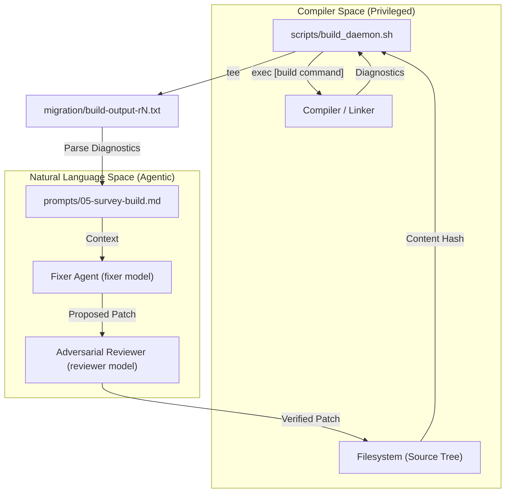
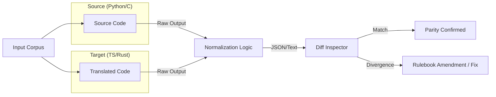

<!-- source: DeepWiki mcp.deepwiki.com · repo anthropics/code-migration-kit-with-claude-code · page 2.5 Step 4: Survey Build and Step 5–6: Parity · patched3 2026-10-26 -->

# Step 4: Survey Build and Step 5–6: Parity
# Step 4: Survey Build and Step 5–6: Parity

Relevant source files

The following files were used as context for generating this wiki page:

- [RUN-NOTES.md](RUN-NOTES.md)
- [prompts/05-survey-build.md](prompts/05-survey-build.md)
- [scripts/build_daemon.sh](scripts/build_daemon.sh)

This section details the final stages of the migration pipeline, moving from individual file translations to system-wide integration. It covers the execution of the **Survey Build** (Step 4), which resolves cross-file type and symbol conflicts, followed by **Smoke Testing** (Step 5) and the **Parity Referee** (Step 6) to ensure functional equivalence with the source system.

## Step 4: The Survey Build

The Survey Build phase resolves integration errors that only appear when the translated files are compiled or linked together. This phase is governed by `prompts/05-survey-build.md` [prompts/05-survey-build.md:1-53]().

### The Build Daemon Strategy
In high-integrity migrations, fixers (LLMs) are denied direct access to the compiler to prevent "guess-and-check" loops that bypass the Rulebook. Instead, a central process—the `build_daemon.sh`—owns the compiler [scripts/build_daemon.sh:6-11]().

1.  **Change Detection**: The daemon monitors the source tree using a content hash, excluding directories like `.git`, `node_modules`, and the `migration/` output folder [scripts/build_daemon.sh:78-90]().
2.  **Round Management**: Every time a change is detected, the daemon executes the configured `[build command]` and captures the output into a new file: `migration/build-output-r<N>.txt` [scripts/build_daemon.sh:105-113]().
3.  **State Persistence**: The daemon auto-increments round numbers based on the filesystem, ensuring the migration state is resumable even if the session restarts [scripts/build_daemon.sh:92-103]().

### Data Flow: Build to Fixer
The following diagram illustrates the quarantine boundary between the compiler and the fix agents.

**Figure 1: Survey Build Quarantine Topology**

**Sources:** [prompts/05-survey-build.md:12-26](), [scripts/build_daemon.sh:1-33]()

### Fixer Workflow
Fixers process the `build-output-rN.txt` file by:
*   Parsing diagnostics into a machine queue (TSV) containing file, module, error code, and message [prompts/05-survey-build.md:12-16]().
*   Ordering the queue from **leaves to root** based on the dependency map generated in Step 1 [prompts/05-survey-build.md:13-16]().
*   Writing patches without running the compiler, relying solely on the error text and the Rulebook [prompts/05-survey-build.md:18-19]().
*   Performing a **Mechanical Trailer Check**: Verifying that the `grep -c 'TODO(port)'` count matches the `todos=` value in the file's `PORT STATUS` trailer [prompts/05-survey-build.md:37-40]().

## Step 5: Smoke Testing

Step 5 is the "Hello World" of the migrated system. It involves running the minimal execution path to verify the target environment is correctly configured.

*   **Objective**: Verify that the translated code can load, resolve its own dependencies, and execute a trivial entry point.
*   **Protocol**: If the smoke test fails, the failure is treated as a Survey Build error. The `build_daemon.sh` is used to capture the runtime crash/traceback, and the fixer cycle repeats.

## Step 6: Parity and the Referee

The migration exit condition is defined by **Parity**: the translated code must behave identically to the source code across a defined suite of inputs.

### The Parity Referee
When the original test suite cannot be easily ported (e.g., it relies on language-specific internals), a **Parity Referee** is used [RUN-NOTES.md:8-10](). This is a dual-sided harness that:
1.  Feeds the same input to both the **Source Implementation** and the **Target Implementation**.
2.  Normalizes both outputs (e.g., converting to JSON, sorting keys, handling floating-point NaN/-Infinity) [RUN-NOTES.md:48-52]().
3.  Diffs the results.

### Inherited Suite Burndown
If the source project has a portable test suite (e.g., a set of C integration tests being migrated to Rust), Step 6 focuses on "Burndown"—systematically fixing failures until the target passes all tests inherited from the source [RUN-NOTES.md:78-80]().

**Figure 2: Parity Referee Execution**

**Sources:** [RUN-NOTES.md:11-16](), [RUN-NOTES.md:48-52]()

### Exit Conditions
A migration is considered complete when:
1.  **Zero Diagnostics**: The `build_daemon.sh` reports a clean exit for the build command [prompts/05-survey-build.md:26-26]().
2.  **Zero Divergence**: The Parity Referee or inherited suite reports 100% pass rate [RUN-NOTES.md:12-13]().
3.  **Trailer Invariant**: All files have a `PORT STATUS` trailer where `todos=0` and `status=parity` [prompts/05-survey-build.md:37-40]().
4.  **Cost Logged**: A final entry is appended to `migration/cost-log.tsv` [prompts/05-survey-build.md:44-52]().

| Phase | Referee Type | Primary Tool | Exit Criteria |
| :--- | :--- | :--- | :--- |
| **Step 4** | Static/Compiler | `build_daemon.sh` | Zero errors in `build-output-rN.txt` |
| **Step 5** | Runtime/Basic | `node` / `cargo run` | Successful execution of entry point |
| **Step 6** | Functional/Adversarial | Parity Harness | Byte-identical output or 0 test failures |

**Sources:** [prompts/05-survey-build.md:1-53](), [scripts/build_daemon.sh:1-125](), [RUN-NOTES.md:6-16]()

---

