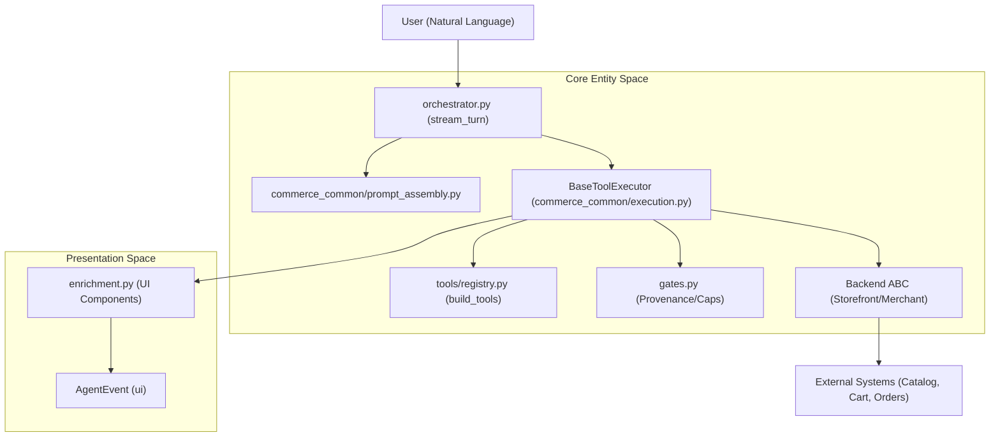
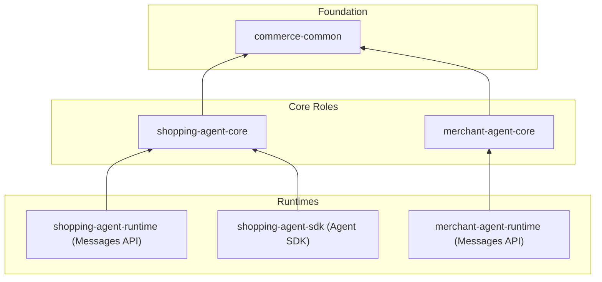

<!-- source: DeepWiki mcp.deepwiki.com · repo anthropics/commerce-agents · page 1 Overview · fetched 2026-10-26 -->

# Overview

Relevant source files

The following files were used as context for generating this wiki page:

- [.claude-plugin/marketplace.json](.claude-plugin/marketplace.json)
- [CLAUDE.md](CLAUDE.md)
- [README.md](README.md)
- [merchant-agent/core/README.md](merchant-agent/core/README.md)
- [merchant-agent/core/merchant_agent/__init__.py](merchant-agent/core/merchant_agent/__init__.py)
- [plugins/commerce-builder/.claude-plugin/plugin.json](plugins/commerce-builder/.claude-plugin/plugin.json)
- [plugins/commerce-builder/README.md](plugins/commerce-builder/README.md)
- [plugins/commerce-builder/commands/add-commerce-flow.md](plugins/commerce-builder/commands/add-commerce-flow.md)
- [plugins/commerce-builder/commands/review-commerce-agent.md](plugins/commerce-builder/commands/review-commerce-agent.md)
- [plugins/commerce-builder/skills/commerce-architecture/SKILL.md](plugins/commerce-builder/skills/commerce-architecture/SKILL.md)
- [shopping-agent/core/README.md](shopping-agent/core/README.md)
- [shopping-agent/core/shopping_agent/__init__.py](shopping-agent/core/shopping_agent/__init__.py)

The Claude Commerce Agents reference implementation provides a blueprint for building high-quality, safe, and performant AI agents for retail and business operations. It features two distinct agent roles—a **Shopping Agent** for customers and a **Merchant Agent** for staff—designed to be defined once and run across multiple environments [README.md:3-6]().

The repository is structured as a monorepo containing seven core Python packages, four runnable vertical examples (Retail, Travel, Telecom, and Entertainment), and a Claude Code plugin for scaffolding new agents [README.md:64-79]().

### Core Philosophy
*   **One Model per Turn:** A single model owns the conversation loop, using dynamic skill loading rather than complex multi-agent handoffs [plugins/commerce-builder/skills/commerce-architecture/SKILL.md:14-16]().
*   **Layered Rules:** Rules are placed in the tool description, the static prompt, or a dynamic skill based on how frequently they apply, optimizing for prompt caching [plugins/commerce-builder/skills/commerce-architecture/SKILL.md:24-30]().
*   **Server-Side Control:** Critical logic—such as cart provenance, merchant write guardrails, and UI enrichment—is enforced in code (the `Executor` and `Backend`), not just prompt instructions [plugins/commerce-builder/skills/commerce-architecture/SKILL.md:80-86]().

---

### The Two Agent Roles

The implementation centers on two primary roles, each defined by a core library and a set of domain-specific skills.

| Role | Purpose | Key Flows (Skills) | Backend Interface |
| :--- | :--- | :--- | :--- |
| **Shopping Agent** | Customer-facing assistant for discovery and purchase. | Search, Planning, Research, Memory, Customer Care [plugins/commerce-builder/commands/add-commerce-flow.md:47-54]() | `StorefrontBackend` [shopping-agent/core/shopping_agent/backend.py:9]() |
| **Merchant Agent** | Back-office assistant for business operations. | Performance, Listings, Inventory, Pricing, Campaigns [plugins/commerce-builder/commands/add-commerce-flow.md:61-67]() | `MerchantBackend` [merchant-agent/core/merchant_agent/backend.py:11]() |

**Sources:** [README.md:48-61](), [plugins/commerce-builder/commands/add-commerce-flow.md:45-73](), [shopping-agent/core/README.md:1-22](), [merchant-agent/core/README.md:1-24]()

---

### Three Runtime Paths

Every agent in this repository is designed to run in three distinct environments using the same core logic:

1.  **Messages API:** The reference implementation where the host application manages the turn loop using `ShoppingAgent.stream_turn` or `MerchantAgent.stream_turn` [README.md:83-96]().
2.  **Agent SDK:** A path using the Claude Agent SDK where the SDK manages the loop and tools, suitable for CLI or local development [README.md:100-105]().
3.  **Managed Agents:** A hosted deployment path where the agent is defined by an `agent.yaml` manifest and interacts with systems via MCP (Model Context Protocol) servers [README.md:108-112]().

**Sources:** [README.md:81-113](), [plugins/commerce-builder/skills/commerce-architecture/SKILL.md:14-20]()

---

### System Architecture

The following diagram illustrates how the core packages bridge natural language interaction with backend execution.

#### Entity Relationship: From User to Backend

**Sources:** [plugins/commerce-builder/skills/commerce-architecture/SKILL.md:8-20](), [shopping-agent/core/README.md:9-22](), [merchant-agent/core/README.md:9-24]()

---

### Package Structure and Layout

The repository is organized to maximize code reuse between roles and runtimes.

| Directory | Package Name | Description |
| :--- | :--- | :--- |
| `commerce-common/` | `commerce-common` | Shared foundations: Fencing, Memory, Skill Registry, and Base Executor [README.md:66](). |
| `shopping-agent/core/` | `shopping-agent-core` | Shopping-specific types, backend interfaces, and tools [README.md:67](). |
| `merchant-agent/core/` | `merchant-agent-core` | Merchant-specific types, staged changes, and analysis logic [README.md:71](). |
| `examples/` | — | Multi-vertical web applications and shared FastAPI host code [README.md:75](). |

#### Logical Package Dependencies

**Sources:** [README.md:64-79](), [CLAUDE.md:8-20]()

---

### Navigation

For detailed technical documentation, visit the following sections:

*   **[Getting Started](#1.1)**: Environment setup, dependency installation, and running the demo verticals.
*   **[Repository Layout and Package Structure](#1.2)**: Detailed breakdown of the monorepo, pip packages, and import patterns.
*   **Core Architecture**: Shared systems including [Fencing and Grounding](#2.2), [Memory System](#2.3), and [Presentation and UI Enrichment](#2.4).
*   **Agent Details**: Deep dives into the [Shopping Agent](#3) and [Merchant Agent](#4) cores and runtimes.
*   **[Backend Integration Guide](#7)**: Implementing `StorefrontBackend` and `MerchantBackend` for your own systems.
*   **[Safety and Security](#8)**: Reference for provenance gates, host approval, and analysis isolation.

---

