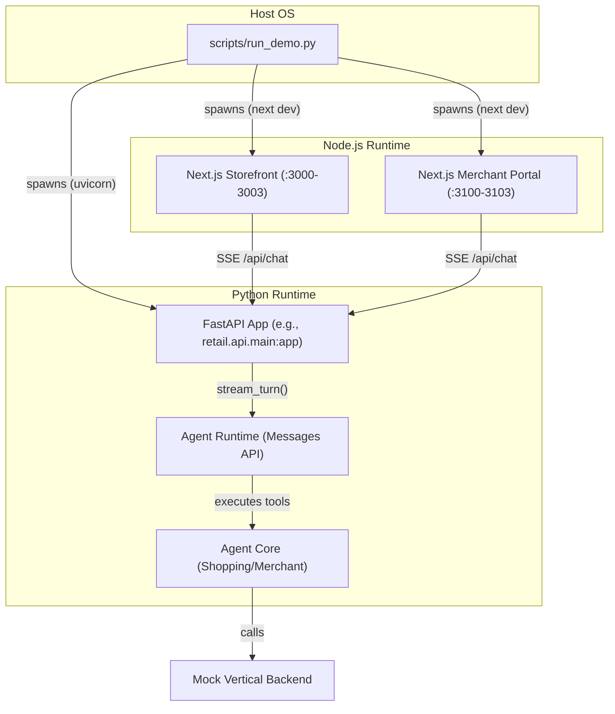
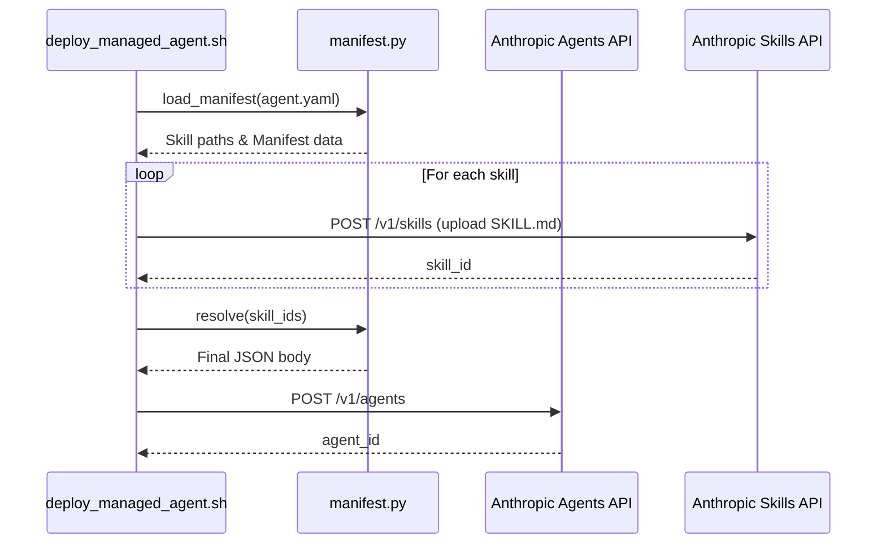

<!-- source: DeepWiki mcp.deepwiki.com · repo anthropics/commerce-agents · page 1.1 Getting Started · fetched 2026-10-26 -->

# Getting Started

<details>
<summary>Relevant source files</summary>

The following files were used as context for generating this wiki page:

- [.claude-plugin/marketplace.json](.claude-plugin/marketplace.json)
- [.env.example](.env.example)
- [.github/workflows/ci.yml](.github/workflows/ci.yml)
- [README.md](README.md)
- [commerce-common/commerce_common/manifest.py](commerce-common/commerce_common/manifest.py)
- [plugins/commerce-builder/.claude-plugin/plugin.json](plugins/commerce-builder/.claude-plugin/plugin.json)
- [plugins/commerce-builder/README.md](plugins/commerce-builder/README.md)
- [plugins/commerce-builder/commands/add-commerce-flow.md](plugins/commerce-builder/commands/add-commerce-flow.md)
- [pytest.ini](pytest.ini)
- [requirements-dev.txt](requirements-dev.txt)
- [requirements.txt](requirements.txt)
- [ruff.toml](ruff.toml)
- [scripts/deploy_managed_agent.sh](scripts/deploy_managed_agent.sh)
- [scripts/install.sh](scripts/install.sh)
- [scripts/run_demo.py](scripts/run_demo.py)

</details>


This guide provides step-by-step instructions for setting up the Claude Commerce Agents reference implementation. It covers cloning the repository, installing dependencies for both Python and Node.js environments, configuring environment variables, and running the included demo verticals.

## Prerequisites

Before starting, ensure your system meets the following requirements:
*   **Python 3.11+**: Required for the agent cores, runtimes, and mock backends `[README.md:16-16]()`.
*   **Node.js 22+**: Required for the Next.js web storefronts and merchant portals `[README.md:16-16]()`.
*   **Anthropic API Key**: Required to power the Claude models.

## Installation and Setup

The repository uses a monorepo structure with seven Python packages and an npm workspace for web applications.

### 1. Clone and Environment Setup
Clone the repository and create a virtual environment to isolate dependencies.

```bash
git clone https://github.com/anthropics/commerce-agents.git && cd commerce-agents
python3 -m venv .venv && source .venv/bin/activate
```
Sources: `[README.md:19-20]()`

### 2. Install Python Dependencies
The repository contains seven core packages. These are installed in editable mode via `requirements.txt` to allow for local development and cross-package referencing `[requirements.txt:4-10]()`.

```bash
pip install -r requirements.txt
```
Sources: `[README.md:21-21]()`, `[requirements.txt:12-18]()`

### 3. Install Web Dependencies
The eight web applications (four storefronts and four merchant portals) share a single npm workspace located in the `examples/` directory `[scripts/run_demo.py:147-150]()`.

```bash
(cd examples && npm ci)
```
Sources: `[README.md:23-23]()`, `[scripts/run_demo.py:154-154]()`

### 4. Configuration
Copy the example environment file and add your `ANTHROPIC_API_KEY`.

```bash
cp .env.example .env
```
Sources: `[README.md:22-22]()`

## Running Demo Verticals

The repository includes four industry verticals: `retail`, `travel`, `telecom`, and `entertainment` `[scripts/run_demo.py:44-54]()`. The `scripts/run_demo.py` utility automates the process of starting the FastAPI backend and the Next.js frontend(s).

### Command Syntax
```bash
python scripts/run_demo.py <vertical> [options]
```

| Option | Description |
| :--- | :--- |
| `retail` | Starts the Retail vertical (Default API :8000, Storefront :3000). |
| `travel` | Starts the Travel vertical (API :8001, Storefront :3001). |
| `telecom` | Starts the Telecom vertical (API :8002, Storefront :3002). |
| `entertainment` | Starts the Entertainment vertical (API :8003, Storefront :3003). |
| `--merchant` | Starts the Merchant Portal instead of the Storefront. |
| `--all` | Starts both the Storefront and the Merchant Portal. |

Sources: `[scripts/run_demo.py:6-11]()`, `[README.md:27-29]()`

### Execution Data Flow
The following diagram illustrates how `run_demo.py` orchestrates the different components of a vertical.

**Demo Orchestration Flow**

Sources: `[scripts/run_demo.py:170-185]()`, `[README.md:83-96]()`, `[scripts/run_demo.py:13-18]()`

## Running via Agent SDK

For a CLI-based experience, you can run the agents using the Claude Agent SDK. This bypasses the web UI and uses a console-based interaction.

*   **Shopping Agent CLI**: `python shopping-agent/runtime-agent-sdk/main.py --once "query"`
*   **Merchant Agent CLI**: `python merchant-agent/runtime-agent-sdk/main.py` (includes interactive approval for staged changes).

Sources: `[README.md:103-106]()`

## Deploying Managed Agents

To test the agents as Managed Agents on the Anthropic platform, use the deployment script to upload skills and register the agent manifest.

```bash
scripts/deploy_managed_agent.sh shopping-agent/managed-agents/shopping-agent --live
```
Sources: `[README.md:111-112]()`, `[scripts/deploy_managed_agent.sh:7-11]()`

**Managed Agent Deployment Process**

Sources: `[scripts/deploy_managed_agent.sh:65-96]()`, `[commerce-common/commerce_common/manifest.py:108-142]()`

## Claude Code Scaffolding

If you are building a new agent, the `commerce-builder` plugin for Claude Code can scaffold the necessary structure based on this reference implementation.

```bash
claude plugin marketplace add anthropics/commerce-agents
claude plugin install commerce-builder@claude-commerce-agents
claude
/scaffold-commerce-agent "a shopping assistant for our store"
```
Sources: `[README.md:36-40]()`, `[plugins/commerce-builder/README.md:11-14]()`

## Verification

To ensure the entire environment is correctly configured and all tests pass, run the verification script:

```bash
python scripts/verify_all.py
```
This script runs the consistency checks in `scripts/check.py` and the full `pytest` suite defined in `pytest.ini` `[pytest.ini:1-24]()`, `[.github/workflows/ci.yml:29-32]()`.

Sources: `[README.md:79-79]()`, `[.github/workflows/ci.yml:29-32]()`

---

