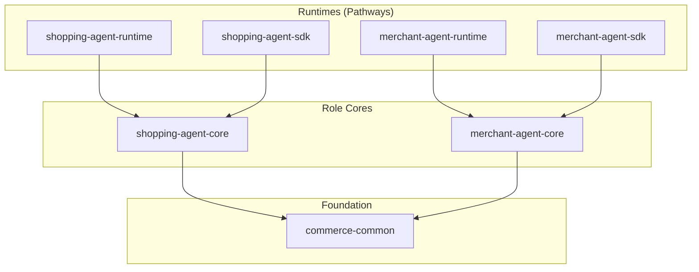
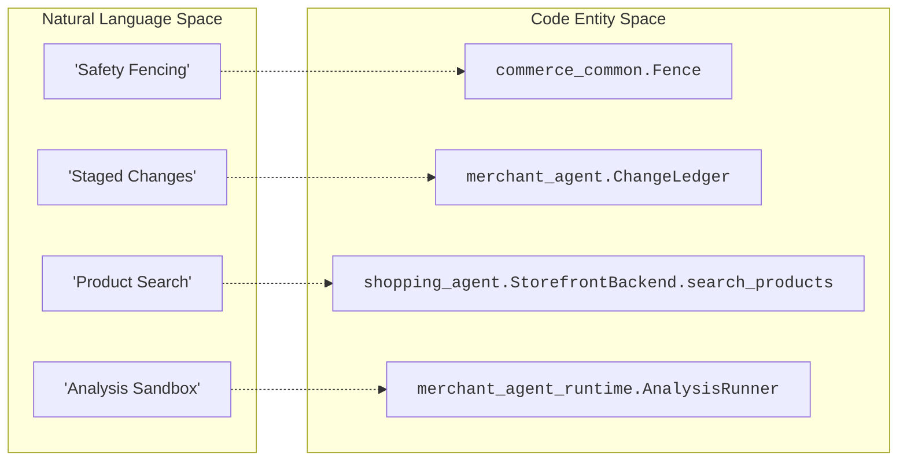

<!-- source: DeepWiki mcp.deepwiki.com · repo anthropics/commerce-agents · page 1.2 Repository Layout and Package Structure · fetched 2026-10-26 -->

# Repository Layout and Package Structure

<details>
<summary>Relevant source files</summary>

The following files were used as context for generating this wiki page:

- [.claude-plugin/marketplace.json](.claude-plugin/marketplace.json)
- [README.md](README.md)
- [commerce-common/commerce_common/config.py](commerce-common/commerce_common/config.py)
- [commerce-common/pyproject.toml](commerce-common/pyproject.toml)
- [merchant-agent/core/pyproject.toml](merchant-agent/core/pyproject.toml)
- [merchant-agent/runtime-agent-sdk/pyproject.toml](merchant-agent/runtime-agent-sdk/pyproject.toml)
- [merchant-agent/runtime-messages-api/pyproject.toml](merchant-agent/runtime-messages-api/pyproject.toml)
- [plugins/commerce-builder/.claude-plugin/plugin.json](plugins/commerce-builder/.claude-plugin/plugin.json)
- [plugins/commerce-builder/README.md](plugins/commerce-builder/README.md)
- [plugins/commerce-builder/commands/add-commerce-flow.md](plugins/commerce-builder/commands/add-commerce-flow.md)
- [shopping-agent/core/pyproject.toml](shopping-agent/core/pyproject.toml)
- [shopping-agent/runtime-agent-sdk/pyproject.toml](shopping-agent/runtime-agent-sdk/pyproject.toml)
- [shopping-agent/runtime-messages-api/pyproject.toml](shopping-agent/runtime-messages-api/pyproject.toml)

</details>


This page describes the monorepo organization of the Claude Commerce Agents reference implementation. The repository is structured to support two distinct agent roles (Shopping and Merchant) across three different runtime environments (Messages API, Agent SDK, and Managed Agents) while sharing a common architectural foundation.

## Package Architecture Overview

The codebase is divided into seven core Python packages. Each package is designed to be independently installable but relies on strict version pinning to sibling packages within the monorepo [shopping-agent/runtime-agent-sdk/pyproject.toml:13-21]().

### The Seven Pip Packages

| Directory | pip package | import name | Purpose |
| :--- | :--- | :--- | :--- |
| `commerce-common/` | `commerce-common` | `commerce_common` | Shared foundation: fencing, memory, grounding, and event protocols [commerce-common/pyproject.toml:5-8](). |
| `shopping-agent/core/` | `shopping-agent-core` | `shopping_agent` | Shopping domain types, `StorefrontBackend`, and shopping tool executor [shopping-agent/core/pyproject.toml:5-8](). |
| `shopping-agent/runtime-messages-api/` | `shopping-agent-runtime` | `shopping_agent_runtime` | The turn loop implementation for the Anthropic Messages API [shopping-agent/runtime-messages-api/pyproject.toml:5-8](). |
| `shopping-agent/runtime-agent-sdk/` | `shopping-agent-sdk` | `shopping_agent_sdk` | Integration with the `claude-agent-sdk` for shopping [shopping-agent/runtime-agent-sdk/pyproject.toml:5-8](). |
| `merchant-agent/core/` | `merchant-agent-core` | `merchant_agent` | Merchant domain types, `MerchantBackend`, and the Change Ledger [merchant-agent/core/pyproject.toml:5-8](). |
| `merchant-agent/runtime-messages-api/` | `merchant-agent-runtime` | `merchant_agent_runtime` | Merchant turn loop and the Analysis Delegate [merchant-agent/runtime-messages-api/pyproject.toml:5-8](). |
| `merchant-agent/runtime-agent-sdk/` | `merchant-agent-sdk` | `merchant_agent_sdk` | Integration with the `claude-agent-sdk` for merchants [merchant-agent/runtime-agent-sdk/pyproject.toml:5-8](). |

**Sources:** [README.md:62-80](), [commerce-common/pyproject.toml:5-8](), [shopping-agent/core/pyproject.toml:5-8](), [merchant-agent/core/pyproject.toml:5-8]()

## Dependency Graph and Data Flow

The architecture follows a layered approach where runtimes depend on role-specific cores, which in turn depend on the shared common package.

### Structural Dependency Diagram
"Repository Package Hierarchy"

**Sources:** [shopping-agent/runtime-agent-sdk/pyproject.toml:16-21](), [merchant-agent/runtime-messages-api/pyproject.toml:16-21](), [shopping-agent/core/pyproject.toml:16-19]()

## Functional Areas

### 1. `commerce-common`
The foundation for both agents. It defines the `BaseAgentConfig` [commerce-common/commerce_common/config.py:1-10](), the `Fence` for safety, and the `SkillRegistry` for loading `.md` based skill definitions. It also contains the `BaseToolExecutor` which provides the frame for executing tool calls with built-in safety gates [README.md:66-66]().

### 2. Role Cores (`shopping-agent/core`, `merchant-agent/core`)
These packages contain the domain-specific logic that remains constant regardless of the runtime:
*   **Backends:** `StorefrontBackend` [shopping-agent/core/pyproject.toml:8-8]() and `MerchantBackend` [merchant-agent/core/pyproject.toml:8-8]() abstract interfaces.
*   **Tools:** The `build_tools` functions and tool contracts [plugins/commerce-builder/commands/add-commerce-flow.md:37-41]().
*   **Gates:** Role-specific safety gates (e.g., Cart Provenance for shopping, Change Guardrails for merchants).

### 3. Runtimes
The runtimes implement the specific communication protocol with Claude:
*   **Messages API:** Provides `ShoppingAgent.stream_turn` [README.md:89-93]() and `MerchantAgent.stream_turn`. This path includes the "eager dispatch" turn loop and post-turn memory extraction [README.md:95-95]().
*   **Agent SDK:** Uses the `claude-agent-sdk` to manage the turn loop, often used for CLI-based interactions [README.md:100-106]().
*   **Managed Agents:** Defined by `agent.yaml` manifests and MCP servers located in `managed-agents/` directories [README.md:70-74]().

### 4. Examples and Verticals
The `examples/` directory contains four vertical implementations: `retail`, `travel`, `telecom`, and `entertainment` [README.md:27-29]().
*   **`demo_common/`**: Shared FastAPI host code for the example web applications [README.md:75-75]().
*   **`web-shared/`**: Shared TypeScript types and React components for the storefront and portal UIs [README.md:75-75]().

### 5. Plugins and Scripts
*   **`plugins/commerce-builder/`**: A Claude Code plugin that uses the repository as a reference to scaffold new agents or add flows to existing ones [plugins/commerce-builder/README.md:1-8]().
*   **`scripts/`**: Utility scripts for installation, running demos, and CI/CD verification [README.md:79-79]().

## Code Entity Mapping

The following diagram maps high-level system concepts to specific code entities within the package structure.

"Entity Mapping: From Concepts to Code"

**Sources:** [README.md:66-72](), [plugins/commerce-builder/commands/add-commerce-flow.md:47-72]()

## Implementation Details: The `ShoppingAgent` Example

The `ShoppingAgent` class in `shopping-agent-runtime` demonstrates how these packages interact during a single turn.

```python
# From README.md:88-96
from shopping_agent import ShoppingAgentConfig          # core
from shopping_agent_runtime import ShoppingAgent        # runtime

agent = ShoppingAgent(
    backend=your_backend,                               # implementation of core interface
    skills_dir=Path("shopping-agent/skills"),          # common skill loader
    config=ShoppingAgentConfig(brand_name="Your Store") # common/core config
)

async for event in agent.stream_turn(messages, session, state):
    # Events like 'ui', 'cart_update', 'text_delta' are defined in commerce-common
    ...
```

**Sources:** [README.md:83-96](), [commerce-common/pyproject.toml:5-8]()

---

