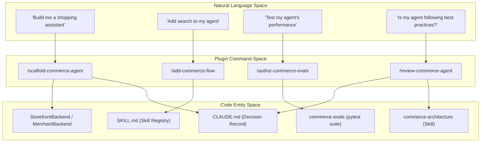
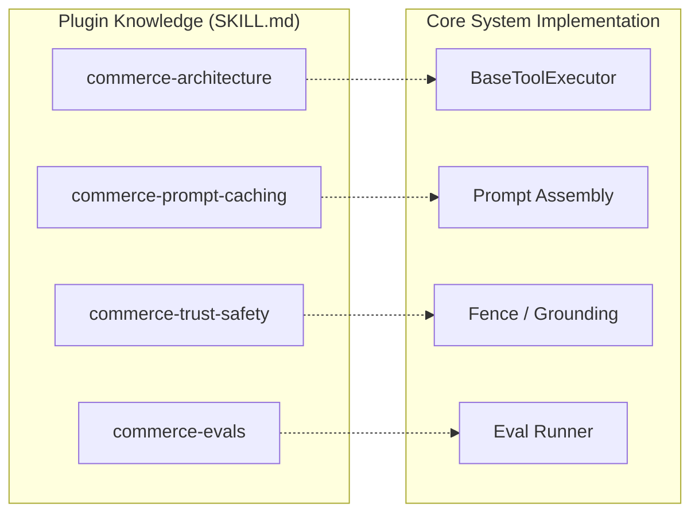

<!-- source: DeepWiki mcp.deepwiki.com · repo anthropics/commerce-agents · page 10 commerce-builder Plugin · fetched 2026-10-26 -->

# commerce-builder Plugin

<details>
<summary>Relevant source files</summary>

The following files were used as context for generating this wiki page:

- [.claude-plugin/marketplace.json](.claude-plugin/marketplace.json)
- [CLAUDE.md](CLAUDE.md)
- [README.md](README.md)
- [plugins/commerce-builder/.claude-plugin/plugin.json](plugins/commerce-builder/.claude-plugin/plugin.json)
- [plugins/commerce-builder/README.md](plugins/commerce-builder/README.md)
- [plugins/commerce-builder/commands/add-commerce-flow.md](plugins/commerce-builder/commands/add-commerce-flow.md)
- [plugins/commerce-builder/commands/review-commerce-agent.md](plugins/commerce-builder/commands/review-commerce-agent.md)
- [plugins/commerce-builder/skills/commerce-architecture/SKILL.md](plugins/commerce-builder/skills/commerce-architecture/SKILL.md)

</details>


The `commerce-builder` plugin is a suite of **Claude Code** commands and skills designed to scaffold, maintain, and review commerce agents built on the reference architecture. It automates the implementation of the shopping and merchant roles, ensuring they adhere to design patterns for safety, prompt caching, and server-side UI enrichment [plugins/commerce-builder/README.md:1-7]().

The plugin does not run its own code; rather, it guides Claude Code to read the reference implementation and apply its patterns to the user's project [plugins/commerce-builder/README.md:1-7]().

### Plugin Structure and Installation

The plugin is located in the `plugins/commerce-builder/` directory and is registered via the repository's marketplace manifest [.claude-plugin/marketplace.json:1-18]().

**Installation:**
```bash
claude plugin marketplace add anthropics/commerce-agents
claude plugin install commerce-builder@claude-commerce-agents
```
[README.md:37-38]()

### Natural Language to Plugin Command Mapping

This diagram illustrates how user intent in natural language maps to specific plugin commands and the underlying codebase entities they manipulate.

**Intent to Code Mapping**

**Sources:** [plugins/commerce-builder/README.md:16-27](), [plugins/commerce-builder/commands/add-commerce-flow.md:17-28](), [plugins/commerce-builder/commands/review-commerce-agent.md:35-43]()

### Plugin Capabilities

The plugin provides four primary commands to manage the agent lifecycle:

| Command | Purpose | Key Actions |
| :--- | :--- | :--- |
| `/scaffold-commerce-agent` | **Initial Setup** | Interviews the user, creates a `CLAUDE.md` decision record, and generates backend stubs [plugins/commerce-builder/README.md:20](). |
| `/add-commerce-flow` | **Skill Injection** | Copies a specific flow (e.g., `search-discovery`) and wires the required tools to the backend [plugins/commerce-builder/commands/add-commerce-flow.md:1-4](). |
| `/author-commerce-evals` | **Testing** | Generates a test suite with at least ten cases and a replay gate for CI [plugins/commerce-builder/README.md:22](). |
| `/review-commerce-agent` | **Modernization** | Maps an existing agent against the reference architecture and suggests conversion steps [plugins/commerce-builder/commands/review-commerce-agent.md:1-4](). |

For details on the first three commands, see [Scaffolding and Flow Commands](#10.1).

### The Knowledge Base (Skills)

The plugin includes six "skills" that act as a knowledge base for Claude Code. These skills define the rules and constraints the agent must follow.

**Architecture Knowledge Mapping**

**Sources:** [plugins/commerce-builder/skills/commerce-architecture/SKILL.md:12-21](), [plugins/commerce-builder/README.md:28-38]()

*   **commerce-architecture**: Defines the single-loop model and the layering of rules (tool description vs. prompt vs. skill) [plugins/commerce-builder/skills/commerce-architecture/SKILL.md:22-31]().
*   **commerce-prompt-caching**: Rules for keeping the static prompt and tool list byte-stable to maximize cache hits [plugins/commerce-builder/README.md:33]().
*   **commerce-trust-safety**: Guidance on fencing third-party content, provenance gating for writes, and grounding rules [plugins/commerce-builder/README.md:35]().
*   **commerce-evals**: Standards for case shapes, scorers, and adversarial fixtures [plugins/commerce-builder/README.md:36]().

### Evaluation and Review

The plugin places heavy emphasis on the `commerce-evals` framework. The `/author-commerce-evals` command builds a suite that includes hostile fixtures—adversarial product descriptions designed to test the agent's safety gates [plugins/commerce-builder/commands/add-commerce-flow.md:87]().

For details on the evaluation suite and hostile fixtures, see [Evaluation Framework](#10.2).

**Sources:**
- [plugins/commerce-builder/README.md:1-49]()
- [plugins/commerce-builder/commands/add-commerce-flow.md:1-96]()
- [plugins/commerce-builder/commands/review-commerce-agent.md:1-75]()
- [plugins/commerce-builder/skills/commerce-architecture/SKILL.md:1-86]()
- [README.md:31-46]()
- [CLAUDE.md:1-56]()

---

