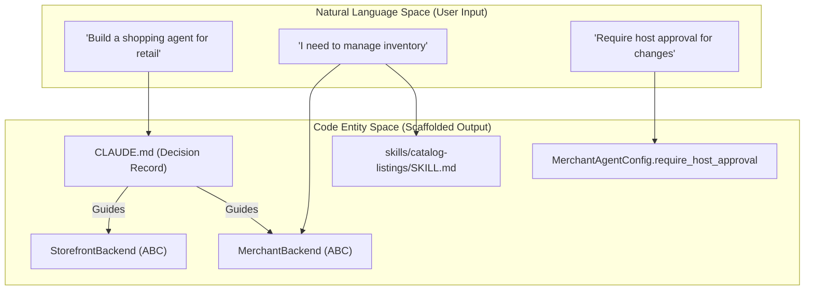
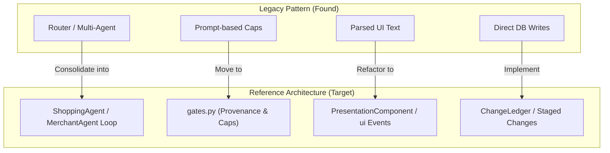

<!-- source: DeepWiki mcp.deepwiki.com · repo anthropics/commerce-agents · page 10.1 Scaffolding and Flow Commands · fetched 2026-10-26 -->

# Scaffolding and Flow Commands

Relevant source files

The following files were used as context for generating this wiki page:

- [CLAUDE.md](CLAUDE.md)
- [merchant-agent/core/merchant_agent/config.py](merchant-agent/core/merchant_agent/config.py)
- [merchant-agent/managed-agents/merchant-agent/system.md](merchant-agent/managed-agents/merchant-agent/system.md)
- [plugins/commerce-builder/commands/author-commerce-evals.md](plugins/commerce-builder/commands/author-commerce-evals.md)
- [plugins/commerce-builder/commands/review-commerce-agent.md](plugins/commerce-builder/commands/review-commerce-agent.md)
- [plugins/commerce-builder/commands/scaffold-commerce-agent.md](plugins/commerce-builder/commands/scaffold-commerce-agent.md)
- [plugins/commerce-builder/skills/commerce-architecture/SKILL.md](plugins/commerce-builder/skills/commerce-architecture/SKILL.md)
- [plugins/commerce-builder/skills/commerce-evals/SKILL.md](plugins/commerce-builder/skills/commerce-evals/SKILL.md)
- [plugins/commerce-builder/skills/commerce-merchant-operations/SKILL.md](plugins/commerce-builder/skills/commerce-merchant-operations/SKILL.md)
- [shopping-agent/core/shopping_agent/config.py](shopping-agent/core/shopping_agent/config.py)
- [shopping-agent/managed-agents/shopping-agent/system.md](shopping-agent/managed-agents/shopping-agent/system.md)

The `commerce-builder` plugin provides a suite of specialized commands for the Claude Code interface, designed to accelerate the development, maintenance, and evaluation of commerce agents built on the `anthropics/commerce-agents` reference implementation. These commands guide developers through the entire lifecycle—from initial architectural decisions and scaffolding to skill injection, automated evaluation authoring, and architectural reviews.

## 10.1.1 Overview of Plugin Commands

The plugin implements four primary commands, each driven by a specific Markdown-based skill file that defines the logic, constraints, and step-by-step procedures for the agent to follow.

| Command | Purpose | Driving Skill File |
| :--- | :--- | :--- |
| `/scaffold-commerce-agent` | Initial setup, interview-driven architecture, and stub generation. | [plugins/commerce-builder/commands/scaffold-commerce-agent.md:1-4]() |
| `/add-commerce-flow` | Injecting new business capabilities (skills) into an existing agent. | [plugins/commerce-builder/commands/review-commerce-agent.md:75-75]() |
| `/author-commerce-evals` | Generating a comprehensive behavioral test suite against real catalog data. | [plugins/commerce-builder/commands/author-commerce-evals.md:1-4]() |
| `/review-commerce-agent` | Auditing an existing implementation against reference safety and architectural standards. | [plugins/commerce-builder/commands/review-commerce-agent.md:1-4]() |

**Sources:** [plugins/commerce-builder/commands/scaffold-commerce-agent.md:1-13](), [plugins/commerce-builder/commands/review-commerce-agent.md:1-13](), [plugins/commerce-builder/commands/author-commerce-evals.md:1-10]()

---

## 10.1.2 Scaffolding and the Decision Record

The `/scaffold-commerce-agent` command initiates a structured interview to determine the agent's role (Shopping, Merchant, or both), the technical stack, and the integration posture.

### The Interview Process
The command follows a multi-step sequence to ensure the resulting scaffold aligns with the reference architecture:
1.  **Reference Loading**: The plugin reads core files like `backend.py`, `types.py`, and `config.py` from the role's package to understand the implementation contract [plugins/commerce-builder/commands/scaffold-commerce-agent.md:15-35]().
2.  **Interview**: A 10-point questionnaire covering role, language, runtime path (Messages API, SDK, or Managed), backend systems (Catalog, Cart, Metrics, etc.), and identity/authentication [plugins/commerce-builder/commands/scaffold-commerce-agent.md:37-95]().
3.  **Decision Record**: The output of the interview is codified into the project's `CLAUDE.md` under a `## Commerce agent decision record` section. This record acts as the "source of truth" for subsequent plugin commands [plugins/commerce-builder/commands/review-commerce-agent.md:35-43]().

### Scaffolding Logic Flow
The following diagram illustrates how natural language requirements are transformed into concrete code entities.

**Natural Language to Code Entity Mapping**

**Sources:** [plugins/commerce-builder/commands/scaffold-commerce-agent.md:6-13](), [plugins/commerce-builder/commands/review-commerce-agent.md:35-43](), [merchant-agent/core/merchant_agent/config.py:75-77]()

---

## 10.1.3 Flow Injection and Skill Management

The `/add-commerce-flow` command utilizes the `SkillRegistry` and the directory-based skill system to expand agent capabilities.

### Skill Structure
A skill is defined as a directory containing a `SKILL.md` file, which includes:
*   **Frontmatter**: Metadata such as `name` and `description` [plugins/commerce-builder/skills/commerce-architecture/SKILL.md:33-35]().
*   **Body**: The procedural rules for the model to follow when the skill is active.
*   **Request Class**: The description field defines the specific request class that triggers the skill, without needing sample utterances [plugins/commerce-builder/skills/commerce-architecture/SKILL.md:34-35]().

### Skill Loading Mechanism
Skills are not part of the static system prompt. Instead:
1.  The static prompt contains a `SkillRegistry.index_block`, which is a sorted list of available skill names and descriptions [plugins/commerce-builder/skills/commerce-architecture/SKILL.md:36-37]().
2.  When the model identifies a need for a specific flow, it calls the `load_skill` tool, which triggers `_load_skill` in `commerce_common/execution.py` to inject the full body of the `SKILL.md` into the conversation context [plugins/commerce-builder/skills/commerce-architecture/SKILL.md:36-37]().

**Sources:** [plugins/commerce-builder/skills/commerce-architecture/SKILL.md:32-40](), [plugins/commerce-builder/skills/commerce-merchant-operations/SKILL.md:1-4]()

---

## 10.1.4 Automated Evaluation Generation

The `/author-commerce-evals` command builds a behavioral test suite tailored to the developer's specific catalog and business rules.

### The Evaluation Runner
The command scaffolds a runner that manages the lifecycle of a test case:
*   **Execution**: A fresh agent, backend, and memory store are initialized for each case [plugins/commerce-builder/commands/author-commerce-evals.md:34-39]().
*   **Scoring**: The runner uses code-based graders to verify tool calls, UI events, and final state (e.g., `cart_contains`, `staged_change_kinds`) [plugins/commerce-builder/skills/commerce-evals/SKILL.md:68-72]().
*   **Judging**: For subjective criteria, a "Judge" model evaluates a `rubric` provided in the case [plugins/commerce-builder/skills/commerce-evals/SKILL.md:73-77]().

### Behavioral Case Mapping
The command generates the first ten critical cases, mapping specific commerce behaviors to code-level assertions.

| Behavior Type | Code Scorer / Expected Field |
| :--- | :--- |
| Product Discovery | `no_skill_load`, `max_tool_calls` |
| Cart Mutation | `cart_contains`, `cart_item_count` |
| Merchant Staging | `staged_change_kinds`, `no_applied_changes` |
| Safety / Refusal | `never_calls`, `reply_omits` |
| Policy Grounding | `first_tool`, `rubric` |

**Sources:** [plugins/commerce-builder/commands/author-commerce-evals.md:30-49](), [plugins/commerce-builder/skills/commerce-evals/SKILL.md:13-37](), [plugins/commerce-builder/commands/author-commerce-evals.md:50-70]()

---

## 10.1.5 Architecture Review and Conversion

The `/review-commerce-agent` command provides a mechanism to migrate existing "legacy" agents to the reference architecture or to audit them for safety compliance.

### The Mapping Table
The command maps the current implementation against reference standards across 10 rows, including Loop ownership, Rule placement, and Write safety [plugins/commerce-builder/commands/review-commerce-agent.md:20-33]().

### Reference Conversion Patterns
When converting a "Found" (legacy) pattern to the "Reference" architecture, the command uses the following logic:

**Conversion Data Flow**

**Sources:** [plugins/commerce-builder/commands/review-commerce-agent.md:44-67](), [plugins/commerce-builder/skills/commerce-architecture/SKILL.md:12-21](), [plugins/commerce-builder/skills/commerce-merchant-operations/SKILL.md:19-29]()

### Technical Implementation Details
*   **Backend Subclassing**: Before conversion, existing service calls are wrapped in a `StorefrontBackend` or `MerchantBackend` subclass to provide a stable interface [plugins/commerce-builder/commands/review-commerce-agent.md:70-72]().
*   **Module Replacement**: In Python environments, reference modules (e.g., `commerce_common.fencing`) are imported to replace custom implementations [plugins/commerce-builder/commands/review-commerce-agent.md:71-73]().
*   **Decision Record Update**: Every conversion updates the `CLAUDE.md` record to ensure subsequent `/author-commerce-evals` calls reflect the new architecture [plugins/commerce-builder/commands/review-commerce-agent.md:74-75]().

**Sources:** [plugins/commerce-builder/commands/review-commerce-agent.md:68-75](), [CLAUDE.md:1-20]()

---

