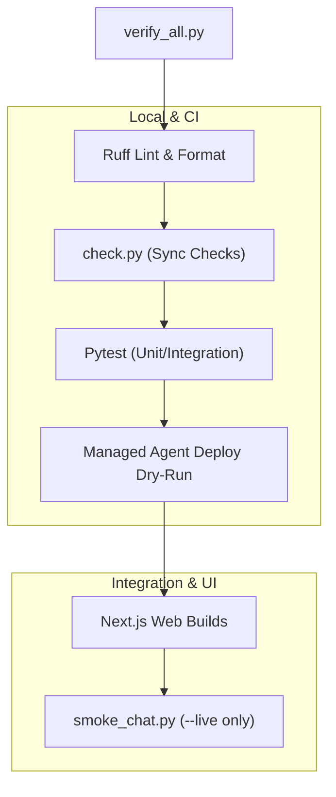

<!-- source: DeepWiki mcp.deepwiki.com · repo anthropics/commerce-agents · page 11 Testing and CI · fetched 2026-10-26 -->

# Testing and CI

Relevant source files

The following files were used as context for generating this wiki page:

- [.github/workflows/ci.yml](.github/workflows/ci.yml)
- [commerce-common/commerce_common/testing.py](commerce-common/commerce_common/testing.py)
- [merchant-agent/managed-agents/scheduled-digest/run_morning_digest.py](merchant-agent/managed-agents/scheduled-digest/run_morning_digest.py)
- [merchant-agent/runtime-agent-sdk/tests/conftest.py](merchant-agent/runtime-agent-sdk/tests/conftest.py)
- [merchant-agent/runtime-agent-sdk/tests/test_agent.py](merchant-agent/runtime-agent-sdk/tests/test_agent.py)
- [merchant-agent/runtime-messages-api/tests/test_orchestrator_followthrough.py](merchant-agent/runtime-messages-api/tests/test_orchestrator_followthrough.py)
- [pytest.ini](pytest.ini)
- [requirements-dev.txt](requirements-dev.txt)
- [requirements.txt](requirements.txt)
- [ruff.toml](ruff.toml)
- [scripts/check.py](scripts/check.py)
- [scripts/install.sh](scripts/install.sh)
- [scripts/screenshot_tour.py](scripts/screenshot_tour.py)
- [scripts/smoke_chat.py](scripts/smoke_chat.py)
- [scripts/verify_all.py](scripts/verify_all.py)
- [shopping-agent/runtime-agent-sdk/tests/conftest.py](shopping-agent/runtime-agent-sdk/tests/conftest.py)
- [shopping-agent/runtime-messages-api/tests/test_orchestrator.py](shopping-agent/runtime-messages-api/tests/test_orchestrator.py)
- [tests/test_turn_loop.py](tests/test_turn_loop.py)

This page provides an overview of the testing infrastructure for the Claude Commerce Agents reference implementation. The repository employs a multi-layered testing strategy ranging from unit tests for core logic to live, multi-turn conversation "smoke tests" and visual regression checks.

The testing suite is designed to ensure consistency across the three runtime paths (Messages API, Agent SDK, and Managed Agents) and the four vertical examples (Retail, Travel, Telecom, and Entertainment).

## Infrastructure Overview

The test infrastructure is composed of standard Python testing tools, custom consistency scripts, and visual regression drivers.

| Component | Tool / Script | Purpose |
| :--- | :--- | :--- |
| **Linting & Formatting** | `ruff` | Static analysis and style enforcement across all packages [scripts/verify_all.py:66-67](). |
| **Unit & Integration** | `pytest` | Validates core logic, executors, and turn loops [.github/workflows/ci.yml:29-30](). |
| **Consistency Validation** | `check.py` | Ensures skills, fixtures, and package versions are synchronized [scripts/check.py:4-6](). |
| **Live Smoke Testing** | `smoke_chat.py` | Executes scripted multi-turn conversations against live APIs [scripts/smoke_chat.py:4-9](). |
| **Visual Regression** | `screenshot_tour.py` | Uses Playwright to capture UI states across verticals [scripts/screenshot_tour.py:4-5](). |
| **CI Orchestration** | `verify_all.py` | Local entry point to run the full verification pipeline [scripts/verify_all.py:4-5](). |

**Sources:** [scripts/verify_all.py:4-5](), [scripts/verify_all.py:66-67](), [.github/workflows/ci.yml:29-30](), [scripts/check.py:4-6](), [scripts/smoke_chat.py:4-9](), [scripts/screenshot_tour.py:4-5]().

## Test Execution Flow

The `verify_all.py` script serves as the primary developer entry point, orchestrating the execution of different test layers in order of increasing cost and complexity.

### CI Pipeline Logic

**Sources:** [scripts/verify_all.py:65-112](), [.github/workflows/ci.yml:12-83]().

## Core Testing Utilities

To test agentic behavior without incurring high API costs or dealing with non-deterministic model output, the codebase provides `FakeClient` and `FakeStream`. These utilities allow developers to "script" model responses, including tool calls and text deltas, to verify how the orchestrator handles specific sequences.

*   **`FakeClient`**: Simulates the Anthropic SDK client, recording all `calls` made by the agent for assertion [commerce_common/testing.py:130-135]().
*   **`FakeStream`**: Simulates an SSE stream from the model, allowing testing of "eager dispatch" and `ui_partial` events by providing `Chunks` of JSON input [commerce_common/testing.py:83-90]().
*   **`ScriptedClient`**: Used in SDK-specific tests to play back response streams [merchant-agent/runtime-agent-sdk/tests/test_agent.py:69-75]().

**Sources:** [commerce_common/testing.py:130-135](), [commerce_common/testing.py:83-90](), [merchant-agent/runtime-agent-sdk/tests/test_agent.py:69-75]().

## Package-Level vs. Cross-Package Tests

Testing is split between local package tests and cross-package integration tests:

1.  **Per-Package Tests**: Located within `tests/` directories of specific packages (e.g., `merchant-agent/runtime-agent-sdk/tests/`). These focus on package-specific surface areas like tool registration and SDK-specific hooks [merchant-agent/runtime-agent-sdk/tests/test_agent.py:4-5]().
2.  **Cross-Package Tests**: Located in the root `tests/` directory. These validate shared behaviors like the `turn_loop` logic, session clock management, and the `ui_partial` streaming mechanism that must remain consistent across both Shopping and Merchant agents [tests/test_turn_loop.py:4-6]().

For details on specific test patterns for executors, memory, and turn loops, see **[Unit and Integration Tests](#11.1)**.

**Sources:** [merchant-agent/runtime-agent-sdk/tests/test_agent.py:4-5](), [tests/test_turn_loop.py:4-6]().

## Consistency and Live Validation

Because the reference implementation supports four distinct verticals and three runtime paths, maintaining data and prompt consistency is critical.

*   **`check.py`**: Validates that product IDs in `catalog.json` are unique, that `SKILL.md` files are not stubs, and that the hand-authored Managed Agent prompts are synchronized with the dynamic prompt builders [scripts/check.py:4-6](), [scripts/check.py:156-175]().
*   **`smoke_chat.py`**: Runs a live conversation using the Anthropic API. It asserts that the agent calls the correct tools (e.g., `search_products` or `apply_change`) and emits required events (e.g., `ui`, `cart_update`) [scripts/smoke_chat.py:4-9]().
*   **`screenshot_tour.py`**: Automates a browser to navigate the React web apps for each vertical, ensuring that components like `plan-matrix` or `venue-map` render correctly [scripts/screenshot_tour.py:4-5]().

For details on fixture validation and live conversation scripting, see **[Consistency Checks and Smoke Tests](#11.2)**.

**Sources:** [scripts/check.py:4-6](), [scripts/check.py:156-175](), [scripts/smoke_chat.py:4-9](), [scripts/screenshot_tour.py:4-5]().

## Continuous Integration (CI)

The GitHub Actions workflow (`.github/workflows/ci.yml`) executes the following on every push and pull request:
1.  **Python Matrix**: Runs linting, formatting, `check.py`, and `pytest` across supported Python versions (3.11, 3.12) [.github/workflows/ci.yml:12-32]().
2.  **PyPI Fallback Check**: A security step ensuring internal package names (e.g., `commerce-common`) are not registered on the public PyPI index to prevent dependency confusion attacks [.github/workflows/ci.yml:34-51]().
3.  **Web Build**: Installs the npm workspace and builds all eight example web applications (storefront and merchant for each of the four verticals) [.github/workflows/ci.yml:67-83]().

**Sources:** [.github/workflows/ci.yml:12-32](), [.github/workflows/ci.yml:34-51](), [.github/workflows/ci.yml:67-83]().

---

